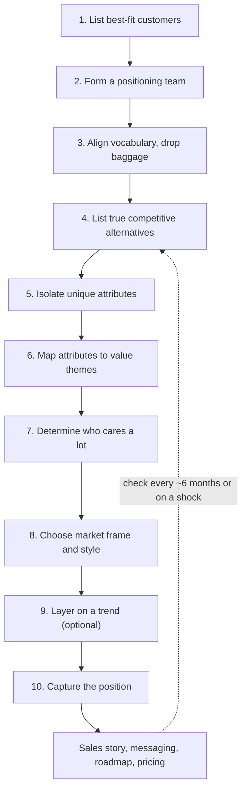

# 01. Positioning

How to decide what your product is, who it is for and which market it belongs in, so customers understand it quickly. Feeds messaging, pricing, sales and the roadmap.

> **Based on:** *Obviously Awesome: How to Nail Product Positioning so Customers Get It, Buy It, Love It* by April Dunford (2019). [Bookshop](https://bookshop.org/book/9781999023003)

## At a glance

| Framework | In one line | Use it when |
|---|---|---|
| Positioning as context | Customers judge a product by the frame of reference around it | Good product, confused or unimpressed buyers |
| Five (plus one) components | Alternatives, attributes, value, target customers, category, (trends) | You need a checklist of what a position contains |
| 10-step process | Work from best customers backwards to a market frame | Doing or redoing positioning properly |
| Best-fit customers | Positioning starts from those who bought fast and love you | Mixed customer base, muddy survey results |
| Three positioning styles | Head to Head, Big Fish Small Pond, Create a New Game | Choosing how to win in the chosen category |
| Positioning canvas and sales story | One-page record, then the pitch arc | Sharing the position across the company |
| Check-in cadence | Revisit about every six months or after a market shock | Competitor, regulation, economy or technology shifts |

## Positioning as context

- Positioning is **context setting**: the clues (messaging, price, features, brand, partners, customers) that tell a buyer what a thing is, who it is for and why it matters.
- Same product, different context, different perceived value. A world-class violinist playing at a subway entrance was mostly ignored; the music was unchanged, the context lost the value.
- Buyers meeting something new grab a **frame of reference** from what they already know ("a giant phone", "a skateboard without pushing").
- Weak positioning looks like a sales or marketing problem. Signs:
  - happy customers love you but prospects cannot say what you sell
  - long sales cycles, low close rates, late drop-outs
  - high churn from buyers who misunderstood the value, then demand features you will not build
  - price pressure because you look like everything else
- More marketing money behind unclear positioning does not fix it (speaking louder to someone who does not share your language).
- Positioning is not messaging and not owned by marketing; it is a business-strategy choice that feeds every function.

### The two traps

| Trap | What happens | Example |
|---|---|---|
| Stuck on what you meant to build | Product drifted during prototyping but you still label it by the original idea | "Cake" that is really a muffin: the category change changes buyers, rivals, price, roadmap |
| Market moved under you | Product unchanged, category and buyer language shifted | "Diet muffin" overtaken by the same ingredients sold as a "gluten-free paleo snack" |

- Cause of both: you never positioned deliberately; you used the **default** position.
- Choosing the category changes: target buyers and channel, competitive alternatives, price and margin, feature priorities.
- Worked example: "cake on a stick" sounds like cake doing something wrong; as a **lollipop for grown-ups made of cake** the stick belongs.

### Why not a positioning statement

The fill-in-the-blanks template (for target, who need, our product is a category that, unlike competitor) is disliked because it:
- assumes you already know the answers and just records current assumptions
- reinforces the status quo and the default category
- gives no guidance on what to do next, so nobody uses it
- is awkward and hard to remember

Keep the idea of its blanks (they hint at the components) but do the real work in the process below.

## The five (plus one) components

| # | Component | Question | Notes |
|---|---|---|---|
| 1 | Competitive alternatives | What would customers do if you did not exist? | Can be "spreadsheet", "hire an intern", "do nothing". The yardstick for "better" |
| 2 | Unique attributes | What do you have that the alternatives lack? | Features, delivery model, business model, expertise, experience |
| 3 | Value (and proof) | What does that attribute let customers achieve? | Make it provable: data, reviewers, customer quotes |
| 4 | Target market characteristics | Who cares a lot about that value? | Buy quickly, rarely discount, refer others |
| 5 | Market category | Which known group of products makes your value obvious? | Triggers assumptions about rivals, features, price |
| + | Relevant trends | Which trend shows why it matters now? | Optional, easy to misuse |

- Each depends on the previous one: attributes are only "unique" versus alternatives; value decides who cares; who cares decides the best frame; trends must matter to those customers.
- **Order matters.** Starting from features or segments (instead of alternatives) gives positioning that does not match how buyers compare.

### Category assumptions

- Naming a category pre-loads buyer assumptions: who your rivals are, which basic functions are expected, what the pricing model and level look like (say "CRM" and people think of the leader, per-user monthly pricing, contacts and pipeline).
- Good choice: you do not have to list rivals or basic features. Bad choice: you spend sales time fighting assumptions that do not fit.
- Example: "better email for lawyers" with no calendar, loved for secure file sharing. Reframed as team collaboration software, the confusion disappeared.

### Trends vs categories

- A category is a set of similar products. A trend is a new, noteworthy characteristic that can cut across categories (AI, mobility, DevOps, direct-to-consumer).
- Use: pick the category first, then add a trend so buyers see why it is relevant and urgent now ("AI-powered CRM").
- Pink couch: still a couch (category), made current by the colour of the year (trend).

## The 10-step process

| Step | What to do | Watch for |
|---|---|---|
| 1. Understand customers who love you | Short list of customers who understood fast, bought fast, refer others | Not enough happy customers yet? Stay broad and test on a diverse audience first |
| 2. Form a team | Business leader drives it; reps from sales, marketing, success, product; roughly 3 to 12 people; consider an outside facilitator | Marketing cannot own it alone; need buy-in from every function |
| 3. Align vocabulary, let go of baggage | Agree what positioning means, the components, how market maturity affects style; suspend the "default" | Founders carry history the customer never sees |
| 4. List true competitive alternatives | What would best customers do without you? Rank by how common; group into 2 to 5 clusters | Customer view, not your startup rivals; a tiny rival with no mindshare is not an alternative |
| 5. Isolate unique attributes | Everything you have that alternatives lack, even doubtful ones | Be factual; "great service" and "easy to use" need proof; prefer consideration over retention attributes |
| 6. Map to value themes | Feature, then benefit, then value in the customer's goal terms; cluster into 1 to 4 themes | "So what?" test until you reach value; do not list every little feature |
| 7. Who cares a lot | Characteristics that make a prospect care, beyond demographics | Segment must be big enough for this year's targets and have a specific unmet need |
| 8. Market frame of reference | Pick the category that makes your value obvious, then the style | See next section |
| 9. Layer on a trend | Only if it reinforces the position | Better a bit boring than baffling |
| 10. Capture it | Positioning document, one-page canvas, share across company | A statement alone is too thin |

### Step 1: the best-fit list

- Surveying all customers gives muddy results; surveying only the ecstatic ones shows a clear pattern. Aim the whole company at lookalikes of that group.
- Best-fit customers: understand quickly, buy quickly, rarely haggle, tell friends, do not churn. Other customers like you but will switch for a cheaper or better option.
- Early on, think of the product as a fishing net: fish a wide area, see what you actually catch (tuna, not grouper) and then move to where the fish are. Position broadly ("fish net") until patterns appear.
- Position for **customers**, not investors: customers buy a fix for a present problem, investors back a future vision. Expect different decks.
- Single-product company: position product and company as one. Multi-product: position the first-purchase product first, or the company first if products are mostly sold together.

### Step 4: alternatives

- Asking customers about their problem is not enough. Asking "what would you use if we did not exist?" showed one team's "fast database" buyers named BI tools and data warehouses, not databases.
- Typical alternatives: manual process, spreadsheets plus documents, an intern, general-purpose software, doing nothing, a small-business tool.
- Example grouping: "do it manually" (intern, Excel) vs "small-business accounting software" (QuickBooks and similar).

### Step 5: attributes

- Examples of attributes: a patented algorithm, the only provider with a certain mix of skills and sector experience, a delivery or business model (lease instead of sell), exclusive partnerships, distribution.
- Service firms: expertise plus experience is the attribute (the only UX agency with enterprise training-design experience).
- Proof counts when it is objective: independent reviewer, approved customer quote, measurable time or cost.
- Consideration attributes (what wins the first purchase) over retention attributes (what keeps customers). Mispositioned products still churn, but nobody stays to enjoy support if they never buy.

### Step 6: feature to value

| Feature | Benefit | Value (customer goal) |
|---|---|---|
| 15-megapixel camera | Sharp images | Photos stay sharp when zoomed or printed large |
| All-metal construction | Stronger frame | Lasts five times longer, saving a stated sum on replacements |
| One-click reports | Fast reporting | Everyone decides from accurate, current figures |
| 24-hour support | Help always available | Global operations covered in every time zone |

- Cluster attributes that deliver the same value from the customer's viewpoint ("supports remote environments" = works on any device + works offline). Often you end up with one to four themes.

### Step 7: who cares a lot

- This is segmentation, but **actionable**: easily identifiable traits that make someone care, not just "small businesses" or "18 to 30". Examples: other tools they own, how they sell, skills they lack, regulation they face.
- Tests for a segment: (1) big enough to hit the near-term sales target (e.g. need 30 deals, only 100 businesses exist, too small), (2) a real, specific unmet need.
- Target as narrowly as the near-term goal allows. You can widen later. Narrow does not mean small outcomes: you drop buyers who were never going to buy.
- Questions to find them: who cares and why? Heavy invoice senders care most about invoice-to-accounting integration; multi-location service firms care most about multi-location booking.

## Step 8: choosing the frame and the style

Ways to find the category:
- **Abductive reasoning**: which types of products usually have these features and deliver this value?
- **Adjacent markets**, especially growing ones, but only if they make your strengths obvious.
- **Ask customers**, with caution: they put you in the nearest obvious market, which may not be your best.

| Style | Aim | Fits | Main requirement |
|---|---|---|---|
| Head to Head | Beat the leader at the market's own game | You are the leader, or the market has no clear leader yet and you can move fast | Evidence you are best on the established criteria; usually funding |
| Big Fish, Small Pond | Dominate a sub-segment of an existing category | Small challenger facing an entrenched leader | Findable sub-segment with a specific, important, unmet need |
| Create a New Game | Define a new category and lead it | Nothing existing frames your value; or you have big resources | Time, money, a "why now", and a long-term plan to stay leader |

### Head to Head
- Buyers already know the category and the buying criteria; you accept both. Do not try as a small firm: it is like trying to out-cola Coke.
- The data-store startup that called itself a "database" invited "how are you better than the leader?" Reframed as a **data warehouse** (market existed, no clear leader) it stopped being compared to the giant and could raise prices.
- Work: if leader, reinforce current criteria and defend. If challenger, prove superiority with hard evidence.

### Big Fish, Small Pond
- Use the category's shorthand but carve out a segment whose rules differ ("Coke for dogs": brown and fizzy, tastes like bones).
- You must still show you meet the basic category criteria "well enough".
- Conditions: category is well defined with a clear leader that is not you; the segment is **identifiable** (you can build a list); the need is specific and important; you can serve it much better than the leader.
- Advantages: easier lists and targeting, tighter communities, word of mouth, success with one customer transfers to the next.
- Risks: leader copies a "good enough" feature or buys you; best defence is something hard for them to copy or that would damage their main business.
- Worked example: an enterprise CRM startup compared unfavourably with the incumbent became "CRM for investment banks" on the strength of one relationship-modelling feature. It could raise prices, speed up deals and grow strongly, then expand into adjacent industries.
- Cautionary example: a "for her" version of a pen that was just pink had no real unmet need and was ignored.

### Create a New Game
- Hardest style because you must teach the problem first, why the category should exist, how to evaluate it and why you are the leader.
- Needs: a product demonstrably different from everything else, a strong answer to **why now** (technology, behaviour, regulation, economy), and resources.
- Reward: you set the boundaries and buying criteria around your strengths. Failure mode: someone with more money swoops in once buyers understand the category.
- Example: a marketing-automation vendor served a few "demand generation" buyers whom analysts called too small. When that role became widespread the market exploded and the category name was broadened later to "marketing automation".

## Step 9: trends, carefully

- Think of three overlapping circles: your strengths, your market context and a trend your customers care about; aim for the overlap.
- Do not describe a trend without declaring a market ("sharing economy for pets", "Uber for cats"): cool but baffling.
- Trend must link to the actual product. Renaming an iced-tea firm after a hot technology, with no real strategy behind it, ended badly.
- Good use: a database-tools vendor wove in "database DevOps" and saw multi-product purchases and inbound leads rise strongly.
- If no trend fits, skip it.

## Step 10 and after: capture and use

- Write a positioning **document** (each component, with detail and relationships) plus a one-page **canvas**.

| Canvas box | Content |
|---|---|
| Product and one-line description | What it is |
| Market category (and subcategory) | The macro market and any submarket |
| Competitive alternatives | What customers use otherwise |
| Unique attributes | What you have that they lack |
| Value | What those enable |
| Who cares a lot | Traits of the best-fit customer |

### What happens next
1. **Sales story first** (before messaging). Arc for business sales:
   1. the problem and boundary of the discussion
   2. how people solve it today and where that falls short
   3. the "perfect world" solution
   4. introduce the product in its category
   5. value themes with how each is delivered
   6. objections and proof (case studies, customers)
   7. what you want the prospect to do next
2. **Messaging document**: one master baseline so copy does not drift as messages are built on messages.
3. **Roadmap**: priorities follow the position ("accounting" vs "financial services" roadmaps differ).
4. **Pricing**: match the expectations of the chosen category (a niche specialist can price above a generic tool).
5. Positioning shift feels more like a **strategy** shift; every function changes.

### Tracking it
- Check in about every **six months** or on a major event.
- New credible competitor: only change if target buyers' expectations change (price, features). If so, restart at Step 4.
- Other shocks: regulation, downturn (revenue growth message becomes cost saving), new technology that makes a feature suddenly critical, shifting buyer taste (even technical buyers liked "cool" hardware).

## Common mistakes

| Mistake | Fix |
|---|---|
| Starting with your features | Start with customers and their real alternatives |
| Using startup rivals as the competition | Use what buyers would actually do instead |
| Self-praise with no proof | Third-party or measurable evidence |
| Targeting everyone | Narrow to best-fit, big enough for this year's number |
| Entering a category by default | Test several; choose the one that makes strengths obvious |
| Fighting the leader head on as a small firm | Sub-segment or new frame |
| Trend without a category, or a trend unrelated to the product | Category first; link trend to value |
| Treating positioning as a marketing project | Business leader owns; cross-functional team |
| One-off exercise | Review twice a year and on market shocks |

## Recall

**Q: What are the five components plus the bonus, and what order should you work them in?**

??? note "Answer"
    Competitive alternatives, unique attributes, value (with proof), target market characteristics, market category, and (bonus) relevant trends. Work in that order, starting with what customers would use if you did not exist, because each later component depends on the one before.

**Q: Why start the process with the customers who love the product rather than with your features?**

??? note "Answer"
    Surveying everyone gives a muddy picture; the happiest, fastest-buying customers show a clear pattern of why they buy, whom they compare you to and what value they get. Starting with features makes you unconsciously compare yourself against rivals the customer may not even know.

**Q: Name the three positioning styles and when a small startup should use each.**

??? note "Answer"
    Head to Head (beat the leader in an existing category; rarely right for a small firm unless there is no clear leader yet), Big Fish Small Pond (win an identifiable sub-segment with a specific unmet need; usually the best fit for a small challenger), Create a New Game (define a new category; only when nothing existing fits and you have time, money and a strong "why now").

**Q: What does a market category do for you, and how can it hurt?**

??? note "Answer"
    It sets assumptions about competitors, basic features and price, so you do not have to explain them. If the assumptions do not fit your product, you waste sales effort fighting them (for example an "email" product with no calendar).

**Q: What should you do after positioning is agreed, and how often should it be revisited?**

??? note "Answer"
    Capture it in a document and one-page canvas, turn it into a sales story, then messaging, roadmap and pricing changes. Revisit about every six months or after a major competitor, regulation, economic or technology change, restarting from competitive alternatives if buyers' view has shifted.

## Links

- [[2. Customer Conversations|Customer Conversations]] for finding out who your best-fit customers are and what they actually use today
- [[3. Marketing Fundamentals|Marketing Fundamentals]] for segmentation, targeting and the wider marketing mix
- [[1. Value-Based Pricing|Value-Based Pricing]] (price follows category and value)
- [[1. Consultative Selling|Consultative Selling]] (the sales story in practice)
- [[1. Good Strategy|Good Strategy]] and [[2. Seven Powers|Seven Powers]] (positioning as a strategic choice, defensibility against copying)
- [[2. Innovation and Entrepreneurship|Innovation and Entrepreneurship]]
