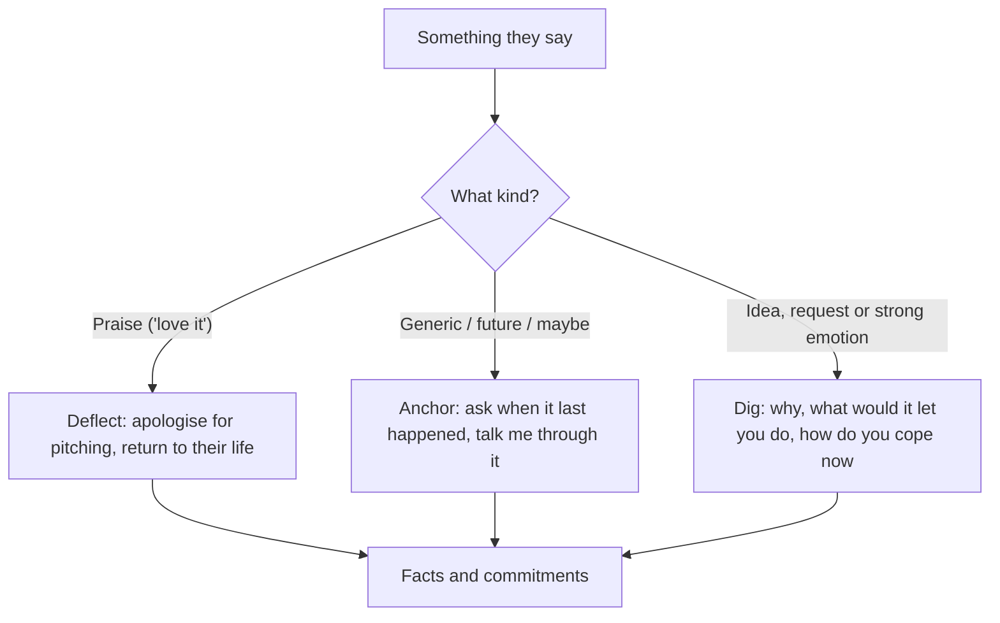

# 02. Customer Conversations

How to talk to customers so you learn the truth about a problem or idea instead of collecting polite lies, and how to turn conversations into commitments.

> **Based on:** *The Mom Test: How to Talk to Customers and Learn If Your Business Is a Good Idea When Everybody Is Lying to You* by Rob Fitzpatrick (2013). [Bookshop](https://bookshop.org/book/9781492180746)

## At a glance

| Framework | In one line | Use it when |
|---|---|---|
| The Mom Test | Talk about their life, ask about specifics in the past, talk less | Writing any question for a customer |
| Three kinds of bad data | Compliments, fluff, ideas | A conversation "went well" but taught you nothing |
| Deflect / anchor / dig | The three recovery moves | The talk drifts into praise, hypotheticals or feature requests |
| Important questions | Look at the elephant, love bad news, don't zoom early | Choosing what to ask |
| Prepare your list of 3 | The three murkiest things to learn per person type | Before any conversation |
| Keeping it casual | Chats, not interviews | Early learning stage |
| Commitment and advancement | Ask them to give up time, reputation or money | Any product or sales meeting |
| Finding conversations | Go to them, bring them to you, warm intros | You know no customers yet |
| Framing the meeting (VFWPA) | Vision, Framing, Weakness, Pedestal, Ask | Requesting a meeting |
| Customer slicing | Cut a segment into a findable who-where pair | Feedback is inconsistent |
| Process and notes | Prep, run, review with the team, signal symbols | Running a batch of conversations |

## The Mom Test

- Idea: never ask whether your business is a good idea. Only the market can say; everything else is opinion. Bad questions invite everyone, not just your mother, to lie a little.
- Not their duty to tell you the truth; it is **your** job to find it by asking good questions.
- Bad conversations are the default and are worse than none: false positives make you over-invest.
- Rules:
  1. Talk about their life instead of your idea.
  2. Ask about specifics in the past instead of generics or opinions about the future.
  3. Talk less and listen more.
- A conversation is useful if it yields **concrete facts about their life and worldview** that improve the business.
- You own the solution, they own the problem: you may not tell them their problem, and they may not tell you what to build.
- Mention your idea too soon rather than too late is the usual error; you still must eventually name it and ask for money.

### Worked contrast (digital cookbook idea)

| Bad version | Good version |
|---|---|
| "Would you buy a cookbook app for $40?" Gets a polite yes and a feature request | "What did you last do on the tablet? Where do you find new apps? Where did those cookbooks on the shelf come from? What was the last cookbook you bought?" |
| Learned: nothing, feels like validation | Learned: this group finds apps through the Sunday paper, gets cookbooks as gifts, buys niche ones; younger cooks may be a better segment |

## Good question or bad question

| Question | Verdict | Why / fix |
|---|---|---|
| "Do you think it's a good idea?" | Bad | Opinion; ask how they do it now, what they love and hate, what else they tried, whether there is a budget |
| "Would you buy a product that did X?" | Bad | Hypothetical optimism; ask how they solve X now, what it costs in money and time, and to talk through the last time |
| "How much would you pay for X?" | Bad | The number feels rigorous but is still a guess; ask what the problem costs them and what they pay today |
| "What would your dream product do?" | Okay only with follow-ups | Want the reasons and constraints behind requests, not a feature list |
| "Why do you bother?" | Good | Gets from the perceived problem to the real goal |
| "What are the implications of that?" | Good | Separates costly problems from tolerable annoyances; pricing signal |
| "Talk me through the last time that happened." | Good | Shows real behaviour; get as close to the action as possible |
| "What else have you tried?" | Good | If they never looked for a fix, they won't look for or buy yours |
| "Would you pay X for a product that did Y?" | Bad | Still hypothetical, about your idea; better to ask for a deposit or pre-order |
| "How are you dealing with it now?" | Good | Workflow plus a price anchor |
| "Where does the money come from?" | Good (B2B) | Budget owner and who can veto |
| "Who else should I talk to?" | Good | End every chat with it; refusal is itself a signal |
| "Is there anything else I should have asked?" | Good, a crutch | Lets them correct your line of questioning |

Rules of thumb worth keeping:
- Opinions are worthless; anything about the future is over-optimistic.
- People know their problems but not the solutions.
- If they have not looked for ways to solve it, they will not buy yours.
- Watching someone do the task shows where the real inefficiencies are.
- They rarely tell you what they will pay but often **show** what it is worth to them.

## Avoiding bad data

Three kinds: **compliments**, **fluff**, **ideas**. Fixes: **deflect, anchor, dig**.

### Deflect compliments
- Compliments are "fool's gold": shiny and worthless, even from experts (professional investors are wrong more than right).
- Symptoms in the meeting: "Thanks!", "Glad you like it". Back at the office: "That went really well", "Everybody loves it".
- Response: if you slipped into pitch mode, apologise briefly and ask how they handle the thing today.
- A negative result is still a good conversation ("it's not a big deal, we ignore it").

### Anchor fluff
- Fluff comes as **generics** ("I usually", "always", "never"), **future promises** ("I would", "I will") and **hypotheticals** ("I might", "I could").
- Fluff-inducing openers: "Do you ever", "Would you ever", "What do you usually", "Could you see yourself".
- The deadliest line: "I would definitely buy that."
- Anchor by asking: when did it last happen, can you talk me through it, how did you handle it, what else did you try.
- People describe who they want to be in generics. Specific past cases expose edge cases (the "inbox zero" fan whose inbox collapsed for ten days).
- Put flaky people to a decision: "why not download it now?" Someone who has not tried existing fixes is a complainer, not a customer.

### Dig beneath ideas, requests and emotions
- Understand feature requests, do not obey them. Write them down, then ask why.
- Dig questions: "Why do you want that?", "What would that let you do?", "How are you coping without it?", "How would that fit into your day?"
- Emotion dig: "Tell me more", "What makes it so awful?", "Why haven't you fixed it?", "Why so happy?" Any strong emotion (angry, embarrassed, overjoyed) is a signal.
- Lesson story: a customer asked for analytics and then branded reports. The real need was a weekly summary to send to their own clients; a simple scheduled export would have done. Months were wasted on a dashboard.
- Possible answers behind one request (sync to Excel): a nice-to-have, a missing must-have across all tools (differentiator), or a painful workaround that makes them an ideal early customer.

### Stop seeking approval
- **Fishing for compliments**: "I'm thinking of starting a business, do you think it will work?"
- **The Pathos Problem**: revealing your ego makes people protect your feelings, even if you say "be honest".
- Famous founders who invite harsh feedback are not a model for you; keep idea and ego out until you ask for commitment.
- **Cut off pitches**: "No, you don't get it" and "but it also does this" mean you are being annoying; they will say it's great to be rid of you. Apologise, promise a demo at the end.
- **Talk less**: when someone starts "So it's like..." or "I like it but...", they are showing you their mental model. Don't interrupt to correct.
- Rules of thumb: if you mention your idea, people protect your feelings; the more you talk, the worse you are doing.

## Asking important questions

| Idea | Meaning |
|---|---|
| Ask questions that can break your business | Imagine it failed: why? Imagine a huge success: what must be true? Learn those pieces |
| Importance test | If a surprising answer would not change what you do, it was not important |
| Fear check | Be nervous about at least one question per conversation (the one you avoid, e.g. the legal team) |
| Love bad news | Spending a small slice to learn it is a dead end is a win; lukewarm ("meh", "that's neat") is reliable information |
| Do not "up your game" | Pitching a lukewarm person only gets false positives; ask why they don't care and thank them |
| Look before you zoom | Start broad (goals, big problems, costs) before asking about your problem area |
| Look at the elephant | Cover all failure points, not the interesting one only (poor schools may share the pain but cannot pay) |
| Product risk vs market risk | See below |

### Premature zoom
- Asking "what is your biggest problem with going to the gym?" of someone who doesn't care about fitness gets a plausible but misleading answer.
- Start generic: "What are your big goals and focuses right now?" If your topic is not on their list, move on.
- When unsure whether the problem is a **painkiller or a vitamin**, ask cost/value questions: how seriously do you take it, do you make or spend money on it, how much time per week, what tools do you use, what are you already doing to improve it, what are the 3 big things you're fixing now.
- If you are 100% sure the problem is a top priority for the segment, you may zoom in straight away.

### Product risk vs market risk

| Risk | Questions | Consequence |
|---|---|---|
| Product risk | Can I build it? Can I grow it? Will they keep using it? | "If you get me X, I'll pay" says little; conversations prove less, build earlier |
| Market risk | Do they want it? Will they pay? Are there enough of them? | Conversations can largely resolve it |

- Examples of mostly product risk: advertising networks, affiliate sales, games, a farm-animal tracker with unproven technology, a bar-deal app that needs a huge consumer audience.

### Prepare your list of 3
- Pick the 3 most important or murkiest things to learn **per type of person**. They change as you learn.
- Don't repeat questions you already have reliable answers for. A fixed list also lets you use chance meetings.

## Keeping it casual

- Original idea: three meetings (problem, solution, sale). In practice a one-hour meeting costs about four hours with scheduling and travel, and early on nobody gives you one.
- Alternative: strip the formality. Early learning works better as a fast, casual chat; you can run many at an industry event.
- **Meeting anti-pattern**: turning every chance for a chat into a calendar slot; it sets expectations that you will show a product.
- Symptoms of formality: "thanks for agreeing to this interview", "on a scale of 1 to 5...", "let's set up a meeting".
- Rule of thumb: if it feels like they are doing you a favour, it is too formal.
- Typical lengths: 5 minutes to learn whether a problem exists; 10 to 15 minutes for most; an hour only for industry detail. A sales-style meeting is about 30 minutes: say hello, understand goals and budget, show the product, agree next steps.
- Give as little detail about your idea as you can while steering the talk. Even in a formal meeting, small talk can disprove an idea (the busy investors who just kept sticky notes) without them knowing.

## Commitment and advancement

- **Commitment**: they give up something of value (time, reputation, money).
- **Advancement**: they move to the next step of your real-world funnel.
- No meeting "just went well": it succeeds (commitment or next step) or fails (compliment or stall, "let me know when it launches").
- Zombie leads: friendly contacts who never buy because you never gave them a chance to say no.
- Real failure is not asking. Rejection is a strong negative data point.
- Rule: it's not a real lead until you have given them a concrete chance to reject you.

### Currencies of commitment

| Currency | Examples |
|---|---|
| Time | Clear next meeting with goals, feedback session on wireframes, serious trial use |
| Reputation risk | Intro to a peer or decision maker (boss, spouse, lawyer), public testimonial or case study |
| Cash | Letter of intent, pre-order, deposit |

Strong commitments combine them (a paid pilot with a whole team). The more they give up, the more you can trust their kind words.

### Good meeting or bad meeting

| What they said | Verdict | Fix |
|---|---|---|
| "That's so cool, I love it!" | Bad: a compliment | Deflect, return to facts |
| "Looks great, let me know when it launches." | Bad: compliment plus stall | Ask for something today: an intro, an alpha trial, a case study |
| "I can intro you to a couple of people when you're ready." | Weak | Make it concrete: who, and what does "ready" mean? |
| "What are the next steps?" | Good | Have the next steps ready |
| "I would definitely buy that." | Bad, dangerous | Ask for a letter of intent, pre-order, deposit or intros |
| "When can we start the trial?" | Maybe good | Raise the cost of the trial (case study, whole team, card on file) |
| "Can I buy the prototype?" | Great | Take the money |
| "When can you come back to talk to the rest of the team?" | Good | Book it |

- Don't pitch blind: start with learning questions that pass the Mom Test, then confirm by selling.
- **Earlyvangelists** (first customers) are "crazy": they have the problem, know it, have the budget and have built a workaround. Look for strong emotion; keep those people close. Lukewarm people rarely write the first cheque.
- Early on, the goal is learning; revenue is a side-effect.

## Finding conversations

| Approach | Tactics |
|---|---|
| Go to them | Cold calls/messages (rejections are irrelevant, you only need a few), seize serendipity, find an excuse to talk (e.g. asking about the story behind the product, a research project), immerse yourself where they gather |
| Bring them to you | Organise a meetup, teach or speak, blog about the industry, use landing pages to collect emails then talk to every sign-up, host a call or event that borrows credibility |
| Warm intros | Ask everyone who they know, use advisors (small equity for regular intros), universities and professors, investors, cash in "let me know how I can help" favours |

- Cold conversations are meant to stop: treat people well and they become warm intros.
- If it's not a formal meeting, you needn't justify yourself; just chat.
- Phone/video loses body language and drifts into scripted interviews; start in person if you can.
- **Advisory flip**: go looking for industry advisors, not customers. It reduces neediness and puts you in control as the one evaluating.
- **How many**: keep going until you stop hearing new things. Often 3 to 5 for a simple industry; if after 10 the results are all over the map, your segment is too fuzzy. Aim to answer a question within a week.

### Framing the meeting: Vision, Framing, Weakness, Pedestal, Ask

| Part | What to say |
|---|---|
| Vision | The problem or change you work on (not your idea) |
| Framing | Your stage, and that you have nothing to sell |
| Weakness | The specific thing you are stuck on |
| Pedestal | Why they in particular can help |
| Ask | A small request for help |

- Avoid "can I interview you", "can I get your opinion" (neediness), and a vague "quick coffee".
- At the start repeat the framing and drop straight into the first good question to grab the reins. You set the agenda; propose next steps.
- Mnemonic: Very Few Wizards Properly Ask.

## Choosing your customers

- Too broad a segment leads to mixed feedback, no way to prove yourself wrong and feature creep ("students" hides a PhD student, a prep-school kid, a rural shared-computer village and more).
- Inconsistent feedback means you are having one conversation each with many different customer types.
- Serve someone before serving everyone (condiment powder: moms with young kids at independent health-food shops, first via a shelf-space commitment).
- **Customer slicing**: from a broad segment ask which sub-group wants it most, why (their goal or problem), who else shares that motivation, what they already do about it, and where to find them. Keep slicing until each group is a **who-where pair**.
- Pick the group that is most profitable, easy to reach and rewarding to serve. Be specific enough to find them (e.g. people already attending a speaking club).
- Talk to representative people, not just the most senior; include every stakeholder (buyer, user, partner, multiple sides of a marketplace).

## Running the process

- Avoid being a **learning bottleneck**: the person who attends all meetings and relays "the customer said so" becomes a dictator. Symptoms: "you worry about product, I'll learn", "customers told me so", "no time, I need to code".
- Founders should attend; do not outsource customer learning. Two people per meeting is best (one talks, one notes); do not send more than two.

### Before, during, after

| Phase | Do |
|---|---|
| Before | Focused, findable segment; team decides the big 3; decide ideal next step or commitment; best guesses of what the person cares about (up to an hour); desk research first; quick background check. Prep question: "What do we want to learn from these guys?" |
| During | Frame it, keep it casual, ask Mom Test questions, deflect/anchor/dig, take notes, push for commitment if relevant |
| After | Review notes and quotes with the team, store them permanently, update beliefs, set the next 3 questions; also review which questions worked |

Prep questions to uncover hidden risk: if this company fails, why? What would have to be true for a huge success?

Time scale: an hour of prep, one to two weeks of focused conversations, then give them something to commit to. Anything more is stalling.

### Taking notes
- Write exact quotes in quotation marks; otherwise just the big idea.
- Tag notes with signal symbols:

| Group | Symbol | Meaning |
|---|---|---|
| Emotion | :) | Excited |
| | :( | Angry |
| | :\| | Embarrassed |
| Their life | lightning bolt | Pain or problem |
| | goal | Goal or job to be done |
| | box | Obstacle |
| | curved arrow | Workaround |
| | caret | Background or context |
| Specifics | tick box | Feature request or purchase criterion |
| | dollar | Money, budget or buying process |
| | person | Named person or company |
| | star | Follow-up |

- Use a medium you can sort and share: index cards (one quote or learning each, dated and named afterwards), a spreadsheet with a column per signal, or a shared notes tool. Avoid burying notes in a general notebook; recordings are hard to search and blow your cover.
- Notes are useless if you don't look at them.

### Signs you're just going through the motions
- You talked more than they did; they complimented you.
- You told them your idea and don't know what happens next.
- No notes, or notes not reviewed with the team.
- An unexpected answer changed nothing.
- No question scared you; unsure which big question you're answering or why you are meeting.

### Pitfalls and symptoms (cheat sheet)

| Mistake | Symptom |
|---|---|
| Fishing for compliments | "Do you think it will work?" |
| Exposing your ego | "Be honest, I can take it" |
| Being pitchy | "No, you don't get it" |
| Being too formal | "Thanks for agreeing to this interview" |
| Learning bottleneck | "Because the customers told me so" |
| Collecting compliments instead of facts | "Everyone loves it" |
| No commitment push | Zombie leads, meetings that "went well" |

Last point from the book: do not get lost in the process; sometimes just pick up the phone (a trainer wondering about a new customer type simply called them).

## Recall

**Q: What are the three rules of the Mom Test?**

??? note "Answer"
    Talk about their life instead of your idea; ask about specifics in the past rather than generics or opinions about the future; talk less and listen more.

**Q: What are the three kinds of bad data and how do you handle each?**

??? note "Answer"
    Compliments (deflect them and return to facts), fluff such as generics, future promises and hypotheticals (anchor them to a specific past example), and ideas or feature requests (dig for the motivation behind them).

**Q: What makes a meeting a success, and what counts as commitment?**

??? note "Answer"
    It ends with a commitment or advancement to a next step, not a compliment or stall. Commitment means giving up something valuable: time (next meeting, serious trial), reputation (intro to a boss, testimonial) or money (letter of intent, pre-order, deposit).

**Q: What is customer slicing, and what is the target result?**

??? note "Answer"
    Repeatedly splitting a broad segment by who wants it most, why, and what they already do about it, until you have a who-where pair: a specific group you know how to find. Choose the one that is profitable, easy to reach and rewarding.

**Q: How should you frame a request for a meeting?**

??? note "Answer"
    Vision (the problem you tackle), Framing (your stage, nothing to sell), Weakness (where you are stuck), Pedestal (why they can help), Ask (a small request for help). Avoid "interview" and "can I get your opinion".

## Links

- [[1. Positioning|Positioning]] (use conversations to find best-fit customers and real alternatives)
- [[3. Marketing Fundamentals|Marketing Fundamentals]]
- [[1. Consultative Selling|Consultative Selling]] (asking about goals and budget, next steps)
- [[1. Value-Based Pricing|Value-Based Pricing]] (what the problem is worth to them)
- [[3. Deciding Under Uncertainty|Deciding Under Uncertainty]] (cheap tests before large bets)
- [[2. Innovation and Entrepreneurship|Innovation and Entrepreneurship]]
