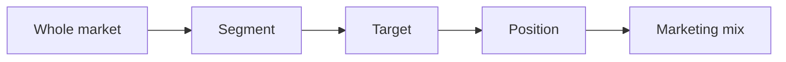
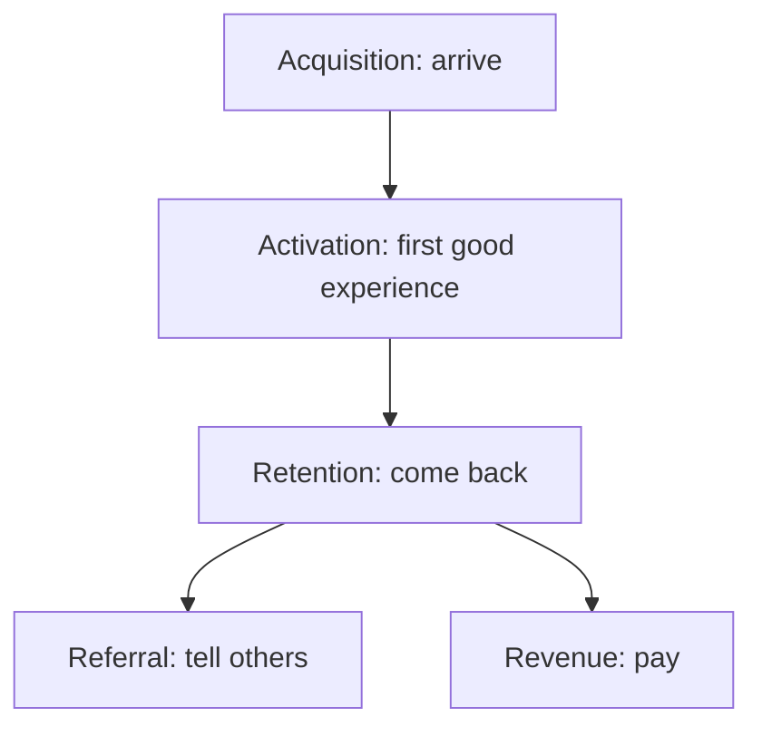

# 03. Marketing Fundamentals

Core marketing vocabulary and numbers: who you serve, what you offer, how customers find and stay with you, and how to measure it.

> **Not from the library.** General reference material written to fill a gap in the books in this section.

Origins checked on the web (November 2026): McCarthy 1960 and Booms and Bitner 1981 confirmed; AARRR confirmed as McClure 2007 but the exact venue is only in secondary sources; the LTV:CAC 3:1 and 12-month payback figures are widely repeated rules of thumb with no confirmed primary source, so use them as rough guides only.

## At a glance

| Framework | In one line | Use it when |
|---|---|---|
| STP | Segment the market, target a segment, position for it | Deciding who the offer is for |
| 4Ps / 7Ps | Product, price, place, promotion (+ people, process, physical evidence) | Checking the whole offer is coherent |
| Customer journey | The stages a buyer passes from unaware to advocate | Finding where buyers drop out |
| AARRR | Acquisition, activation, retention, referral, revenue | Choosing which funnel metric to fix first |
| Channels | Organic, paid, referral, email | Deciding where to spend effort |
| Market research | Primary vs secondary, qualitative vs quantitative | Before a launch or a pricing/positioning change |
| B2B vs B2C | Buying committee and long cycle vs individual and short cycle | Adapting tactics to the buyer |
| CAC, LTV, conversion | Cost to win a customer vs what they return | Judging whether a channel pays |

## Segmentation, targeting, positioning (STP)

- Segment: split the market into groups with different needs. Common bases: demographic (age, income), firmographic (industry, size, for B2B), behavioural (usage, purchase triggers), needs-based (the job they want done).
- Target: pick the segment(s) you can serve best and profitably. A good segment is measurable, reachable, big enough, and different in how it responds.
- Position: the place you hold in the target's mind relative to alternatives. Detail in [[1. Positioning|Positioning]].
- Common mistake: "everyone with a business" is not a segment. Narrow first; widen after winning.

## The 4Ps and 7Ps

- 4Ps: E. Jerome McCarthy, *Basic Marketing* (1960). The 7Ps extension for services: Bernard Booms and Mary Jo Bitner (1981). Later authors have proposed further Ps; the 1981 set is the standard seven.

| P | Question |
|---|---|
| Product | What problem does it solve; what is in/out of scope? |
| Price | What does it signal; how is it packaged? |
| Place | Where and how is it bought or delivered? |
| Promotion | How do people hear about it? |
| People | Who delivers it; how do they behave? |
| Process | How is the service delivered end to end? |
| Physical evidence | What proves it is real (site, case studies, reviews)? |

- For services and software the last three matter most: the customer experiences the people and process as the product.
- Mistake: treating the Ps as a checklist instead of a consistent story. A premium price with a sloppy site breaks the signal.

## Customer journey and funnel (AARRR)

- Journey stages (generic): awareness, consideration, decision, onboarding, use, advocacy.
- AARRR "pirate metrics" was popularised by Dave McClure in 2007 as "Startup Metrics for Pirates" (sources describe a short Ignite talk in Seattle, August 2007, then longer versions; the venue rests on secondary sources). The "pirate" name is from how the acronym sounds.

| Stage | Example metric |
|---|---|
| Acquisition | Visitors, leads by source |
| Activation | % who book a call, finish onboarding |
| Retention | Repeat rate, churn, renewals |
| Referral | Referrals per customer |
| Revenue | Average order/contract value, MRR |

- Worked example: 1,000 visitors, 3% enquire (30), 20% of enquiries become customers (6). Doubling visitors doubles customers; lifting enquiry rate to 4% gives 8. Fix the leakiest step, not the most fashionable one.
- The order of stages varies by business (revenue can precede retention). Use the model as a lens, not a law.

## Channels

| Channel | Pros | Cons |
|---|---|---|
| Organic (SEO, content, social) | Compounds; low marginal cost | Slow; hard to control |
| Paid (search, social ads) | Fast, measurable, scalable | Stops when spend stops; CAC rises |
| Referral / word of mouth | High trust, low CAC | Hard to scale on demand |
| Email | You own the list; cheap; good for retention | Needs a list and consent |

- Rule of thumb: prove a channel at small scale, then scale only if CAC stays under the payback limit.
- Own what you can (list, site); rent attention sparingly.
- Mistake: running five channels badly instead of one properly.

## Content and brand basics

- Content: useful material that attracts the target (guides, case studies, talks). It proves expertise before the sales conversation.
- Brand: the set of associations people hold about you; built from consistent promise, visuals, tone, and delivered experience.
- A brand is promise plus proof. Consistency beats cleverness.
- Mistake: content about yourself rather than the buyer's problem.

## Market research

- Secondary: existing data (industry reports, statistics offices, competitor sites). Cheap; start here.
- Primary: you collect it. Qualitative (interviews, to learn why) vs quantitative (surveys, to learn how many). See [[2. Customer Conversations|Customer Conversations]].
- Sequence: qualitative first to find the right questions, quantitative to size them.
- Mistakes: leading questions, asking only friends, sample too small to generalise, asking what people would do rather than what they did.

## B2B vs B2C

| | B2B | B2C |
|---|---|---|
| Buyer | Committee: user, influencer, approver, payer | Usually one person or household |
| Cycle | Weeks to months | Minutes to days |
| Value | Larger, often recurring | Smaller per transaction |
| Appeal | Rational: ROI, risk reduction | Mix of emotional and rational |
| Trust | Case studies, references, relationships | Reviews, social proof |

- B2B: map the buying committee; give each member a reason to say yes.

## Marketing metrics

- CAC (customer acquisition cost) = total sales and marketing spend / new customers won in the period.
- Conversion rate = outcomes / opportunities at a given step.
- LTV (lifetime value) = average margin per period x expected lifetime of a customer.
- LTV:CAC of around 3:1 and CAC payback under about 12 months are commonly cited for subscription (SaaS) businesses, often credited to investor David Skok; sources disagree on the origin and the payback figure, and some suggest longer payback is acceptable for enterprise sales and that the ratio is not meant for pre-fit startups. Rule of thumb only.
- Worked example: customer pays R1,000 a month at 70% margin (R700), stays 20 months on average, so LTV = R14,000. If CAC is R4,000, LTV:CAC = 3.5 and payback = 4,000 / 700 = about 6 months.
- Include all costs (time, tools, salaries) in CAC; "blended" CAC hides bad channels, so also track it per channel.
- Mistakes: vanity metrics (impressions, followers), ignoring churn when computing LTV, measuring revenue not margin.

## Recall

**Q: What are the three steps of STP?**

??? note "Answer"
    Segment the market, target the best-fit segment, position the offer for that target.

**Q: Why do services add people, process and physical evidence to the 4Ps?**

??? note "Answer"
    The customer experiences delivery directly, so who delivers, how, and what proves it is real are part of the product.

**Q: Name the AARRR stages.**

??? note "Answer"
    Acquisition, activation, retention, referral, revenue.

**Q: How is CAC calculated and why track it per channel?**

??? note "Answer"
    Total sales and marketing spend divided by new customers. A blended figure hides channels that lose money.

## Links

- [[1. Positioning|Positioning]]
- [[2. Customer Conversations|Customer Conversations]]
