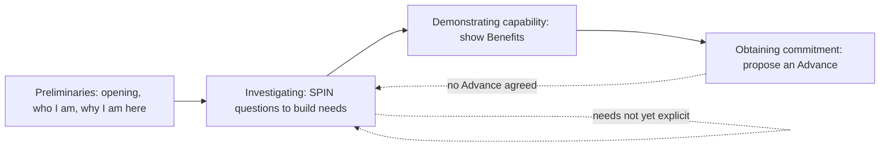

# 01. Consultative Selling

How to run a larger, multi-call sale by asking the right questions instead of pitching and closing.

> **Based on:** *SPIN Selling* by Neil Rackham (1988). [Bookshop](https://bookshop.org/book/9780070511132)

Rackham's team studied 35,000+ real sales calls (116 behaviours, 27 countries) and found that most classic sales advice only works for **small, one-call sales**. In a large sale, success is decided in the *Investigating* stage.

## At a glance

| Framework | In one line | Use it when |
|---|---|---|
| Small vs large sale | Pressure and product talk work on small decisions, hurt on big ones | Deciding how hard to push and how long to investigate |
| Four stages of a call | Preliminaries, Investigating, Demonstrating Capability, Obtaining Commitment | Planning any call |
| Implied vs Explicit Needs | A problem is not yet a want; only wants predict a big sale | Judging whether a call really went well |
| Value equation | Buy only when the perceived problem outweighs the cost of the fix | Facing "too expensive" |
| SPIN questions | Situation, Problem, Implication, Need-payoff | Investigating a larger sale |
| Features / Advantages / Benefits | Only a statement that meets a need the buyer *said out loud* is a Benefit | Presenting a solution |
| Objection prevention | Objections are mostly caused by offering solutions too early | Getting lots of objections |
| Advances vs Continuations | Close for an action that moves the sale, not for nice words | Setting call objectives |
| Opening the call | Get consent to ask questions; do not pitch | The first minutes of a call |
| Learning rules | One behaviour at a time, three tries, quantity first, safe practice | Building the skill |

## Small sale vs large sale

The research finding that frames everything: techniques developed in 1920s-style single-call, low-value sales were assumed to scale up. They do not.

| Factor | Small sale | Large sale |
|---|---|---|
| Selling cycle | One call, decided on the spot | Many calls; the real decision happens when you are not in the room |
| Effect of a polished pitch | Works, buyer says yes immediately | Forgotten within days; under half of key points remembered a week later |
| Pushiness | Can pay off | Makes the buyer avoid the next meeting |
| Perceived value | Barely matters | Building value is the main skill |
| Relationship | Seller and product are separate | Buyer is buying a relationship with you |
| Risk | Mistakes are private and cheap | Mistakes are public, so buyers get cautious |
| Needs | Appear fast, partly emotional, one person | Develop slowly, many people, need rational justification |

- Product knowledge alone does not carry a big sale: buyers need to see enough value to justify the decision.
- Professional services (consulting, banking, accounting) behave like large sales, so these ideas fit them closely.

## The four stages of a call

Every call, small or large, passes through four stages; the balance shifts with the sale.

- **Preliminaries:** warm-up; matters less than people think in large sales.
- **Investigating:** finding facts, problems and needs. The most important stage by far in large sales.
- **Demonstrating capability:** show you can solve the problem; works only after needs are developed.
- **Obtaining commitment:** end the call with an action from the buyer.
- Plan the call around what you will *ask*, not what you will *tell*.
- Weak "closers" are usually weak investigators: fixing the questions fixes the close.

## Needs: Implied and Explicit

Needs develop in three steps: minor imperfection, then a clear problem, then a want or intention to act.

| Type | What the buyer says | Example |
|---|---|---|
| Implied Need | A problem, difficulty or dissatisfaction | "Our current process is slow" |
| Explicit Need | A specific want or desire you can satisfy | "We need something that cuts processing time" |

- In small sales, counting Implied Needs predicts success.
- In large sales, Implied Needs do *not* predict success, Explicit Needs do (roughly double in successful calls).
- So the job of questions in a large sale: **uncover Implied Needs and develop them into Explicit Needs**.
- Experienced sellers treat "customer talks about action" as the real buying signal, not "customer admits a problem". Almost everyone has problems; few act.

### Value equation

- Buyer weighs the **seriousness of the problem** against the **cost of the solution**.
- Cost includes risk, hassle and career exposure, not just money.
- Cheap solution: a small problem is enough. Expensive solution: the problem must be made bigger first (in the buyer's own mind).
- Pitching a costly fix to a small problem produces "you must be kidding".

## SPIN questions

A pattern found in successful investigating, not a rigid script. Order is broadly S, P, I, N but fluid.

| Type | Asks about | Example | Notes |
|---|---|---|---|
| **S**ituation | Facts, background, current state | "How long have you had the present equipment?" | Needed, but too many bore the buyer; do homework first |
| **P**roblem | Difficulties, dissatisfactions | "Is this step hard to do reliably?" | Surfaces Implied Needs; strongest link to success in small sales |
| **I**mplication | Effects and consequences of a problem | "What does this do to your delivery times and costs?" | Hardest and most powerful in large sales; makes the problem bigger |
| **N**eed-payoff | Value or usefulness of a solution | "How would fixing that help you?" | Buyer states the benefits themselves |

### Situation questions
- Ask fewer, with a purpose; inexperienced sellers over-ask because they feel safe.
- Successful calls tend to contain fewer of them. Professional buyers hate answering the same ones all day.
- Cut them by researching beforehand.

### Problem questions
- Probe for problems your offer can actually solve.
- Planning aid: before a call write at least three problems the buyer may have that you can solve, then a question for each.

### Implication questions
- Take a problem the buyer sees as small and explore its knock-on effects until it justifies action.
- Rare in practice (about 1 question in 20) because people do not plan them.
- Planning method: (1) write a likely problem, (2) list the related difficulties it could cause, (3) turn each difficulty into a question.
- Risk: they make the buyer uncomfortable. Follow with Need-payoff questions.

### Need-payoff questions
- Move attention from the problem to the solution; the buyer lists benefits and sells themselves.
- They reduce objections: you are not claiming to fix everything, the buyer says which parts matter.
- Generic ones: "Why is that important?", "How would that help?", "Would it be useful if...?", "Is there any other way it would help?"
- Mistakes: asking too early (before problems are built), or asking about a need you cannot meet (it only strengthens a need you cannot satisfy).
- Top performers ask many times more of them than average performers.

### Implication vs Need-payoff
- Implication questions are problem-centred ("sad"); Need-payoff questions are solution-centred ("happy").

### Open vs closed questions
- The classic distinction showed **no relationship** with success in the large-sale studies.
- What matters is whether the question touches an area psychologically important to the buyer.

### Worked example (generic)
- A seller of a faster scheduling tool hears "our rota is a bit fiddly" (Implied Need, small).
- Implication: "What happens when it clashes with shift swaps?" then "What does that cost in overtime?" then "What does it do to staff who quit over it?"
- Buyer adds up the cost and calls the problem serious.
- Need-payoff: "If this was automatic, how would that help you?" Buyer: "Managers would get a day a week back." That is an Explicit Need and a Benefit you can now meet.

## Features, Advantages, Benefits

| Statement | Definition | Small sale | Large sale |
|---|---|---|---|
| Feature | Fact or data about the product | Neutral | Neutral to slightly negative, especially early |
| Advantage | Shows how the product is used or could help | Positive | Weak; fades through the sales cycle |
| Benefit | Shows how the product meets an **Explicit Need the buyer already stated** | Very positive | Very positive, all through the cycle |

- Most training calls an Advantage a "Benefit". That is the trap.
- You can only give a true Benefit after the buyer says "I want it", which means you must have developed the need first.
- Features raise price sensitivity: a feature-heavy pitch of an expensive product invites price objections.
- Benefits correlate with buyer approval and support.
- **New products:** the usual launch is a "feature dump". Launch in terms of the problems it solves and the questions to find those problems (a pilot group doing this beat the rest of the sales force substantially in year one).
- Three rules for demonstrating: do not demonstrate too early; beware Advantages; be careful with new products.
- If forced to present early, try to hold at least one pre-meeting to learn needs.

## Objections: prevent rather than handle

- Objections are more often **created by the seller** than raised by the customer.
- More objections means a *less* likely sale (the "objections are opportunities" idea is a myth).
- Skilled sellers receive far fewer objections; the gap between sellers on one team can be tenfold.
- Cause: offering Advantages and solutions before the need is strong.
- Diagnosing:
    - Objections early in the call mean you pitched too soon.
    - Value objections ("too expensive", "we are happy as we are") mean needs are not developed enough.
- Treat the cause, not the symptom: ask more Implication and Need-payoff questions and use fewer Features.
- Some objections remain (real mismatches), so keep basic objection handling, but do not rely on it.

## Obtaining commitment

### Why classic closes fail in large sales
- Closes (assumptive, alternative, standing-room-only, last-chance, order-blank) shorten the transaction, useful when you want volume.
- In one study, high-close calls closed fewer sales than low-close ones; training in closing raised success on cheap goods and lowered it on dearer ones.
- Professional buyers react badly: most surveyed buyers said closing made them *less* likely to buy.
- Pressured buyers report lower satisfaction after the sale, which matters when the relationship continues.
- Why people still love closing: it is the one behaviour rewarded instantly with an order, so it feels like it caused the sale.
- But no closing at all is also weak; some commitment must be sought.

### Four call outcomes
| Outcome | Meaning | Successful? |
|---|---|---|
| Order | Firm commitment to buy (signed, not "99% likely") | Yes |
| Advance | An action that moves the sale forward (demo, trial, access to a senior decision maker) | Yes |
| Continuation | Sale continues but no concrete action agreed ("great presentation, let's talk again") | No |
| No-sale | Buyer refuses the main objective | No |

- Judge a call by the buyer's **actions**, not their compliments.
- Set call objectives that are Advances, not "build relationship" or "collect data" (those give Continuations).

### Four successful actions
1. Spend your effort on Investigating and Demonstrating Capability.
2. Check that key concerns are covered, before closing, so doubts surface as simple questions rather than antagonism.
3. Summarise the Benefits.
4. Propose a commitment: *tell* the next step instead of asking "will you buy?". It should advance the sale and be the highest realistic commitment the buyer can give.

## Opening the call

- First impressions matter far less in large sales than older books claim.
- Traditional openers (rapport on personal interests, opening benefit statement) have weak or no relation to success in larger sales; repeating the same opener across calls irritates.
- Opening benefit statements also drag you into product talk and let the buyer take over asking.
- Aim of the opening: establish who you are, why you are there (without product detail), and your **right to ask questions**.
- Rules: get to business quickly (keep Preliminaries under about 20 percent of the call), do not talk solutions early, spend prep time on questions not opening lines.
- Vary your openings.

## How to apply and practise

Four rules for learning any skill:
1. **One behaviour at a time.**
2. **Try it at least three times**: it feels awkward at first.
3. **Quantity before quality**: ask lots of the new question type before polishing.
4. **Practise in safe situations** (friends, low-stakes calls).

Strategy:
- Focus on Investigating.
- Build questions in S, P, I, N order: first just ask more questions; then plan Problem questions (aim for half a dozen a call); then Implication (takes months); then Need-payoff.
- Think of your offer as a list of **problems it solves**, not features.
- Plan, do, **review**: after each call ask what you would do differently, which questions moved the buyer, which needs changed. Top performers review details.

## Common mistakes

- Pitching after finding a single problem (small-sale reflex).
- Counting problems found as proof the call went well.
- Hammering closing techniques on a professional buyer.
- Calling Advantages "Benefits".
- Over-asking Situation questions; no Implication questions at all.
- Treating SPIN as a fixed formula.
- Handling price objections with discounts or clever answers when the real cause is weak need development (see [[1. Value-Based Pricing|Value-Based Pricing]]).

## Recall

**Q: Why do Implied Needs fail as buying signals in large sales?**

??? note "Answer"
    Almost every buyer has problems. In a big sale the problem must outweigh a higher cost and risk, so it has to be developed into an Explicit Need (a want to act). Only Explicit Needs predicted success.

**Q: What are the four SPIN questions and the purpose of each?**

??? note "Answer"
    Situation (facts, kept few), Problem (difficulties), Implication (consequences, makes the problem bigger and urgent), Need-payoff (value of the fix, buyer states benefits).

**Q: What is the difference between an Advantage and a Benefit?**

??? note "Answer"
    An Advantage says how the product helps or could be used. A Benefit shows it meets an Explicit Need the buyer already expressed. Benefits drive large sales; Advantages mostly work in small ones and fade.

**Q: How do you "close" a large-sale call?**

??? note "Answer"
    Set an Advance as the objective, check key concerns are covered, summarise the Benefits, then propose the highest realistic next step the buyer can give. Compliments without an agreed action are only a Continuation.

**Q: Why prevent objections instead of handling them?**

??? note "Answer"
    Objections are mostly caused by offering solutions before the need is strong, and more objections correlate with fewer sales. Better questioning removes the cause.

## Links

- [[1. Value-Based Pricing|Value-Based Pricing]]: a developed Explicit Need is what makes a high price feel justified.
- [[1. Positioning|Positioning]]: knowing the problems you solve best tells you which questions to plan.
- [[2. Tactical Negotiation|Tactical Negotiation]]: once the need is built, how to negotiate terms.
- [[3. Trust and Advisory Relationships|Trust and Advisory Relationships]]: the relationship side of large sales.
