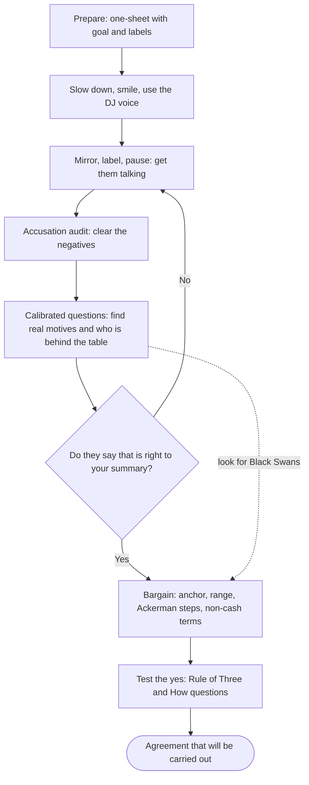

# 02. Tactical Negotiation

Practical listening, questioning and bargaining tools for negotiations, from a former hostage negotiator.

> **Based on:** *Never Split the Difference: Negotiating As If Your Life Depended On It* by Chris Voss with Tahl Raz (2016). [Bookshop](https://bookshop.org/book/9780062407801)

Core idea: negotiation is **discovery, not battle**. Everyone has emotions and hidden needs; the person who listens best steers the conversation. Compromising down the middle is usually a bad deal for both sides.

## At a glance

| Framework | In one line | Use it when |
|---|---|---|
| Voice tones | Late-night FM DJ (selective), positive/playful (default), assertive (rare) | Every conversation |
| Mirror | Repeat the last 1-3 words, then stay quiet | Drawing out more, disagreeing gently |
| Label | Name their emotion: "It seems like..." | Defusing negativity, building trust |
| Tactical empathy | Understand their feelings and framing without agreeing | Always, especially before asking for anything |
| Accusation audit | Say the worst things they might think about you first | Before a tense conversation |
| "No"-oriented questions | Let them say no to feel safe and in control | Opening, or when ignored |
| "That's right" | Summarise their world until they say it | Stuck negotiations, breakthroughs |
| Calibrated questions | Open "How" and "What" questions that hand them the problem | Pushing back without saying no |
| Rule of Three | Get the same agreement repeated three ways | Testing whether a "yes" is real |
| Bending reality | Anchor emotions, ranges, odd numbers, non-money terms | Pricing and haggling |
| Ackerman model | Offers at 65, 85, 95, 100 percent of target | Hard bargaining over a number |
| Negotiator types | Analyst, Accommodator, Assertive | Adapting to the person |
| Black Swans | Unknown unknowns that change the leverage | Deadlocks and high-stakes deals |
| One-sheet preparation | Goal, summary, labels, calibrated questions, non-cash offers | Before any negotiation |

## Flow of a negotiation

## Voice and mindset

- Treat assumptions as hypotheses and test them; the aim is to uncover surprises.
- Quiet the voices in your head by focusing entirely on the other person.
- **Slow down.** Rushing makes people feel unheard and damages rapport.
- **Smile.** People in a positive mood think faster and cooperate more.

| Voice | When | Effect |
|---|---|---|
| Late-night FM DJ | Selectively, to make a point; calm, slow, downward inflection | Authority and calm without defensiveness |
| Positive / playful | Your default | Easygoing, collaborative |
| Direct / assertive | Rarely | Creates pushback |

- Pronouns reveal authority: lots of "I/me/my" suggests the real decision lies elsewhere; "we/they/them" suggests a decision maker keeping options open.
- Words are a small share of the message: pay attention to tone and body language (the 7-38-55 idea). A mismatch signals discomfort or lying.

## Mirroring

- Repeat the **last three words** (or the key one to three) of what they said, in a curious tone.
- Why it works: we are drawn to similarity; people keep elaborating and rewording.
- Gentle way to ask "what do you mean?" without sounding defensive.
- Sequence for disagreeing without conflict: DJ voice, start with "I'm sorry...", mirror, **silence of at least four seconds**, repeat.
- Example: boss says "Let's make two copies of everything." Reply: "I'm sorry, two copies?" Boss explains and often revises the request himself.

## Labelling and tactical empathy

- **Tactical empathy:** understand the other person's feelings and perspective and show it, without agreeing. Hearing it calms the fear response and invites information.
- **Label:** name the emotion or situation.
    - Start with "It seems like...", "It sounds like...", "It looks like...".
    - Avoid "I" ("I hear that...") because it raises guards and makes it about you.
    - Then **stop talking**: the label invites them to expand. If wrong, "I didn't say it was, just that it seems like it."
- Label negatives to defuse them; label positives to reinforce them.
- Barriers to agreement are often more powerful than reasons to agree, so surface them first.
- Pause after a label or mirror.

### Accusation audit
1. List every awful thing they might think or say about you or your position, however unfair.
2. Reduce it to a few labels (no more than five) and say them first.
3. They often respond by contradicting the accusation.
- Do not deny negatives ("I don't want to sound harsh...") because that gives them weight.
- Example: before a role-play, tell the group "it is going to be horrible"; more people volunteer.
- Fill-in labels: "It seems like ___ is valuable to you", "It seems like you're reluctant to ___".

## "No" and "that's right"

### Master "No"
- Pushing for "yes" makes people defensive. "No" gives the speaker a feeling of safety and control, and often means "wait" or "I'm not comfortable".
- Three kinds of "yes":

| Type | Meaning |
|---|---|
| Counterfeit | They plan to say no but say yes to escape or keep you talking |
| Confirmation | Reflexive agreement to a black-or-white question; no promise |
| Commitment | Real agreement that leads to action |

- "No"-oriented questions:
    - "Is now a bad time to talk?" beats "Do you have a few minutes?"
    - "Have you given up on this project?" revives a silent counterpart.
    - "Do you want the project to fail?" forces a safe "no" and a conversation.
- You can also trigger a "no" by deliberately mislabelling an emotion ("It seems like you want this to fail").

### "That's right" beats "you're right"
- "You're right" usually means "please stop talking"; "that's right" means they feel truly understood.
- Build it with active listening: pauses, minimal encouragers ("uh-huh"), mirrors, labels, paraphrase, then **summary = paraphrase + label of the emotion underneath**.
- When they say "that's right", barriers drop and change becomes possible.

## Calibrated questions

- Open questions that begin with **"How"** or **"What"**, aimed at making the other side solve your problem.
- Avoid yes/no questions (little thought, trigger reciprocity) and avoid **"Why"**, which sounds accusing.
- Examples:
    - "How am I supposed to do that?" (a polite, soft no, makes them rethink the demand)
    - "What are we trying to accomplish here?" and "What is the biggest challenge you face?"
    - "How does this affect your team?" (finds people behind the table)
    - "What happens if you do nothing?"
- Ask them again and again. It gives the illusion of control, keeps them engaged and often makes them bid against themselves.
- Bite your tongue under attack: pause and ask a calibrated question.
- Always ask about the **team behind the table**: those comfortable with the status quo can kill deals. Look at status, self-esteem and fear of loss, not only money.
- Losses sting at least twice as much as equal gains (loss aversion): frame inaction as costly.

## Execution: Rule of Three

- "Yes" is nothing without "How". Ask how it will be done.
- **Rule of Three:** get the same commitment confirmed three times, using different tools (a calibrated question, a summary, a label). Faking conviction repeatedly is hard.

## Bending reality (bargaining psychology)

1. **Anchor their emotions:** audit their fears first so loss feels likelier, then tell them how bad it will be.
2. **Let them go first** with a number when you lack market information (you avoid underselling, a possible winner's curse). Be ready for an extreme anchor; then do not drift to your maximum.
3. **Establish a range** instead of a single number: "Similar roles pay X to Y". Expect them to land at the low end, so make the bottom the number you actually want.
4. **Pivot to non-monetary terms:** offer things that are cheap for you and valuable to them, or ask for what is cheap for them but valuable to you.
5. **Use odd numbers:** a figure ending in zero looks like a placeholder; a number like 37,263 feels calculated and fixed.
6. **Surprise with a gift:** after the first rejection of an extreme anchor, an unrelated gesture triggers reciprocity.
- Deadlines push people to rush against their own interest. Most are softer than they look.
- When someone says "that's not fair", do not concede; ask what you are doing that is unfair.
- Never split the difference: meeting in the middle ("one black shoe and one brown") often yields a bad deal for both.

## Ackerman model

An offer-counteroffer system for the moment of exchanging numbers. Works because it blends an extreme anchor, reciprocity and diminishing concessions.

| Step | What to do | Why |
|---|---|---|
| 1 | Set your target price (your goal) | Defines the target |
| 2 | Make first offer at **65 percent** of target | Extreme anchor, shocks them into a reaction |
| 3 | Plan three raises to **85, 95, then 100 percent** | Decreasing increments signal you are near the limit |
| 4 | Between raises, use empathy and varied ways of saying "no"; make them counter first | Gets them to bid against themselves; reciprocity |
| 5 | Make the final number **precise and non-round** (e.g. 37,893) | Looks calculated and final |
| 6 | Add a small **non-monetary item** on the last offer | Shows you are at your limit |

- Worked example (buyer): target to pay 1,000. Offers: 650, then 850, then 950, then 1,000 (a precise figure like 997 plus a small extra). Each raise comes only after a counter or a "how" question.
- Selling works in mirror image: start high and step down in shrinking increments.
- The book describes it as four steps but lists six items; the table keeps all six.
- Expect pushback; the model assumes you stay calm and keep using labels and "how" questions between offers.

## Negotiator types

| Type | Cares about | Time means | How to work with them |
|---|---|---|---|
| Analyst | Being right, no mistakes | Preparation | Be prepared; use data; no surprises; give them time; they may need days to answer |
| Accommodator | The relationship | Relationship | Be friendly, then use "how" questions on implementation; they may promise what they cannot deliver |
| Assertive | Getting things done, being heard | Money | Let them be heard first; mirrors and labels; aim for "that's right" |

- Most effective negotiators in the cited study were cooperative, not aggressive.
- Everyone has a mix; add the other styles instead of replacing your own.
- Silence means different things: thinking time (Analyst), a chance to talk (Assertive).

## Black Swans

- **Black Swans:** unknown unknowns, hidden facts about the other side that change the game; they multiply your leverage.
- You do not know the right question, so keep probing, listening and re-reviewing what you heard (use a second listener).
- Three kinds of leverage:

| Leverage | Meaning |
|---|---|
| Positive | Ability to give them what they want |
| Negative | Ability to hurt them |
| Normative | Using their own norms and values to bring them around |

- Tactics: understand the other side's "religion" (worldview); use the similarity principle; get **face time**; watch unguarded moments; treat "irrational" behaviour as signs of hidden constraints, desires or bad information.
- Rules that "never" fail can still change (the book's example of a hostage-taker breaking a pattern), so stay flexible.

## One-sheet preparation

Prepare a single page before any negotiation:
1. **Goal:** write only the specific best-case goal (best/worst thinking is fine, but the goal is what you carry). Do not anchor on your fallback, which makes you aim low. People who expect more get more.
2. **Summary:** a couple of sentences of known facts, which should earn a "that's right".
3. **Labels / accusation audit:** three to five.
4. **Calibrated questions:** three to five to reveal motives and deal killers.
5. **Non-cash offers:** what could they give that is cheap to them and valuable to you?

## Worked example (generic)

- Freelancer quotes for a project; client says "your price is too high".
- Mirror: "Too high?" Pause. Client explains a budget cap.
- Label: "It seems like the budget has been set above you." Accusation audit: "You probably feel I'm padding the number."
- Calibrated: "How would a smaller scope work for you?" "What is the biggest risk if this slips?"
- Summary until client says "that's right"; then settle on a precise price, plus a case-study agreement as a non-cash term.

## Common mistakes

- Chasing "yes" early; mistaking compliments or "yes" for commitment.
- Asking "why" and sounding accusatory.
- Using labels with "I".
- Talking after a label or mirror.
- Fixating on a fallback (BATNA) and aiming low.
- Splitting the difference to end tension.
- Ignoring the people behind the table.

## Recall

**Q: What do you do after you mirror or label?**

??? note "Answer"
    Stay silent (at least a few seconds). The other person fills the gap with more information. Talking over it wastes the effect.

**Q: Why aim for "that's right" instead of "you're right" or "yes"?**

??? note "Answer"
    "That's right" shows they feel understood, which opens room for change. "You're right" is often just a way to end the conversation, and "yes" can be counterfeit or a reflex.

**Q: What are the Ackerman offers and finishing touches?**

??? note "Answer"
    Offer 65, then 85, 95, 100 percent of target, in shrinking steps, with empathy and "no" in between so they counter. Finish with a precise non-round number and a small non-money extra.

**Q: How do you test whether a "yes" will be carried out?**

??? note "Answer"
    Ask "how" questions and use the Rule of Three: have them confirm the same thing three times through different prompts. Check tone and body language for mismatch, and ask who else must agree.

**Q: What is a Black Swan?**

??? note "Answer"
    A hidden unknown about the other side that changes their motives or your leverage. Find them by listening for constraints and beliefs, reviewing what you heard, and getting face time.

## Links

- [[1. Consultative Selling|Consultative Selling]]: develop the buyer's need first, then negotiate terms.
- [[3. Trust and Advisory Relationships|Trust and Advisory Relationships]]: rapport and low self-orientation underpin tactical empathy.
- [[1. Value-Based Pricing|Value-Based Pricing]]: anchors, ranges and non-cash terms in fee conversations.
- [[1. Positioning|Positioning]]: knowing your differentiated value strengthens your goal.
