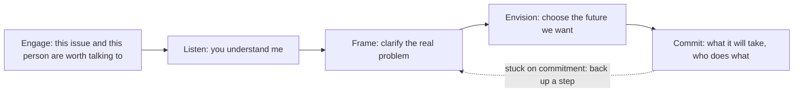

# 03. Trust and Advisory Relationships

How advisors earn trust, give advice that gets acted on, and win and keep clients by serving rather than selling.

> **Based on:** *The Trusted Advisor* by David H. Maister, Charles H. Green and Robert M. Galford (2000). [Bookshop](https://bookshop.org/book/9780743205443)

Core idea: technical expertise is necessary but not enough. Clients give access, information, loyalty and higher fees to people they trust, and trust is something you can manage and improve deliberately. Written for professional services (consulting, law, accounting), but it fits any freelancer or small studio.

## At a glance

| Framework | In one line | Use it when |
|---|---|---|
| Benefits of trust | Trusted advisors get consulted earlier, on harder issues, and paid without fuss | Making the case for investing in relationships |
| Four levels of relationship | Vendor, problem solver, valuable resource, trusted advisor | Seeing where you sit with a client |
| Trust equation | Trust = (Credibility + Reliability + Intimacy) / Self-orientation | Diagnosing why a client does not trust you |
| Five-step trust process | Engage, Listen, Frame, Envision, Commit | Running any advisory or sales conversation |
| Giving advice | Options, education, recommendation, then let them choose | A client asks "what should I do?" |
| Relationship rules | Go first, illustrate not tell, earn the right to advise | Opening and deepening a relationship |
| Mindsets | Other-focus, self-confidence, ego strength, curiosity, inclusive professionalism | Preparing yourself before a meeting |
| Client types | Adapt to motivation, personality and organisation | Dealing with a very different client |
| Trust-based selling | Do not pitch, start serving; sell is serve | Competing for work |
| Trust in teams | Trust is personal; relationship managers coach the team | Several people serve one client |
| Quick-impact list | Listen, empathise, name feelings, shared agenda, take a position | Needing immediate improvements |

## Why trust pays

- Clients who trust you: reach for your advice, act on it, involve you early and in strategic issues, share more information, pay without questioning, refer you, forgive mistakes, warn you of dangers, and give you the benefit of the doubt.
- Trust is mostly a **person-to-person** thing: "institutional trust" is people-trust in disguise. Brand gets you on a shortlist, a person keeps you there.
- Trust grows over time through accumulated experience. It is rational and emotional, two-way, personal, and always involves perceived risk. "Trust me" does not work: it must be earned and shown.
- Trust is cheaper. The authors say, from their own work with professional firms (and what other researchers found), that developing new-client business costs about 4 to 7 times as much as the same volume from an existing client. Treat it as their estimate, not a measured law. They link it to the trust equation: their illustrative new-client score (1.25) against an existing-client score (5) is a ratio of 4, and high-retention relationships are high-trust ones.

## Four levels of relationship

Two axes: **breadth of issues** and **depth of personal relationship**.

| Level | You are seen as | Typical scope |
|---|---|---|
| 1 | Vendor of a specific task | Narrow, technical |
| 2 | Problem solver with wider skills | Broader issues, called earlier |
| 3 | Valuable resource | Context and perspective, proactive advice |
| 4 | **Trusted advisor** | Business and personal issues; first call when something happens |

- Most daily work happens at levels 1 and 2; the skill is shifting up when needed.
- Needs-based and service-based relationships are fine at times; the missing type is the **trust-based** one (broad issues, deep personal relationship).
- The advisor can act as a mirror, sounding board, confessor and mentor.

## Trust equation

**Trust = (Credibility + Reliability + Intimacy) / Self-orientation**

| Component | About | What clients ask | How to raise it |
|---|---|---|---|
| Credibility | Words: believable and honest | "Does this person know and tell the truth?" | Do homework; say "I don't know" quickly; never exaggerate; avoid claims others could call lies; show passion |
| Reliability | Actions: promises kept | "Will they do what they say?" | Small commitments delivered on time; agendas and materials in advance; use client's style and terminology |
| Intimacy | Emotions: safe to discuss difficult topics | "Can I talk openly about this?" | Candour, courage, a face-saving "out", go first with a small risk |
| Self-orientation | Motives: whose interest comes first | "Are they in it for me or for themselves?" | Focus on the client; listen; do not rush to solve or look clever |

- Self-orientation is the **denominator**: lower it and trust rises sharply; it is the biggest single source of distrust.
- Credibility and reliability are what most professionals focus on (and what competitors have too). Intimacy and self-orientation differentiate.
- Credibility has a rational side (accuracy, believable) and an emotional side (completeness, honest). Most buyers decide emotionally.
- Intimacy here means emotional closeness about the issue at hand, not private life. It can be built quickly, and is the least time-dependent part.
- Lack of intimacy is the most common failure; the first move is yours.
- Signs of high self-orientation: finishing their sentences, filling silences, name-dropping, reciting qualifications, rushing to answers, having the last word.
- Behaviours that show low self-orientation: let silences be, open questions, defining the problem before guessing solutions, reflective listening, admitting ignorance, taking responsibility for failed communication.
- Worked example: a new client scores you C5, R3, I2, S8, so trust is 10/8 = 1.25. After a good relationship: C7, R8, I5, S4, so 20/4 = 5. The authors say these are their own guesses and invite you to substitute yours; use your own scoring to compare relationships.

## Five-step trust process

| Step | Client feels | Advisor language | Skill |
|---|---|---|---|
| 1. Engage | "There is an issue, and this person is worth talking to" | Interest and concern | Being credibly noticed |
| 2. Listen | "They understand me" | Understanding and empathy | Understanding a person |
| 3. Frame | "They helped me see my problem clearly" | Perspective and candour | Insight and emotional courage |
| 4. Envision | "I know what I really want" | Possibility | Collaboration, creativity |
| 5. Commit | "I know what it takes and I will do it" | Joint exploration | Generating (or tempering) enthusiasm |

- No one step is "the key"; all are needed.
- The most common mistake in the book: **rushing to action** (step 5 or a solution) before finishing the earlier steps. Reasons: focusing on yourself, thinking you sell only content, wanting something tangible, and seeking validation.

### 1. Engage
- Client must feel both that the issue matters and that you are the right person to discuss it.
- Come with something of value; just asking "what are your problems?" wastes their time.
- New clients: research them thoroughly, bring two or three topics (not questions), customise your approach, and don't be transactional. Talk to them like a new friend, not an old one.
- Existing clients: re-engage with competitive developments, an individual's career challenges, a specific managerial issue, or continuity ("I thought about what you said").
- Pick topic and timing: short on time, lead with the urgent; more time, start with the important.
- If you cannot add value, postpone the meeting.

### 2. Listen
- Listening earns the right to comment; rushing to answer reads as arrogance.
- Mistakes: listening only for the rational; listening passively.
- Acknowledge emotion as well as facts (an emotional message needs more than "mm-hmm").
- Let the speaker set the structure of their story; avoid "name your top three issues".
- Three layers: reflective ("what I hear is..."), supportive ("that must be tough"), listening for possibility ("what have you thought of doing?").
- **Shared agenda:** start meetings by proposing an agenda and asking what to add.
- Good listeners probe, listen for unvoiced emotion, summarise, ask "how do you feel about that?", hear their version first, and remove distractions. They do not interrupt, match with their own story, or solve too fast.

### 3. Frame
- Crystallise the client's issue into a problem statement that gives a fresh view; often more than halfway to the answer.
- **Rational framing:** distil to a few critical variables (a list, diagram, model).
- **Emotional framing:** surface the unspoken emotional or political issue. Use **naming and claiming**: acknowledge it is hard to raise, accept responsibility for raising it, state the issue directly.
- Example: an executive team agrees a standard but nobody wants to confront a top performer; the advisor names it and asks what it will really require.
- Hold a view as a trial balloon; stating a point of view stimulates thinking, even if wrong.

### 4. Envision
- Don't jump to solving. Ask: What are we really aiming for? What will it look like when we get there? How will we know?
- Sometimes expand their ambition; sometimes manage expectations down. The client may decide the problem is not worth the effort.

### 5. Commit
- Not "closing the sale"; making sure the client understands and will do what it takes.
- Cover: what will get in the way, what we do about it, who must be involved, who does what, what information is needed, when to check in, deadlines.
- Be candid about risks: promising "no problem" sounds arrogant or secretive.
- Play devil's advocate to test resolve.
- Clients commit for one of two reasons: they feel pain or energy around the topic, or something new and appealing has captivated them. The authors openly guess that pain or energy drives about 80% of commitments (their guess, not data), so ask whether you are offering pain relief or inspiration.
- Good commitment is **joint** (you take on part) and **personal** (it deepens the relationship).
- If commitment stalls, back up one or two steps; name fear or complacency.

## Handling a request for advice

- Being right is not enough: the job is to be **helpful**. Telling clients they are wrong needs earning the right.
- Advice is an emotional duet. Clients are anxious, dependent and fear blame.
- **Treat it like advising a parent:** respect, no patronising, make the idea theirs.
- Process: 1) give options, 2) educate them on each, 3) give a recommendation, 4) let them choose.
- If they ask you to choose: "If this were my business, I would do X."
- Words matter: turn assertions into questions ("What is most in need of improvement?" instead of "What are your problems?"); ask "Have I made myself clear?" not "Did you understand?"
- Be Socratic like a good teacher: learn where they are (point A) then lead step by step.
- Do not argue to prove you are right; do not take a rigid position early.
- Deal with client politics: speak to each decision participant before a group meeting, summarise decisions after.
- Fit style to the client; some say "just tell me".
- Know your limits: if the client chooses a path you cannot support, withdraw rather than force it.

## Relationship rules

1. Go first (give a favour to earn one).
2. Illustrate, don't tell (demonstrate rather than assert).
3. Listen for what is different, not familiar.
4. Be sure your advice is being sought.
5. Earn the right to offer advice.
6. Keep asking.
7. Say what you mean.
8. Ask for help when you need it.
9. Show interest in the person.
10. Use compliments, not flattery.
11. Show appreciation.
- One-off gimmicks only work as part of a pattern of genuine gestures.

## Mindsets

- Focus on the other person: you influence by finding what they want and helping them get it.
- Self-confidence, ego strength (no need for constant stroking), curiosity, inclusive professionalism.
- The key shift: from **technician** (content, done out of sight) to **advisor** (in-person, helping the client see things anew).
- Roots of self-focus are fear: of looking ignorant, of being wrong, of rejection.
- Credibility is helped, not hurt, by changing your position when the facts change.

## Client types

The authors warn against assuming all clients are alike, then give five guiding principles and nine archetypes (admittedly simplified).

### Five principles
1. **Prepare for what is different.** Compare the client with your best and worst past ones. Ask your main contact delicate questions beforehand: topics to avoid in a big forum, issues where colleagues are split, where resistance will come from, other initiatives that may collide. If a briefing was missed, own it rather than blaming the client.
2. **Read three things:** their prevailing motivation, personality, and how their organisation's state shapes their outlook (the same person can change after moving company or role). Then ask how to adapt your style.
3. **Motivation, in four flavours:** the need to excel, to act and get results, to analyse before deciding, or to drive consensus. Tailor the conversation to whichever ranks first.
4. **Find something to like.** If you can't find anything to like, the client probably isn't a good fit, and no style change will fix that.
5. **Use the trust equation.** Some clients treat credibility and reliability as entry factors and need to be led towards intimacy and low self-orientation; others signal comfort with those early. Adapting means matching style without faking: draw on the real part of you that suits the role.

Process preferences (which step a client leans on): some value being understood so much they let you move fast; articulate people want to reach real issues quickly; highly rational people lean on framing; emotional framing suits conflicted or frustrated moments, and is best done privately; analytical or creative types gain most from envisioning. Resist the pull of clients who want to jump to action steps.

### Nine difficult archetypes

| Client says (paraphrase) | What is behind it | How to respond |
|---|---|---|
| 1. "Just the facts, no selling" | A plea to be understood, sometimes masking fear of being wronged | Clarify and confirm in their language: "you want it direct, no padding; have I got that?" |
| 2. "I'll get back to you" | Cautious, afraid of being wrong, wants time | Anticipate: leave a one-page summary, make it easy to reply, legitimise the secrecy |
| 3. "You're the expert, what's the answer?" | Wanting to dominate (fear, resentment or a bad day) | Do not call the bluff; offer several hypotheses and ask to explore a little more |
| 4. "Let me handle the politics" | Doesn't trust you, or doesn't trust anyone; may be a job-security worry | Apply the trust process; if needed, name and claim in private; ask them to say more |
| 5. "Let's go through it again" (drafts, details) | Detail focus that masks a wish to control | Make the big picture feel controllable: offer split choices or a simple model to walk through |
| 6. "You don't understand our business" | Wants to feel special | Don't argue; accept the difference, ask them to teach you what matters |
| 7. "My enemy's enemy" (loves politics) | Seeks power in an area with less competition | Make politics a content issue: agenda, pros and cons, with the door closed |
| 8. "Just, you know, make it happen" | Weak verbal articulation, strong insight | Write up options for them to rank or rate; open questions will not work |
| 9. "Oh, by the way" (left out of things) | Either a personal issue or you are labelled as expert in one area only | Ask for a private meeting, assume labelling, drop "we're good at" language, engage them on non-core topics |

- Type 3 and Type 6 both rest on the same trap: arguing. Give value or curiosity back instead.
- Do not confuse these with the three cross-selling types below; the numbering is separate.

### Columbo approach
- Lieutenant Columbo (the TV detective) wins through style, not method: rumpled, apparently slow, praising the suspect, which wipes out the "expert versus dummy" gap that clients feel.
- Clients feel intimidated by expertise, by what is at stake, and by status symbols (degrees, uniforms, gadgets). Strip those down and ask for their view.
- The authors are explicit that you should not act incompetent; the point is to neutralise expectations and subordinate your ego to the client.
- The hard part is our own pride in credentials and the belief that our value is purely technical (nodding sagely, dropping knowledge). Their phrase: the enemy is us.

## Trust-based selling and getting hired

- Selling and serving converge: good selling is giving the client a taste of working with you.
- In a pitch, use the time as the first hours of the project rather than a canned presentation.
- Clients prefer to buy from a sample; sell confidence and ease.
- Point out opportunities and risks you notice: it is a professional duty, not pushing.
- Cautionary tale (a disguised consulting firm): four separate units for lead generation, closing, diagnostics and delivery, each with its own incentives. Nobody sold to existing clients or watched for follow-on needs, so retention stayed low. It worked only while new clients kept arriving; when demand fell, the firm declined. Specialising is fine if something links the roles.
- Sales and service converge: demonstrating you can help is serving, and helping a client well is the best selling. Their phrase for the stance: "contributing ideas" rather than selling.
- Reasons to give a sample: buyers of intangible services face financial, emotional, time, embarrassment and career risk; experiencing the work lowers them. Hoarding knowledge until paid costs you work and the relationship.
- A pitch can be treated as the first hours of the project (the authors' example is a three-hour slot).

### Cross-selling
- Hard because it looks like selling to people you know, yet involves strangers; trust is personal and does not transfer from the institution. Meeting the in-laws is their analogy: liked probably, assumed never.

| Type | Meaning | Who is new |
|---|---|---|
| 1. Expand | New service to an existing client person | Your colleague, the content expert |
| 2. Broaden | Existing service to a new person in the same client | The new client individual |
| 3. Diversify | New service to a new client person | A player on each side |

- **Type 1, "passing the business card":** handing over a card and asking the client to call your colleague draws down trust (a favour request with nothing in return). The authors rate the score as lower than a brand-new client. Fix: spend slightly more than usual time briefing the colleague first, and settle three things with them: the issue is real, you care about their interests too, and they are not being set up. Barriers on the colleague's side: less credit for another's client, a time sink, embarrassment if you promised too much or priced wrongly.
- **Type 2, "I just need an intro":** asking the happy client for an introduction puts them at risk with little upside. Put the existing client on the selling team and answer their "what is in it for me" honestly (better results from prior knowledge, a good outcome reflecting on them, their own issues handled with background, scale effects, political and relationship gains, insight into their own work). Belief matters more than wording: if you do not believe it benefits them, do not say it.
- **Type 3, "diversify":** the weakest trust of all, with several relationships live at once (you with the client, you with the colleague, colleague with client, client with the new person), and each other party doubts it (the expert thinks it may be a wild-goose chase, the client dislikes being caught in the middle, the new executive distrusts an unknown). Sequence it iteratively and internal first: talk to your expert, then gather more from your client, defining the problem as you go, repeat. Stop iterating when you can no longer think of a reason not to hold the full three- or four-person meeting. That meeting runs well only if everyone has invested time, the problem is understood, the expertise is real and known, interests are genuine, and everyone knows everyone.
- **Hidden relationship:** your own with the original client, who must accept that the expert is good, that you understand both businesses and the new service, and that the personal relationship survives. The issue is mostly your credibility, intimacy and self-orientation, not the expert's. You do not need to become the expert; you need enough to say the issue is worth their time. Vague assurances ("she's great") draw down trust.
- Use naming and claiming for the unspoken worries ("if I were you I'd worry about bringing someone new in"; admit you are not the expert; flag your apparent conflict). Use the trust equation as a checklist, and show intentions by spending your own time first.

## Building trust on the job and in teams

- On the assignment, raise perceived value through: understanding, sense of control, sense of progress, access, responsiveness, reliability, appreciation, importance, respect.
- Concrete: involve the client, give options, make reports reusable internally, send materials in advance, summarise meetings the same day, be reachable.
- Between jobs: keep investing (non-billable) in the relationship.
- **Teams:** trust is personal, so build many contacts. A relationship manager should manage, not hoard, the relationship: create chances for colleagues to meet client people, coach and credit the team, give them research and context, and ensure consistent standards.
- Junior people often see emerging needs first.
- Relationship managers who act as salespeople are less effective than those who strengthen the relationship.

## Pitfalls

- Rushing to solutions and action.
- Worrying about yourself, appearing clever, or being right.
- Overinvesting in credibility and reliability while ignoring intimacy.
- Leading with credentials, name-dropping, or reciting qualifications.
- Fear of taking a view or of speaking about the "unspeakable".
- Over-promising ("no problem") rather than honest about risks.
- Assuming trust transfers from institution or colleague.
- Believing it takes too long or is soft: the authors argue it is profitable.

## Quick-impact list

1. Listen and paraphrase until they say "that's exactly it".
2. Empathise (understand, don't necessarily agree).
3. Name what they are feeling.
4. Build a shared agenda.
5. Take a point of view ("let me float a trial balloon").
6. Take a small personal risk.
7. Ask about a related area.
8. Ask open questions.
9. Give away ideas.
10. Return calls fast.
11. Calm your mind before meetings; keep the focus on the client.
- Also: make and keep small commitments; never lie or shade the truth.

## Recall

**Q: What is the trust equation and which term matters most?**

??? note "Answer"
    Trust = (Credibility + Reliability + Intimacy) / Self-orientation. Self-orientation is the denominator, so reducing it lifts trust the most; intimacy and low self-orientation are the real differentiators since credibility and reliability are common.

**Q: What are the five steps of the trust process?**

??? note "Answer"
    Engage, Listen, Frame, Envision, Commit. The common failure is jumping to action before finishing the earlier steps.

**Q: How should you answer when a client asks what to do?**

??? note "Answer"
    Give options, educate them on each, give a recommendation, then let them choose. If pressed, say what you would do if it were your money. Ask questions and keep the decision theirs.

**Q: What is naming and claiming?**

??? note "Answer"
    Raising an unspoken emotional or political issue by acknowledging it is hard to raise, taking responsibility for raising it, and stating it directly.

**Q: Why is trust hard to transfer between colleagues?**

??? note "Answer"
    Trust is personal, not institutional. A colleague has to earn their own trust; the existing advisor can help by preparing the colleague and having the client take part in the introduction.

## Links

- [[1. Consultative Selling|Consultative Selling]]: the questioning method that sits inside the Listen, Frame and Envision steps.
- [[2. Tactical Negotiation|Tactical Negotiation]]: empathy and labelling for tense moments.
- [[1. Value-Based Pricing|Value-Based Pricing]]: trust shifts the conversation from price to value.
- [[1. Positioning|Positioning]]: how you want to be noticed in the Engage step.
