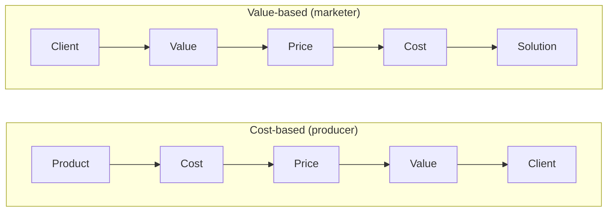
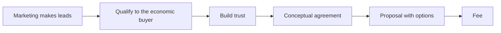

# 01. Value-Based Pricing

Why to price on the client's outcome instead of hours or costs, how to find the value with the buyer, and how to talk about it. Packaging the price into options and proposals is in [[2. Packaging and Proposals|Packaging and Proposals]].

> **Based on:** *Value-Based Fees: How to Charge What You're Worth and Get What You Charge* (3rd ed.) by Alan Weiss (2021). [Bookshop](https://bookshop.org/book/9781119776925)
> **Based on:** *Pricing Creativity: A Guide to Profit Beyond the Billable Hour* by Blair Enns (2018). Not verified on Bookshop (ISBN 9781605440538).

Both books are written for people who sell advice or creative work (consultants, design and marketing firms). The ideas carry to any service business where each job is different. Weiss = **W**, Enns = **E** below.

## At a glance

| Framework | In one line | Use it when |
|---|---|---|
| Three ways to price (E) | Inputs (time), outputs (deliverables), or value (client's future state); same job, three prices | Deciding what you are actually selling |
| Cost-based vs value-based chain (E) | Cost-based: product > cost > price > value > client. Value-based reverses it | A price feels "wrong" because you started from hours |
| Time-billing critique (W) | Hours cap income, create a conflict of interest and make you a vendor | Someone asks for an hourly rate |
| Subjective value and fairness (E) | Value and fairness are in the buyer's head; price the client, not the job | Tempted to charge everyone the same |
| Commitment, not compliance (W) | Big fees need a buyer emotionally invested, not one who just goes along | A "yes" came too easily |
| Conceptual agreement (W) | Objectives + measures + value agreed with the economic buyer before any fee | Before every proposal |
| Four-step value conversation (E) | Commit to future state, set metrics, put a value on success, give pricing guidance | The meeting where money first comes up |
| Why me, why now, why this way (W) | Your own uniqueness is a second input to the fee | Sizing your premium |
| Good-deal equation (W) | Raise the benefits side, never lower the fee side | Buyer wants a "better deal" |
| Four resistance points (W) | No trust, no need, no urgency, no money; money is usually the cover | Hearing "no budget" |
| Anchoring (E) | Say the high number first; it drags the final price up | Presenting any price or range |
| Fair-ROI yardsticks (W, E) | Weiss: aim around 10-20x on first-year value; Enns: start from a share of value, then discount for risk | Turning a stated value into a number |
| Price buyers, value buyers, poker players (E) | Know who is bluffing about price | Hard negotiators |
| Conversion and progression (W, E) | Move existing clients carefully, new clients straight to value | Leaving hourly billing |

## What are you selling: inputs, outputs or value

Enns's worked example: a design firm is asked to build a loyalty app for a restaurant chain.

| Basis | What the firm sells | Price | Who carries the risk |
|---|---|---|---|
| Inputs (time and materials) | Hours and costs | about $75k | Client (final bill may rise) |
| Outputs (fixed price for the deliverable) | Finished app plus price certainty | about $90k | Firm (it padded for risk) |
| Value | Client's future state: loyal customers, about $1m extra profit per year | $200k | Shared; priced on the outcome |

- Same work, a price range of more than 2x. The value price was one fifth of one year's projected profit.
- Enns on the market evidence: firms stuck at the efficient end of time-selling get a ceiling on profit; the high earners (AGI per full-time employee well above the efficient band, he gives roughly $250k+ as of 2017) almost all price on value.
- Enns on the maths of "efficiency": utilisation 60%, payroll under 45% of adjusted gross income, profit 20% (the 60/45/20 rule). Useful, but it caps you; going beyond means selling value.
- W makes the same point more bluntly: a time unit puts a ceiling on income however good you are, and a faster, better result earns you less.

### Cost-based vs value-based chain

- E borrows the picture from Nagle and Holden: cost-plus feels prudent but "guides you to mediocrity".
- Value chain in practice: find the client's value, set the price, only then decide the most you can spend (E's example: price x 0.6), then design what you will do.
- E: you can run a culture of efficiency or a culture of innovation, not both. Producers chase scale and cost cuts and take whatever price the market gives; marketers create something new and set the price. Pick which you are.

## Why hourly and cost-plus are poor (Weiss)

- **Conflict of interest.** Paid by time: slow is richer than fast, scope creep is welcome, extra tasks are padded in. The client pays most when you are least efficient.
- **Client has to re-decide the investment every time** they want a quick question answered, so they use you less.
- **You become a vendor.** Purchasing and accounts payable have rules and rate caps for vendors, and their job is to push your rate down. You end up pitting your buyer against their own purchasing office.
- **Budget gets squeezed.** Unforeseen needs mean either more money or unfinished work.
- **Buyer pushes both levers.** Fewer hours and a lower rate, so you shrink the work and the rate and look padded when you concede.
- **The rate formula is fiction.** Needs / hours / usage gives a rate unrelated to what the client gains; the "available hours" always shrink; being 80% booked removes your freedom.
- **Supply and demand does not apply.** You can serve many clients at once and the hour is not the unit of value.
- W goes as far as calling time billing unethical; treat that as his stance. The practical point: it caps income, rewards slowness and makes you comparable on the one number you do not want compared.
- Weiss: remote or short work is not worth less. Value does not shrink because you were not in the room.
- E adds: "retainer-for-everyone" and productised price lists drift into cost-based pricing (see [[2. Packaging and Proposals|Packaging and Proposals]]).

## Value is subjective, so price the client

- E: the labour theory of value (worth = effort to make) was replaced by the subjective theory (worth = what the buyer feels). Even B2B, not everyone on the buying team values it the same; personal career risk, prestige and relief all enter.
- E's risk point: a large premium mostly pays for risk removed. A magnifier of economic value, not an add-on.
- **Price discrimination = willingness to pay.** Same logo for a local dealer and a multinational should not cost the same, because the value differs by orders of magnitude.
- W agrees: "if value differs, fees can differ". His example: the same coaching method for a call-centre manager and a VP of sales with a $24m goal. Same method, very different outcomes, so very different fees. Hourly billing would charge the same.
- **Fairness is a feeling**, held by the buyer, not you. You cannot decide what is fair for them (E: do not mix up egalitarianism with fairness).
- Target the "double thank-you": buyer says "great value", you say "well paid" (W: the "good deal", both sides).
- Rules of thumb:
  - Never answer "what do you charge for X?" without "for which client?" (E, Rule 1).
  - Price high-value work so that your margin is big; then the exact number matters less (W).
  - W: you are under no duty to pick your lowest acceptable number. If they are delighted, $140k vs $125k is irrelevant.

## Commitment vs compliance (Weiss)

| | Low fee | High fee |
|---|---|---|
| **High buyer commitment** | Wasted opportunity | The target |
| **Low commitment (just complying)** | Indifferent sale | You get shown the door |

- W's estimate: most consultants sit in "high commitment, low fee" far less than they think; they undercharge and over-deliver.
- A compliant buyer says yes to the expert, then blames you for everything. Commitment comes from the relationship stage, well before fees.
- W's acquisition sequence: **shared values > relationship > conceptual agreement > proposal**. Fees are not even on the chart.
- Shared success lowers fee pressure: buyer is a partner (return-on-investment thinking) not a vendor-purchaser (cost thinking). Write joint accountabilities into the proposal and let the buyer take the credit.
- Brand shortcuts this: a name that arrives before you reduces price pushback (W: "a brand is how people think of you when you're not around"). See [[1. Positioning|Positioning]].

## The economic buyer and conceptual agreement

- **Economic buyer (W):** the person who can write the cheque and whose operation is affected. You cannot make the sale with anyone else; gatekeepers, HR, purchasing and "feasibility buyers" only compare prices.
- E says the same in other words: you want **senior decision makers who are charged with creating future value**. Employees remember the past, managers handle the present, executives own the future; budget objections lower down often do not exist higher up.
- **Conceptual agreement (W)** = agreement with the economic buyer on three things before any fee:
  - **Objectives**: business outcomes, not tasks.
  - **Measures**: objective (turnover, margin) or agreed subjective evidence.
  - **Value**: what the improvement is worth to them, in their own numbers.
- Rule of thumb from W: for every objective get at least three value statements, and half of them in money. With conceptual agreement done his proposals close more than 80% of the time (his claim).
- W's example (new-hire turnover): turnover cost salary and benefits of $545k a year, lost productivity of $2.6m a year, failure work of $350k; roughly $3.5m a year spent on a poor hiring process. Fee scale follows from that.
- Subjective measures are fine if the buyer judges them and you agree on observable evidence and a time frame (his CEO-teamwork example: fewer meetings, fewer escalations, fewer duplicate customer complaints).
- Do not peg yourself to a "magic number". Commit to direction ("maximise", "toward the industry average"). If pushed for a number, ask for a conservative figure and halve it.
- Inputs vs outputs: rewrite every task as the result it produces. "Focus groups" becomes "find why top sales staff leave". Do not lead with deliverables or hours.
- Ask "why?" until the want turns into a need ("two-day retreat" becomes "stop losing top talent").
- Buyers know what they want; few know what they need. The gap between the two (W: "value distance") is where your value is.

## The value conversation (Enns)

E: the sale is four conversations. Each has one objective, and you keep the "expert practitioner" position throughout.

| Conversation | Objective |
|---|---|
| Probative | Prove expertise so you are seen as the expert, not a vendor ("the Flip") |
| Qualifying | Vet the lead: future state, timing, authority, budget, next step |
| Value | Find the value you can create and the share you can command |
| Closing | Move from sale to engagement by facilitating the choice |

Three conditions make the value conversation easy: the client sees you as an expert, you know their desired future state, and decision makers are in the room.

**The three-year question** (Dan Sullivan, via E): "It's three years from today, we're having coffee, you are really happy with your progress. What happened?" Brings out personal wants as well as business needs. Keep the wording; E warns that changing it weakens it.

**Four steps:**

1. **Commit the client to the desired future state.** Read it back; ask "is that right, did I miss anything?" Do not mention your own solutions yet.
2. **Set metrics of success.** For each want, "how will we know?"
3. **Agree the value of success.** "What is that worth?" Do the arithmetic aloud with their numbers. Do not force every non-economic want into money.
4. **Offer pricing guidance.** Tell them the range of options to come, high end first. This stops surprises and tests willingness to pay.

- Solutions are deliberately left out until after the price is set.
- Always book the closing meeting, with all decision makers, before you leave.
- E rates this like W rates his chapter: the value conversation is "if you only read one chapter". Both books point to the other.

### How the two authors line up

| Topic | Weiss | Enns |
|---|---|---|
| Core idea | Conceptual agreement: objectives, measures, value | Value conversation: future state, metrics, value, guidance |
| Who you talk to | Economic buyer only | Senior decision makers |
| When to state price | Hold fees until after conceptual agreement; quote with the proposal | Say a price (range) orally at the end of the value conversation, before writing the proposal |
| Budget question | Ask after conceptual agreement, before the proposal | Learn it as the low end of the range in step 4 |
| How you derive the number | Work back from value; start near 20x return | Work back from value; anchor against guaranteed value, then discount for uncertainty |
| Rounding | Avoid obviously round, but not absurdly exact | Strategic prices end in three zeros; any precise formula invites haggling |
| Options | 3 or more "choice of yeses" | Always 3 (or 4) |
| Hours | Unethical to bill; never use time as the basis | Don't track or sell time if possible; may sell a block of time for the lowest option |
| Discounting | Reduce value first; a courtesy discount for payment up front; rebates for phases | Never discount to win; discounts only for loyal clients, documented |
| Retainer | Pay for access, advance, 90 days | Fine for access or capacity, wrong if budget divided by 12 |
| Tone | Confident, blunt, "capitalism" | Behavioural-economics flavoured; "double thank-you" |

- They agree on far more than they differ: start from the client's outcome, quantify it with the buyer, price on share of value, offer options, never reveal a formula.
- Notable disagreements: when to quote (W later, E earlier but only as a range), rounding, and whether time can ever be sold.
- Enns cites Weiss on the starting point: a fifth of the value (5:1). Weiss's own worked formula in the book is stricter: 20:1 on first-year value (fee is 5% of it) is the conservative starting point, with 10:1 "just fine" and 5:1 still "a great investment". These do not match; treat both as starting yardsticks, not rules, and check against your own buyer's reaction.
- E also mentions large consulting firms charging half of the first year's savings on cost projects.

## Your uniqueness: why me, why now, why this way (Weiss)

Answer before pricing; a second driver beside the buyer's value.

- **Why me?** Few alternatives raise value: author of the book, referral, past work for them, reputation, available now.
- **Why now?** Cost of doing nothing, closing window, a boss pushing, year-end funds that vanish.
- **Why this manner?** Why not in-house, what failed before, who else is involved. If it has not happened in about 30 days internally, it probably will not.
- Buyers who come to you carry more urgency than buyers you chase.
- Test (W): write five strengths, how you transfer them (workshop, coaching), and the results. Most people charge for the first two columns and not for results.
- Make sure the buyer knows your full range, not just one specialty. Narrow labels limit what they think to buy.

### The "good deal" equation (Weiss)

- Buyer's good deal = benefits over investment. Do not try to shrink the divisor (price); grow the numerator.
- Benefit drivers beyond the headline result: duration (benefit annual and recurring, fee one-off), skills transfer, leading-edge status, taking control, responsiveness, referral trust, speed, access to a known expert, documentation, guarantees, remote working, someone to take the hard decision.
- Fees are never on the list. Discount-driven deals do not help you.

## Buyer types and price signals

| Type | Signals | Handling (E) |
|---|---|---|
| Price buyer | Always picks the cheapest; sees you as a vendor; finds future-state questions a waste | Offer a stripped-down low option; or decline |
| Value buyer | Does some return maths | Normal value conversation |
| Poker player | Hard on price but really buys value | Don't fold; show what they give up at the low price; they pick the middle |

- Weiss: if most prospects ask for a deal, you are giving off "deal vibes" (accepting rescheduling, delegating you down, giving free advice in the sale).
- Weiss on the four resistance points (his source: Larry Wilson):
  - **I don't trust you**: build trust with the economic buyer first.
  - **I don't need you**: show need, or raise the bar; do not push methods.
  - **I feel no urgency**: create it (competitor moves, window closing, the cost of doing nothing).
  - **I have no money**: usually the excuse for one of the first three. "Money is a priority, not a resource": it gets reallocated.
- E agrees: if you cannot win the Flip, expect to be told your rate and terms. Many "no budget" objections vanish when the CEO is in the room.
- E: procurement often arrives after the choice is made; see [[2. Tactical Negotiation|Tactical Negotiation]] and the negotiation section in [[2. Packaging and Proposals|Packaging and Proposals]].

## Anchoring and framing the price

- **Anchor** = first number heard; later judgments adjust from it and rarely adjust enough. E uses Kahneman and Tversky's wheel study and his own seminar test (an anchor question about a $500 hourly rate lifted guesses by 38%).
- "He who speaks first loses" is wrong for price. Setting the first, high number wins the range. Cancelling an anchor needs the buyer to reject it and ask you to restart.
- The high option's job is not to be bought but to make the next one look reasonable (E's Prada $500 T-shirt that sells the $275 one; SaaS top tiers).
- Use it in conversation too: lead with your biggest past engagement. Present options from high to low even if laid out low to high.
- Quick anchor: "what would we do and charge if money were no object?" (E).
- Signs to calibrate: if buyers choose your top option 20% or more, you underprice; if they always take the bottom, the gap is too big (E).
- Weiss gets a similar lift another way: put two options inside the stated budget and one above it. A buyer who can find $175k can find $225k if the value is there. Never be bound by a budget, bring more value.
- **Frame as return, not cost.** W's line: your fee is "my contribution to the value, a dramatic return for you and equitable pay for me". Use comparisons the buyer already accepts (see below).
- **Practice saying the number** aloud without flinching; W and E both put heavy weight on your own confidence (E: pricing performance = motivation x ability x self-esteem).
- **Do not justify the price** line by line. E: a formula invites arithmetic; "that's what we charge companies like yours". If challenged on "companies like ours", answer that the price reflects the value to you.

## Selling and pricing are one job

- E: in consultative sales "pricing success cannot be uncoupled from sales success". If you are a vendor, expect vendor prices.
- W: an early price is a lower price; a later set of fees, quoted at the right moment, gets bought upward.
- Both keep early price talk in service of the client's outcome; see [[1. Consultative Selling|Consultative Selling]] for question technique and [[3. Trust and Advisory Relationships|Trust and Advisory Relationships]] for the relationship that makes this possible.
- W's tests for not discussing fees yet: have you met the economic buyer, formed trust, cleared the four resistance points, agreed objectives, measures and value, and agreed to a written proposal with options?
- If asked "how much?" too early (W): "I don't know yet, I don't know what you need; let's talk about your situation, then I'll give options within 24 hours." (E gives the same line a different answer: say the range once you know the value.)

## Dealing with discounts (principles)

| Move | Source |
|---|---|
| Never cut a fee without cutting value | W, E |
| Ask for something back (referrals, quicker payment, more work, client does part) | W |
| Courtesy discount for payment on acceptance (around 10%) | W |
| Rebate part of phase 1 if phase 2 is bought (keep it at or below 25%) | W |
| Don't discount to win the first job; the low price becomes your baseline | E |
| Reserve discounts for loyal clients; show the full price, then the discount, on the estimate and invoice | E |
| Ask the client to name the discount instead of guessing | E |
| Give the full thank-you reply so reciprocity is planted ("I know you would do the same for me") | E |
| Better than discounting: terms, take out value, guarantee, longer commitment, walk away | E |

- W: when the buyer says "lower and we have a deal", agree only with a quid pro quo; otherwise they ask "how low will he go?"
- W: do not offer lower fees for volume or multiple jobs on your own initiative.
- E: a discount that is not documented becomes the new price.
- Handling "that's more than we planned" (W's "smack to the head" comparisons): contrast with what they already waste: warranty on copiers, one lost customer a week, cost of a bad hire, cost of the last failed launch, cost of an employee leaving, what the board would say about leaving the problem. Prepare a few before you need them.
- Full detail on terms and on bargaining against procurement is in [[2. Packaging and Proposals|Packaging and Proposals]].

## Moving to value pricing

**Existing clients (W):**
- Triage: score clients (potential, senior buyer, accepts fees, would you hate to lose them...) on a 10-question test; convert only the high scorers.
- Do not just announce it. Offer new value that justifies a new basis: unlimited access, new services, wider scope, combined buyers, membership extras. Offer, never remove, the old option.
- Use trigger moments: a great year, a bad year, a new buyer, an acquisition, a new initiative, travel-heavy work.
- Find new buyers inside the same client and treat them as new clients with no hourly history.
- Resist: remind quarterly, appeal to fairness against the value created, propose a minimum-days halfway house, revisit later.
- Drop about the bottom 15% of clients every 18 months to two years; you cannot grow carrying low-fee baggage. Pass them to someone else cleanly, no referral fee.

**Existing clients (E):**
- Treat new and old differently: reinvent one new client at a time.
- Value-price the strategy phase first (diagnose and prescribe), then concepts and first application; leave repeat implementation as time or units if the market forces it, and use cheap tactical pricing to lift the strategic premium.
- Stop tracking time only for those who sell strategy; or replace timesheets with firm-wide profit or AGI per full-time employee. You lose the right to ask for more when you misscope, so price that risk in (his car-dealer lesson: friends and family messy accounts need a surcharge).

**Fee progression (W):** entry level > going concern > word of mouth > brand > "ultimate consultant"; at the first stages low fees set a baseline you spend years to undo; the danger is complacency at word-of-mouth. Raise fees roughly every two years, above inflation. Low fees "to get in the door" make you a guest at that fee.

**Capacity (E):** a customised firm can really handle only about 10-12 live client relationships. Treat it like airline seats: grow by raising average engagement size and churn out the smallest, not by adding clients. Minimum level of engagement is about 10% of annual income target (a $1m firm: roughly $100k); use ranges as guidance, not a published price list.

## Mental barriers (Enns, with Weiss)

- Low self-esteem (the "last obstacle is you"): evidence of lacking belief includes discounting, bending terms, free advice before an engagement, letting the client define the problem.
- Dysfunctional ideas about money (fear, hoarding), sticking to the labour theory of value ("how can that be the price when it took you two days?"), mixing egalitarianism with fairness, scarcity mindset.
- Weiss's version: "the first sale is always to yourself"; an abundance mindset; confidence that fees are a fair exchange.
- E (via David Baker): confidence comes from deeply held beliefs and from having other options, such as a healthy pipeline of prospects.

## Common mistakes

- Price from costs or hours and call it value.
- Discuss fees before objectives and value are agreed with a real buyer.
- Show only one price (see packaging note).
- Publish a price list for a customised service. A range or minimum level of engagement is fine (E).
- Accept gatekeeper or procurement negotiation as the real decision (W: go back to the buyer).
- Quote precise formula-looking numbers.
- Tie the fee to a magic result number.
- Defend your price with effort ("it took many hours").
- Cut price to win the first job.
- Treat all objections as fee problems.

## Recall

**Q: What are the three ways to price a job and which does each author favour?**

??? note "Answer"
    Inputs (time and materials), outputs (deliverables with a fixed price) and value (the client's desired outcome). Both books favour value, pricing back from the outcome. E's example: about $75k, $90k, $200k for the same app. W goes further and calls time billing a conflict of interest.

**Q: What is Weiss's conceptual agreement and who must it be with?**

??? note "Answer"
    Agreement with the economic buyer (the person who can sign the cheque and whose operation changes) on objectives (business outcomes), measures of progress and the value of the improvement, before any fee. Aim for three value statements per objective, half of them in money.

**Q: Name Enns's four steps of the value conversation.**

??? note "Answer"
    Commit the client to their desired future state (use the three-year question), set metrics of success, agree the value of success, then give pricing guidance as a range, high end first. Solutions come only afterwards.

**Q: How do the authors differ on when to name a price?**

??? note "Answer"
    Weiss keeps fees back until conceptual agreement and quotes in the proposal with options, asking about budget only after conceptual agreement. Enns wants a spoken price range at the end of the value conversation, before any proposal is written, so objections arrive early.

**Q: What should you do instead of cutting a fee?**

??? note "Answer"
    Take out value for the lower price, get something in return (up-front payment, referrals, a larger commitment), adjust terms, offer a guarantee on a first phase, or walk away. Weiss: never reduce the fee without reducing value. Enns: never discount to win business.

## Links

- [[2. Packaging and Proposals|Packaging and Proposals]]: options, proposals, retainers, terms and negotiation
- [[1. Positioning|Positioning]]: brand and expert position that make premium prices stick
- [[2. Tactical Negotiation|Tactical Negotiation]]: negotiating price with procurement and hard buyers
- [[3. Trust and Advisory Relationships|Trust and Advisory Relationships]]: the relationship basis for access-based fees
- [[1. Consultative Selling|Consultative Selling]]: questioning to uncover need and value
- [[2. Customer Conversations|Customer Conversations]]: listening for what buyers really want
- [[4. Building a Business That Sells|Building a Business That Sells]]: productised vs customised services
