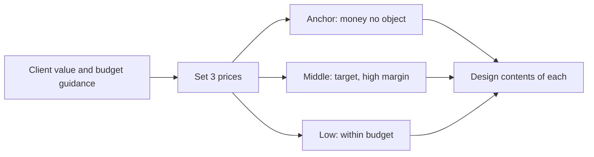

# 02. Packaging and Proposals

How to turn a value-based price into options, a proposal, retainer or terms, and how to hold the price in negotiation. The reasoning behind the number is in [[1. Value-Based Pricing|Value-Based Pricing]].

> **Based on:** *Value-Based Fees: How to Charge What You're Worth and Get What You Charge* (3rd ed.) by Alan Weiss (2021). [Bookshop](https://bookshop.org/book/9781119776925)
> **Based on:** *Pricing Creativity: A Guide to Profit Beyond the Billable Hour* by Blair Enns (2018). Not verified on Bookshop (ISBN 9781605440538).

Weiss = **W**, Enns = **E**. Where neither book covers a point it is marked as gap material.

## At a glance

| Framework | In one line | Use it when |
|---|---|---|
| Choice of yeses (W) | Several options of rising value, fees stated separately; "which?" not "whether?" | Writing any proposal |
| Rule 2 and 3: options and anchor (E) | Always 3 (or 4) options, the top one priced to anchor, the middle one the one you want | Designing the columns |
| Low / middle / high option design (E) | Low for price buyers, middle with the margin, high as anchor | Filling the three columns |
| Home Depot option (E) | "You can do it, we can help" as the middle option between a diagnostic and full delivery | Client has an in-house team |
| Selling risk reduction (E) | A premium is insurance against risk; let the client choose their risk | Explaining why option 3 costs more |
| Proposal as confirmation (W) | Proposal confirms what is already agreed; it does not explore or negotiate | Before writing, check agreement exists |
| One-page proposal and four-step order (E) | Spoken options + one page, then agreement in principle, then contract | Closing |
| Paid diagnostic (E) | Charge for discovery when you cannot scope without it | Complex, unclear scope |
| Retainer as access (W) | Pay for availability, in advance, 90 days, scope and people defined | Advisory relationships |
| Retainer cautions (E) | One side ends unhappy; do not divide the budget by 12 | Offered a retainer |
| Terms as a lever (W, E) | Payment in advance, deposits, instalments close deals and protect cash | Affordability or cash-flow worry |
| Policy and price authority (E) | Take pricing off the front line; invoke policy | Negotiation under pressure |
| Alternatives to cutting price (E) | Believe, terms, take out value, guarantee, trade for commitment, walk away | "Too expensive" |

## Options: the "choice of yeses" (Weiss) and Rule 2 (Enns)

**Why options.** Without them the buyer faces yes or no. With them the question becomes which one.

- W: options move you to an "assumptive close" and fees move upward; he claims at least +50% acceptance. Offering options makes the buyer a collaborator ("how should I use you?").
- E: people cannot judge absolute value, only comparisons. Control the comparison or the buyer goes away to build one (competitors, last price, other uses of the money). Even a value-based price needs options.
- E: extremeness aversion means buyers drift to the middle, so a third, higher option lifts the middle one's sales. Three is better than two; four works; beyond that choice paralysis is a risk (E calls the evidence contested).
- E: the classic case is a breadmaker line where adding a far dearer model made the existing one sell much better.

**W's ten guidelines (summarised):**

1. Talk about options in the value discussion but attach no fees until the proposal.
2. Unbundle. Do not stuff everything into one take-it-or-leave-it package.
3. Keep clear price gaps; each step is a meaningfully larger fee.
4. Each step must add real value (new insight, new scope), not more of the same hours or more focus groups.
5. Some options include earlier ones (1 < 2 < 3); add-ons can stand alone.
6. List them formally under a heading such as "Methodology and Options".
7. List fees separately under "Terms and Conditions" so the buyer picks value before seeing price.
8. If a buyer likes 3 but has budget for 2, take 2; no haggle.
9. If they ask for a lower fee on an option: "fine, which value do you want removed?"
10. Keep it simple and be ready to show the difference between steps.

**W's worked example (staff feedback study):**

| Option | What it adds | Fee |
|---|---|---|
| 1 | Focus groups with about 15% of staff | $45k |
| 2 | Adds confidential one-to-one interviews with about 5% | $65k |
| 3 | Adds an all-staff survey | $95k |
| 4 | Benchmark comparison with other organisations (add-on) | +$35k |
| 5 | Workshops for managers on acting on results (add-on) | +$45k |

- Two options inside the stated budget and one above it; a buyer who can find the budget can find the extra.
- Never decide "this or nothing"; ask them to choose a version.

**E's pricing of the three:**

- Option 1: inside the client's stated budget or expectation.
- Option 2: the high-margin option you want sold; usually priced above the budget, maybe still within range.
- Option 3 (anchor): deliberately very high; its job is to make option 2 look sane. It is not required to be in budget and, per the research E cites, there is no backlash for pricing it high.
- Lay out low to high on the page but walk the client through starting from the anchor.
- If your anchor sells 20% of the time, you are too low; if everyone takes option 1, the gap to option 2 is too large.
- Pick the price first, then design what is in each option ("prices before solutions").

## Designing the three columns (Enns)

### Value menu to draw from

E's lesson from airlines and mobile phone bills: you sell many kinds of value, not just the core service. Bundle them into columns; do not offer à la carte (it invites line-by-line comparison and downward pressure).

- Core craft quality, speed, prestige, reserved capacity, research, prototyping, testing, project management, reporting, senior access, out-of-hours access, presentations, knowledge transfer, oversight of the client's team, standards guides, supplier network access, price certainty, financial terms, guarantees.
- Some clients value some of these hugely and others not at all; that is the point of options.

### Low-priced option

- Often follows the client's stated budget; for price buyers and poker players.
- Strip everything but the core: junior staff, a block of hours, no senior access, no reporting, all payment up front, no price certainty. This is the one place E allows cost-based, time-block pricing, usually to sell spare junior capacity.
- Make sure the higher columns show what is given up so a price buyer sees the trade.
- Do not use it unless you are happy to deliver it profitably and without annoyance.

### Middle option: the margin

- Where you want the sale. Ideas for filling it:
  - **Home Depot option.** Low = diagnostic ("we'll tell you what to do"). High = we do everything. Middle = "you can do it, we can help": you supply strategy and concepts, their team executes. E's example: a small firm charged $175k for a three-day workshop, against an implementation anchor of about $5m, which made the workshop look cheap and was almost all profit.
  - **Knowledge transfer** (training, shadowing, workshops; may tap a separate training budget).
  - **Oversight and quality control**, such as creative direction of the client's work.
  - **Access to principals** (E priced his own open access at no less than $5k a month).
  - **Standards** documents and **reporting** (daily calls, weekly meetings, monthly reports).

### High-priced option (anchor)

- Ask: what would we do, and charge, if money were no object? Price it even if you think it is four times their budget.
- Start from the guaranteed-value price from the value conversation, then discount for uncertainty.
- Contingency or performance pay: legitimate as one option, but E is cautious: most sellers who take all the risk for an all-or-nothing payoff get nothing. His analogy is a portfolio: balance a few high-risk, high-reward clients with low-risk ones. W is firmly against percentage-of-result fees (see below).

### Risk as the price of the premium (E, "Sell Risk Reduction")

- Premium has two meanings and they are the same thing: price above benchmark, and insurance cost. The more risk you remove, the higher the price.
- The top (guaranteed) option = lowest risk for the client, highest for you. The bottom (time or capacity) option = all risk on them.
- Say the risk aloud: "this one is low-risk at $100k, this one fits your $40k but you carry the risk, this one shares it at $65k."
- Do not impose your own risk appetite (E's mechanic who skipped a part to "save money").

## Proposals

### Weiss: proposal as confirmation

- Don't submit until you have conceptual agreement (objectives, measures, value) with the economic buyer. A proposal written before that becomes a negotiating document.
- Use plain language; no boilerplate or hold-harmless clauses (they send it to legal, which can unpick the fee).
- Include joint accountabilities and an explicit statement of what you expect from the client.
- Use him as a pointer for detail: *Million Dollar Proposals* (W's own other book).
- Practical clauses he uses:
  - Acceptance window (for example 30 days) after which a new proposal is needed.
  - First payment counts as acceptance in place of a signature (learned when a buyer paid without signing because his authority limit prevented it).
  - For the buyer's use only; add a copyright notice if you suspect it will be shown to competitors.
  - Non-cancellable for any reason; client may reschedule within a stated window; forfeiture after a stated period (he suggests about six months' warning in a year-long window).
  - Expenses extra, stated aloud and in writing; billed monthly, due on receipt.
  - "Plus expenses" unless an all-in fee is deliberate.
  - Add a premium when you personally do all the work; subcontractors, if needed, cost extra.
  - Scope change gets a new proposal with new objectives and fees (reply to creep with "I'll send a new proposal").
- Do not print fees in brochures, web pages or testimonials.
- Go back to the buyer if purchasing or accounts payable want to renegotiate; do not argue with support functions.

### Enns: one page, three columns

- E's order of events:
  1. Options with prices spoken in the closing meeting, supported by one page.
  2. Agreement in principle on option and start date.
  3. Contract with terms and conditions.
  4. Signed contract and cheque or purchase order.
- Do not mail an unattended proposal ("as a matter of policy"); ask to present it live with all decision makers.
- Leave out firm history, sales copy, free diagnostic findings, long terms and signatures. Resist the PowerPoint pack.
- Closing is facilitation, not persuasion: recap future state, metrics and value; walk options from high to low with the trade-offs; then ask which suits.
- **Unpaid vs paid proposals:** if you can price with only what the sale already gave you, the proposal is free. If you need discovery work (audits, interviews, research) to scope it, sell a paid diagnostic as phase 1 and present options after the findings.
  - Don't present options for the diagnostic itself; propose the right one.
  - Keep the diagnostic report short; a long report erodes profit and sends the client away to read it rather than deciding.
  - Treat the findings meeting as a closing meeting.

### Presenting price: what each recommends

| Point | Weiss | Enns |
|---|---|---|
| Where the price appears | Separate section "Terms and Conditions" | At the foot of each option column on the one page |
| Prior knowledge of price | Budget asked after conceptual agreement, proposal after | Range already spoken in value conversation |
| Number shape | Not round-looking, not absurdly exact | Round, ending in three zeros for strategic work |
| Justification | Value and return; no hours breakdown | None: "that's what we charge for work like this" |
| Length | Normal proposal, plain language | One page |
| Delivery | 24-48 hours after agreement, with the buyer; payment on acceptance | In person at the closing meeting; no unattended send |

## Retainers and other models

### Weiss: retainer as paid access

- Value-based fee = pay for contribution to a project result. Retainer = pay for access to the adviser for a fixed period. Contingency (a percentage of a result) he rejects.
- Insurance logic: the client pays whether or not the fire happens. Do not discount a retainer because they called less.
- **Ten conditions:** client understands access is the value; access is not instant; agree who has access; access is unlimited for those people; payment in advance; boundaries for extras and expenses; fixed, non-pausable period (a "freeze" option is allowed); clear renewal procedure; priority areas to focus on; stress that it is a collaboration.
- **Three dimensions to price:** time frame (3 months minimum; 90 days or six months is ideal), numbers (who can call), scope (hours, channels, topics).
- **Prime directive:** no guilt. If they do not call, you do not owe more.
- Keep project work separate: new objectives, a separate proposal and payment, a discount because you are on retainer. Never accept a retainer covering unlimited project work.
- Use a one-page letter of agreement ("rules of engagement"): period, access, payment non-refundable, scope, expenses, renewal date, confidentiality.
- Keep contact in silences (call after about 10 quiet days), respond within hours, push back when the client is wrong, walk away if it is not working.
- Very long retainers turn the adviser into part of management and cost objectivity (W); renew in short blocks.
- W's "pick my brain" fee is his own price for one hour ($5,000, his number; use your own).

### Enns: when retainers work and fail

- Benefits: predictable revenue, better resource planning, better relationships.
- Failures: (1) one party is nearly always unhappy, because fixed price with fluctuating effort means you slow down when you lose and they suspect it; (2) they tend to be cost-based; (3) they push you into productised packages, which suit only a productised business model.
- Good uses: **strategic guidance** (call it "open access"; offer a discount of 10% or more for paying 12 months up front, per E citing W) and **implementation capacity** for clients with big, sporadic needs.
- Bad use: dividing the client's annual budget by 12. E's example of a firm that refused a $50k job because of a $10k-a-month minimum.
- Ask: are you overvaluing revenue certainty? Is it right for both? Is it merely easy to sell?

### Other models (Enns)

- **Lease or license instead of sell** (software logic): a $50k website the client refused became $3k a month for 36 months ($108k). Cover the front-loaded cost either by charging for part of the development or through a contract that treats it as a financed sum. Photography and some design licensing are models.
- **Satisfaction guarantee** (Maister): client may pay what they think fair, within an understood price. A guarantee protects the client and so earns a premium.
- **Tip clause:** agree up front that they will review whether an extra payment is appropriate; reciprocity works only if planted at the agreement.
- **Pay what you like:** signalling power of price; risky for professional firms.
- **Points:** E sees little value, adds a layer to the language of dollars.
- **Sprints:** good way to build but not automatically a pricing model; a fixed-price discovery then a sprint run is an alternative.
- W adds: phase rebates are acceptable; percentage-of-result fees are not (clients resent paying more as results climb, results are rarely attributed to you, and you would owe a lower fee on a miss).

## Fees and terms

| Term | Weiss | Enns |
|---|---|---|
| Payment timing | Whole fee up front with about 10% off; else 50% on acceptance and 50% at about 45 days; measure "total days to cash" | Deposit before any work for a new client; purchase order may suffice in big firms |
| Invoices | Due on receipt; send early; expenses billed monthly | Show any discount on estimate and invoice |
| Terms as a tool | Year-end budget money; invoices split to fit an approval limit | Affordability: stretch terms, instalments; generous terms can be a competitive edge |
| Cancellation | Non-cancellable; forfeit after a set period | n/a |
| Late payment | Go to the buyer; stop work until paid | n/a |
| Expenses | Extra and stated; claim only what you spent; reimburse savings | n/a |
| Currency, tax | State your own currency; resist local tax withholding; take wire or card | n/a |

- W: money in hand beats a handshake, and payment should never depend on conditions met at completion.
- W: invite a courtesy discount only for payment in full on acceptance.
- Both note that these are firm opening positions, not demands: start with the best-for-you terms.
- Tax and legal advice from W is American; check local rules (South African readers need their own adviser; this note does not cover them).

## Negotiating price

### Weiss

- If the conversation becomes about fees rather than value, you have lost control.
- Budget questions: after conceptual agreement and before the proposal, with three standard replies prepared: a buyer who will not disclose (give your honest range and ask if it is workable), a buyer who names a figure (accept if realistic, otherwise state your range), and "whatever is reasonable" (say the proposal will show the value justifies it).
- When a low fee is demanded, reduce value first; if you reduce fee, get something back.
- Know your preparatory comparisons (copier warranties, lost customer, bad hire).
- Always be willing to walk away; it raises fees. Reject accounts payable and purchasing as negotiating partners.
- Ignore the competition's prices; neither the buyer nor competitors set your margin.
- RFPs with fixed rates: avoid if you can; if forced, answer as asked and attach your own value-based proposal. Ideal: be a sole-source supplier.

### Enns (procurement and hard buyers)

- **Power = how much they want you relative to how much you want them.** Do not over-invest in time, emotion or money in the sale; sunk costs make walking away harder.
- **Stop negotiating when you have won.** If procurement arrives only after you have presented, you have probably won; they will ask until you say no.
- **Out-wait the waiter:** match their delays and do not rush.
- **Decide concessions in advance** (give-gets); offer them late and only in exchange for something.
- **Do not negotiate against yourself:** respond to a single "small" request with "if we do that, do we have a deal?" (the "one more thing" pattern).
- **Neuter the final negotiators:** at the verbal yes, tell the senior buyer procurement will want concessions and ask for their help.
- **Beware the rabbit:** a cheap bidder invited to make you cheaper; "go get your three bids, then call me".
- **Beware the white knight:** a senior colleague who swoops in and gives away margin. Keep discount-prone people off the front line.
- **Alternative forms of no:** positive no (restate the need and offer a different yes), "how would I do that?" (from Chris Voss, see [[2. Tactical Negotiation|Tactical Negotiation]]), "yes, but" (here is how we would hit your number: junior team, no senior access, pay up front).
- **Policy beats preference:** a policy is a decision made in advance. Invoking it ("we have a policy on identity work: $20k, eight weeks") ends haggling, and nobody replies "so break it". Use more policies; counter policy with policy.
- **Pricing authority off the front line:** not the artist, the account lover or the desperate new-business person. In many firms with margin problems the principal is the price-cutter. Options: a central price setter or council; after each engagement review how the price held ("make the next price perfect").
- **Alternatives to cutting price:**
  - Believe in the value (people who always talk price lose on it).
  - Offer better terms.
  - Take out value for the lower price.
  - Guarantee the first phase, paid up front, with few conditions.
  - Trade the price for a written larger commitment (be careful with this one; few true economies of scale).
  - Walk away; "no" is the start of what happens next.
- **Discount hygiene:** see [[1. Value-Based Pricing|Value-Based Pricing]] for the principles table. W: existing clients should get your best deal; do not let them subsidise new business, and do not quote newer clients better rates (a veteran client who finds out leaves quickly).
- Put price rises into a plan, not a surprise. W: raise fees at least every two years, above inflation, and charge new clients more than old.

## Win and loss handling

What the books say (both are thin on formal win/loss reviews):

- W: if conceptual agreement is done and options are offered, expect to close roughly 60-80% (his figure from a formula, take as a hope, not a statistic). Fewer proposals, more accepted.
- W: objections are signs of interest; apathy is the problem. Revisit a lost proposal later when the buyer, conditions or finances change. Prepared responses beat improvisation.
- W's reading of objections: a price loss usually means an earlier stage (trust, need, urgency) did not land, not that the fee was wrong.
- E: a "no" is a pause, not an end; walking away preserves your expert position and your right to return. Everybody is buying, only the timing varies.
- E: use the option you win as the signal. Option 1 mostly means the gap is too big; the anchor sold more than about 1 in 5 means you are underpriced. Review each price after the job.
- E: bad news early is cheap; overcome price objections before you present a proposal.

> **Gap material (not from either book):** neither book gives a structured win/loss debrief. A plain version that fits their ideas: after each proposal record the buyer's role, which option won or lost, the stated reason, whether you had met the economic buyer, and whether price was spoken before the proposal. Look for patterns every quarter. Treat this as a personal suggestion, not their method.

## Common mistakes

- One option, or two options a few percent apart.
- Fees printed next to each option so the buyer reads price before value.
- Options that differ only by hours or number of deliverables.
- Treating the anchor as something that has to sell.
- Sending the proposal unattended.
- Offering a retainer by dividing the annual budget by twelve.
- Bundling project work free into a retainer.
- Accepting terms (60-90 days, completion-conditional payment) without asking for better.
- Letting the person who loves the client, or the work, set the price.
- Cutting price without cutting value or getting something back.

## Recall

**Q: Why does Weiss say to list fees apart from the options in a proposal?**

??? note "Answer"
    So the buyer chooses on value first and makes a mental pick before connecting it to the fee. Options go under a heading like "Methodology and Options" and fees under "Terms and Conditions".

**Q: How does Enns structure the three options and what is each for?**

??? note "Answer"
    Low (within the stated budget, stripped of other value, for price buyers), middle (the high-margin one you want sold, often with knowledge transfer, oversight, access or reporting) and high (the anchor, priced for a client with no budget limit, there to make the middle look reasonable). Prices are set before the contents.

**Q: What is a Weiss retainer paying for, and what are its key conditions?**

??? note "Answer"
    Access to the adviser, not hours or a project. Paid in advance, fixed period (about 90 days or six months), who has access and scope agreed, projects handled by separate proposals, renewal arranged before the end, no guilt if the client does not call.

**Q: What does Enns say about the order of proposal events and why?**

??? note "Answer"
    Spoken options with a one-page support, then agreement in principle, then a contract, then signature and payment. It avoids long pitch documents and unattended proposals, and the closing meeting becomes facilitation. Paid diagnostics handle jobs that cannot be scoped without discovery.

**Q: Name three ways to answer a price push without cutting the price.**

??? note "Answer"
    Take out value for the lower price; change terms such as payment up front or instalments; guarantee a paid first phase; trade for a larger written commitment; invoke a policy; walk away. Always get something in return for any concession.

## Links

- [[1. Value-Based Pricing|Value-Based Pricing]]: finding and pricing the value
- [[2. Tactical Negotiation|Tactical Negotiation]]: tactics for hard bargaining (Voss) behind the "positive no" and "how?" moves
- [[3. Trust and Advisory Relationships|Trust and Advisory Relationships]]: the adviser relationship that retainers pay for
- [[1. Positioning|Positioning]]: expert position and premium
- [[1. Consultative Selling|Consultative Selling]]: building the case before the proposal
- [[4. Building a Business That Sells|Building a Business That Sells]]: productised vs customised, and what retainers do to a firm's saleability
