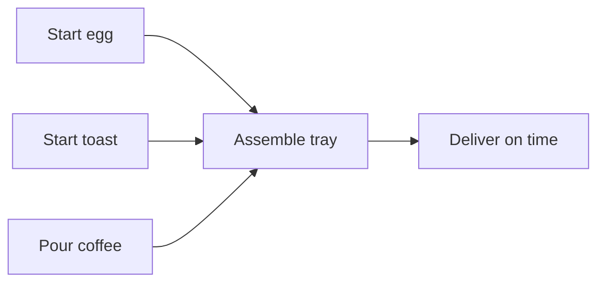
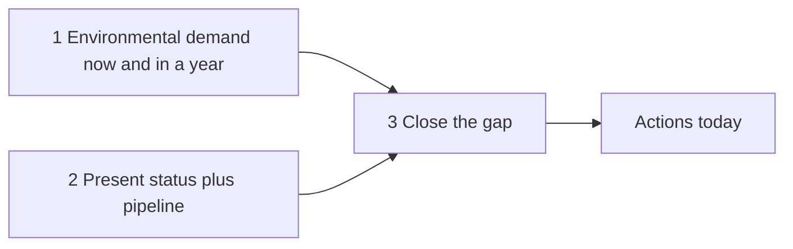

# 01. Managerial Output

How a manager's work is measured, multiplied and coached: treat every team as a small factory, then pick the few activities that move its output the most.

> **Based on:** *High Output Management* by Andrew S. Grove (1983, rev. 1995). [Bookshop](https://bookshop.org/book/9780679762881)

## At a glance

| Framework | In one line | Use it when |
|---|---|---|
| Breakfast factory model | Plan any flow backward from delivery, around its slowest or costliest step | Scheduling a project, a hiring cycle, a launch |
| Indicators (paired) | A few daily measures of output and quality, each balanced by a counter-measure | Setting up a dashboard or a weekly check |
| Black box and inspection points | Treat any team as inputs, labour, outputs; reject defects where they are cheapest | Finding where quality leaks |
| Work simplification | Flow-chart every step, then cut 30 to 50 percent | A slow, tedious process |
| Managerial leverage | Output = sum of leverage x activity; do the high-leverage things | Your day is full and you must choose |
| Delegation and span | Delegate what you know best, monitor, keep 6 to 8 reports | Overload or micromanaging |
| Process vs mission meetings | Regular meetings share knowledge; ad hoc ones decide | Cleaning up a meeting calendar |
| Free discussion, clear decision, full support | Debate openly, decide plainly, back it even if you disagree | Decisions stall or leak afterwards |
| Planning gap method | Demand minus present status = gap; act today on tomorrow's gap | Annual or quarterly planning |
| Objectives and key results | One objective, a few measurable milestones, short cycles | Focusing a team |
| Hybrid organisation and dual reporting | Mix mission units with functional groups; give some people two bosses | Growing past one team |
| Modes of control | Market, contract or culture, picked by complexity and motivation | Deciding how tightly to manage |
| Task-relevant maturity | Match management style to how experienced the person is at this task | Coaching and delegating |
| Performance review | Highest-leverage feedback; level, listen, leave yourself out | Writing or giving a review |
| Training as the boss's job | The manager teaches, as a process | Improving capability |

## The breakfast factory (production model)

The author's picture of any work: deliver a soft-boiled egg, toast and coffee together, hot, at a promised time, at acceptable quality and lowest cost.

- **Limiting step**: the slowest, costliest or most sensitive step. Here the egg. Build the whole plan around it.
- **Work back from delivery**: add the time of each step to get **total throughput time**, and **offset** the other steps so everything finishes together.
- If a resource is scarce (one toaster), the limiting step moves; redo the offsets around the new one.
- Trade-offs are always three-way: **capacity**, **manpower**, **inventory**, balanced against delivery time. Pick the cheapest mix that still hits the date.
- Three kinds of operation exist in any work: **process** (change something), **assembly** (combine parts), **test** (check it). Failed tests mean rework.
- Control future output two ways: **build to order** (customer waits) or **build to forecast** (inventory risk). Use forecast only when waiting loses you the customer.
- Same model fits non-factory work: a recruiting cycle (the expensive step is the site visit, so screen by phone first), a sales-training pack, a software release.

Mistake: scheduling every step from its own start date instead of from the delivery date and the limiting step.

## Indicators

- Measure **output**, not activity. A few indicators, looked at every morning, let you fix a problem before it lands.
- Grove's five for the factory: forecast and yesterday's variance, raw-material stock, equipment condition, manpower, a quality measure (a complaint log).
- Indicators steer behaviour, like looking where you want a bike to go. So **pair** them: cut inventory but also count shortages; speed but also defects.
- Always include **quantity and quality** together.
- Example: a support team tracks tickets closed per day *and* re-opened tickets.

## The black box and inspection

- Any team is a **black box**: inputs and labour in, output out. Productivity = output / labour.
- Two ways up: do the same work faster, or raise **leverage** (more output per unit of activity). Faster alone has a ceiling.
- **Inspection points**, always as early as possible: receiving, in-process, final. Rule: reject defects at the stage where their accumulated value is lowest (a bad raw egg, not a cooked one; a weak candidate before the paid site visit).
- **Work simplification**: draw the real flow, count steps, set a target, question every step. First pass typically removes 30 to 50 percent.

Mistake: judging a team by effort or hours when you cannot say what its output is.

## Managerial leverage

Key sentence: a manager's output is the output of the team under their supervision plus that of neighbouring teams they influence.

- **Output = L1 x A1 + L2 x A2 + ...** (leverage times activity).
- Raise productivity three ways: do things faster, raise the leverage of each activity, **shift your mix** toward high-leverage work.
- Activities have high leverage when:
  - one action affects **many people** (setting the planning rules for 200 managers)
  - a brief action affects **behaviour over a long time** (a performance review, a tickler file)
  - you supply a **unique piece of knowledge** many depend on (pricing, a core process)
- **Timeliness** matters: the same help given early has far more leverage than a scramble later.
- **Negative leverage** exists: arriving unprepared, waffling (no decision is a red light for everyone), a visibly depressed boss, **meddling** (dictating the fix to someone who owns the problem).

### Delegation and monitoring

- Delegator and delegatee need shared information and shared operating values, or delegation degrades into instructions.
- **Delegation without follow-through is abdication.** Monitoring is not meddling.
- Delegate the tasks you know best (easiest to monitor) and let go of them for real.
- **Span of control**: six to eight reports. Rule of thumb of half a day per report per week. A half day a week in an advisory group counts as a report too.

### Interruptions and rhythm

- Smooth the load: same blocks of time for like work (planning meetings on Monday morning).
- Prepare **standard responses** for the common interruptions rather than hiding.
- Your own limiting step: schedule fixed commitments first, then work around them.

## Meetings: the medium of managerial work

Managers move knowledge and make decisions, and both happen face to face. So improve meetings; do not fight them.

| Type | Purpose | Cadence |
|---|---|---|
| **Process-oriented** | Share information and know-how | Regular, predictable |
| **Mission-oriented** | Solve one problem, usually decide | Ad hoc |

### Process-oriented

- **One-on-one**: supervisor and one report.
  - Mutual teaching and information exchange; it is the *report's* meeting, with their agenda and outline.
  - At least an hour, near the report's work area; weekly for a novice, every few weeks for a veteran.
  - Cover indicators, trouble signs, people, plans and nagging worries, including hunches.
  - Coach with "ask one more question".
- **Staff meeting**: the boss and all reports. Topics affect more than two people. Mostly agenda, plus an open session. The boss moderates; never lectures.
- **Operation review**: managers present their work to people several levels away, so teaching and learning flow up and down.

### Mission-oriented

- The **chairman** owns the result and does most of the work before the meeting.
- Ask first: what do I want out of it, is a meeting needed, is it worth the cost? Time has a price: ten managers for two hours is real money.
- Cap decision meetings at six or seven people, eight at most; spectators get in the way.
- Send a purpose-and-roles agenda, secure commitments, start on time, and end with a clear decision and follow-ups.

## Decisions

- In know-how businesses, **knowledge power** and **position power** diverge; the decision process has to bridge them.
- The ideal sequence:
  1. **Free discussion**: every view aired, especially when disagreement is high.
  2. **Clear decision**: stated plainly, even if unpopular.
  3. **Full support**: everyone backs it, agreeing or not.
- Decide at the **lowest competent level**, where the knowledge is.
- Failure modes: waiting to see which way the boss leans, mushy wording to avoid conflict, relitigating afterwards.
- If talk never converges, use position power: the boss decides, after genuinely hearing the issues.

## Planning

Planning is everyday work, modelled on the factory forecast.

1. **Demand**: what customers, vendors, competitors, technology will expect now and in a year. Do not filter it by what you think you can deliver.
2. **Present status**: capabilities and projects in the pipeline, in the same units as demand, allowing for some projects failing.
3. **Close the gap**: what you must do, what you can do, then what you will do. That set of actions is your **strategy**; the next level down's strategy is tactics.

- Today's gap is a planning failure of the past. Ask what to do **today** to avoid tomorrow's problem.
- The real output of planning is the actions taken, not the document.
- You only implement the window until the next planning round; re-plan the rest.
- Planning cannot be a separate career from doing. Saying yes to one thing is saying no to another.
- Not every surprise is plannable; plan like a fire brigade, with a capable team ready to respond.

## Objectives and key results (the OKR ancestor)

Grove's **management by objectives**: two questions only.

1. **Where do I want to go?** (objective)
2. **How will I know I am getting there?** (key results, milestones)

- Short horizons (quarter or month) so feedback is quick.
- **Few** objectives, because focus means saying no.
- Key results must have wording and dates that leave no doubt whether they were met.
- Objectives **nest**: a manager's key result becomes the report's objective.
- Not a mechanical scorecard or a basis for pay by formula; judgment still applies, and a good new opportunity beats a rigid plan.

Example: Objective "Decide on the new site". KRs: land study by June, cost analysis, steering group decision, executive sign-off by October.

## Hybrid organisations and dual reporting

- Two extremes: **mission-oriented** (each unit self-contained; fast, close to its market, duplicated) and **functional** (central expertise; scale and leverage, slow and remote).
- Real firms are **hybrids**: business units set priorities; functional groups act as internal subcontractors.
- Advantages of functions: scale, shifting capacity, spreading expertise. Costs: overload, negotiation and competition for shared resources.
- **Dual reporting**: a person answers to the mission boss (priorities, day-to-day) and to a functional authority (standards, technical supervision, career), often a **peer group** of fellow specialists.
  - Example: a unit controller reports to the division head and to the finance function.
- Needs members to surrender some individual freedom and a strong shared **culture of trust**.
- It is ambiguous and uncomfortable, but simpler forms were worse.

## Modes of control

| Mode | How it controls | Works when |
|---|---|---|
| Market forces | Price, self-interest | Value is easy to price |
| Contractual obligation | Rules, monitoring, reviews | Work is hard to price but can be specified |
| Cultural values | Shared values, trust, group before self | Change is fast or situations too ambiguous for rules |

- Match the mode to the person's motivation (self vs group interest) and the **CUA factor** (complexity, uncertainty, ambiguity of the environment).
- New hire: give a structured, low-CUA job. High CUA plus pure self-interest gives chaos.
- Culture is built by stating values and, more, by **example**.

## Motivation and task-relevant maturity

- A person underperforms because they **can't** (training fixes it) or **won't** (motivation fixes it). Test: if their life depended on it, could they do it?
- Motivation comes from within; the manager creates the environment. Judge it by performance, not by "feeling motivated".
- Needs are layered (physiological, safety, social, esteem, self-actualisation). Lower needs get people to show up; esteem and self-actualisation make them perform. Self-actualisation never runs out.
- **Task-relevant maturity (TRM)**: experience and readiness for *this* task, not general ability.

| TRM | Effective style |
|---|---|
| Low | Structured; tell what, when, how |
| Medium | Two-way, supportive, mutual reasoning |
| High | Agree objectives, monitor lightly |

- Always monitor enough to avoid surprises.
- TRM drops when the job or pace changes; style moves back up the ladder. A star moved to a new function starts low.
- Raise TRM fast: it frees your time and increases your leverage.
- Pass on shared operating values early; a subordinate's learning by mistakes is paid for by customers.

## Performance review

- The most important task-relevant feedback and a top-leverage activity. Its purpose is **better performance**: closing skill gaps and lifting motivation.
- Assess **performance, not potential** (a manager's rating cannot beat their group's).
- Define expectations in advance. Weigh output measures against internal measures (people development, health of the team), short term against long term.
- Watch the **time offset**: this year's results may reflect last year's work.
- Delivering it: **level** (be frank), **listen** (confirm the message landed), **leave yourself out**.
- Do not overload: pick a few key messages. Brain-dump items on paper, group related ones, then choose.
- Promotions tell everyone what you value.
- Pay is feedback too: link a share of pay to performance, bigger share for senior people.
- Hiring interviews: let the candidate talk ~80 percent, steer into familiar territory, probe skills, what they did with them, gaps, and operational values. Here you must judge potential.
- When a valued person wants to quit, act at once.

## Training is the boss's job

- Capability and motivation are the only two levers; neither can be handed off.
- High leverage: twelve hours of preparation and teaching for ten people can return many times the hours.
- Must be tied to how your organisation really works, repeated as a **process**, and given by the manager as a believable role model.

## Common mistakes

- Measuring activity instead of output.
- Unpaired indicators that get gamed.
- Calling a meeting without a purpose, or with too many people.
- Waffling on decisions; meddling after delegating.
- Treating all reports with the same style.
- Reviewing potential, not performance; piling on too many messages.
- Planning only when the gap is already open.

## Recall

**Q: What is a manager's output?**

??? note "Answer"
    The output of the organisation under their supervision plus the neighbouring organisations they influence. Activity matters only through its leverage.

**Q: What are the three ways to raise managerial productivity?**

??? note "Answer"
    Work faster, raise the leverage of each activity, and shift your mix of activities to higher-leverage ones.

**Q: How do process-oriented and mission-oriented meetings differ?**

??? note "Answer"
    Process-oriented ones are regular and share knowledge (one-on-one, staff meeting, operation review). Mission-oriented ones are ad hoc, led by a chairman, and end in a decision.

**Q: How should you manage someone with low task-relevant maturity?**

??? note "Answer"
    Structured and directive: say what, when and how, and monitor closely. Loosen as their maturity for that task grows.

**Q: What are the two questions of an objectives system?**

??? note "Answer"
    Where do I want to go (objective) and how will I know I am getting there (key results).

## Links

- [[2. Running on Systems|Running on Systems]] (building the system the team runs on)
- [[3. Operating Rhythm|Operating Rhythm]] (rocks, scorecards and weekly meetings, a modern descendant of these ideas)
- [[4. Building a Business That Sells|Building a Business That Sells]]
- [[1. Hiring|Hiring]]
- [[5. Operations Basics|Operations Basics]]
