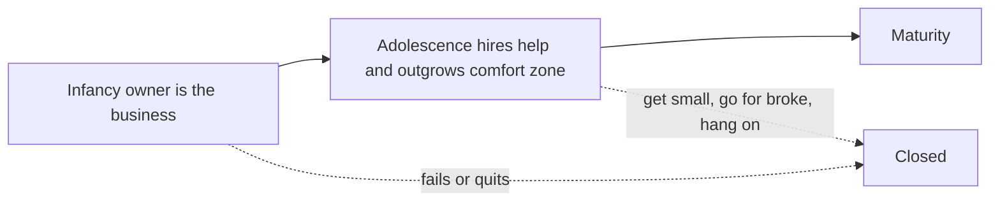

# 02. Running on Systems

Why most small businesses depend on their owner, and how to build one that works without you: a documented, repeatable system.

> **Based on:** *The E-Myth Revisited: Why Most Small Businesses Don't Work and What to Do About It* by Michael E. Gerber (2007 edition of the 1995 book). [Bookshop](https://bookshop.org/book/9780061446788)

## At a glance

| Framework | In one line | Use it when |
|---|---|---|
| Entrepreneurial myth and seizure | Skilled technicians start businesses and end up with a job they can't leave | Deciding whether to start, or why your business traps you |
| Entrepreneur, manager, technician | Three personalities in one owner, typically 10 / 20 / 70 | Diagnosing why you are overloaded or stuck |
| Three phases (infancy, adolescence, maturity) | Owner-is-the-business, then outgrown comfort zone, then a business that knows how it works | Seeing where a business is and why it is stalling |
| Comfort zone and the three bad exits | Past your limit: shrink, gamble or hang on | Growth is causing chaos |
| Franchise prototype | Build the business as the model for 5,000 identical copies | Designing how to operate and how to scale |
| Six rules of the model | Consistent value, low-skill operation, order, documentation, predictability, a look | Checking whether a business is replicable |
| Business Development Process | Innovate, quantify, orchestrate, forever | Improving any step of the operation |
| Seven-step Business Development Program | Primary aim to systems strategy | Planning the build |
| Organisation chart and position contracts | Organise around accountabilities, not personalities | Hiring or splitting up work |
| Operations manual | Write down how each job is done | Handing work to someone else |
| Three kinds of systems | Hard, soft, information | Spotting what to systematise |

## The entrepreneurial myth

- The myth: businesses are started by entrepreneurs who take a risk for profit. The reality: most are started by **technicians** (baker, plumber, designer, programmer) who are good at the work.
- **Entrepreneurial seizure**: the technician wants freedom, to be their own boss. They assume that understanding the technical work means understanding a business that does that work.
- That is the **fatal assumption**. A business is more than the work done in it. Soon the technician is doing the work they love plus the work they never learned: sales, books, hiring, supplies.
- Result: a job, with a worse boss than before, and no time away.
- Core diagnosis: the owner sees the business bottom-up (tactical, "get the work done") instead of top-down (strategic, "what does the business need to be?").

## Three personalities

| Personality | Lives in | Wants | Tendency |
|---|---|---|---|
| **Entrepreneur** | The future | Change, opportunity, control | Ideas outrun the organisation; sees people as obstacles |
| **Manager** | The past | Order, predictability | Plans, structures, resists change |
| **Technician** | The present | Doing the work | Mistrusts both others; believes thinking is idle unless it produces |

- A typical owner is about 10 percent entrepreneur, 20 percent manager, 70 percent technician. The technician ends up in charge.
- The aim is a **balanced** business where each personality has a proper job. The Franchise Prototype is the tool that feeds all three.

## The three phases of a business

1. **Infancy**: owner and business are the same thing. Long hours, juggling every role. It ends when the owner sees it can't carry on like this. This is where many fail or quit.
2. **Adolescence**: the owner gets help, usually a technician ("the first Harry") handed a whole area without clear results or standards. Delegation turns into **abdication**.
3. **Maturity**: the business knows how it got here and where it is going. Crucially, mature firms *start* with the mature perspective (a clear picture of the finished company, how it must act, and the system needed). It is not what an infant business grows into by default.

### The comfort zone

- Each personality has a limit: the technician's is how much they can do themselves; the manager's is how many people they can supervise; the entrepreneur's is how many managers they can engage.
- When the business outgrows the owner's ability to touch and check everything, three common responses:
  - **Get small again**: back to Infancy; the exhaustion returns.
  - **Go for broke**: grow wildly with no structure.
  - **Hang on for dear life**: stay put and slowly burn out.
- The fix is a new perspective, not more effort.

## The franchise prototype

- Model: the **business format franchise** (the hamburger chain case). The franchisor's real product is **the business itself**, not the food, and the franchisee is the first customer who needs to know "does it work?"
- Independent owners fail in large numbers; franchises on a proven system fail far less (the book quotes a Commerce Department-era comparison; treat the exact figures as dated).
- The **prototype** is a working model where every assumption is tested before it becomes standard operation. The system runs the business; people run the system.
- Work **on** your business, not **in** it. Pretend you will build 5,000 identical copies. Ask:
  - How can it work without me?
  - How can people work without my constant interference?
  - How can I own it and still be free of it?

### Six rules of the model

1. Provide consistent **value** beyond what customers, staff, suppliers and lenders expect.
2. Be run by people with the **lowest practical skill level**, because systems, not stars, produce results.
3. Stand out as a place of **order**.
4. Document all work in **operations manuals**.
5. Give a **uniformly predictable** service.
6. Use a uniform **look** (colour, dress, facilities).

- Good ordinary people plus a good system beat brilliant people with no system.
- Make the business **systems-dependent, not expert-dependent**: ask "how do I get this result systematically, not personally?"

## The Business Development Process

A continuous loop, never finished, because the world will collide with anything static.

| Step | Meaning | Example |
|---|---|---|
| **Innovation** | Doing new things that serve the customer, the "best way" skill. Creativity thinks; innovation does | Change a shop greeting from "may I help you?" to "have you been in before?" |
| **Quantification** | Measure the effect against a control | Count visitors, buyers, average sale before and after the change |
| **Orchestration** | Remove discretion at the operating level: do the proven thing every time | Everyone uses the winning greeting until something better wins |

- Innovation asks: *what stands in the way of my customer getting what they want?* It should make operation simpler, otherwise it is complication.
- Quantify everything: customers per day, calls, price enquiries, purchases, busiest hours. Know the key numbers like a doctor knows pulse.
- Orchestration alone is deadening; with innovation and quantification feeding it, the routine becomes the thing you improve.
- If you haven't orchestrated it, you don't own it.

## The seven-step Business Development Program

1. **Primary aim**: what you want your life to look like (the personal standard the business must serve). Business serves life, not the other way round.
2. **Strategic objective**: a short list of measurable standards for the finished business.
   - Money (revenue, profit, and what you want it to sell for).
   - What you really sell: the **product** is the feeling the customer leaves with, not the commodity.
   - Who the customer is: the **central demographic model** (who buys) and **psychographic model** (why they buy).
   - Size, location, how the business looks and behaves.
3. **Organisational strategy**: an organisation chart (below).
4. **Management strategy**: a management **system** that produces results automatically instead of depending on exceptional managers.
5. **People strategy**: communicate the idea of the business and the game your people play (hiring and induction included).
6. **Marketing strategy**: build from demographic and psychographic knowledge, treating management as a marketing tool.
7. **Systems strategy**: design and integrate hard, soft and information systems.

## Organisation chart and position contracts

- Most small firms organise around **personalities** ("taking turns" doing every job), which gives chaos when work grows.
- Instead organise around **functions and accountabilities**:
  - Draw the chart for the *finished* business; every position is there even if one person fills several today.
  - Owners fill every box themselves at first, then hire into boxes one by one.
  - Think as **shareholders** outside the business, **employees** inside it. (Partnerships and family firms need this separation most.)
- Classic functional core: a chief operating role, then marketing, operations, finance, each with sub-roles.
- **Position contract**: for each box, the results the person is accountable for, the work, the standards and a signed agreement. Not a job description of tasks only.
- The owner's time then moves toward the entrepreneur and manager roles.

## Operations manual

- "This is how we do it here": for every repeated job, the purpose, the steps and the standard.
- Without it, routine work turns into exceptions and personal improvisation.
- Grows naturally from innovation and quantification: write what currently works, then improve it.
- Gives new staff structure and makes the person replaceable.

## Management system and people strategy

- Example the book gives: a hotel whose guests found their preferred coffee and newspaper waiting. The ordinary staff did it because the system asked each guest once, recorded it and made it automatic.
- The system turns manager decisions into routines; judgment is saved for exceptions.
- People do what you want when they buy into a clear, honest idea of the business. Rules of the "game":
  - Design the game before the tasks.
  - Never ask people to play a game you won't play.
  - Give real ways to win without ending the game.
- Induction: explain the idea, interview for fit, train the system, document everything.

## Three kinds of systems

| Kind | What | Examples |
|---|---|---|
| **Hard** | Inanimate things | Equipment, premises, colours, layout |
| **Soft** | People and ideas | Scripts, behaviours, standards |
| **Information** | Data about how the other two interact | Inventory control, cash-flow forecast, sales reports |

- The job: innovate, quantify and orchestrate each, and integrate the three.

## Common mistakes

- Believing technical skill equals business skill.
- Doing everything yourself and calling it commitment.
- Hiring a "Harry" and abdicating rather than delegating with results and standards.
- Organising around who is available, not what must be done.
- Documenting nothing, so every job lives in someone's head.
- Treating the manual as finished; it is the base for the next improvement.
- Copying the prototype idea literally when the point is to *think* like a franchisor.

## Recall

**Q: What is the "fatal assumption" of the technician-owner?**

??? note "Answer"
    That because you understand the technical work of a business, you understand a business that does that work.

**Q: What are the three phases of a business and what ends the first?**

??? note "Answer"
    Infancy, adolescence and maturity. Infancy ends when the owner sees the business cannot go on depending on them.

**Q: What are the three parts of the Business Development Process?**

??? note "Answer"
    Innovation (find a better way), quantification (measure whether it worked), orchestration (do the proven way every time), repeated endlessly.

**Q: What should an organisation chart be built around?**

??? note "Answer"
    Functions and accountabilities, not personalities, drawn for the finished business with each box held by someone under a position contract.

**Q: Why write operations manuals?**

??? note "Answer"
    So the work does not depend on any one person, new people are productive quickly, and there is a baseline to measure and improve.

## Links

- [[1. Managerial Output|Managerial Output]] (managing output and leverage once the team exists)
- [[3. Operating Rhythm|Operating Rhythm]] (a weekly operating system with accountability chart and scorecard)
- [[4. Building a Business That Sells|Building a Business That Sells]] (making the business sellable and independent of the owner)
- [[1. Hiring|Hiring]]
- [[5. Operations Basics|Operations Basics]]
