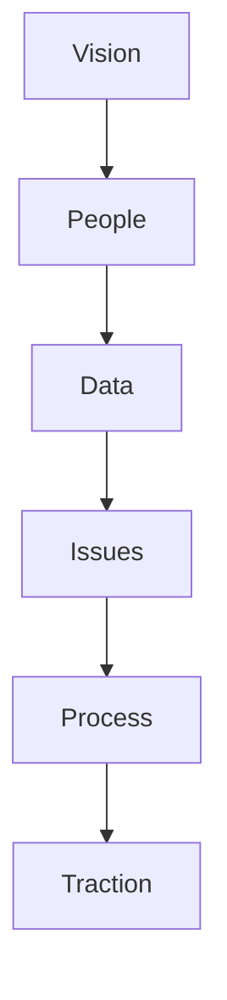
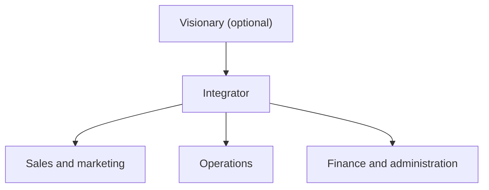

# 03. Operating Rhythm

A simple operating system for a small-to-mid-size business: one shared vision, the right people in the right seats, a handful of weekly numbers, issues solved in order, documented processes, and a fixed 90-day and weekly beat.

> **Based on:** *Traction: Get a Grip on Your Business* by Gino Wickman (2011 trade edition). [Bookshop](https://bookshop.org/book/9781936661831)

## At a glance

| Framework | In one line | Use it when |
|---|---|---|
| Six Key Components | Vision, People, Data, Issues, Process, Traction | Auditing where the company is weak |
| Organizational Checkup | 20 statements scored 1 to 5; aim to rise every 90 days | Baselining and tracking progress |
| Five leadership abilities | Simplify, delegate, predict, systemise, structure | The business has hit its ceiling |
| Vision/Traction Organizer (V/TO) | Two pages answering eight questions | Aligning the leadership team on direction |
| Core values and core focus | 3 to 7 values; purpose plus niche | Hiring, saying no to distractions |
| Marketing strategy (four elements) | Target market, three uniques, proven process, guarantee | Sharpening what you sell and to whom |
| Rocks | 3 to 7 priorities per person per 90 days | Priorities keep slipping |
| People Analyzer | Core-value ratings plus a yes/no on GWC | Evaluating each person |
| Accountability Chart | Three functions, one owner each, plus a visionary and integrator | Roles are unclear or overlapping |
| GWC | Get it, want it, capacity to do it | Right seat check |
| Scorecard | 5 to 15 weekly numbers, each with one owner | You are managing by feel or by late financials |
| IDS | Identify, discuss, solve | Problems keep coming back |
| Process documentation | Core processes written (20/80), followed by all | Quality is inconsistent; you want to scale or sell |
| Meeting pulse and Level 10 | Weekly 90-minute agenda, quarterly and annual sessions | Meetings are long and unproductive |

## The Six Key Components

| Component | Core idea | Main tools |
|---|---|---|
| **Vision** | Everyone sees the same target and how to get there | V/TO |
| **People** | Right people (share values) in the right seats (can do the job) | People Analyzer, Accountability Chart, GWC |
| **Data** | A handful of numbers tell you the real state weekly | Scorecard, measurables |
| **Issues** | Name obstacles openly and solve them for good | Issues List, IDS |
| **Process** | Your "Way" of doing business is documented and followed by all | Core process documentation |
| **Traction** | Discipline and accountability turn vision into action | Rocks, meeting pulse |

- The six are worked in order; traction without the earlier five moves you fast in the wrong direction.
- Most firms run below 50 percent on a self-assessment; above 80 percent is described as a well-run machine.
- Re-run the **Organizational Checkup** (20 statements rated 1 to 5) every 90 days and expect steady, not instant, gains.

## Letting go of the vine

Before the tools, the owner has to loosen their grip.

- Growth hits a ceiling because the owner is the bottleneck.
- Five leadership abilities lift it:
  1. **Simplify**: fewer rules, models, checklists, one message.
  2. **Delegate and elevate**: give away what you have outgrown; work in your strongest area.
  3. **Predict**: see problems and numbers ahead.
  4. **Systemise**: documented, repeatable processes.
  5. **Structure**: clear roles and accountability, not ego and personality.
- Attitude conditions: be open-minded, honest and vulnerable with the team; commit to the whole system; give it a full ramp-up (months, not weeks).

## Vision: the V/TO and its eight questions

Two pages replace a long business plan. The questions:

1. **Core values**: three to seven timeless principles that define the culture.
   - Find them by naming people you would clone, listing what they share, then narrowing.
   - They are already there; you rediscover them. Then hire, review, reward and fire by them.
2. **Core focus**: **purpose/cause/passion** plus **niche**.
   - Purpose: why you exist (short, simple, not about money).
   - Niche: what you do better than anyone.
   - Stay in your **sweet spot**; decline things that don't fit.
3. **10-year target**: one big long-range goal everybody works toward.
4. **Marketing strategy**: four elements.
   - **Target market** (the "List"): demographic, geographic and psychographic traits of the ideal customer.
   - **Three uniques**: three differentiators no competitor has all of.
   - **Proven process**: three to seven named steps you take every customer through, with talking points.
   - **Guarantee**: removes the customer's biggest fear; only use it if it wins business.
5. **Three-year picture**: future date, revenue, profit, measurables, and a short description of what the company looks like.
6. **One-year plan**: revenue and profit targets plus three to seven specific, measurable, attainable goals.
7. **Quarterly Rocks**: the 90-day priorities.
8. **Issues list**: the obstacles in the way.

Example: A repair firm names its niche ("simplify the printing environment"), lists three uniques, a six-step process and a "4 hours or it's free" guarantee, so every sales conversation says the same thing.

Mistakes: a vision stuck in the owner's head; too many goals; unattainable "stretch" goals everywhere; no way to tell if a goal was met.

## Rocks (90-day world)

- Every 90 days the team picks what must be done next to stay on track for the one-year plan.
- A **Rock** is a specific, measurable, attainable priority with **one owner**. Company Rocks and individual Rocks nest.
- Limit: three to seven per person, preferably near three.
- Process:
  1. List everything that must be done this quarter.
  2. Keep, kill or combine down to three to seven.
  3. Make each specific and measurable.
  4. Assign a single owner.
  5. Each person then sets their own Rocks supporting the company's.
- Score "done" or "not done". Aim for roughly 80 percent completion, not 100.
- Missed Rocks: carry forward, finish as a to-do if nearly complete, or reassign. Ask whether the target was too ambitious or someone dropped the ball.
- Name them whatever you like; the point is the 90-day discipline.

## People

### Right people: core values and the People Analyzer

- Right people share your core values.
- **People Analyzer**: names down the side, core values across the top; rate each **+** (most of the time), **+/-** (sometimes) or **-**.
- Set a **bar** (suggested for five values: three pluses, two plus/minuses, never a minus).
- **Three-strike rule** for people below the bar: discuss and allow 30 days; repeat; if no change by strike three, they go. Often they leave first.

### Right seats: Accountability Chart and GWC

- A supercharged org chart. Every business has **three major functions**: sales/marketing, operations, finance/administration. All must be strong.

- **One person per box.** When two own it, nobody does. One person can sit in two seats; two people cannot share one.
- **Visionary**: ideas, big problem solving, key relationships, culture. **Integrator**: runs the day-to-day, ties the functions together, holds accountability and breaks ties. Many owner pairs are one of each.
- Each function is defined by about **five major roles**. Anyone with direct reports also carries **LMA**: lead, manage, hold accountable.
- **GWC**: for each seat the person must **get it**, **want it**, and have the **capacity** to do it. It is a plain yes/no; all three or the wrong seat. (A promotion fails when someone wants the job but lacks capacity.)
- Fit seats to each person's **unique ability**.
- When tension arises between two leaders: each names the other's three strengths and three weaknesses, then list and solve the issues.

## Data: the Scorecard

- A weekly one-page report of **five to 15** activity-based numbers (revenue, cash, sales activity, customer problems, receivables).
- **Leading** (activity) numbers beat trailing ones (monthly statements that arrive too late).
- Each number has **one accountable owner**, a goal and a weekly column.
- Give every person at least one number; derive them from the five roles in the Accountability Chart.
- Benefits listed: shared language, clear expectations, comfort for right people, teamwork, competition, faster problem solving, results.
- Wrong people tend to resist numbers; right people like clarity.

## Issues: IDS

- Keep a running **Issues List** at company and team level. Anything stuck in your head goes on it.
- **IDS** (Issues Solving Track):
  1. **Identify**: find the real root issue, not the symptom.
  2. **Discuss**: everyone speaks, no tangents ("tangent alert").
  3. **Solve**: usually a to-do with an owner; confirm the statement aloud so all agree.
- Three outcomes: solved with an action, awareness only, or more research needed.
- Ground rules, paraphrased:
  - No decision by consensus; hear everyone, then the right person decides.
  - Be decisive; avoid second-hand information, get the parties in the room.
  - Serve the greater good, not ego.
  - Take issues one at a time in priority order; you will never clear them all.
  - You can **live with it, end it or change it**; living with it is last.
  - Feel the short-term pain; face the issue you fear most.
- Pick the top three, start with number one. Often lower ones were symptoms.

## Process

- Your processes are your **Way** of doing business. Keep it out of heads and on paper.
- Steps:
  1. **Identify** the handful of core processes (e.g. people, marketing, sales, operations, customer, finance).
  2. **Document** each at the high level, capturing the critical 20 percent of steps that gives 80 percent of the result, then **simplify**.
  3. **Package** them in one place.
- Then get them **Followed By All**: make a simple visual of the whole system, share it, retrain everyone, and manage people to follow it.
- Benefits: simpler troubleshooting, fewer errors, scalability, and a turnkey system that raises the value of the firm (to grow, franchise, step back or sell).

## Traction: the meeting pulse

| Meeting | Who and how long | Purpose |
|---|---|---|
| **Weekly Level 10** | Leadership team, 90 minutes, same day and time | Keep numbers and Rocks on track, solve issues |
| **Quarterly** | Leadership team, a full day, off-site | Review the quarter, refresh V/TO, set new Rocks |
| **Annual** | Two days, off-site | Team health, reset vision, one-year plan |

### Level 10 agenda

| Item | Time |
|---|---|
| Segue (good news, personal and business) | 5 |
| Scorecard review (identify off-track numbers, no discussion) | 5 |
| Rock review (on or off track) | 5 |
| Customer/employee headlines | 5 |
| To-do list (7-day items, done or not) | 5 |
| IDS (top issues in order) | 60 |
| Conclude (recap to-dos, message to team, rate meeting 1 to 10) | 5 |

- Off-track items drop to the issues list; discussion only happens in IDS.
- A **Rock** is a 90-day priority; a **to-do** is a 7-day commitment. Roughly 90 percent of to-dos should be done each week.
- One page agenda; no minutes needed. Start on time, end on time, never cancel.
- One person runs the meeting, another manages the agenda.
- Quarterly agenda: segue, review last quarter, review V/TO, set Rocks, tackle key issues, next steps, conclude.
- Annual: segue, review the year, build team health, SWOT and issues, V/TO through the one-year plan, set the budget.

## Common mistakes

- Skipping vision and jumping to tools.
- Core values that are slogans and not used in hiring or review.
- Two people in one box on the chart.
- Too many Rocks or scorecard numbers.
- Discussing issues during the scorecard review.
- Letting meetings drift into tangents; not enforcing to-dos.
- Not leaving the owner out of the way: holding on to the vine.

## Recall

**Q: What are the Six Key Components?**

??? note "Answer"
    Vision, People, Data, Issues, Process and Traction.

**Q: What is the difference between a Rock and a to-do?**

??? note "Answer"
    A Rock is a 90-day priority (three to seven per person); a to-do is a seven-day action item reviewed weekly.

**Q: What does GWC stand for and how is it scored?**

??? note "Answer"
    Get it, want it, capacity to do it; a plain yes or no on each, and all three are needed for the right seat.

**Q: What are the three steps of IDS?**

??? note "Answer"
    Identify the real issue, discuss it openly without tangents, and solve it with an owned action.

**Q: How long is the Level 10 meeting and where does most of the time go?**

??? note "Answer"
    90 minutes, with about 60 spent on IDS after short reviews of the scorecard, Rocks, headlines and to-dos.

## Links

- [[1. Managerial Output|Managerial Output]] (the objectives and one-on-one ideas behind Rocks and meetings)
- [[2. Running on Systems|Running on Systems]] (process and org chart thinking)
- [[4. Building a Business That Sells|Building a Business That Sells]]
- [[1. Hiring|Hiring]]
- [[5. Operations Basics|Operations Basics]]
