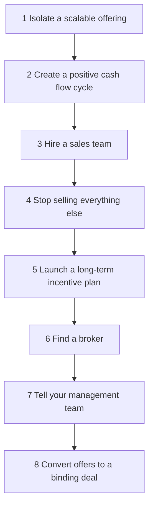

# 04. Building a Business That Sells

How to turn a custom, owner-dependent service business into a standard, repeatable offering that can run without you and be sold, or simply be run well, on your own terms.

> **Based on:** *Built to Sell: Creating a Business That Can Thrive Without You* by John Warrillow (2010, paperback 2012). [Bookshop](https://bookshop.org/book/9781591845829)

## At a glance

| Framework | In one line | Use it when |
|---|---|---|
| Options strategy | Build so you can sell, step back or stay, as you choose | You want freedom, not a forced exit |
| Why a service firm is unsellable | Custom work, key-client dependence and owner as rainmaker | Diagnosing a firm that cannot run without you |
| Standard offering (productised service) | One teachable, valuable, repeatable thing with a named process | Narrowing what you sell |
| Teachable x valuable x repeatable | Plot every offer on teachable vs valuable; drop one-off ones | Deciding what to keep |
| Recurring revenue ladder | Six forms from consumables to contracts | Raising the value and predictability of revenue |
| Positive cash flow cycle | Get paid before you pay the costs | Cash is tight, or you want a higher price |
| Eight-step road map | Isolate, cash cycle, sales team, stop custom, incentive, broker, tell managers, close | Planning the change |
| Owner independence tests | How buyers probe whether you matter too much | Preparing for due diligence |
| Concentration and moat | No client over about 15 percent; make staff hard to copy | Reducing risk |
| Long-term incentive plan | A deferred cash reserve that rewards managers for staying | Keeping a management team through a sale |

## The core idea

- Many owners build a business where customers want the owner, the owner does the work, and that reliance feeds itself. The owner is trapped and the business is worth little to a buyer.
- A buyer pays for a business that earns without you, has predictable revenue, and can grow with someone else's money.
- **Options strategy** rather than exit strategy: build systems and a team so you can sell, appoint a president, or just run a calmer business. Many owners who reach the final stage decide to keep it.
- The story told in the book: a creative agency owner takes on any job, depends on one big client for around 40 percent of revenue, gets told by a mentor that the business is "worthless" as it stands, then reshapes it around one standard service.

## Why custom service businesses do not sell

| Problem | Why a buyer worries |
|---|---|
| Does everything for everyone | No scale, no specialist skill, every job is custom |
| One client is a big share of revenue | Losing it ruins the business; rule of thumb: keep any one client under about 15 percent |
| Owner is the main salesperson and relationship | Revenue leaves when the owner does |
| Selling time | Staff become flight risks as they gain skill |
| Low or lumpy cash | Buyer has to fund working capital |

## Standard offering (productised service)

The book's central move: replace many custom projects with **one standard service** delivered through a **named, documented process**.

- Criteria for what to productise:
  1. **Teachable**: junior staff can run it, or technology can.
  2. **Valuable**: customers care, so it escapes price shopping.
  3. **Repeatable**: customers need it again and again (think razor blades, not razors).
- Method:
  1. List everything you sell and plot teachable (one axis) against valuable (the other).
  2. Drop things customers buy once.
  3. Teachable work tends to be low value and valuable work hard to teach; **combine** to craft the ideal offer.
  4. Document the process in steps with the benefits of each step, and describe it the same way everywhere (website, brochures, scripts).
- Example from the book: logos delivered by a **five-step logo design process**, with a one-page description to pitch to ten prospects.
- Specialise: hire specialists in that thing; the quality improves and you stand out.
- **Own a process** and you are easier to pitch and in control of price. Avoid responding to price-driven request-for-proposal bidding, which commoditises you.
- Use product language: "customers" not "clients", "business" not "firm"; remove references to being a generic service shop.
- Model the plan: sales pipeline conversion rates (how many prospects become sales) show a buyer the size of the opportunity.

## Recurring revenue ladder

From least to most valuable, as buyers see them:

| Rank | Form | Example | Note |
|---|---|---|---|
| 6 | Consumables | Toothpaste | Track repurchase rate |
| 5 | Sunk-money consumables | Razor blades, printer ink | Customer already bought the platform |
| 4 | Renewable subscription | Magazine | Revenue guaranteed ahead, customer re-ups |
| 3 | Sunk-money renewable subscription | Data terminal plus data | Very sticky |
| 2 | Auto-renewal subscription | Document storage billed until cancelled | Predictable; track cancellation rate |
| 1 | Contract for a fixed term | Phone contract | Strongest |

- Higher up the ladder, value rises. Offer a standard subscription or contract rather than one-off projects.
- Mistake from the author's own story: giving best customers the option to stay on the old custom model, so they never switch. Make it a clear choice: the standard offer or end the relationship.

## Positive cash flow cycle

- Charge in full or part **before** you incur the cost (like subscriptions).
- Possible only once the offering is documented and differentiated.
- Gives you cushion to make hard changes.
- Raises sale value: a buyer writes one cheque to you and one to fund working capital; if the business generates cash, the second is smaller. Check the working capital definition in any offer, since it can move the real price by double-digit percentages.
- Avoid the **cash suck**: standardise, then bill up front or by progress.

## The eight-step road map

1. **Isolate a product or service with the potential to scale**: teachable, valuable, repeatable; document the process.
2. **Create a positive cash flow cycle**: bill ahead.
3. **Hire a sales team**: get yourself out of selling.
   - Hire at least **two** salespeople (competition, and proof the model is not one star).
   - Prefer people who sell products over professional-services sellers, who tend to customise everything.
   - Selling the product earns little; selling the business earns far more.
4. **Stop selling everything else**: turn away custom work that falls outside the standard offer.
   - Hardest step. Staff test you, customers ask for exceptions.
   - Over time customers respect the focus and many buy more.
   - Saying no generates referrals to people who want the work.
   - In the switch year, look at cash flow, not profit; expect a bonus hit.
   - Run the new model for **at least two years** of financials so a buyer can verify it. When asked for help, diagnose and fix the system rather than do it yourself.
5. **Launch a long-term incentive plan for managers**: avoid equity (it complicates a sale and dilutes you). Each year set aside an amount for each key manager, releasing a third a year after three years, so leaving costs them money. A one-off stay bonus can top it up on sale.
6. **Find a broker**: under roughly $2 million in sales a business broker, above that a boutique M&A firm, with industry experience. Be neither their biggest nor smallest client. Avoid an adviser who just introduces you to one favoured buyer; you want competing bids.
7. **Tell your management team**: make sure there is something in it for them; use the stay bonus.
8. **Convert offers to a binding deal**: a letter of intent is not binding; treat any earn-out as gravy and judge the up-front cash; due diligence takes roughly 60 to 90 days; offers are often trimmed afterwards, so walk if the final cash falls below your threshold.

- Before starting, involve an accountant experienced in succession planning; tax planning has to start early.
- Think big: write a three-year plan that shows what a larger buyer's resources could unlock for the offering (an "engine of growth" story), grounded in what is possible.

## What buyers test during due diligence

- Paperwork: lease, contracts, IP, software licences, loan covenants, receivables, licences, litigation.
- Owner dependence (the "tricks" listed in the book):
  - Calendar change at short notice, to see if you are needed.
  - Asking staff for the vision, to see if it lives only in your head.
  - Asking customers why they buy: product benefits are good, "we like him" is bad.
  - Mystery shopping: your own involvement in winning new customers is a warning sign.
- Lesson: make the experience consistent for a stranger and keep yourself out of customer acquisition.

## Moat: protect against staff leaving

- If you only sell time, a well-trained employee can set up as a competitor. Build something hard to copy.
- Ideas given: own the annual ranking study, awards programme, industry event, or benchmark database for your category.
- A moat also supports pricing power.

## The sellability check

- The author offers an online "sellability" assessment; the book itself does not set out a numbered list of scoring drivers, so use the themes above as the checklist: standard offering, recurring revenue, client concentration, cash cycle, sales team, management team and incentive, moat, owner independence.

## Worked example (generic)

A web design studio does brochures, posters, SEO and logos for ten clients, one of them 40 percent of revenue.

1. It plots services, picks logos delivered via a named five-step process.
2. It bills a deposit before work starts.
3. Hires two salespeople who pitch the one-page process.
4. Declines posters and SEO; replaces the big client's work gradually.
5. Sets up a deferred bonus pool for the studio manager.
6. After two years of clean numbers, engages an adviser with industry contacts.

## Common mistakes

- Keeping every old client on the old model.
- Hiring one star seller.
- Giving up on saying no after a few weeks.
- Equity for managers instead of a cash plan.
- Telling the broker or buyer you can deliver customisation "for the right price".
- Leaving working capital terms vague.
- Looking only at the headline price.

## Recall

**Q: What three tests identify a service worth productising?**

??? note "Answer"
    Teachable to staff, valuable to customers, and repeatable (customers buy again and again).

**Q: Why charge up front?**

??? note "Answer"
    It funds the business, gives room to make changes, and a cash-generating company needs less working capital from the buyer, so a buyer can pay more.

**Q: Why hire two salespeople rather than one?**

??? note "Answer"
    Competition between them, and proof to a buyer that the model sells without one star.

**Q: How does the book suggest keeping managers through a sale?**

??? note "Answer"
    A long-term cash incentive reserve released in thirds after three years, topped up with a stay bonus, instead of equity.

**Q: What is the highest form of recurring revenue?**

??? note "Answer"
    A fixed-term contract, followed by auto-renewal subscriptions.

## Links

- [[2. Running on Systems|Running on Systems]] (systems and documentation that make the business independent)
- [[3. Operating Rhythm|Operating Rhythm]] (the process and accountability tools that make the business run)
- [[1. Managerial Output|Managerial Output]]
- [[1. Positioning|Positioning]] (specialising and narrowing what you sell)
- [[1. Value-Based Pricing|Value-Based Pricing]]
- [[1. Hiring|Hiring]]
- [[5. Operations Basics|Operations Basics]]
