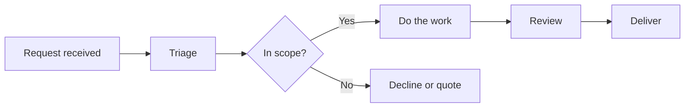
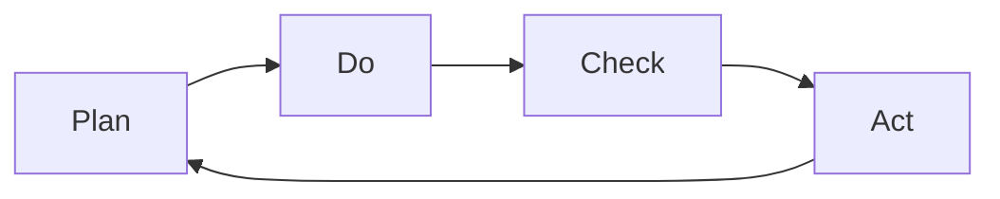

# 05. Operations Basics

How work flows through an organisation: mapping it, finding the constraint, removing waste, improving quality, and managing projects and service levels.

> **Not from the library.** General reference material written to fill a gap in the books in this section.

Origins checked on the web (November 2026): Goldratt 1984, Royce 1970, the Snowbird meeting of February 2001 and the bullwhip effect confirmed; PDCA and Six Sigma histories are disputed in the sources and are worded cautiously below.

## At a glance

| Framework | In one line | Use it when |
|---|---|---|
| Process mapping | Draw the steps, owners and handoffs | Work is slow, unclear or inconsistent |
| Theory of Constraints | Improve only the bottleneck | Throughput is capped |
| Lean | Remove waste (muda) | Lots of waiting, rework, handoffs |
| PDCA | Plan, do, check, act loop | Continuous improvement |
| Six Sigma basics | Cut variation using data (DMAIC) | Defects are costly and measurable |
| Supply chain | Flow of inputs to customer | You depend on suppliers or delivery |
| Waterfall vs agile | Sequential plan vs iterative delivery | Choosing a project approach |
| Critical path + risk register | Longest chain of tasks; tracked risks | Planning and de-risking delivery |
| SLAs and KPIs | Promised service levels and measured results | Setting expectations with clients |

## Process mapping

- Write the steps, who does each, inputs/outputs, decisions and handoffs. Map the process as it is, then as it should be.
- Handoffs and waiting time are where most delay lives, not the work itself.

- Measure: cycle time (start to finish), lead time (request to delivery), touch time (actual work).
- Mistake: documenting the ideal process nobody follows. Walk the real one.
- Written processes are the basis of [[2. Running on Systems|Running on Systems]].

## Capacity and Theory of Constraints

- Eliyahu Goldratt introduced it in the novel *The Goal* (1984). Every system has one constraint limiting output; improving anywhere else does not raise throughput.
- Five focusing steps: identify the constraint, exploit it (never let it idle), subordinate everything else to it, elevate it (add capacity), repeat because the constraint moves.
- Worked example: design takes 2 days per job, build 5, test 1. Build is the bottleneck, so hiring a second designer changes nothing; helping build does.
- Capacity planning: capacity = available hours x utilisation. Running near 100% utilisation makes queues explode; leave slack.
- Mistake: optimising local efficiency while the bottleneck starves or is overloaded.

## Lean and waste

- Origins in the Toyota Production System (Taiichi Ohno). Value is what the customer would pay for; everything else is waste (muda).
- Seven classic wastes (TIMWOOD): transport, inventory, motion, waiting, overproduction, over-processing, defects. Often an eighth: unused talent.
- Software/services translation: waiting for approvals, half-finished work in progress, rework, features nobody uses, context switching.
- Tools: value stream mapping, limiting work in progress, kanban boards, pull rather than push.
- Mistake: cutting slack until nothing absorbs variation, or treating lean as headcount cutting.

## Quality: PDCA and Six Sigma basics

- PDCA (Plan-Do-Check-Act) grows from Walter Shewhart's cycle (1920s-30s), which Deming taught in Japan in the 1950s. Deming himself preferred PDSA (Plan-Do-Study-Act), saying "check" suggested holding back; the PDCA wording is a later Japanese variant, so either name is fine.

- Run small, check against a stated prediction, then standardise what worked.
- Six Sigma started at Motorola in the mid-1980s (engineer Bill Smith is usually credited, with CEO Bob Galvin backing it; sources give 1985-87) and aims to reduce variation and defects; the usual target is 3.4 defects per million opportunities. DMAIC: define, measure, analyse, improve, control (its exact lineage is unclear in sources).
- Useful basics without the belts: define a defect precisely, measure its rate, find root causes (5 Whys, fishbone), fix, then add a control so it stays fixed.
- Mistake: fixing symptoms; or measuring so much that nothing improves.

## Supply chain basics

- Chain: suppliers, inputs, production or delivery, distribution, customer. Services have a supply chain too: tools, contractors, hosting vendors.
- Concerns: lead time, inventory/buffer, supplier concentration, cost, quality.
- Reduce risk: more than one supplier for critical inputs, buffers for long lead items, clear contracts.
- Bullwhip effect: small demand swings amplify upstream, so share forecasts. Traced to Jay Forrester's work on industrial dynamics (1958-61); named and analysed by Lee, Padmanabhan and Whang (1997).

## Project management

| | Waterfall | Agile |
|---|---|---|
| Plan | Full plan upfront | Short cycles, adjust each one |
| Change | Costly, controlled | Expected |
| Fits | Fixed scope, regulation, physical work | Uncertain requirements |
| Risk | Late discovery of misfit | Scope drift without discipline |

- Waterfall is traced to Winston Royce's 1970 paper "Managing the Development of Large Software Systems"; he never used the word and warned that a single pass is risky (he advocated iterating). Agile Manifesto: written by 17 practitioners at Snowbird, Utah, February 2001.
- Critical path: the longest chain of dependent tasks; it sets the earliest finish. Delay on it delays the project; other tasks have float.
- Risk register: table with risk, likelihood, impact, owner, mitigation, status. Review it weekly, not once.
- Scope, time, cost: pick which flexes. Write down what is out of scope.
- Mistakes: padding every task, no single owner, treating estimates as promises.

## SLAs and KPIs

- SLA (service level agreement): promised levels, e.g. response time, uptime, resolution time, with remedies. Internal version is an OLA.
- KPI: a few metrics tied to goals. Distinguish leading (predicts) from lagging (reports).
- Set SLAs on what you can reliably meet and measure; promise less, deliver more.
- Mistakes: dozens of KPIs; metrics people can game; SLAs nobody monitors.

## Service delivery for a software/services firm

- Standard flow: intake, scoping, plan, build/deliver, review, handover, support.
- Standardise the repeatable parts (checklists, templates), customise the edge.
- Capacity is mostly people-hours: track utilisation, bench, and pipeline together.
- Keep a clear change-request path so scope changes are priced, not absorbed.
- Cadence of reviews: [[3. Operating Rhythm|Operating Rhythm]]. Output of managers: [[1. Managerial Output|Managerial Output]].

## Recall

**Q: What does Theory of Constraints say about improvement?**

??? note "Answer"
    Output is capped by one bottleneck, so only improvements at the constraint raise throughput; then find the next constraint.

**Q: Name the PDCA steps.**

??? note "Answer"
    Plan, do, check, act, then repeat.

**Q: What is the critical path?**

??? note "Answer"
    The longest chain of dependent tasks; it sets the minimum project duration.

**Q: Why avoid 100% utilisation?**

??? note "Answer"
    Queues and waiting grow sharply near full load and there is no slack for variation.

## Links

- [[2. Running on Systems|Running on Systems]]
- [[3. Operating Rhythm|Operating Rhythm]]
- [[1. Managerial Output|Managerial Output]]
