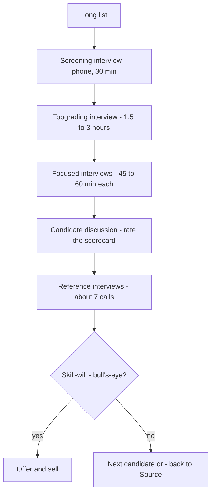

# 01. Hiring

How to hire people who will actually perform: define the job as outcomes, keep candidates flowing, interview for track record, and close the candidate.

> **Based on:** *Who: The A Method for Hiring* by Geoff Smart and Randy Street (2008). [Bookshop](https://bookshop.org/book/9780345504197)

## At a glance

| Framework | In one line | Use it when |
|---|---|---|
| A Player | Candidate with a 90%+ chance of hitting outcomes only the top 10% of candidates could hit | Setting the hiring bar |
| Scorecard | Mission + outcomes + competencies instead of a job description | Before any sourcing or interviewing |
| Source | Always-on talent flow, led by referrals | Continuously, not only when a seat is empty |
| Screening interview | 30-minute phone call, four questions, hit the gong fast | Cutting a long list to 2-5 |
| Topgrading interview | Chronological walk through each job, five questions per job | The main selection tool |
| Focused interview | Colleagues probe one outcome/competency each | Adding data and checking culture fit |
| Reference interview | About seven calls, chosen by you, decoded for hedging | Before every offer |
| Skill-will bull's-eye | Rate skill (outcomes) and will (competencies) A/B/C | The final decision |
| Five F's | Fit, family, freedom, fortune, fun | Closing the candidate |

## The hiring problem

- The book's claim: the key decisions are **who**, not **what** (strategy, product, process). Wrong hires drain the owner's time.
- The authors cite their client studies putting an average mis-hire at about 15x base salary in hard cost and lost productivity (their figure, treat as indicative), and a long-quoted ~50% manager hiring success rate.
- Four failure points, which become the four steps:
    - unclear about what the job needs -> **Scorecard**
    - weak flow of candidates -> **Source**
    - cannot pick the right one from lookalikes -> **Select**
    - lose the ones you want -> **Sell**
- **A Player**: at least a 90% chance of achieving outcomes that only the top 10% of possible candidates could. Two parts: high probability *and* a high bar. Right superstar for *this* role and culture, not just a star.
- Aim for a team that is 90%+ A Players, with a 90% hiring success rate as a manager outcome.

### Voodoo hiring methods to stop

| Type | What goes wrong |
|---|---|
| Art Critic | Trusts gut after a few minutes; easily fooled |
| Sponge | Everyone interviews, nobody coordinates, same shallow questions |
| Prosecutor | Trick and logic questions test knowledge, not job ability |
| Suitor | Spends the interview selling, not listening |
| Trickster | Gimmicks (a dropped paper, a party) to test behaviour |
| Animal Lover | Favourite quirky question with no validity |
| Chatterbox | Pleasant chat, no data |
| Psychological tester | Personality quizzes are fakeable and weakly predictive |
| Aptitude tester | Fine as a screen, never the only input |
| Fortune-teller | "What would you do?" gets a rehearsed ideal, not past behaviour |

- Underlying trap: it is hard to see people for who they are; a resume is the highlights reel. The antidote is facts about the past, gathered by structure.

## Step 1: Scorecard

A document of what the person must achieve and how, replacing the job description (which lists activities).

| Part | What it holds | Rules |
|---|---|---|
| **Mission** | Why the role exists, 1-5 plain sentences | Anyone (candidate, recruiter, peer) understands it without questions; no jargon |
| **Outcomes** | 3-8 specific, objective results, ranked | Measurable or at least observable, with dates; high but reasonable |
| **Competencies** | How they work: role-based plus 5-8 culture competencies on every scorecard | Do not make the list so narrow that only one style qualifies |

- **Hire the specialist, not the all-round athlete.** Generalists look great but jobs need deep fit with the problem at hand. Different phases of a company need different leaders; a scorecard is rewritten per hire, not dusted off.
- **Outcomes cull candidates early**: high clear targets scare off B and C players and attract A players. They also free the new hire: they know what they will be judged on.
- Example outcomes (sales head): grow revenue from X to 2X by end of year three; lift margin by a stated amount; build the sales team with A players by end of year one; forecast accuracy of 90%.
- Non-numeric roles: "launch a campaign within 180 days", "count attendance at events".
- **The authors' most-cited competencies**: efficiency, honesty/integrity, organisation and planning, aggressiveness (fast and forceful, not abrasive), follow-through, intelligence, analytical skill, attention to detail, persistence, proactivity. Extras to choose from: ability to hire A players and develop people (managers), adaptability, calm under pressure, strategic thinking, creativity, enthusiasm, work ethic, high standards, listening, openness to criticism, communication, teamwork, persuasion.
- **Cultural fit** is a top cause of failure (about one in three leaders interviewed said so). To find it: ask the leadership team for adjectives that describe the culture, then translate them into competencies for every job. Be willing to refuse a brilliant but disrespectful candidate.
- Scorecards also cascade: strategy -> leader outcomes -> each direct report's outcomes. Reuse them to set expectations, track progress and anchor reviews.

How to build one (four steps): write the mission; list 3-8 outcomes; list role competencies plus 5-8 culture competencies; pressure-test against the business plan and neighbouring roles, then share it.

Common mistakes: activity lists dressed as outcomes; wish lists of "everything"; copy-pasting an old description; not agreeing the mission with the other stakeholders first (two executives can hold opposite pictures of the same role).

## Step 2: Source

- Do it **always**, before a vacancy opens. Waiting until a seat is empty means fishing a stagnant talent pool.
- Ads give a flood of CVs but a poor flow of the right people.
- Ranked methods from the leaders surveyed: referrals from business network and personal network (the top two, each cited by about three quarters), then external recruiter, recruiting researcher, internal recruiter.

| Channel | How to use it |
|---|---|
| Network referrals | Ask everyone: "Who are the most talented people you know that I should hire?" Ask customers, suppliers, partners |
| Employee referrals | Put "source N A-player candidates a year" on employee scorecards and reward it |
| Deputies / friends of the firm | Influential outsiders or advisory-board members with an incentive; ensure they report regularly |
| External recruiters | Treat as partners: share the scorecard and culture, or they cannot help |
| Recruiting researchers | Contract names-finders; you still do the vetting |

- **System**: a list with a follow-up date per name (index cards, spreadsheet, tracker). Book 30 minutes weekly to call the top names until one live conversation happens; one script is "I hear you are great at what you do; I am always meeting talented people", then ask the referral question again.
- Common mistake: letting the tool replace the habit.

## Step 3: Select, the four interviews

Principle: do not watch how the person *acts* in a short meeting. Collect facts about a decades-long track record, and use the same questions for every candidate.

### Screening interview

Phone, maximum 30 minutes. Four questions:

1. What are your career goals? (let them speak first; no goals or an echo of your website = out)
2. What are you really good at professionally? (push for 8-12 strengths with examples)
3. What are you not good at or not interested in? (if cookie-cutter, "that sounds like a strength to me"; push for 5-8 real weaknesses)
4. Who were your last five bosses, and how will each rate you from 1-10 when we talk to them?

- Say **"when we talk to them"**, not "if". Look for 8-10s; treat 7 as neutral; a 6 or below means "really a 2".
- Follow every answer with the **"What? How? Tell me more"** loop until the picture is clear.
- **Hit the gong fast**: end calls quickly when a mismatch shows. One divisional team only passed 10-20% of calls through screening, and saved much time.
- Expect to bring in 2-5 people.

### Topgrading interview (chronological)

Walk the career in order, earliest first (never backwards), split into "chapters" of 3-5 years or a job each. Cover roughly the last 15 years. Same five questions per job:

1. What were you hired to do? (reconstruct the scorecard they had)
2. What accomplishments are you most proud of? (do they match outcomes of the role?)
3. What were some low points? (keep reframing: "biggest mistake?")
4. Who were the people you worked with? (see TORC below; also rate the team they inherited and left on an A/B/C scale)
5. Why did you leave? (promoted, recruited, or pushed?)

- **TORC, threat of reference check**: ask for the boss's name, make them spell it, ask what working with them was like, then "what *will* they say were your strengths and areas to improve?" (will, not would). Reciprocity makes them answer.
- Takes about 3 hours on average (90 minutes entry-level, up to 5 for a top executive). Hiring manager runs it, with a colleague taking notes.
- Open by setting expectations: five questions per job, 80% of the process is in this room, references follow.
- **Five master tactics**:

| Tactic | Meaning |
|---|---|
| Interrupt politely | Every 3-4 minutes; use warm reflective listening, never a "stop" gesture |
| The three P's | Compare each result with previous year, with plan, and with peers |
| Push versus pull | Were they pulled to bigger roles or pushed out? Do not hire anyone pushed out of 20%+ of jobs (authors report about 3x chance of a chronic B/C player) |
| Painting a picture | Keep asking until you can see what happened; "good communicator" may mean great writer, poor presenter |
| Stop signs | Inconsistencies in words or body language: slow down and get curious |

- Mindset: biographer, not investigative reporter.

### Focused interview

- Each interviewer takes a slice of the scorecard's outcomes and competencies (e.g. one on revenue and cost, one on building the team, one on the rest).
- Three questions: purpose of this interview (name the outcome or competency); biggest accomplishments in this area; biggest mistakes and lessons.
- Like a behavioural interview but tied to the scorecard, not a vague job description. Also a good vehicle for a **cultural-fit interview** built on your company values.
- Brief colleagues to follow the script and not run a second Topgrading.

**Typical interview day**: 15-minute team prep; greet; Topgrading in the morning; informal lunch; focused interviews in the afternoon; thank and explain next steps; 30-60 minute team discussion to rate the scorecard and make a go/no-go on references.

### Reference interview

- Do not skip. Seven calls: about three past bosses, two peers or customers, two subordinates. The hiring manager does about four.
- You pick them from the Topgrading notes, not just the candidate's list; ask the candidate to arrange the calls (roughly doubles the chance the person responds). **Backdoor references**: people you know who worked with them, and levels down (one leader: ask the players, not the head coach). Check local rules, some countries need consent.
- Five questions: in what context did you work together; biggest strengths; biggest areas for improvement **back then**; overall 1-10 and why; "the person mentioned they struggled with X, tell me more" (the TORC payoff; "you might say" gives permission).
- **Decode the language**: people dislike giving negative references, so listen for hesitation, "if you are willing to... then hire", only confirming dates, and faint praise ("faint praise is damning"). A true positive reference brims with enthusiasm and detail. Look for 8-10s; a lone 6 needs explaining.

### Red flags to dig into (not automatic rejections)

Never mentions failures; exaggerates; takes credit for others' work; speaks badly of past bosses; cannot explain job moves; key people unsupportive of the change; a manager who never hired or fired; more interested in pay than the job; overplays being an expert; self-absorbed. Goldsmith's derailer cues: needing to win petty points, adding too much value to your idea, starting sentences with "no/but/however", boasting, passing the buck, excuses, "that's just me".

### The skill-will bull's-eye and decision

- **Skill** = ability to hit each *outcome*; **Will** = motivation and *competencies* (and culture) fit. Rate each A/B/C: A means 90%+ confidence from the data.
- Decision: no A -> go back to Source; one A -> hire; several A's -> rank and hire the best.
- Common mistake: deciding to hire and stopping (the "five frogs on a log" riddle: deciding is not doing).

Legal guardrails: stick to relevance, standardise the process, use neutral language, avoid illegal questions (varies by country: check local HR/legal advice).

## Step 4: Sell

Sell throughout, not only at the offer. Put yourself in their shoes.

| F | What to address |
|---|---|
| **Fit** | Most important. How their goals, strengths, values fit your vision and culture. Show you care about fit for them too |
| **Family** | The upheaval of a move; spouse and kids often decide. Involve them |
| **Freedom** | Autonomy; A players dislike micromanagement. Let them check you out as a manager |
| **Fortune** | Pay is rarely the key motivator but must be fair; link variable pay to scorecard attainment |
| **Fun** | Work environment and colleagues; means different things per culture |

- **Five waves of selling**: when sourcing; during interviews (leave time at the end for their questions); between offer and acceptance (do not go silent: assume a counteroffer); between acceptance and day one (celebrate and keep in touch; include the spouse); the first 100 days (good onboarding, since buyer's remorse is common).
- Be sincere, and be **persistent**: most managers under-sell.
- The final-step checklist: find which F's matter, plan against each wave, keep going until they start.

## Installing it in a business (the authors' ten moves)

Make people a top priority; model it yourself; recruit peers; set the "A player in every role" vision; train managers; remove blocking policies; add rules ("no scorecard, no requisition", "no Topgrading interview, no hire", a 90% hiring-success outcome on managers' scorecards); reward users; remove managers who refuse; celebrate and iterate.

## Recall

**Q: What are the four steps of the A Method and the failure each one fixes?**

??? note "Answer"
    Scorecard (unclear job), Source (weak candidate flow), Select (cannot tell candidates apart), Sell (losing the ones you want).

**Q: What are the three parts of a scorecard, and how is it different from a job description?**

??? note "Answer"
    Mission, outcomes (3-8 measurable results) and competencies (role plus culture). It states what must be achieved, not a list of activities.

**Q: Name the four interviews in Select.**

??? note "Answer"
    Screening (phone, four questions), Topgrading (chronological, five questions per job), focused (one outcome or competency each), reference (about seven calls).

**Q: How do you read a reference who says "if you can handle someone who disagrees with you, hire him"?**

??? note "Answer"
    As code for a problem. Hesitation, conditional praise, only confirming dates, and faint praise are all warnings. Follow up with "tell me more".

**Q: What are the five F's?**

??? note "Answer"
    Fit, family, freedom, fortune, fun.

## Links

- [[1. Managerial Output|Managerial Output]] (the manager's output is the team's output)
- [[2. Leadership and Organisational Behaviour|Leadership and Organisational Behaviour]]
- [[3. Operating Rhythm|Operating Rhythm]]
- [[1. Positioning|Positioning]] (selling the role is positioning your company)
