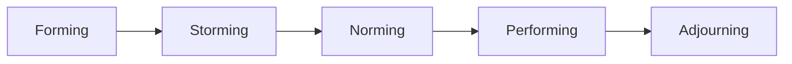
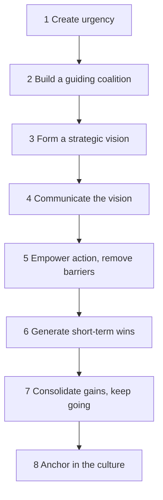
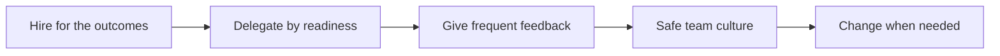

# 02. Leadership and Organisational Behaviour

How people behave at work and how to lead them: motivation, teams, leadership style, delegation, feedback, culture, change and psychological safety.

> **Not from the library.** General reference material written to fill a gap in the books in this section.

Dates below are the originators' publication years. Each was checked against web sources (November 2026): Herzberg 1959 and 1968, Edmondson 1999, Deci and Ryan 1985, Locke and Latham 1990, Schein 1985, Maslow 1943, Burns 1978, Bass 1985, Blake and Mouton 1964, Tuckman 1965 and Kotter 1995 all match. Two points are softer: the 2000 Ryan and Deci article was not found by search, and the Hersey-Blanchard 1969 date is firm for the model (first called Life Cycle Theory of Leadership) but not confirmed for the book's first edition. The delegation ladder and the Project Aristotle ranking are not from one original source (see notes in place).

## At a glance

| Framework | In one line | Use it when |
|---|---|---|
| Herzberg two-factor | Fixing pay/conditions removes dissatisfaction; only the work itself motivates | Wondering why a raise did not lift morale |
| Self-determination (Ryan and Deci) | Autonomy, competence, relatedness drive motivation | Designing roles and delegation |
| Goal-setting (Locke and Latham) | Specific, hard, accepted goals beat "do your best" | Setting targets |
| Tuckman stages | Forming, storming, norming, performing, adjourning | A new or changed team feels rocky |
| Situational leadership (Hersey and Blanchard) | Match directing/coaching/supporting/delegating to the person's readiness for *this task* | Choosing how hands-on to be |
| Delegation levels | From "do exactly this" to "act and tell me later" | Handing work over |
| Feedback / SBI | Situation, behaviour, impact | Any performance conversation |
| Schein culture layers | Artefacts, espoused values, underlying assumptions | Diagnosing why "the way we do things" resists change |
| Kotter's eight steps | Urgency to anchoring in the culture | Leading a real organisational change |
| Psychological safety (Edmondson) | Team belief that speaking up is safe | Errors hidden, silent meetings |

## Motivation

### Herzberg's two factors
- Frederick Herzberg (with Mausner and Snyderman, *The Motivation to Work*, Wiley, 1959, from interviews with engineers and accountants; popularised in the *Harvard Business Review* article "One More Time: How Do You Motivate Employees?", January-February 1968).
- **Hygiene factors** (pay, policy, supervision, conditions, security): if bad, cause dissatisfaction; if good, only remove it.
- **Motivators** (achievement, recognition, the work itself, responsibility, growth): create real engagement.
- Use: fix hygiene so it is not a grievance, then design the *job* to motivate. Example: matching market pay stops complaints but a more meaningful project drives effort.
- Mistake: assuming a raise is a long-term motivator (also noted in [[1. Hiring|Hiring]], where pay is one of five levers).

### Self-determination theory
- Deci and Ryan, *Intrinsic Motivation and Self-Determination in Human Behavior* (1985); the Ryan and Deci 2000 *American Psychologist* article is the usual summary (not independently confirmed here). Three needs: **autonomy**, **competence**, **relatedness**.
- Controlling rewards can crowd out intrinsic interest; support the three needs instead.
- Use: give people ownership of outcomes, stretch tasks matched to skill, and a team they belong to.

### Goal-setting
- Locke and Latham (1990, *A Theory of Goal Setting and Task Performance*; summarised in their 2002 *American Psychologist* article, "Building a practically useful theory of goal setting and task motivation: a 35-year odyssey"): specific and challenging goals, with commitment and feedback, outperform vague ones.
- Same logic as the outcomes in a hiring scorecard. Mistakes: impossible targets, goals with no feedback loop, too many at once.

### Maslow (1943) as a caution
- Abraham Maslow, "A Theory of Human Motivation", *Psychological Review*, 1943. The hierarchy of needs is a useful reminder that basic security comes first, but the strict stage order has weak empirical support. Treat as a prompt, not a law.

## Teams: Tuckman's stages

| Stage | What you see | Leader's move |
|---|---|---|
| Forming | Polite, unclear roles, dependence on the leader | Give direction, purpose, introductions |
| Storming | Conflict over roles, approach, authority | Name it, clarify roles and decision rights; do not suppress |
| Norming | Agreed ways of working, cohesion | Reinforce norms, share ownership |
| Performing | Self-driven, flexible, results | Delegate, remove obstacles, develop people |
| Adjourning | Ending or breaking up | Mark the end, capture lessons |

- Bruce Tuckman (1965) named the first four; Tuckman and Jensen (1977) added adjourning.
- Caveat: stages overlap and teams loop back when members or goals change. A new member can reset the team to forming.

## Leadership

### Situational leadership
- Hersey and Blanchard introduced it in 1969 as the "Life Cycle Theory of Leadership" (developed alongside their textbook *Management of Organizational Behavior*); renamed Situational Leadership in the mid-1970s, and later developed by Blanchard and colleagues as SLII. The style labels below are the SLII ones; the original four were telling, selling, participating, delegating.
- Two dials: how much **direction** and how much **support**. The right mix depends on the follower's **competence and commitment for a specific task**, not a general label.

| Person's state on this task | Style | What it means |
|---|---|---|
| New, keen, low skill | Directing | Tell what, how, when; check closely |
| Some skill, dipping confidence | Coaching | Explain why, invite input, keep direction |
| Capable, variable confidence | Supporting | Listen, encourage, let them decide how |
| Capable and committed | Delegating | Agree the result, step back |

- Example: a strong analyst new to presenting needs coaching on the presentation, delegation on the analysis.
- Mistakes: one style for everyone; staying in directing mode after competence has grown (micromanagement); delegating to someone still learning.

### Other lenses (brief)
- Transformational versus transactional leadership (Burns 1978; Bass 1985): inspiring a shared purpose versus exchanging reward for performance. Most leaders need both.
- Task versus people concern (Blake and Mouton's managerial grid, 1964; Ohio State and Michigan studies): good leaders score high on both.

### Delegation
- Delegate the *outcome and its authority*, not just the task. Agree: the result wanted, the standards, the limits of authority, the check-in points.
- Levels of authority (a common ladder with many variants; no single originator, so treat the wording as a convention): 1 do as told; 2 research and report; 3 recommend, I decide; 4 decide, I'll confirm; 5 act and report; 6 act, no report needed.
- Mistakes: delegating work but keeping the decisions; reverse delegation (taking the problem back when they bring it); checking only at the end.
- Link: the manager's output is the output of the team ([[1. Managerial Output|Managerial Output]]), so delegation is the lever.

## Feedback and performance conversations

- **SBI** (developed by the Center for Creative Leadership, which holds the trademark; some add a fourth step, intent): **Situation** (when and where), **Behaviour** (what you saw, not an interpretation), **Impact** (effect on results or people). Then ask for their view.
- Give it soon, specifically, privately for corrective points. Mix recognition and correction by honesty, not by a formula.
- Structure for a performance conversation: agree the purpose; compare with the agreed outcomes (the scorecard); ask the person to assess first; explain gaps with facts; agree actions and a date; write it down.
- Underperformance ladder: clarify expectations, check skill vs will, coach, set a time-bound plan, then decide. Do it early; delay hurts the rest of the team.
- Mistakes: surprises at the annual review; labelling the person ("you are careless") instead of the behaviour; only feedback when things go wrong.

## Organisational culture

- Edgar Schein (*Organizational Culture and Leadership*, 1985) describes three layers:

| Layer | Example |
|---|---|
| Artefacts | Office layout, rituals, dress, how meetings run |
| Espoused values | The stated values and mission |
| Basic assumptions | Unspoken beliefs about "how things really work" |

- Culture is set by what leaders pay attention to, reward, tolerate and punish, more than by posters. If the stated value and the promotion decisions disagree, the decisions win.
- Use it in hiring: describe your culture in adjectives and turn them into competencies ([[1. Hiring|Hiring]]).
- Mistakes: copying another company's values; mistaking perks for culture.

## Leading change: Kotter

John Kotter, "Leading Change: Why Transformation Efforts Fail", *Harvard Business Review*, 1995 (book 1996), based on his study of companies attempting transformations. His eight steps:

- Example: moving a small firm to a new delivery process: show why the old one is failing (1), enlist respected people (2), describe the end state in one page (3), repeat it often (4), remove the rule that blocks it (5), prove it on one project (6), extend to the rest (7), change onboarding and promotion criteria so it sticks (8).
- Mistakes: declaring victory early; under-communicating; skipping the coalition; ignoring that people lose something in change (explain and listen to resistance rather than overpower it).
- Alternative simple lens: individuals move from awareness to desire to ability to reinforcement (ADKAR, Prosci). Mention only; use whichever you can explain.

## Psychological safety

- Amy Edmondson, "Psychological Safety and Learning Behavior in Work Teams", *Administrative Science Quarterly*, 1999: a shared belief that the team is safe for interpersonal risk-taking (asking, admitting error, disagreeing).
- Google's Project Aristotle (about 180 teams) later reported psychological safety as the most important of five dynamics, ahead of dependability, structure and clarity, meaning and impact. This ranking comes from the company's own reporting via secondary sources, so treat it as one input.
- It is not "being nice" or low standards: pair high safety with high standards to get learning and performance.
- Leader behaviours: admit your own mistakes; ask for dissent and thank the person for it; respond to bad news with curiosity; separate the learning discussion from blame; frame work as learning, not only execution.
- Signs it is missing: silence in meetings, news arriving late, the same two people talking, errors found by customers first.

## Putting it together

## Recall

**Q: In Herzberg's model, why does a raise often fail to motivate?**

??? note "Answer"
    Pay is a hygiene factor: it prevents dissatisfaction but real motivation comes from the work itself, achievement, recognition and growth.

**Q: What are Tuckman's stages and who added the last?**

??? note "Answer"
    Forming, storming, norming, performing (Tuckman 1965); adjourning added by Tuckman and Jensen in 1977.

**Q: How does situational leadership choose a style?**

??? note "Answer"
    By the person's competence and commitment for the specific task: directing, coaching, supporting or delegating.

**Q: Give Kotter's first three and last steps.**

??? note "Answer"
    Create urgency, build a guiding coalition, form a vision; the last is anchoring the change in the culture.

**Q: What does SBI stand for?**

??? note "Answer"
    Situation, behaviour, impact.

## Links

- [[1. Managerial Output|Managerial Output]]
- [[1. Hiring|Hiring]]
- [[3. Operating Rhythm|Operating Rhythm]]
- [[2. What an MBA Teaches|What an MBA Teaches]]
