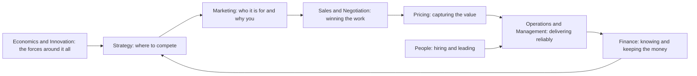

# 01. Start Here

Business notes for running and growing a small services or software business: strategy, money, customers, selling, pricing, operations and people. Written as a study and reminder resource: find the right framework, see how it works, and know when to reach for it.

Most notes are built from books, and every note names its book and author. A few fill gaps the books leave (accounting, valuation, South African tax, economics and more); those open with a **Not from the library** callout so you always know which is which. The full book list, with bookshop links, is in [[6. Business and Management|Business and Management]] under Books.

## How to use it

- Facing a situation (a price to set, a hire, a tense negotiation)? Start with [[11. Frameworks at a Glance|Frameworks at a Glance]]: one line per framework and when to use it, with a link to the note.
- Want to study a subject? Open its section below and read the notes in order.
- Each note ends with **Recall** questions with hidden answers. Cover the answer, say it aloud, then open it.
- Notes explain ideas in their own words and are no substitute for the books. Read the book when an idea matters to you.

## How the sections fit together

## The sections

| Section | What is in it | Start with |
|---|---|---|
| Foundations | How a business works as a whole; what a formal business education covers; mental models for thinking and systems | [[1. How Business Works|How Business Works]] |
| Strategy | What makes a strategy good; the seven sources of lasting advantage; deciding well when you cannot be sure | [[1. Good Strategy|Good Strategy]] |
| Finance | Reading financial statements; splitting cash so profit happens first; accounting, valuation, South African tax | [[1. Reading the Numbers|Reading the Numbers]] |
| Marketing | Positioning a product; learning from customer conversations; marketing fundamentals | [[1. Positioning|Positioning]] |
| Sales and Negotiation | Consultative selling; tactical negotiation; trust-based advisory relationships | [[1. Consultative Selling|Consultative Selling]] |
| Pricing | Charging for value rather than time; packaging, proposals and terms | [[1. Value-Based Pricing|Value-Based Pricing]] |
| Operations and Management | Managerial output; running on systems; an operating rhythm; building a business that can be sold; operations basics | [[1. Managerial Output|Managerial Output]] |
| People | A repeatable hiring method; leadership and organisational behaviour | [[1. Hiring|Hiring]] |
| Economics and Innovation | Economics essentials; lean startup and innovation | [[1. Economics Essentials|Economics Essentials]] |

## A suggested route

1. [[1. How Business Works|How Business Works]] for the whole picture.
2. [[1. Good Strategy|Good Strategy]] and [[1. Positioning|Positioning]] to decide what you do and for whom.
3. [[1. Reading the Numbers|Reading the Numbers]] and [[2. Cash Allocation|Cash Allocation]] before spending money.
4. [[1. Value-Based Pricing|Value-Based Pricing]], [[1. Consultative Selling|Consultative Selling]] and [[2. Tactical Negotiation|Tactical Negotiation]] when winning work.
5. [[2. Running on Systems|Running on Systems]], [[3. Operating Rhythm|Operating Rhythm]] and [[1. Hiring|Hiring]] when the business needs to run without you.

## Notes on the notes

- Figures that change over time (tax rates, thresholds, B-BBEE bands) carry an "as of" date and the official source. Check the source before acting; this is general information, not professional advice.
- Where a book gives an illustrative number, the note says it is the author's figure, not a verified statistic.
- Some checks are still open. Anything not confirmed is flagged in the note where it appears.
