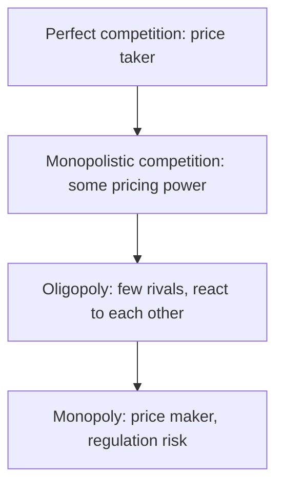
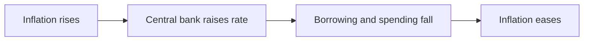

# 01. Economics Essentials

The handful of economic ideas that explain prices, competition and the macro environment a small business operates in.

> **Not from the library.** General reference material written to fill a gap in the books in this section.

Checked on the web (November 2026): Nash 1950 (PNAS, "Equilibrium points in n-person games"), Ricardo 1817 (*On the Principles of Political Economy and Taxation*) and the South African inflation target (3% with a 1-point band, announced 12 November 2025). Worked numbers are illustrative, not data. No repo rate is quoted because it changes at each Monetary Policy Committee meeting.

## At a glance

| Idea | In one line | Use it when |
|---|---|---|
| Supply and demand | Price balances what buyers want with what sellers offer | Explaining price moves |
| Elasticity | How strongly quantity reacts to price | Changing price |
| Opportunity cost, marginal thinking | The best alternative forgone; decide on the next unit | Any trade-off |
| Market structures | Competition to monopoly | Judging pricing power |
| Game theory | Outcomes depend on others' choices | Competitors, negotiation |
| Externalities | Costs or benefits borne by third parties | Regulation, shared platforms |
| Comparative advantage | Specialise where the relative cost is lowest | Outsourcing, focus |
| Inflation, rates, FX | Macro prices that squeeze or help margins | Planning cash and pricing |
| Network effects, scale | Value or cost advantage grows with size | Judging durable advantage |

## Supply and demand

- Demand: quantity buyers want falls as price rises. Supply: quantity sellers offer rises with price.
- Equilibrium is where they meet. A demand increase raises price and quantity; a supply increase lowers price.
- Demand shifts with income, tastes, substitutes; supply shifts with input costs and technology.
- Price ceilings cause shortages; floors cause surpluses.
- Mistake: confusing a move along the curve (price change) with a shift of the curve (other cause).
- Worked example: a service sells 100 units a month at R500 when the market price is R500. A new competitor enters (supply up): the market price slips to R450 and your volume only holds if you cut to match. A rise in client incomes (demand up) works the other way and lets you lift price or sell more at the same price.
- Shortage test: if you are always fully booked with a waiting list, the price is probably below equilibrium; raise it until the queue clears.

## Elasticity

- Price elasticity of demand = % change in quantity / % change in price.
- Elastic (above 1 in size): customers react strongly, so a price rise cuts revenue. Inelastic (below 1): a rise raises revenue.
- Drivers: close substitutes, share of budget, necessity, time to adapt.
- Worked example (inelastic): price R100 to R110 (+10%), volume 1,000 to 980 (-2%). Elasticity = 0.2. Revenue goes from R100,000 to R107,800.
- Worked example (elastic): the same +10% price rise cuts volume 20% to 800. Elasticity = 2. Revenue falls to R88,000.
- Break-even idea: a price rise pays only if the volume lost is smaller than the extra margin earned; with a 40% margin, a 10% rise stays profitable until you lose roughly 20% of volume (margin per unit rises from 40 to 50, so volume can fall to 40/50 = 80%).
- Test with a small change on a slice of customers before changing everything.
- Link to value perception: [[2. Seven Powers|Seven Powers]] describes why some firms keep pricing power.

## Opportunity cost and marginal thinking

- Opportunity cost: value of the next best use of a resource, including your time.
- Marginal: decide on the extra cost versus extra benefit of one more unit. Continue while marginal benefit exceeds marginal cost.
- Sunk costs are gone; ignore them in forward decisions.
- Worked example: a unit costs R60 to produce at the margin and sells for R100. Fixed costs of R20,000 a month are already paid, so a one-off order for 100 units at R75 still adds 100 x (75 - 60) = R1,500. The fixed cost is sunk; the real question is whether the discount damages your normal price.
- Worked example (time): a day spent on a R2,000 task that blocks a R10,000 contract costs R10,000 in opportunity terms, not R2,000.
- Mistake: comparing average cost when the decision is about the next unit.

## Market structures

| Structure | Features | Pricing power |
|---|---|---|
| Perfect competition | Many sellers, identical product | None |
| Monopolistic competition | Many sellers, differentiated | Some |
| Oligopoly | Few large firms, interdependent | Often high |
| Monopoly | One seller, barriers to entry | High (may attract regulation) |

- Differentiation and barriers to entry lift margins; commodities compete on cost.
- Concentration measure: the Herfindahl-Hirschman index sums the squared market shares. Four firms at 40, 30, 20 and 10 give 1,600 + 900 + 400 + 100 = 3,400; a market of 100 firms at 1% each gives 100. Regulators use thresholds that vary by country, so look up the current ones.
- Moving up the ladder is the strategic goal of most small firms: from selling a commodity, to a differentiated offer, to a niche where you are the only credible option.

- Moves that climb the ladder: a distinctive brand, switching costs, proprietary data or know-how, exclusive relationships, a specialised niche. See [[1. Positioning|Positioning]].

## Game theory basics

- Players, choices, payoffs. Prisoner's dilemma: each does better defecting, yet both lose if both do (price wars).
- Nash equilibrium (John Nash, 1950): no player gains by changing alone.
- Repeated games reward reputation and cooperation; one-off games reward defection.
- Worked example (price war), profits in rand thousands per month, yours first:

| | Rival holds price | Rival cuts price |
|---|---|---|
| You hold | 50, 50 | 20, 80 |
| You cut | 80, 20 | 30, 30 |

  Cutting is better for you whatever the rival does (80 > 50 and 30 > 20), and the same for the rival, so both cut and end at 30 each: the Nash equilibrium, worse than both holding. The way out is differentiation (compete on something other than price) or a credible reason the rival will not cut.
- Mistake: assuming a rival will behave as you would; check their costs and incentives.
- Use: anticipate competitor reactions before cutting price; signal credibly.

## Externalities

- Negative: pollution, congestion. Positive: training, shared standards. Costs/benefits fall on others, so markets over- or under-produce.
- Fixes: taxes, subsidies, regulation, property rights.
- Business angle: expect regulation where harm is externalised; a positive externality can justify cooperation.

## Comparative advantage

- David Ricardo (1817): even if you are better at everything, gain by specialising where your relative opportunity cost is lowest and trading.
- Ricardo's own illustration: Portugal makes both wine and cloth with less labour than England, yet both gain if Portugal makes wine (where its edge is largest) and England makes cloth.
- Example: a founder who bills R1,000 an hour spends 10 hours a month on bookkeeping that a bookkeeper does for R3,000. Doing it herself costs R10,000 of billable time; buying it saves R7,000, provided those 10 hours really would be billed.
- Mistake: outsourcing core capability, or doing low-value work out of habit.

## Inflation, interest rates, exchange rates

- Inflation: general rise in prices. Squeezes margins if you cannot reprice, erodes fixed-price contracts, and raises wage demands. Index multi-year contracts.
- Interest rates: set by the central bank to steer inflation. Higher rates raise debt and overdraft costs, cut customer spending, and raise the return on cash.
- Exchange rates: a weaker home currency raises the rand cost of imported inputs and foreign-priced subscriptions, and helps exporters.
- South Africa: the South African Reserve Bank (SARB) runs monetary policy through its Monetary Policy Committee, setting the repo rate; commercial banks set prime off it. On 12 November 2025 the Finance Minister announced, with the SARB Governor's agreement, a new inflation target of 3% with a tolerance band of 1 percentage point, replacing the earlier 3% to 6% range; it was to be implemented over about two years (reported by SAnews and other outlets; the SARB's own monetary policy pages describe the framework). The repo rate changes at each Monetary Policy Committee meeting, so look it up on the SARB website when you need it.
- Worked example (inflation): a fixed R100,000 annual contract is worth about R95,200 in last year's money after 5% inflation (100,000 / 1.05). Add an annual escalator tied to a published index or a fixed percentage.
- Worked example (rates): R500,000 of floating-rate debt costs R10,000 more a year for every extra 2 points of interest (500,000 x 2%). Test that your cash flow survives it.
- Worked example (exchange rate): a US$100 monthly subscription is R1,800 at R18 to the dollar and R2,000 at R20, an 11% rise in rand cost with no change in the product.
- Small-business playbook: price in the currency of your costs, hold a cash buffer, avoid floating-rate debt you cannot service at +2 points, review prices annually.

## Network effects and economies of scale

- Network effects: each new user raises the value for others (marketplaces, messaging). Direct (same side) or indirect (two-sided).
- Economies of scale: average cost falls as volume rises (fixed costs spread, bulk buying). Diseconomies appear when coordination costs overwhelm.
- Both can create winner-takes-most markets and durable advantages; see [[2. Seven Powers|Seven Powers]].
- Worked example (scale): fixed cost R60,000 a month plus R200 per unit. At 300 units the average cost is 200 + 200 = R400; at 600 units it is 200 + 100 = R300. Volume cut the unit cost by a quarter.
- Worked example (network): with n users, possible pairwise connections are n(n-1)/2: 10 users give 45, 20 users give 190. Doubling the users more than quadruples the potential links, which is why value can rise faster than size, though real value is below this upper bound.
- Mistake: assuming every product has network effects; many only have usage.

## Business cycle and why it matters

- Economies move through expansion, peak, contraction and recovery; demand, credit and confidence move together.
- In a contraction customers delay purchases and pay slowly, so cash collection matters more than profit. In an expansion, costs (wages, rent, inputs) rise faster than you expect.
- Use: keep a cash buffer sized in months of fixed costs, avoid fixed commitments that assume today's growth, and invest in capability when competitors are cutting back.

## Recall

**Q: When does a price rise increase revenue?**

??? note "Answer"
    When demand is inelastic, meaning volume falls proportionally less than price rises.

**Q: What is opportunity cost?**

??? note "Answer"
    The value of the best alternative you give up by choosing something.

**Q: How does a weaker rand hit a small business?**

??? note "Answer"
    It raises the rand cost of imported inputs and foreign-priced tools, squeezing margins unless prices adjust.

**Q: What is a network effect?**

??? note "Answer"
    A product becomes more valuable as more people use it.

**Q: In the price war table, why do both firms cut even though both holding is better?**

??? note "Answer"
    Cutting beats holding whatever the rival does (a dominant strategy), so both cut and end at the worse outcome. That is the Nash equilibrium.

**Q: A price rise of 10% loses 20% of volume. Elastic or inelastic, and what happens to revenue?**

??? note "Answer"
    Elastic (elasticity 2), so revenue falls.

**Q: What is a sunk cost and how should it affect a forward decision?**

??? note "Answer"
    A cost already incurred and unrecoverable. Ignore it; compare only future costs and benefits.

**Q: What does the South African inflation target look like since the November 2025 announcement?**

??? note "Answer"
    3% with a tolerance band of 1 percentage point, replacing the old 3% to 6% range. Check the SARB site for the current position.

**Q: Why can a founder who is better at everything still gain by outsourcing?**

??? note "Answer"
    Comparative advantage: if her time earns more elsewhere than the task costs to buy, buying is cheaper than the opportunity cost.

## Links

- [[2. Seven Powers|Seven Powers]]
