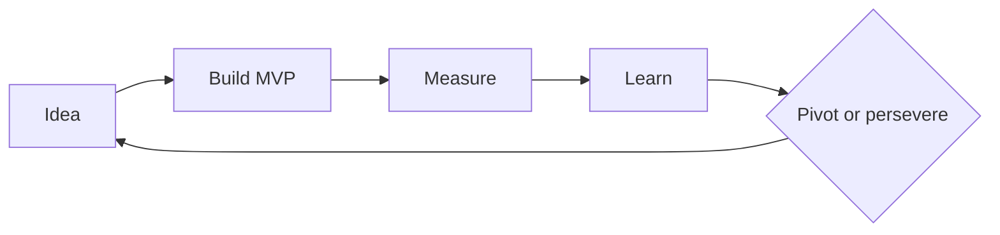
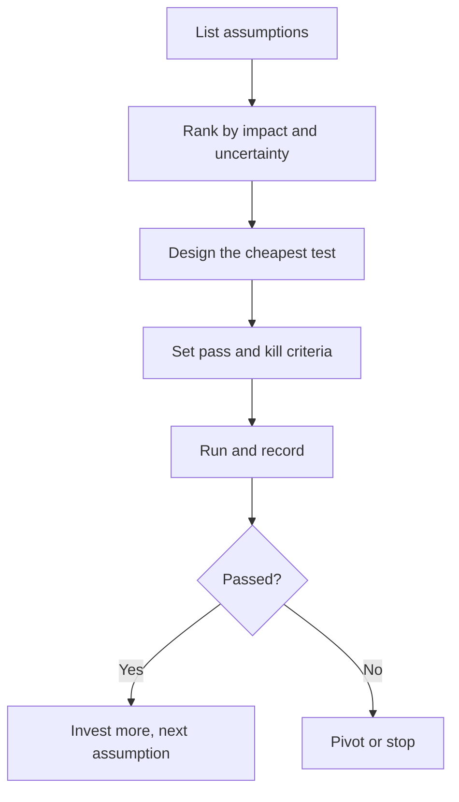

# 02. Innovation and Entrepreneurship

How new ventures and products are tested, shaped and funded, and how to keep experiments cheap.

> **Not from the library.** General reference material written to fill a gap in the books in this section.

Checked on the web (November 2026): Ries 2011, Blank (usually dated 2005), Bower and Christensen HBR 1995, Christensen 1997, Competing Against Luck 2016, Osterwalder thesis 2004 and Business Model Generation 2010, Andreessen 2007, and Platform Revolution 2016 all confirmed. Softer points: who coined "product/market fit" is disputed (Rachleff versus Andreessen), the year of the Sean Ellis survey varies by source so none is given, and the origin of jobs to be done is claimed differently by Ulwick and Christensen. Worked numbers are illustrative.

## At a glance

| Framework | In one line | Use it when |
|---|---|---|
| Lean startup | Build-measure-learn with an MVP | Uncertain demand |
| Disruptive vs sustaining | Cheap simple entrants climb from below | Judging threats and moves |
| Jobs to be done | Customers hire products to make progress | Defining what to build |
| Business model canvas | One-page map of the model | Designing or reviewing a model |
| Product-market fit | A strong market pulls the product | Deciding when to scale |
| Funding stages | Bootstrap, angel, seed, Series A+ | Choosing capital |
| Platforms and ecosystems | Value created by outside participants | Considering a marketplace or API |
| Experiment risk | Cap the downside of each test | Running many bets |

## Lean startup

- Eric Ries, *The Lean Startup* (2011), building on Steve Blank's customer development (*The Four Steps to the Epiphany*, usually dated 2005) and Toyota's lean thinking. Ries combined customer development with agile engineering.

- MVP: smallest thing that tests the riskiest assumption. It can be a landing page, concierge service or manual process, not necessarily software.
- Validated learning: set a falsifiable hypothesis and a success threshold before building.
- Innovation accounting: track actionable metrics, not vanity ones.
- Pivot: change a core assumption (customer, problem, channel, model) while keeping the learning.
- Example: before building a booking tool, take bookings by form and email for ten customers; if fewer than a set number pay, rethink.
- Worked example of a pass mark: take bookings by form for 10 target customers, charging a R500 deposit. Decide beforehand: 3 or more pay means continue; 0 or 1 means rethink the offer. A result of 2 means refine the offer and rerun, not celebrate.
- Test ladder, cheapest first: customer interviews, landing page with sign-up, manual "concierge" delivery, pre-sale or deposit, small paid pilot, then a built product.
- Mistakes: calling an unfinished product an MVP, never defining what would count as failure.

## Disruptive vs sustaining innovation

- Clayton Christensen, *The Innovator's Dilemma* (1997), after the 1995 Harvard Business Review article "Disruptive Technologies: Catching the Wave" with Joseph Bower (February 1995). The article's examples include radial tyres and Canon taking the small-copier market from Xerox.
- Sustaining: improves existing products for existing, demanding customers. Incumbents usually win.
- Disruptive: starts simpler, cheaper or more convenient, serves overlooked or new customers, then improves until it satisfies the mainstream. Incumbents ignore it because their best customers do not want it and margins look lower.
- Two types: low-end (undershot customers) and new-market (non-consumers).
- Use: ask who is overserved, and who cannot afford or access the current solution.
- Trajectory idea: products improve faster than customers' needs, so a simple product that is "not good enough" today overshoots the mainstream tomorrow.

| | Sustaining | Low-end disruption | New-market disruption |
|---|---|---|---|
| Customers | Best, most demanding | Overserved, price sensitive | Non-consumers |
| Offer | Better | Good enough, cheaper | Simpler, more accessible |
| Incumbent response | Invest | Flee upmarket | Ignore |

- Response options for an incumbent: a separate unit with its own economics (the 1995 article's advice), partner or acquire, or accept the lower margin deliberately.
- Mistake: calling any new technology disruptive. Christensen's definition is about business model and trajectory.

## Jobs to be done

- Customers hire a product to make progress in a circumstance. Tony Ulwick built the outcome-driven innovation (ODI) method, which he says he shared with Christensen in 1999; Christensen popularised the idea (*Competing Against Luck*, 2016, with Taddy Hall, Karen Dillon and David Duncan). Both camps claim authorship, and their methods differ.
- Job statement: when [situation], I want to [motivation], so I can [outcome].
- Includes functional, emotional and social dimensions, and what it competes with (including doing nothing).
- Find the job through interviews: see [[2. Customer Conversations|Customer Conversations]].
- Example: people "hire" a milkshake on a morning commute to make a boring drive less dull and to stay full; the competitors are a banana, a bagel and boredom, not other milkshakes. (The well-known illustration from the Christensen camp; treat as a teaching story.)
- Example for a small firm: a client "hires" a monthly retainer to stop worrying about whether the system will break; the real competitor is doing nothing and hoping.
- Interview prompts: what happened the day you decided to look; what else did you try; what nearly stopped you; what would you do if this did not exist.
- Mistake: segmenting by demographics when circumstance predicts buying better.

## Business model canvas

- Alexander Osterwalder, from his 2004 doctoral thesis (supervised by Yves Pigneur), popularised in *Business Model Generation* (2010, with Pigneur; Tim Clark is also credited on the book).

| Left (efficiency) | Centre | Right (value to customer) |
|---|---|---|
| Key partners | Value propositions | Customer relationships |
| Key activities | | Channels |
| Key resources | | Customer segments |
| Cost structure | | Revenue streams |

- Fill with sticky notes, one per assumption; mark the riskiest and test those.
- Start with segments and value proposition, then check that revenue exceeds cost.
- Link to differentiation: [[1. Positioning|Positioning]].
- Worked example (bookkeeping subscription for tradespeople): segment: sole-trader plumbers; value: monthly books done, no tax-season panic; channel: referrals from suppliers; relationship: monthly call; revenue: R1,200 a month; key activity: reconcile and report; cost: bookkeeper time at R300 an hour, 2 hours a client. Margin per client = 1,200 - 600 = R600. Riskiest assumption: plumbers will pay R1,200, so test that first.
- Check the left side supports the right: if a key resource is one person, the model does not scale beyond that person's hours.
- Mistake: filling it once and never testing it.

## Product-market fit

- Andy Rachleff is usually credited with the term and with the underlying thinking; Marc Andreessen spread it in his June 2007 essay "The only thing that matters" (sources disagree on who named it). His definition: being in a good market with a product that can satisfy that market. He argued the market matters more than the team or the product.
- Signs: organic growth, retention, referrals, demand outrunning delivery.
- Sean Ellis test: ask users how they would feel if they could no longer use the product; if at least roughly 40% say "very disappointed", fit is likely (a heuristic from benchmarking startups, not a law).
- Worked example: 100 active users surveyed; 45 say very disappointed, so likely fit. At 28, the product has not found its core group yet: ask what those 28 have in common, narrow to them, and improve for them.
- Retention view: plot the share of each month's new customers still active over time. A curve that flattens above zero signals fit; one that keeps falling to zero does not.
- Do not scale spending before fit; scaling a leaky retention curve just burns cash.

## Stages of funding

| Stage | Source | Typical purpose |
|---|---|---|
| Bootstrap | Savings, customer revenue | Prove demand cheaply |
| Friends and family / grants | Small cheques | Early build |
| Angel / pre-seed | Individuals | Validate and hire first people |
| Seed | Seed funds | Reach fit |
| Series A, B, C | Venture funds | Scale repeatable growth |
| Debt, revenue-based, profit | Banks, lenders | When cash flows are predictable |

- Trade-off: equity gives capital and dilution plus pressure to grow fast; bootstrapping keeps control and pace.
- Not every business fits venture funding; profitable small firms often should not take it.
- Worked example (dilution): a founder owns 100%. A seed round of R2m at an R8m pre-money valuation makes the company worth R10m after the money, so investors hold 20% and the founder 80%. A later R10m at R40m pre-money (R50m post) gives investors 20% again, and the founder's 80% becomes 64% (80% x 80%). Owning less of something bigger can still be worth more.
- Terms and amounts shift with the market, so check current norms when raising.

## Platforms and ecosystems

- Platform: connects producers and consumers and enables third parties to create value (Geoffrey Parker, Marshall Van Alstyne and Sangeet Paul Choudary, *Platform Revolution*, 2016). They contrast platforms with traditional "pipeline" businesses that create and sell their own products.
- Core challenge: the chicken-and-egg start; solve one side first or a single-user utility (come for the tool, stay for the network).
- Ecosystem questions: who else benefits, who controls standards, what stops multi-homing.
- Worked example (chicken and egg): a marketplace for local tutors needs students to attract tutors and tutors to attract students. Start by recruiting 20 tutors by hand in one suburb and serving students yourself by referral; widen only when most requests are matched within a day.
- Platform health metrics: matches made, repeat use on both sides, and the share of transactions that stay on the platform.
- Mistake: building a platform before having one successful product.

## Risk management of experiments

- List assumptions; rank by risk (impact if wrong x uncertainty). Test the largest first.
- Cap each experiment: fixed time, money and a kill criterion decided up front.
- Keep a portfolio: few big bets, many cheap probes; avoid betting the core business.
- Reversible decisions fast, irreversible decisions slowly.
- Log results, including failures, so lessons survive.
- Worked example (portfolio): five tests of R10,000 each cost R50,000. If one in five leads to a product worth R400,000 in gross margin, the expected value per test is 0.2 x 400,000 = R80,000, against a cost of R10,000. Cheap tests with an uncertain but large payoff are worth running; one R50,000 bet with the same odds is not the same thing.
- Risk ranking: score each assumption for impact if wrong and uncertainty (1 to 5 each); test the highest product first.

## Recall

**Q: What are the steps of the lean loop?**

??? note "Answer"
    Build a minimum viable product, measure behaviour, learn, then pivot or persevere.

**Q: Who developed the disruptive innovation theory and in what year?**

??? note "Answer"
    Clayton Christensen, The Innovator's Dilemma, 1997 (earlier article with Bower, 1995).

**Q: What is a job to be done?**

??? note "Answer"
    The progress a customer wants to make in a given circumstance, for which they hire a product.

**Q: What are the nine canvas blocks?**

??? note "Answer"
    Partners, activities, resources, value propositions, customer relationships, channels, segments, cost structure, revenue streams.

**Q: What is a pivot?**

??? note "Answer"
    A change to a core assumption (customer, problem, channel or model) while keeping what you learned.

**Q: Why do incumbents tend to ignore disruptive entrants?**

??? note "Answer"
    The entrant's offer does not suit their best customers and its margins look low, so rational resource allocation points elsewhere.

**Q: A survey of 100 users gives 28 who would be very disappointed. What do you do?**

??? note "Answer"
    Below the roughly 40% heuristic, so fit is not shown. Find what the 28 share, narrow to them and improve for them.

**Q: Seed round of R2m at R8m pre-money: what does the investor own?**

??? note "Answer"
    R2m / R10m = 20%.

**Q: What is the difference between a platform and a pipeline business?**

??? note "Answer"
    A pipeline makes and sells its own product; a platform lets outside producers and consumers create value together, so the early problem is attracting both sides.

## Links

- [[2. Customer Conversations|Customer Conversations]]
- [[1. Positioning|Positioning]]
