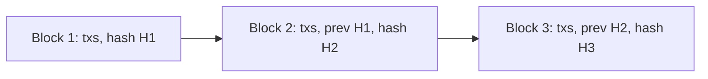
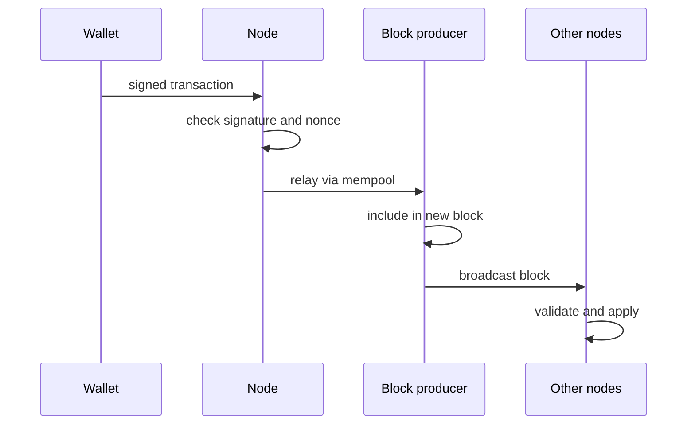
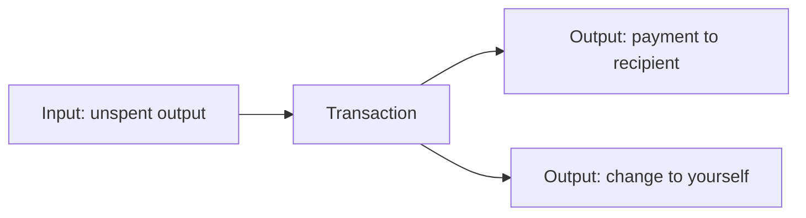
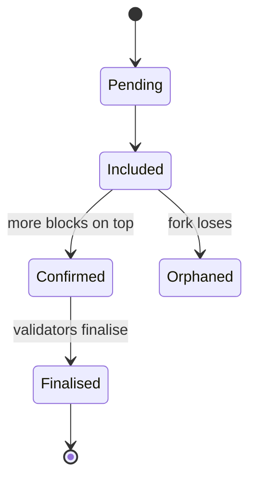

# 01. Blockchain Fundamentals

What a blockchain is, how blocks are linked, and how a network of strangers agrees on one history.

> **Not from the library.** General reference material written to fill a gap.

## At a glance

| Concept | In one line | Use it when |
|---|---|---|
| Hash chain | Each block commits to the previous block's hash | Explaining why history is tamper-evident |
| Consensus | The rule for choosing which block comes next | Comparing Proof of Work and Proof of Stake |
| Account vs UTXO model | Balances in accounts vs spendable outputs | Reading Ethereum vs Bitcoin data |
| Finality | How sure you are a transaction will not be reversed | Deciding how long to wait for confirmations |

## Hash chain

- A **hash function** (SHA-256 in Bitcoin, Keccak-256 in Ethereum) maps any input to a fixed-size fingerprint. Change one bit of input and the output changes completely.
- A block holds a list of transactions plus the **hash of the previous block**. Altering an old block changes its hash, which breaks every block after it.
- Transactions in a block are summarised by a **Merkle root**, so a light client can prove one transaction is included without downloading the whole block.

## Consensus

Nodes do not trust each other, so a rule decides who may add the next block and which fork wins.

| | Proof of Work (Bitcoin) | Proof of Stake (Ethereum) |
|---|---|---|
| Who proposes a block | Miner who finds a valid hash first | Validator chosen by the protocol |
| Scarce resource | Electricity and hardware | Staked coins |
| Attack cost | Control most of the hash power | Control a large share of staked value |
| Punishment for cheating | Wasted energy | Stake can be slashed |
| Fork choice | Chain with most accumulated work | Fork with the greatest weight of validator attestations (LMD-GHOST) |

- **Sybil resistance** is the real job: making fake identities expensive.
- A **51% attack** means one party controls enough power to rewrite recent history or censor transactions.

How a transaction travels from signature to block:

## Data models

- **UTXO** (Bitcoin): there are no balances, only unspent outputs. A transaction consumes outputs and creates new ones; change goes back to yourself. Your "balance" is the sum of outputs you can spend.

UTXO spending, with change returning to you:

- **Account** (Ethereum): the chain stores a state table of address to balance, nonce, and for contracts, code and storage. A transaction changes that state.
- The **nonce** is a per-account counter that orders transactions and stops replay.

## Finality and forks

- **Probabilistic finality** (Proof of Work): each extra block makes a reversal less likely, so exchanges wait for several confirmations.
- **Economic finality** (Ethereum): after a block is finalised by validators, reversing it would require burning at least one-third of the total staked ETH (Casper FFG).
- Short-lived forks happen naturally; the fork-choice rule resolves them and orphaned blocks are dropped.

Life of a transaction through finality:

## Node types

| Node | Stores | Typical use |
|---|---|---|
| Full node | Recent state, validates everything | Running your own trusted RPC |
| Archive node | Every historical state | Analytics, block explorers |
| Light client | Block headers only | Phones, browsers |

## Common mistakes

- Treating "blockchain" as a synonym for "database": a chain is slow and expensive by design, in exchange for no central operator.
- Assuming a transaction is final the moment it appears in the mempool or in one block.
- Confusing public chains (anyone can join) with permissioned ledgers (known participants, closer to a shared database).

## Recall

1. What stops someone editing an old block unnoticed?
2. Why does Proof of Stake slash and Proof of Work not need to?
3. How does the UTXO model handle "change"?
4. What is the nonce for?

??? note "Answers"
    1. Each block contains the previous block's hash, so an edit changes every later hash and the rest of the network rejects the altered chain.
    2. Staked coins can be destroyed by the protocol; in Proof of Work the cost of cheating is the energy already spent.
    3. The transaction creates an extra output that sends the leftover value back to an address you control.
    4. It orders an account's transactions and prevents the same signed transaction being replayed.

## Links

- [[1. Web3 Start Here|Web3 Start Here]]
- [[3. Keys, Wallets and Signatures|Keys, Wallets and Signatures]]

## External references

- [Proof of stake (ethereum.org docs source)](https://github.com/ethereum/ethereum-org-website/blob/dev/public/content/developers/docs/consensus-mechanisms/pos/index.md): validator selection, slashing, Casper FFG finality, LMD-GHOST fork choice.
- [Ethereum accounts (ethereum.org docs source)](https://github.com/ethereum/ethereum-org-website/blob/dev/public/content/developers/docs/accounts/index.md): account fields (nonce, balance, codeHash, storageRoot) and address derivation.
- [Nodes and clients (ethereum.org docs source)](https://github.com/ethereum/ethereum-org-website/blob/dev/public/content/developers/docs/nodes-and-clients/index.md): full, archive and light node definitions.
- [BIP-141 Segregated Witness](https://github.com/bitcoin/bips/blob/master/bip-0141.mediawiki): witness structure, block weight limit, txid vs wtxid.
- [Bitcoin Core consensus.h](https://github.com/bitcoin/bitcoin/blob/master/src/consensus/consensus.h): consensus constants such as coinbase maturity and max block weight.
