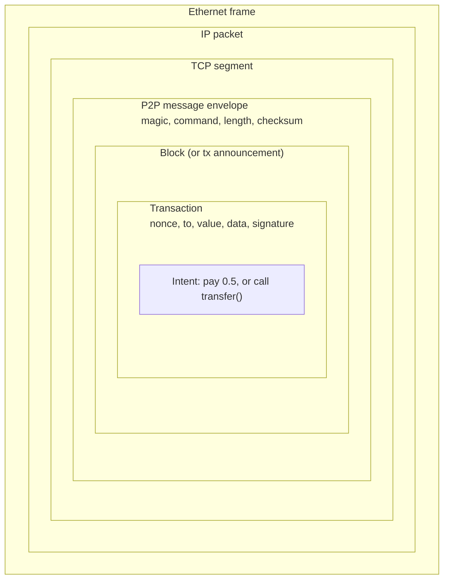
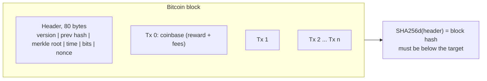
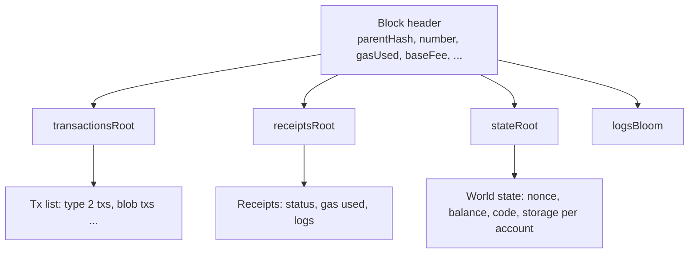
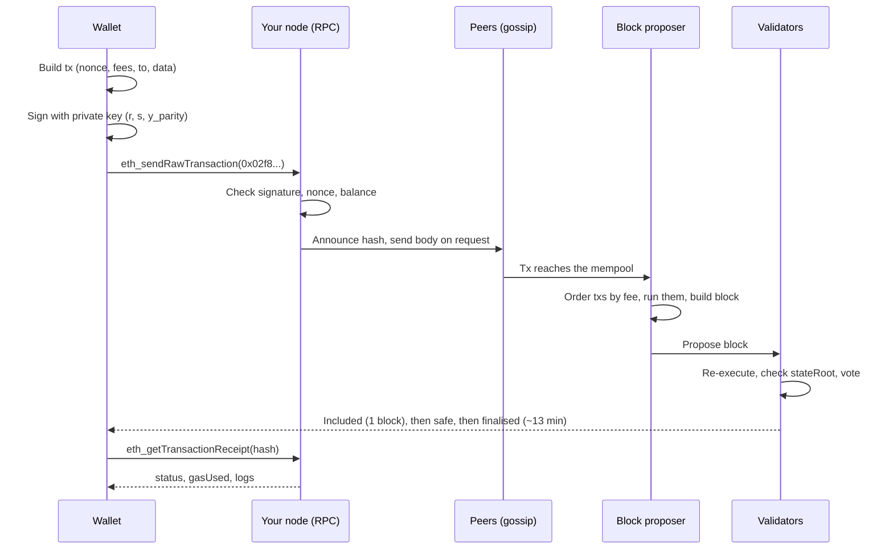

# 02. What Travels the Chain

A blockchain has no PDUs in the OSI sense ([[02. PDUs|PDUs]]), but if you had to draw one you would draw four nested units: the **transaction** (what a user signs), the **block** (what a producer assembles), the **network message** (what nodes pass around), and the ordinary TCP/IP packet carrying it. This note lays each one out field by field, the way you would read a packet in Wireshark. Concepts are in [[1. Blockchain Fundamentals|Blockchain Fundamentals]]; how these objects move and chain together is in [[3. How the Chain Moves|How the Chain Moves]].

> Related: [[4. Bitcoin Internals|Bitcoin Internals]] (Script, address types, Lightning), [[20. EVM Bytecode and Low-Level Analysis|EVM Bytecode and Low-Level Analysis]] and [[13. Node Operation and Infrastructure|Node Operation and Infrastructure]]. Layouts are for Bitcoin (simple, fixed, good for learning) and Ethereum (the smart-contract chain). Sizes are in bytes. Protocols change with upgrades; check the current specs (bitcoin.org developer docs, ethereum.org / execution-specs) before writing a parser.

---

# Encapsulation, Chain Style



| OSI-style layer | Chain equivalent | Unit |
| --------------- | ---------------- | ---- |
| 7 Application | The user's intent | "Send 10 USDC to Alice" |
| 6 Presentation | Serialisation | RLP (Ethereum), little-endian binary with varints (Bitcoin), SSZ (Ethereum consensus layer) |
| 5 Session / security | Signature | ECDSA over secp256k1 proves who authorised it |
| Chain data unit | **Transaction**, grouped into a **block** | Block header + body |
| 4 Transport | TCP (or QUIC / libp2p streams) | Reliable stream between peers |
| 3 Network | IP | Peers are found by IP:port (Bitcoin 8333, Ethereum 30303) |
| 2 Data link | Ethernet or Wi-Fi | Frame |

---

# Bitcoin

## Transaction

A transaction **consumes outputs** of earlier transactions (UTXOs) and **creates new outputs**. There are no account balances in the protocol, only unspent outputs.

```
Bitcoin transaction (SegWit serialisation)

 +--------------------+------------------------------------------+
 | version            | 4   int32 LE (1 or 2)                    |
 | marker, flag       | 1+1 0x00 0x01 (signals witness data)     |
 | input count        | 1-9 varint                               |
 | inputs[]           | see below, repeated                      |
 | output count       | 1-9 varint                               |
 | outputs[]          | see below, repeated                      |
 | witness[]          | one stack per input (signatures)         |
 | locktime           | 4   uint32 LE (0 = valid at once)        |
 +--------------------+------------------------------------------+

 Input                                   Output
 +-----------------+-----------------+   +-----------------+-----------------+
 | prev txid       | 32 hash         |   | value           | 8 satoshis      |
 | prev vout index | 4               |   | scriptPubKey len| varint          |
 | scriptSig len   | varint (0 in    |   | scriptPubKey    | locking script  |
 |                 |  native SegWit) |   +-----------------+-----------------+
 | scriptSig       | unlocking script|
 | sequence        | 4 (RBF, timelock)|
 +-----------------+-----------------+
```

- **txid** = `SHA256(SHA256(tx without witness))`: the same transaction always gets the same id
- Fee is not a field: fee = sum(input values) - sum(output values), and the input values are looked up from earlier outputs
- Typical sizes: a simple SegWit payment is about 140 vbytes
- 1 BTC = 100,000,000 satoshis, which is why `value` is an integer

## Block header: exactly 80 bytes

This is what proof of work hashes.

```
 Offset  Size  Field              Notes
 ------  ----  -----------------  -----------------------------------------
   0      4    version            Which rules / signalling bits
   4     32    previous hash      SHA256d of the previous header  <- THE CHAIN LINK
  36     32    merkle root        Commits to every transaction in the block
  68      4    timestamp          Seconds since 1970 (producer's clock)
  72      4    bits               Target in compact form; lower target = harder
  76      4    nonce              Ground by the miner until hash < target
 ------  ----
  80 bytes total
```

Block = header (80) + transaction count (varint) + transactions. The **first** transaction is the *coinbase*: it has no real input and creates the block reward plus fees. The block body is capped by "weight" (4,000,000 weight units, about 1 to 2 MB of typical data).



## P2P message envelope (the closest thing to a PDU header)

Every Bitcoin node-to-node message, over TCP port 8333, has this 24-byte header:

```
 Offset  Size  Field      Notes
 ------  ----  ---------  ------------------------------------------------
   0      4    magic      F9 BE B4 D9 on mainnet (finds message boundaries,
                          separates networks: testnet differs)
   4     12    command    ASCII, null-padded: "version", "inv", "tx", "block"
  16      4    length     Payload size, uint32 LE
  20      4    checksum   First 4 bytes of SHA256d(payload)
  24      n    payload    The transaction, the block, a list of hashes...
```

| Command | Purpose |
| ------- | ------- |
| `version` / `verack` | Handshake: protocol version, services, best block height |
| `inv` | "I have these tx / block hashes" (announce, do not send) |
| `getdata` | "Send me the full data for these hashes" |
| `tx` / `block` | The actual transaction or block |
| `getheaders` / `headers` | Sync by headers first, then fetch blocks |
| `ping` / `pong` | Keepalive |

Note the pattern: nodes announce **hashes** first and send full data only to peers that ask, which saves bandwidth on a gossip network.

---

# Ethereum

## Accounts, not UTXOs

Ethereum keeps a global **state**: for each address, a `nonce`, a `balance`, and for contracts also `code` and `storage`. A transaction is an instruction that changes that state.

| Account type | Controlled by | Has code? |
| ------------ | ------------- | --------- |
| **EOA** (externally owned) | A private key | No |
| **Contract** | Its own code | Yes (runs when called) |

## Transaction (type 2, EIP-1559)

Serialised as `0x02 || RLP([ ... ])`. The first byte is the transaction *type*, so new formats can be added without breaking old ones.

```
 Field                    Size        Meaning
 -----------------------  ----------  ------------------------------------------
 type                     1           0x02 (EIP-1559). 0x01 access list, 0x03 blob, 0x04 set-code
 chain_id                 var         1 = Ethereum mainnet. Stops replay on other chains
 nonce                    var         Count of txs this sender has sent. Orders them and stops replay
 max_priority_fee_per_gas var (wei)   Tip to the block producer
 max_fee_per_gas          var (wei)   Most the sender will pay per gas in total
 gas_limit                var         Cap on computation; unused gas is refunded
 to                       20          Recipient address; EMPTY = deploy a new contract
 value                    var (wei)   Native ETH to move (1 ETH = 10^18 wei)
 data                     0..n        Empty for a plain transfer; call data for a contract
 access_list              list        Optional pre-declared addresses/storage (cheaper gas)
 y_parity, r, s           1 + 32 + 32 ECDSA signature
```

- **There is no "from" field.** Nodes recover the sender's public key from `(r, s, y_parity)` and the signed hash (`ecrecover`)
- **tx hash** = `Keccak256(0x02 || RLP(fields incl. signature))`, the id you paste into a block explorer
- Fee paid = `gas_used x (base_fee + priority_fee)`. The base fee is **burned**, the tip goes to the producer

## What `data` looks like: an ERC-20 transfer

Sending 10 USDC (6 decimals) to an address. The transaction's `to` is the *token contract*, `value` is 0, and `data` is:

```
 a9059cbb                                                              <- 4-byte selector: first 4 bytes of Keccak256("transfer(address,uint256)")
 000000000000000000000000 d8dA6BF26964aF9D7eEd9e03E53415D37aA96045     <- recipient, left-padded to 32 bytes
 0000000000000000000000000000000000000000000000000000000000989680     <- amount 10,000,000 (= 10 USDC), 32 bytes
```

That is the whole "message" to the contract: a function id plus ABI-encoded arguments, each padded to 32 bytes. Decoding calldata is how explorers show you "Transfer 10 USDC".

## Block

An Ethereum block is a **header** plus a body (transactions, withdrawals). Since the Merge the header looks like this (fields added by later upgrades are marked):

```
 Field               Size     Notes
 ------------------  -------  ----------------------------------------------
 parentHash          32       Hash of the parent header      <- THE CHAIN LINK
 ommersHash          32       Constant (no uncles since the Merge)
 feeRecipient        20       Producer's address, gets the tips
 stateRoot           32       Merkle-Patricia root of ALL accounts after this block
 transactionsRoot    32       Root over this block's transactions
 receiptsRoot        32       Root over the receipts (results) of those transactions
 logsBloom           256      Bloom filter of all event logs, for fast searching
 difficulty          -        Always 0 after the Merge
 number              var      Block height
 gasLimit            var      Max gas this block may use (60M per ethereum.org in late 2025; validators vote it up over time, so check the current value)
 gasUsed             var      Gas actually used
 timestamp           var      Seconds; one slot every 12 s
 extraData           0-32     Free-form, e.g. client or builder tag
 prevRandao          32       Randomness from the beacon chain
 nonce               8        Always 0 after the Merge
 baseFeePerGas       var      Burned fee floor, adjusts +-12.5% per block with demand
 withdrawalsRoot     32       (Shanghai) staking withdrawals
 blobGasUsed         var      (Cancun) data blobs for rollups
 excessBlobGas       var      (Cancun) drives the blob fee
 parentBeaconBlockRoot 32     (Cancun) links to the consensus layer
```

Three roots matter most: `transactionsRoot` (what happened), `receiptsRoot` (what it produced) and `stateRoot` (the world after it). A light client with a trusted header can verify "account X has balance Y" with a Merkle proof against `stateRoot`.



## Receipt and logs (the result of a transaction)

A transaction is the request; the **receipt** is the response. It is not inside the transaction, it is computed when the block runs.

```
 Receipt
 +--------------------+-------------------------------------------+
 | status             | 1 success, 0 reverted                      |
 | cumulativeGasUsed  | Gas used in the block up to this tx        |
 | logsBloom          | Bloom filter for this tx's logs            |
 | logs[]             | Events emitted by contracts                |
 +--------------------+-------------------------------------------+

 Log (event)
 +--------------------+-------------------------------------------+
 | address            | 20  contract that emitted it               |
 | topics[]           | up to 4 x 32. topic0 = Keccak256 of the    |
 |                    | event signature; the rest are indexed args |
 | data               | the non-indexed arguments                  |
 +--------------------+-------------------------------------------+
```

An ERC-20 `Transfer(address indexed from, address indexed to, uint256 value)` log has topic0 = `0xddf252ad...`, topic1 = sender, topic2 = recipient and `data` = the amount. dApps read these logs, not the transactions, to track activity cheaply.

## Gossip

| Layer | Protocol | Carries |
| ----- | -------- | ------- |
| Execution (EL) | devp2p: RLPx encrypted TCP sessions on port 30303, `eth/68` | Transactions, block bodies |
| Consensus (CL) | libp2p gossipsub | Blocks, attestations (validator votes) |
| Local | JSON-RPC over HTTP / WebSocket, Engine API between EL and CL | Your wallet talking to a node |

As in Bitcoin, nodes first announce transaction **hashes** (`NewPooledTransactionHashes`) and send the full body only on request.

---

# Life of One Transaction



---

# Bitcoin vs Ethereum at a Glance

| | Bitcoin | Ethereum |
| - | ------- | -------- |
| Data model | UTXOs (spend old outputs, create new ones) | Accounts with balance, nonce, code, storage |
| Serialisation | Custom binary, little-endian, varints | RLP (execution), SSZ (consensus) |
| Header size | 80 bytes, fixed | Variable, about 500+ bytes |
| Hash function | SHA-256 (twice) | Keccak-256 |
| Tx ordering protection | Spending an output once | Account `nonce` |
| Logic | Small stack-based Script | Turing-complete EVM bytecode, paid per step in gas |
| Block time | About 10 minutes | 12 seconds |
| Result of a tx | New UTXOs | New state + receipt + logs |

---

# Tools to Look Inside

```
$ bitcoin-cli getblockheader <hash> false        # raw 80-byte header in hex
$ bitcoin-cli decoderawtransaction <hex>
$ cast tx <hash>                                  # Foundry: decoded Ethereum tx
$ cast 4byte a9059cbb                             # selector -> transfer(address,uint256)
$ cast calldata "transfer(address,uint256)" 0xd8dA...6045 10000000
$ cast receipt <hash>
```

Browsers: mempool.space (Bitcoin), etherscan.io (Ethereum, has a "Decode Input Data" button).

---

# Recall Questions

1. Which 32 bytes of the Bitcoin header form the chain link, and what is hashed to produce them?
2. Why is there no "from" field in an Ethereum transaction, and how does a node know the sender?
3. What does the `nonce` in an Ethereum transaction protect against? What protects Bitcoin?
4. Where do you find the *result* of an Ethereum transaction, if it is not in the transaction?
5. Why do nodes send `inv` / hash announcements before the full data?
6. Decode: `a9059cbb` + a padded address + a 32-byte amount. What was called?
