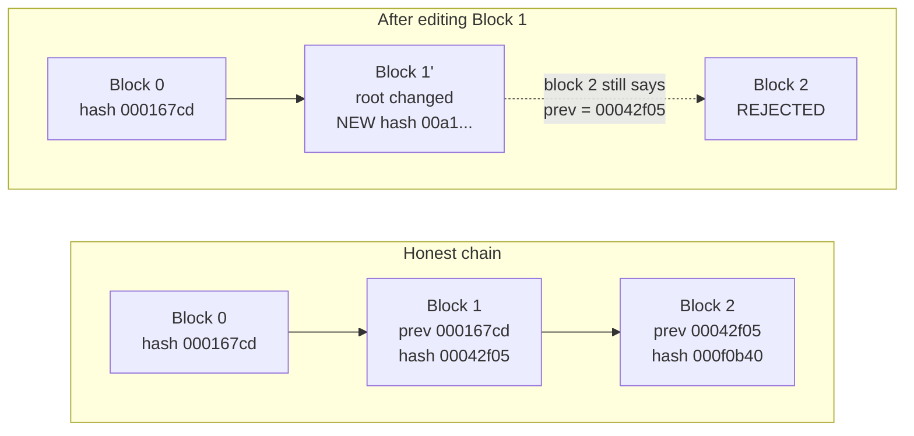
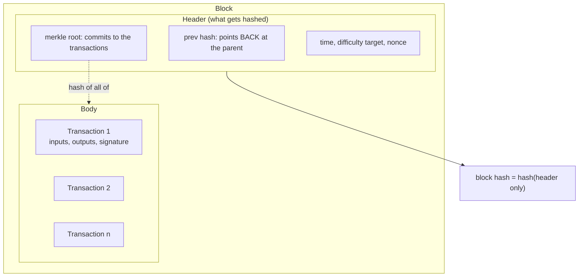
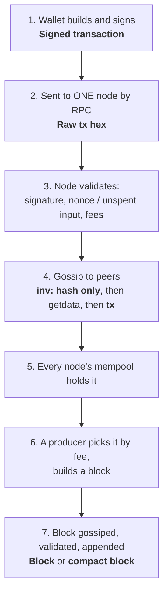
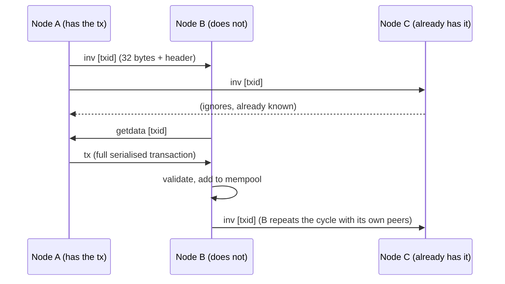
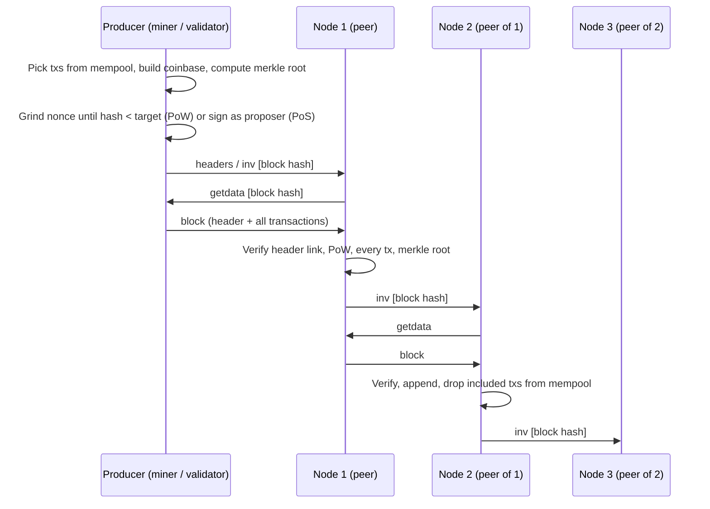
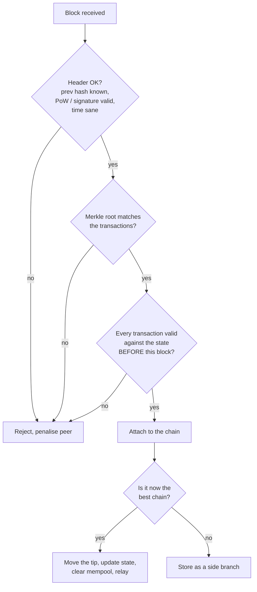
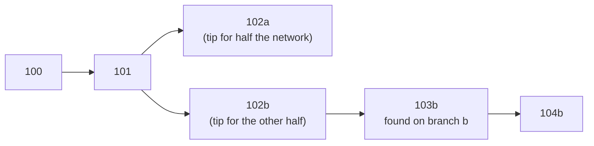
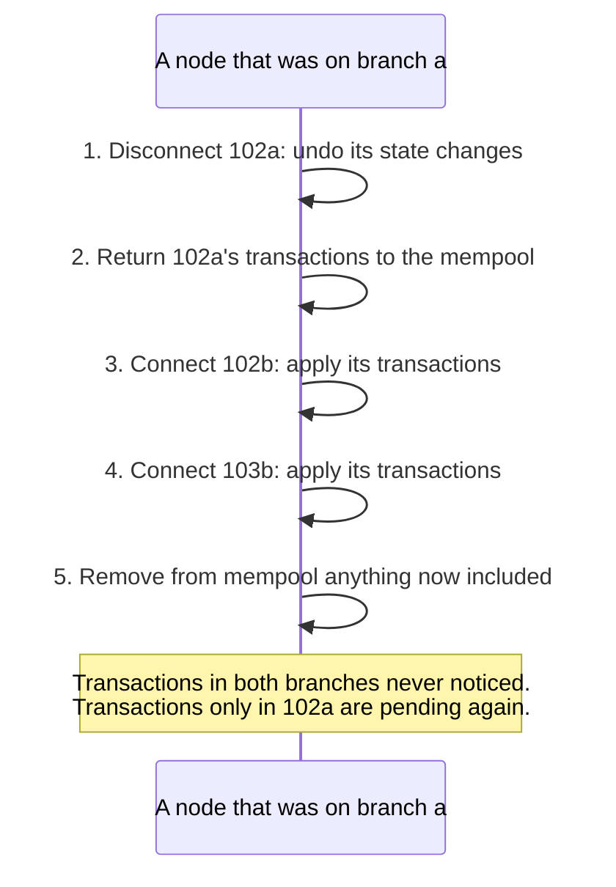
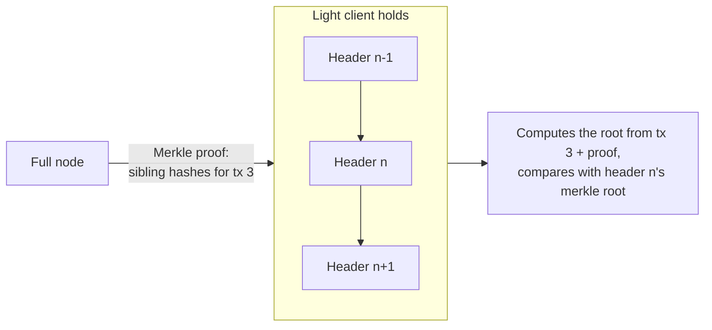

# 03. How the Chain Moves

The chaining mechanism in motion: a toy chain you can run, then the journey of a transaction and a block from one node to the whole network, with the object that travels at each hop. Concepts are in [[1. Blockchain Fundamentals|Blockchain Fundamentals]]; the byte layouts of each object are in [[2. What Travels the Chain|What Travels the Chain]].

---

# Build a Chain in 40 Lines

Everything a real chain does to link blocks, in a toy: a Merkle root over the transactions, a header that includes the previous hash, and a nonce ground until the hash starts with `000`.

```python
import hashlib

def sha(s): return hashlib.sha256(s.encode()).hexdigest()

def merkle(txs):
    level = [sha(t) for t in txs]
    while len(level) > 1:
        if len(level) % 2: level.append(level[-1])
        level = [sha(level[i] + level[i + 1]) for i in range(0, len(level), 2)]
    return level[0]

def header(height, prev, root, nonce):
    return f"{height}|{prev}|{root}|{nonce}"

def mine(height, prev, txs, zeros=3):
    root, nonce = merkle(txs), 0
    while not sha(header(height, prev, root, nonce)).startswith("0" * zeros):
        nonce += 1
    return {"height": height, "prev": prev, "txs": txs, "root": root,
            "nonce": nonce, "hash": sha(header(height, prev, root, nonce))}

def valid(chain, zeros=3):
    for i, b in enumerate(chain):
        if b["root"] != merkle(b["txs"]): return f"block {i}: merkle root mismatch"
        if sha(header(b["height"], b["prev"], b["root"], b["nonce"])) != b["hash"]: return f"block {i}: hash mismatch"
        if not b["hash"].startswith("0" * zeros): return f"block {i}: proof of work missing"
        if i and b["prev"] != chain[i - 1]["hash"]: return f"block {i}: prev hash does not match block {i-1}"
    return "chain valid"
```

Run it with three blocks, then attack block 1:

```
$ python3 toychain.py
block 0 nonce=1341  prev=00000000 root=15862535 hash=000167cd
block 1 nonce=703   prev=000167cd root=318f8200 hash=00042f05
block 2 nonce=3738  prev=00042f05 root=d3d7637c hash=000f0b40
chain valid
after edit:               block 1: merkle root mismatch        # changed "Alice->Bob:5" to :500
after fixing root:        block 1: hash mismatch               # attacker recomputes the root
after re-mining block 1:  block 2: prev hash does not match block 1   # attacker redoes the work
```

Read the last three lines as the whole security argument. Each fix the attacker makes moves the failure one step **forward** along the chain. To finish they must also re-mine block 2, 3, 4... faster than honest miners extend the real chain.



---

# What One Block Contains, as Nested Objects



Two links make the structure tamper-evident:

| Link | Points | Protects |
| ---- | ------ | -------- |
| **Merkle root** (in header) | Header → body | The transactions cannot change without changing the header |
| **Prev hash** (in header) | Header → parent's header | The parent cannot change without changing this header |

The block hash is not stored in the header; it is *computed from* the header. The next block's `prev hash` field is what stores it.


## Merkle trees

Transactions are not hashed as one blob. They are hashed in pairs, repeatedly, up to one **Merkle root** stored in the header.

```mermaid
flowchart BT
    T1[Tx 1] --> H1["H(1)"]
    T2[Tx 2] --> H2["H(2)"]
    T3[Tx 3] --> H3["H(3)"]
    T4[Tx 4] --> H4["H(4)"]
    H1 --> H12["H(1+2)"]
    H2 --> H12
    H3 --> H34["H(3+4)"]
    H4 --> H34
    H12 --> R["Merkle root<br/>(in block header)"]
    H34 --> R
```



Benefit: a light client can prove "Tx 3 is in this block" with just the sibling hashes along the path (`H(4)`, `H(1+2)`) and the header, without downloading the block. Bitcoin duplicates the last hash when a level has an odd count; Ethereum uses a Merkle-Patricia trie instead (see [[2. What Travels the Chain|What Travels the Chain]]).
---

# Journey of a Transaction

Seven steps from a click in a wallet to a block that is buried and final. The object that moves is named at each hop.



## Step 4 in detail: why hashes go first

Sending full transactions to every peer would deliver each one many times over. The protocol sends a cheap announcement and the full object only to those who need it.



Bitcoin Core by default makes about 10 outbound connections (8 full-relay, 2 block-relay-only) and accepts inbound ones up to a total of 125, so the announcement spreads like a rumour: after a few hops, most of the network knows within seconds.

## What a node checks before it relays

| Check | Reason |
| ----- | ------ |
| Well-formed, within size limits | Reject garbage cheaply |
| Signature verifies for the claimed owner | Only the key holder can spend |
| Inputs exist and are unspent (Bitcoin) / nonce and balance fit (Ethereum) | No double-spend, no replay |
| Fee meets the minimum | Spam control |

Invalid objects are dropped and the peer that sent them may be penalised. A node never trusts a peer's claim: it re-derives everything itself.

---

# Journey of a Block



## Compact blocks: sending only what the peer lacks

Peers already hold most of the block's transactions in their mempool, so resending them wastes bandwidth. A compact block (Bitcoin BIP 152) sends the **header** plus **short IDs** (6 bytes each) of the transactions, and the peer rebuilds the block from its own mempool. It requests only the ones it is missing.

```
 Full block:     [ header ][ tx1 ][ tx2 ][ tx3 ] ... [ txN ]            ~1-2 MB
 Compact block:  [ header ][ id1 ][ id2 ][ id3 ] ... [ idN ] (+ nonce)  ~15-30 KB
                              |
                              +-- peer looks each id up in its mempool;
                                  missing ones come back via getblocktxn / blocktxn
```

## Validation order a node follows



---

# What a Node Stores

A node keeps three things, not one:

| Store | Contents | Why |
| ----- | -------- | --- |
| **Block files** | Every block, appended in arrival order | The full history, for serving peers and rebuilding state |
| **Block index** | Header, height, parent pointer and status of every block it knows, including side branches | Walks the tree of competing chains |
| **State** | Bitcoin: the *UTXO set* (all unspent outputs). Ethereum: the *state trie* (all accounts) | Fast validation without replaying history |

The **chain tip** is just a pointer to the best block. "The chain moves" means that pointer advances: a node attaches a validated block whose parent is the current tip, applies its transactions to the state, and drops them from the mempool.

---

# When the Tip Changes Branch (Reorg)

Two producers find block 102 at nearly the same moment. Some nodes see `102a` first, others `102b`. Both are valid, so each node keeps both and follows whichever branch it saw first. The tie breaks when the next block lands.



When `103b` arrives, nodes on branch `a` see that branch `b` now has more accumulated work and **reorganise**:



This is why exchanges wait for confirmations: a transaction with 1 block on top can still be reorganised away; one with 6 (Bitcoin) is, in practice, permanent. On Ethereum, a block is **finalised** after about 13 minutes and cannot be reverted without destroying a large amount of staked ETH.

---

# Light Clients: Following the Chain With Headers Only

A phone wallet cannot hold hundreds of gigabytes. It downloads only headers (80 bytes each in Bitcoin, about 4 MB per year) and checks two things itself:

1. The headers link correctly and carry real proof of work.
2. A Merkle proof shows that a specific transaction belongs under a header's merkle root.



It trusts the full node for nothing except availability: any lie about the transaction fails the hash check.

---

# Summary of Objects

| Object | Where | Size (Bitcoin) | Holds |
| ------ | ----- | -------------- | ----- |
| Transaction | Wallet → node → mempool → block | ~140-250 B typical | Inputs/outputs or nonce/to/value/data, plus signature |
| `inv` | Peer → peer | ~36 B per item | Type + hash only |
| `getdata` | Peer → peer | ~36 B per item | A request for those hashes |
| Block header | Inside block; also `headers` messages | 80 B | prev hash, merkle root, time, bits, nonce |
| Block | Producer → network | up to ~1-4 MB | Header + all transactions |
| Compact block | Peer → peer | ~15-30 KB | Header + short ids of transactions |
| Merkle proof | Full node → light client | ~32 B × log2(n) | Sibling hashes to rebuild the root |
| Receipt / log (Ethereum) | Computed per block, stored by nodes | 100s of B | Status, gas, events |
| Attestation (Ethereum PoS) | Validator → network | ~200 B | A vote for a block |

---

# Recall Questions

1. In the toy chain, why did fixing the Merkle root not repair the tampered block? And why did re-mining that block still break the chain?
2. What are the two links that make a block tamper-evident, and which header fields hold them?
3. Why does a node announce `inv` with hashes before sending a block or transaction?
4. What does a compact block leave out, and how does the peer recover it?
5. What exactly does a node do to its state and mempool during a one-block reorg?
6. How can a phone wallet trust that a payment is in the chain without the block?
