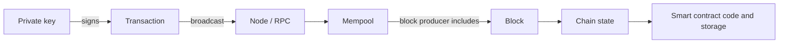

# 01. Web3 Start Here

Notes on blockchains, cryptocurrencies, keys and wallets, smart contracts and how to build and secure them. Written as a study and reminder resource, not investment advice.

> **Not from the library.** General reference material. Anything that changes quickly (fees, prices, protocol upgrades, tooling versions) is deliberately kept out; check the official docs of each project before relying on specifics.

## Reading order

| # | Note | Question it answers |
|---|---|---|
| 02 | [[2. Blockchain Fundamentals\|Blockchain Fundamentals]] | What is a blockchain, and why do nodes agree on it? |
| 03 | [[3. Keys, Wallets and Signatures\|Keys, Wallets and Signatures]] | What is a private key, a seed phrase, an address? |
| 04 | [[4. Cryptocurrencies and Tokens\|Cryptocurrencies and Tokens]] | Coins vs tokens, gas, stablecoins, DeFi, layer 2 |
| 05 | [[5. Smart Contracts\|Smart Contracts]] | What runs on-chain and how is it written and deployed? |
| 06 | [[6. Smart Contract Security\|Smart Contract Security]] | How do contracts get drained, and how to prevent it? |
| 07 | [[7. Web3 Development Workflow\|Web3 Development Workflow]] | How does a normal app talk to a chain? |
| 08 | [[8. DAOs and Governance\|DAOs and Governance]] | How do on-chain organisations vote and get attacked? |
| 09 | [[9. Zero-Knowledge Proofs\|Zero-Knowledge Proofs]] | How can something be proved without being revealed? |
| 10 | [[10. Non-EVM Chains\|Non-EVM Chains]] | How do Solana, Cosmos, Move and Cardano differ? |
| 11 | [[11. Bitcoin Internals\|Bitcoin Internals]] | How do Bitcoin transactions, Script and Lightning work? |
| 12 | [[12. MEV and Transaction Ordering\|MEV and Transaction Ordering]] | Who orders transactions, and who profits? |
| 13 | [[13. Node Operation and Infrastructure\|Node Operation and Infrastructure]] | How do I run and secure my own node? |
| 14 | [[14. Contract Testing and Auditing\|Contract Testing and Auditing]] | How do I test contracts and prepare for an audit? |
| 15 | [[15. On-Chain Forensics and Reverse Engineering\|On-Chain Forensics and Reverse Engineering]] | How do I read transactions and bytecode and trace an incident? |
| 16 | [[16. Exploit Case Studies\|Exploit Case Studies]] | What went wrong in the big hacks? |
| 17 | [[17. DeFi Mechanics and Risks\|DeFi Mechanics and Risks]] | How do AMMs, lending and perps work, and break? |
| 18 | [[18. Oracles and Cross-Chain Messaging\|Oracles and Cross-Chain Messaging]] | How do contracts get trustworthy data and cross-chain messages? |
| 19 | [[19. Decentralised Storage\|Decentralised Storage]] | How do IPFS, Arweave and Filecoin store data? |
| 20 | [[20. EVM Bytecode and Low-Level Analysis\|EVM Bytecode and Low-Level Analysis]] | How do I read EVM bytecode without source? |
| 21 | [[21. Tracing and On-Chain Analytics Tooling\|Tracing and On-Chain Analytics Tooling]] | What tracing APIs and analytics tools exist? |
| 22 | [[22. Fund Tracing and Attribution\|Fund Tracing and Attribution]] | How do I follow funds and attribute carefully? |
| 23 | [[23. Wallet Drainers and Token Scam Analysis\|Wallet Drainers and Token Scam Analysis]] | How do drainers and token scams work, and how do I analyse them? |
| 24 | [[24. Incident Response and Post-Mortems\|Incident Response and Post-Mortems]] | What do I do during and after an incident? |

## The big picture

- A **key** proves you control an account. Nobody can reverse or reset it.
- A **transaction** is a signed instruction: move value or call a contract.
- The **network** orders transactions into blocks and every node checks them.
- A **contract** is code stored on-chain that runs the same way on every node.

## Related notes elsewhere in the vault

- [[Crytography|Linux Cryptography]]: hashing, symmetric and asymmetric encryption with OpenSSL and GnuPG.
- [[1. Security Fundamentals|Security Fundamentals]] and [[5. Secure Coding and Supply Chain|Secure Coding and Supply Chain]]: general practice that applies directly to contract and wallet work.
