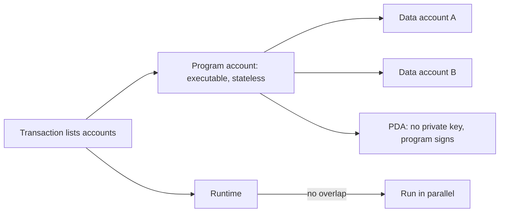
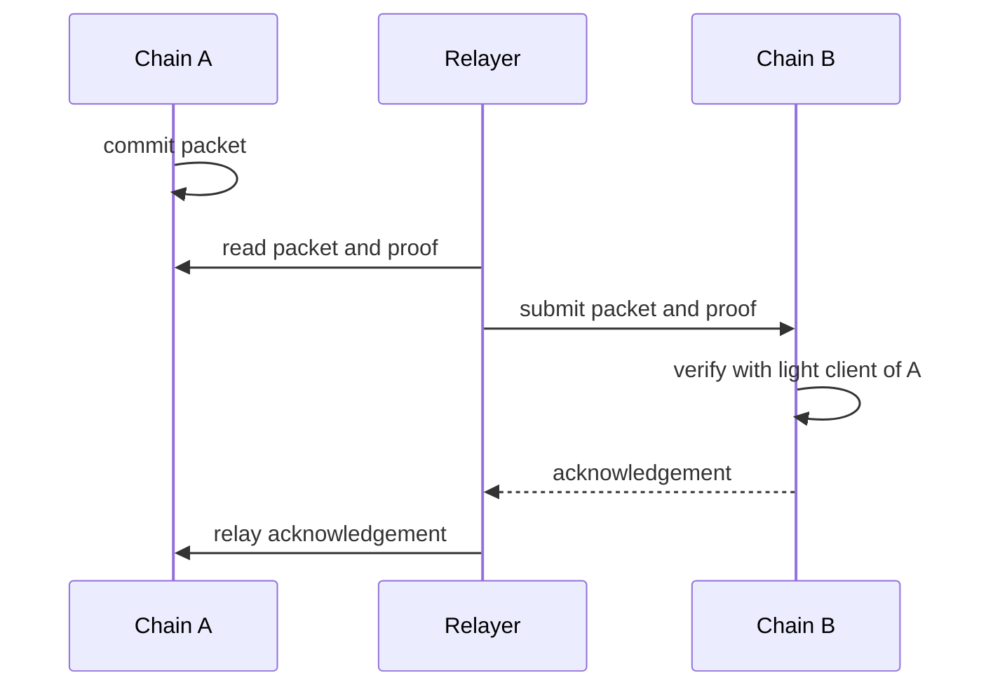
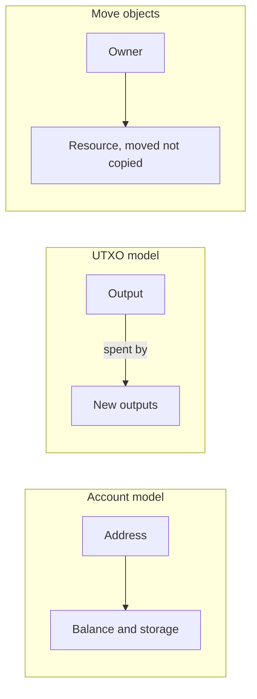

# 09. Non-EVM Chains

How Solana, Cosmos, Move chains, Cardano and others differ from the Ethereum model, and what changes for a developer.

> **Not from the library.** General reference material written to fill a gap. These ecosystems move fast; check current docs.

## At a glance

| Chain family | Language | Core idea | Use it when |
|---|---|---|---|
| Solana | Rust (Anchor) | Programs are stateless, state lives in separate accounts | High throughput, parallel execution |
| Cosmos SDK / CosmWasm | Go, Rust | Each app is its own chain, linked by IBC | Sovereign application chains |
| Move (Aptos, Sui) | Move | Assets are resources that cannot be copied | Safer asset handling by design |
| Cardano | Haskell-based, Aiken | Extended UTXO with validators | Deterministic, formally minded contracts |
| Polkadot / Substrate | Rust | Shared security for parachains | Custom chains with pooled security |
| Bitcoin | Script | Minimal, UTXO | See [[11. Bitcoin Internals\|Bitcoin Internals]] |

## What "EVM" fixes in place

The EVM model: contract = code + storage under one address, stack-based bytecode, gas per opcode, Solidity. Other chains change one or more of these:

- the **execution environment** (WebAssembly, BPF, Move VM),
- the **state model** (accounts, UTXO, objects),
- the **fee model**,
- and the **consensus**.

## Solana

- **Accounts hold all state.** A program (smart contract) is itself an account holding executable code and is stateless; data lives in separate accounts the program owns.
- A transaction lists **every account it will read or write** up front. Because of that, the runtime can run non-conflicting transactions **in parallel**.
- **Programs** are written in Rust, usually with the **Anchor** framework, and compiled to BPF bytecode.
- **PDAs** (program derived addresses) are addresses with no private key; only the owning program can sign for them. They are used for per-user state and vaults.
- **Fees and limits**: a small base fee per signature, optional priority fees, and a **compute unit** budget per transaction instead of EVM-style gas.
- **Rent**: accounts must hold a minimum balance (rent-exempt) to stay alive.
- Tokens use the **SPL Token** program: balances live in **token accounts** per owner and mint, not inside a per-token contract.
- Consensus: Proof of Stake with Proof of History for ordering timestamps and Tower BFT for voting.

How a Solana transaction touches state:



Security differs from Solidity: the classic bugs are **missing signer checks, missing owner checks and account confusion** (passing an unexpected account where the program trusted its type). Reentrancy is limited, but account validation is everything.

```bash
solana-keygen new                # key pair file
solana config set --url devnet
anchor init my_program && cd my_program
anchor build && anchor test
anchor deploy
```

## Cosmos

- **CometBFT** (formerly Tendermint) provides fast-finality BFT consensus; the **Cosmos SDK** is a framework for building a chain with modules (bank, staking, governance).
- Each application can be its **own chain** with its own validators, tokens and rules ("app-chain"), instead of a contract on a shared chain.
- **IBC** (Inter-Blockchain Communication) lets chains pass messages and tokens with light-client verification of the counterparty chain (other client types, such as attestation or ZK light clients, are also possible).
- **CosmWasm** adds Rust-based smart contracts compiled to WebAssembly on chains that enable it.
- Trade-off: you must bootstrap validators and security yourself, but you control the whole stack.

Moving a token between two app-chains:



## Move chains (Aptos, Sui)

- **Resources** are linear types: an asset cannot be copied or silently dropped, only moved. This removes whole classes of token bugs by construction.
- Aptos stores resources under accounts; Sui uses **objects** with owners (address-owned, shared, immutable); each transaction lists its input objects up front, which lets the network see which transactions do not conflict and, for simple owned-object cases, avoid contention on shared state.

## Cardano and extended UTXO

- Uses the UTXO model extended with data and **validators**: a script that decides whether an output can be spent.
- Validation is deterministic: you can predict the fees and outcome before submitting, since only the inputs you reference matter (the Cardano docs contrast this with account-based chains).
- Contracts are written in Plutus (Haskell) or alternatives like Aiken.

Three ways to hold state:



## Comparison

| | Ethereum (EVM) | Solana | Cosmos | Move chains | Cardano |
|---|---|---|---|---|---|
| State model | Contract storage | Separate accounts | Module state per chain | Resources / objects | UTXO + datum |
| Language | Solidity, Vyper | Rust | Go, Rust (CosmWasm) | Move | Haskell, Aiken |
| Parallel execution | Largely sequential | Yes, by declared accounts | Per chain | Yes, in some cases | Per UTXO |
| Typical gotcha | Reentrancy, storage cost | Account validation | Operating a chain | New language, tooling | UTXO concurrency |

## Choosing

- Wide tooling, liquidity and audited libraries: EVM.
- Throughput and low fees with a Rust stack: Solana.
- Own the chain, governance and fee token: Cosmos or Substrate.
- Safer asset semantics: Move.
- For most beginners, learn the EVM first. The ideas (keys, signed transactions, state, fees) carry over.

## Recall

1. Why must a Solana transaction list its accounts in advance?
2. What is a PDA?
3. What does IBC do?
4. What does a Move resource guarantee?

??? note "Answers"
    1. It lets the runtime see which transactions conflict and run the rest in parallel.
    2. An address derived from a program with no private key; only that program can sign for it.
    3. It relays messages and tokens between Cosmos chains using light-client verification.
    4. It cannot be copied or dropped, only moved.

## Links

- [[5. Smart Contracts|Smart Contracts]]: the EVM baseline.
- [[6. Smart Contract Security|Smart Contract Security]]
- [[1. Blockchain Fundamentals|Blockchain Fundamentals]]

## External references

- [Anchor](https://github.com/solana-foundation/anchor): the Solana program framework (Rust eDSL, IDL, CLI).
- [Solana developer content](https://github.com/solana-foundation/developer-content): archived source of the official Solana docs (accounts, PDAs, compute units).
- [CosmWasm](https://github.com/CosmWasm/cosmwasm): Rust and WebAssembly smart contracts for the Cosmos SDK.
- [IBC specifications](https://github.com/cosmos/ibc): the canonical IBC interchain standards, including light clients and relayers.
- [Move language repository](https://github.com/move-language/move): archived Move source, pointing to the Aptos and Sui successors.
- [Cardano: EUTXO explainer](https://docs.cardano.org/about-cardano/learn/eutxo-explainer): scripts in addresses, data on outputs, redeemers, predictable outcomes.
- [Sui: object model](https://docs.sui.io/develop/sui-architecture/object-model): objects, ownership kinds.
- [Sui: Move concepts](https://docs.sui.io/concepts/sui-move-concepts): object-centric storage, inputs declared up front.
- [CosmWasm docs](https://cosmwasm.github.io/): Rust smart contracts on a Wasm VM in the Cosmos SDK.
- [How IBC works](https://ibcprotocol.dev/how-ibc-works): light clients, packets, client types.
- [Cardano Developer Portal source](https://github.com/cardano-foundation/developer-portal): the official Cardano developer documentation.
