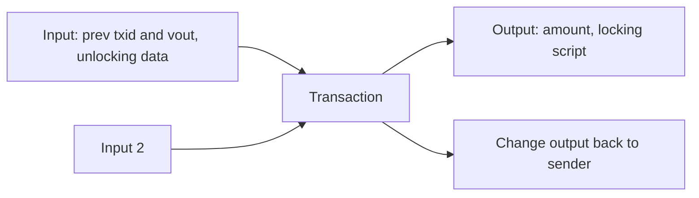

# 11. Bitcoin Internals

Transaction structure, Script, address types, SegWit and Taproot, block mechanics, and the Lightning Network.

> **Not from the library.** General reference material written to fill a gap.

## At a glance

| Concept | In one line | Use it when |
|---|---|---|
| UTXO | A spendable output; transactions consume and create them | Reading or building a transaction |
| Script | Stack-based locking and unlocking language | Understanding how coins are locked |
| SegWit | Moves signatures to a witness section | Lower fees, no malleability |
| Taproot | Schnorr signatures plus hidden script branches | Privacy and flexible spending |
| Lightning | Off-chain payment channels | Fast, cheap small payments |

## Transaction anatomy

A transaction has:

- **version** and **locktime** (earliest time or block it can be mined),
- **inputs**: each points to a previous output (`txid` + output index `vout`) and provides unlocking data,
- **outputs**: an amount in **satoshis** (1 BTC = 100,000,000 sats) and a locking script (`scriptPubKey`).



- Fee = sum of inputs minus sum of outputs. There is no explicit fee field; if you forget the change output, the difference becomes a huge fee.
- Fees are priced by **size**, in sat per virtual byte (sat/vB), not by amount sent.
- **Dust** outputs, too small to be worth spending, are rejected by standard nodes.
- **RBF** (replace-by-fee) lets a sender rebroadcast with a higher fee while unconfirmed.
- The first transaction in a block is the **coinbase**, which pays the miner the subsidy plus fees; its outputs can only be spent after 100 blocks.

## Script

- Script is a small, **stack-based**, deliberately **non-Turing-complete** language (no loops), so execution always finishes.
- To spend, the unlocking data plus the locking script are run together; the output is spendable if the result is true.

Classic pay-to-public-key-hash (P2PKH):

```text
scriptPubKey: OP_DUP OP_HASH160 <pubKeyHash> OP_EQUALVERIFY OP_CHECKSIG
unlocking:    <signature> <publicKey>
```

Flow: duplicate the public key, hash it, check it matches the hash in the output, then verify the signature.

## Address types

| Type | Prefix | Notes |
|---|---|---|
| P2PKH (legacy) | `1...` | Original format |
| P2SH | `3...` | Pay to a script hash, e.g. multisig |
| P2WPKH (native SegWit) | `bc1q...` | Lower fees, bech32 encoding |
| P2TR (Taproot) | `bc1p...` | Schnorr/Taproot, bech32m encoding |

## SegWit and Taproot

- **SegWit** (2017) moves signature data into a separate **witness**. This fixes **transaction malleability** (changing a txid without invalidating the transaction), which Lightning requires, and gives witness data a discount in block weight.
- Block limit is expressed in **weight units** (4,000,000), where witness bytes count less than other bytes.
- **Taproot** (2021) uses **Schnorr signatures** (BIP-340), which support key aggregation, and **MAST/Merkle trees** so only the executed branch of a script is revealed. A complex spending condition can look like a normal single-key payment on-chain when everyone cooperates ("key path" versus "script path").

## Blocks and mining

An 80-byte header contains: version, previous block hash, Merkle root of the transactions, timestamp, difficulty target (`bits`), and nonce.

- Miners hash the header twice with **SHA-256** and change the nonce until the hash is below the target.
- Difficulty **adjusts every 2016 blocks** (about two weeks) to keep blocks at roughly **10 minutes**.
- The block subsidy halves every **210,000 blocks** (about four years), which produces the 21 million cap.
- Mining pools split work and rewards; nodes, not miners, enforce the rules by rejecting invalid blocks.

## Bitcoin Core in practice

```bash
bitcoind -daemon                                   # run a node
bitcoin-cli getblockchaininfo                      # sync status
bitcoin-cli getrawtransaction <txid> 1             # decoded transaction (needs txindex=1 for old txs)
bitcoin-cli getmempoolinfo
bitcoin-cli decoderawtransaction <hex>
```

- `prune=<MB>` in `bitcoin.conf` discards old block data to save disk while still validating.
- `txindex=1` keeps an index of all transactions, useful for explorers but needs more space.

## Lightning Network

- Two parties lock coins in a **2-of-2 multisig funding transaction**, then exchange signed updates off-chain that reallocate the balance. Only opening and closing hit the chain.
- Payments across the network are routed through intermediate channels using **HTLCs** (hash time-locked contracts): a payment is claimed by revealing a secret, otherwise it times out and refunds.
- Trade-offs: you need to stay online (or use a watchtower) to catch cheating, and liquidity must exist along the route.

## Other points

- Bitcoin uses **Merkle trees** for transactions and **double SHA-256** for block and transaction hashing.
- **Timelocks** (`nLockTime`, `CHECKLOCKTIMEVERIFY`, `CHECKSEQUENCEVERIFY`) allow vaults, inheritance and channel logic.
- **Ordinals/inscriptions** and similar protocols embed data in witness space; they are conventions on top of the same rules, not protocol changes.

## Common mistakes

- Creating a transaction without a change output.
- Reusing addresses, which weakens privacy.
- Assuming one confirmation is final; wait for more for large amounts.
- Mixing up a seed phrase with a wallet descriptor: restoring may need address type and derivation path details.

## Recall

1. What happens to value not assigned to any output?
2. Why is Script non-Turing-complete?
3. What does SegWit fix that Lightning depends on?
4. How often does difficulty adjust and what is it aiming for?

??? note "Answers"
    1. It becomes the miner's fee.
    2. No loops means every script terminates, so nodes cannot be stalled by an infinite script.
    3. Transaction malleability.
    4. Every 2016 blocks, targeting about 10 minutes per block.

## Links

- [[2. Blockchain Fundamentals|Blockchain Fundamentals]]
- [[3. Keys, Wallets and Signatures|Keys, Wallets and Signatures]]
- [[13. Node Operation and Infrastructure|Node Operation and Infrastructure]]
