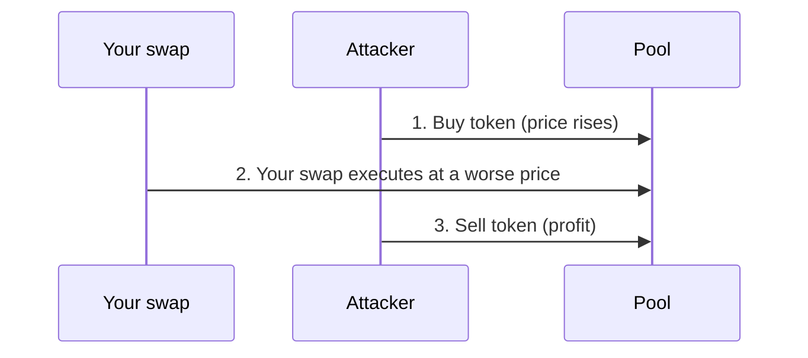
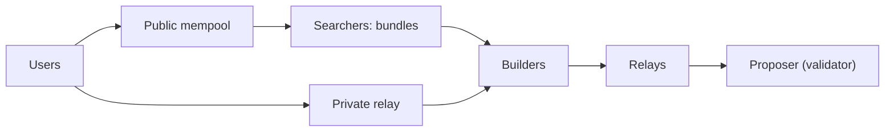
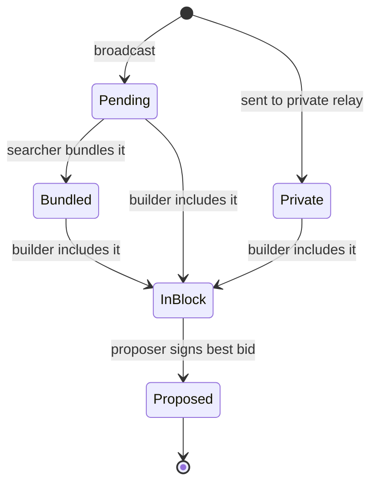
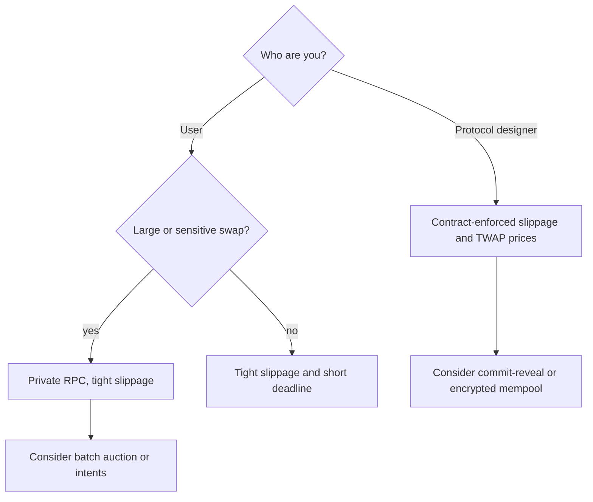

# 11. MEV and Transaction Ordering

Who decides the order of transactions in a block, how that order creates profit, and how users and protocols defend themselves.

> **Not from the library.** General reference material written to fill a gap. The MEV supply chain changes often; check current docs.

## At a glance

| Concept | In one line | Use it when |
|---|---|---|
| MEV | Profit from choosing which transactions go in a block and in what order | Understanding hidden swap costs |
| Mempool | Public waiting area for pending transactions | Seeing why transactions are visible |
| Searcher | Bot that finds profitable orderings | Arbitrage, liquidation, sandwiching |
| Builder / relay / proposer | Roles that assemble and propose blocks | Following the MEV supply chain |
| Private order flow | Sending transactions outside the public mempool | Avoiding sandwiches |

## Why order matters

A block producer decides which transactions are included and **in what order**. Where state changes depend on order (prices in a pool, who liquidates first), that power is worth money. Originally "miner extractable value"; now **maximal extractable value** since proposers, not only miners, hold it.

## Common strategies

| Strategy | What it does | Effect on users |
|---|---|---|
| Arbitrage | Buys cheap in one pool, sells high in another | Mostly benign; keeps prices aligned |
| Liquidation | Repays an undercollateralised loan for a bonus | Needed for lending protocols |
| Front-running | Copies a profitable pending trade with a higher fee | Takes the opportunity from you |
| Back-running | Places a transaction right after a target | Neutral to harmful |
| Sandwich attack | Buys before your swap, sells after it | You get a worse price |
| JIT liquidity | Adds and removes liquidity around a swap to take its fees | Less fee income for regular providers |

The attacker pays a higher priority fee for step 1 and lands step 3 right after yours. Your **slippage tolerance** sets how much of that loss you accept: the larger it is, the more room to sandwich you.

## How blocks are built (Ethereum)

Post-merge there is a separation between the roles:

- **Searchers** send **bundles** (ordered transaction groups) with a payment to the builder.
- **Builders** assemble the most profitable block.
- **Relays** pass blocks to proposers and check them; the proposer signs the highest bid.
- This is **proposer-builder separation** as implemented by MEV-Boost: proposers get the best revenue without specialised infrastructure, at the price of concentration among a few builders and relays and a censorship risk.

Where a transaction sits on its way into a block:

## Ordering rules by environment

| Environment | How order is set |
|---|---|
| Ethereum L1 | Builder chooses; priority fee and bundle payments influence |
| Layer 2 rollups | A sequencer orders transactions, often a single operator, often first-come-first-served |
| Solana | Validators schedule; priority fees and tips (e.g. Jito bundles) |
| Bitcoin | Miners pick by fee rate; MEV is limited because there is little on-chain state to exploit |

## Defences for users

- **Tight slippage** and short deadlines on swaps.
- **Private RPCs** (Flashbots Protect is one example) send your transaction to a private mempool instead of the public one, hiding it from front-running and sandwich bots. Flashbots documents that transactions are included only if they do not revert (no fee for failed ones) and that users can earn MEV and gas-fee refunds; other providers differ, so check their docs.
- Avoid swapping large size in thin pools; split or use aggregators and limit orders.
- **Batch auctions / intent-based** systems (e.g. CoW Protocol) collect signed intents off-chain and auction them to solvers; the winning solvers settle orders together, and CoW's uniform directed clearing prices (one price per directed asset pair per auction) aim to make ordering within the batch irrelevant.

## Defences for protocol designers

- **Commit-reveal**: users commit a hash first, reveal later, so contents are hidden while order is fixed.
- Use **time-weighted** prices rather than the spot price (see [[6. Smart Contract Security|Smart Contract Security]]).
- **Encrypted mempools** and threshold encryption: transactions are decrypted only after their order is fixed.
- Slippage limits enforced by the contract, not just the UI.
- Fair-ordering sequencers on L2s; research into decentralised sequencing.

Picking a defence:

## Seeing it yourself

- Block explorers and MEV dashboards flag sandwiches and arbitrage.
- Simulation tools (Foundry's `cast run`, Tenderly) replay a transaction in its block to see state changes.
- On a local fork you can reorder transactions to reproduce an attack safely.

## Common mistakes

- Setting slippage to 50% to "make it go through".
- Believing a private mempool removes all risk; the builder still sees your transaction.
- Assuming MEV only hurts users: arbitrage and liquidations keep protocols working.

## Recall

1. What gives a block producer MEV?
2. How does a sandwich attack work?
3. What does proposer-builder separation split?
4. Why do batch auctions resist ordering games?

??? note "Answers"
    1. Control over inclusion and ordering of transactions.
    2. The attacker buys before your swap to move the price, then sells after it.
    3. Block building (specialised builders) from block proposing (validators).
    4. Orders in the batch are settled together (in CoW's design a directed asset pair settles at one consistent price per auction), so their order inside the batch should not change the outcome.

## Links

- [[4. Cryptocurrencies and Tokens|Cryptocurrencies and Tokens]]: AMMs and slippage.
- [[6. Smart Contract Security|Smart Contract Security]]
- [[13. Node Operation and Infrastructure|Node Operation and Infrastructure]]

## External references

- [MEV-Boost](https://github.com/flashbots/mev-boost): reference middleware implementing proposer-builder separation via builders and relays
- [Flashbots docs: Protect overview](https://docs.flashbots.net/flashbots-protect/overview): private mempool, revert protection, refunds
- [CoW docs: Fair Combinatorial Batch Auction](https://docs.cow.fi/cow-protocol/concepts/introduction/fair-combinatorial-auction): solver auction and uniform directed clearing prices
- [CoW Protocol contracts](https://github.com/cowprotocol/contracts): settlement contracts through which solvers execute batched orders
- [Foundry](https://github.com/foundry-rs/foundry): cast and anvil for replaying transactions and forking locally
- [MEV (ethereum.org)](https://ethereum.org/en/developers/docs/mev/): overview of maximal extractable value and its effects
- [EIP-1559](https://eips.ethereum.org/EIPS/eip-1559): base fee plus priority fee, the fee market that ordering bids sit on
