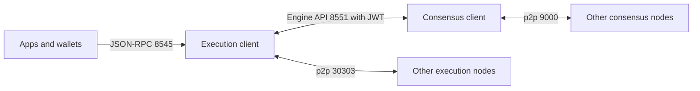

# 13. Node Operation and Infrastructure

Running your own Ethereum and Bitcoin nodes: clients, sync, ports, hardening, monitoring, and when to use a provider instead.

> **Not from the library.** General reference material written to fill a gap. Flags and hardware requirements change between releases; check the client's documentation before deploying.

## At a glance

| Concept | In one line | Use it when |
|---|---|---|
| Execution client | Runs the EVM and holds state | Serving RPC, applying transactions |
| Consensus client | Follows the proof-of-stake chain | Every Ethereum node needs one |
| Engine API | Authenticated link between the two clients | Wiring them together |
| Sync mode | How much history a node downloads and keeps | Choosing disk and time cost |
| RPC provider | Hosted node service | You don't want to operate infrastructure |

## Why run a node

- **Trust and privacy**: your own node checks the chain itself and does not tell a third party which addresses you query.
- **Reliability**: no rate limits or provider outages, important for production apps and indexers.
- **Network health**: more independent nodes make the network more resilient.
- Cost: hardware, bandwidth, maintenance and security work. Providers are fine for prototypes; see [[7. Web3 Development Workflow|Web3 Development Workflow]].

## Ethereum node anatomy



| Layer | Client examples |
|---|---|
| Execution | Geth, Nethermind, Besu, Erigon, Reth |
| Consensus | Lighthouse, Prysm, Teku, Nimbus, Lodestar |

- Running **more than one client type** (client diversity) protects the network from a single-client bug. Choose the minority option where possible.
- The two clients share a **JWT secret file** to authenticate the Engine API.

## Sync modes and node types

| Type | Keeps | Notes |
|---|---|---|
| Full (snap sync) | Recent state plus blocks | Default for most uses |
| Archive | Every historical state | Needed for deep analytics, very large |
| Light | Headers, requests data from peers | Limited availability |

- The consensus client should use **checkpoint sync** from a trusted endpoint to catch up in minutes rather than days; then verify the checkpoint.
- Plan for a **fast NVMe SSD**, ample RAM and a stable connection with generous data allowance; disk usage keeps growing, so check the client's current figures.

## Example: Geth plus Lighthouse (Docker Compose)

```yaml
services:
  geth:
    image: ethereum/client-go:stable
    command:
      - --http
      - --http.addr=0.0.0.0        # reachable by other containers only; do not publish publicly
      - --http.api=eth,net,web3
      - --authrpc.addr=0.0.0.0
      - --authrpc.vhosts=*
      - --authrpc.jwtsecret=/jwt/jwt.hex
      - --metrics
      - --metrics.addr=0.0.0.0
    volumes: ["geth-data:/root/.ethereum", "./jwt:/jwt"]
    ports: ["30303:30303", "30303:30303/udp"]    # p2p only
  lighthouse:
    image: sigp/lighthouse:latest
    command:
      - lighthouse
      - bn
      - --network=mainnet
      - --execution-endpoint=http://geth:8551
      - --execution-jwt=/jwt/jwt.hex
      - --checkpoint-sync-url=<trusted checkpoint URL>
      - --metrics
    volumes: ["lighthouse-data:/root/.lighthouse", "./jwt:/jwt"]
    ports: ["9000:9000", "9000:9000/udp", "9001:9001/udp"]    # p2p; 9001/udp is QUIC
volumes: { geth-data: {}, lighthouse-data: {} }
```

```bash
openssl rand -hex 32 > jwt/jwt.hex      # shared secret for the Engine API
```

Pin image versions in production instead of `stable` or `latest`. See [[2. Docker Compose|Docker Compose]].

## Bitcoin node

```bash
# bitcoin.conf
server=1
prune=10000        # keep ~10 GB of recent blocks (omit for a full copy)
rpcbind=127.0.0.1
rpcallowip=127.0.0.1
```

```bash
bitcoind -daemon
bitcoin-cli getblockchaininfo     # check verificationprogress
```

More in [[11. Bitcoin Internals|Bitcoin Internals]].

## Ports and exposure

| Port | Purpose | Expose? |
|---|---|---|
| 30303 TCP/UDP | Ethereum execution p2p | Yes |
| 9000 TCP/UDP | Consensus p2p (client-dependent) | Yes |
| 8545 / 8546 | JSON-RPC HTTP / WebSocket | **No**, local or behind authenticated proxy |
| 8551 | Engine API | **No**, local only |
| 8333 | Bitcoin p2p | Optional |
| 8332 | Bitcoin RPC | **No** |

- An open RPC is an open door: attackers can burn your resources and, if admin or personal APIs are enabled, steal keys. Enable only the API namespaces you need.
- Put a reverse proxy with authentication and rate limits in front if a remote app needs access.
- Run the process as an unprivileged user, apply the firewall and SSH practices in [[Server Hardening with SSH, UFW and Fail2ban|Server Hardening]] and [[Firewalls|Firewalls]].

## Monitoring and operations

- Enable the clients' **Prometheus metrics** and graph them in Grafana: sync status, peer count, head slot lag, disk, memory, and RPC latency. General host monitoring: [[System Monitoring|System Monitoring]].
- Alert on: falling peer count, node more than a few blocks behind, disk almost full, process restarts.
- Upgrade clients promptly (hard forks require compatible versions) and read release notes first.
- Back up configuration and the JWT file; chain data can be re-synced, validator keys cannot.

## Validators (optional)

- Staking on Ethereum means running a **validator client** with signing keys in addition to the node. It requires a deposit of 32 ETH per validator.
- **Never run the same validator keys on two machines**: double-signing causes **slashing**. Use the validator client's slashing protection and plan failover carefully.
- Keep withdrawal keys offline and separate from the signing keys (see [[3. Keys, Wallets and Signatures|Keys, Wallets and Signatures]]).

## Choosing between self-hosting and providers

| | Own node | Hosted provider |
|---|---|---|
| Control and privacy | High | Lower |
| Effort | Setup and upkeep | Minimal |
| Cost | Hardware and time | Usage-based |
| Reliability | You provide it | Provider SLA |
| Typical use | Production, indexers, validators | Prototypes, bursts, extra redundancy |

A common setup is your own node plus a second provider as a fallback.

## Common mistakes

- Publishing port 8545 to the internet.
- Putting the chain data on slow or network storage, causing the node to fall behind.
- Running one client with no fallback and no monitoring.
- Ignoring clock drift; consensus clients need accurate time (use NTP/chrony).
- Using the same machine for validator keys and untrusted software.

## Recall

1. Why does an Ethereum node need two clients?
2. What protects the Engine API?
3. Which ports should never be public?
4. Why must validator keys never be on two machines at once?

??? note "Answers"
    1. One executes transactions and holds state, the other follows proof-of-stake consensus; they cooperate over the Engine API.
    2. A shared JWT secret, and binding it to local or private networks.
    3. JSON-RPC (8545/8546), the Engine API (8551) and Bitcoin RPC (8332).
    4. Two machines signing can produce conflicting messages, which is a slashable offence.

## Links

- [[7. Web3 Development Workflow|Web3 Development Workflow]]
- [[12. MEV and Transaction Ordering|MEV and Transaction Ordering]]
- [[2. Docker Compose|Docker Compose]]

## External references

- [Geth command-line options](https://geth.ethereum.org/docs/fundamentals/command-line-options): `--http*`, `--authrpc*` and `--metrics*` flags and defaults.
- [Lighthouse: run a node](https://lighthouse-book.sigmaprime.io/run_a_node.html): `--network`, `--execution-endpoint`, `--execution-jwt`, checkpoint sync.
- [Lighthouse: Docker](https://lighthouse-book.sigmaprime.io/installation_docker.html): the `sigp/lighthouse` image and example run command.
- [Lighthouse: networking](https://lighthouse-book.sigmaprime.io/advanced_networking.html): port 9000 TCP/UDP and QUIC on 9001.
- [Ethereum: run a node](https://ethereum.org/en/developers/docs/nodes-and-clients/run-a-node/): port 30303 and the JWT secret between clients.
- [Ethereum: staking](https://ethereum.org/en/staking/): 32 ETH minimum for a solo validator and slashing.
- [Ethereum: client diversity](https://ethereum.org/en/developers/docs/nodes-and-clients/client-diversity/): why running minority clients matters.
- [bitcoin.conf reference](https://raw.githubusercontent.com/bitcoin/bitcoin/master/doc/bitcoin-conf.md): format and precedence of Bitcoin Core configuration (official repository).
