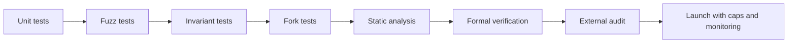
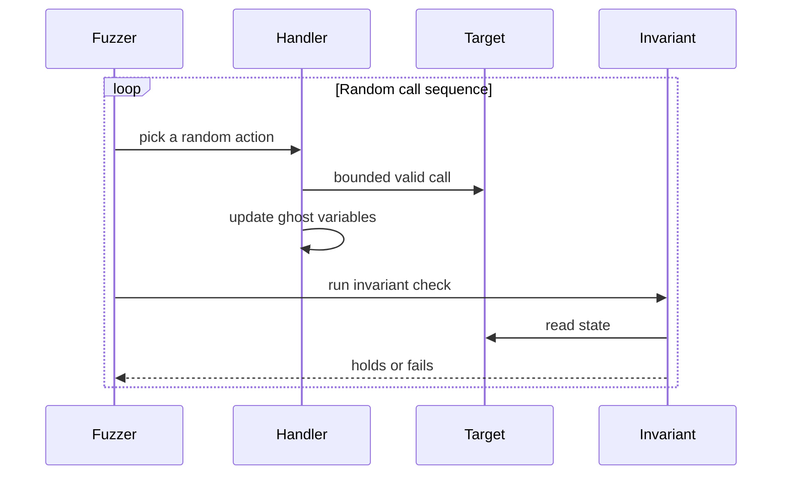
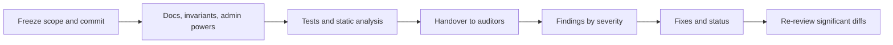
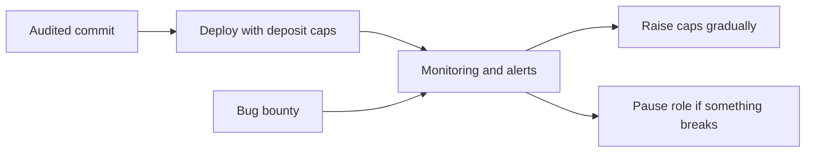

# 14. Contract Testing and Auditing

How to test contracts so bugs surface before launch: unit, fuzz, invariant and fork tests, static analysis, formal methods, and what a good audit looks like.

> **Not from the library.** General reference material written to fill a gap. Tool flags change; check each tool's docs.

## At a glance

| Technique | In one line | Use it when |
|---|---|---|
| Unit test | One behaviour, fixed inputs | Every function, including failure paths |
| Fuzz test | Random inputs against a property | Arithmetic, bounds, access rules |
| Invariant test | Random call sequences, property must always hold | Protocol-wide rules like solvency |
| Fork test | Run against real mainnet state | Integrations with live protocols |
| Static analysis | Pattern scanning of source | Cheap first pass on every commit |
| Formal verification | Mathematical proof of a property | High-value core logic |
| Audit | Independent expert review | Before anything holds real value |

## Layers of assurance



Each layer catches bugs the previous layer cannot. None replaces the others.

## Unit and failure-path tests (Foundry)

```solidity
function test_WithdrawRevertsWhenInsufficient() public {
    vm.prank(alice);
    vm.expectRevert(Vault.InsufficientBalance.selector);
    vault.withdraw(1 ether);
}
```

- `vm.prank` sets the caller, `vm.expectRevert` asserts a failure, `vm.deal` sets an ETH balance (forge-std's `deal(token, to, amount)` sets ERC-20 balances), `vm.warp` / `vm.roll` move time and blocks.
- Test **who may not** do something as much as who may: every privileged function should have a test that an outsider is rejected.
- `vm.expectRevert` also accepts a `bytes4` custom-error selector or full encoded revert data; `vm.startPrank` / `vm.stopPrank` apply a caller to every call in between.
- Check **events** with `vm.expectEmit`.

## Fuzz tests

A test with parameters is fuzzed with many random values:

```solidity
function testFuzz_DepositThenWithdraw(uint96 amount) public {
    vm.assume(amount > 0);
    vm.deal(alice, amount);
    vm.startPrank(alice);
    vault.deposit{value: amount}();
    vault.withdraw(amount);
    vm.stopPrank();
    assertEq(vault.balanceOf(alice), 0);
}
```

- Use `bound(x, min, max)` rather than `vm.assume` when most random values would be rejected.
- Fuzzing finds edge cases: zero, max values, rounding, odd decimals.

## Invariant tests

An **invariant** is a statement that must hold after any sequence of calls.

```solidity
function invariant_SolvencyHolds() public view {
    assertGe(address(vault).balance, handler.sumOfBalances());
}
```

- Functions prefixed `invariant_` are checked after random call sequences against the contracts registered with `targetContract` (usually the handler).
- The fuzzer calls random functions in random order; a **handler** contract constrains calls to sensible ones (valid actors, bounded amounts) and tracks ghost variables like the running sum.
- Good invariants: total supply equals the sum of balances; assets in vault are at least what shares are redeemable for; a loan is never created without enough collateral; the sum of rewards paid never exceeds the funded amount.
- Writing invariants forces you to state what the system promises.

One round of an invariant test:



## Fork tests

```bash
forge test --fork-url $RPC_URL --fork-block-number 20000000
```

- Test against real tokens, pools and oracles. Pin a block so results are reproducible.
- Catch integration mistakes: tokens with fees, no return values, 6 decimals, blacklisting (like USDC), rebasing.

## Static analysis and other tools

| Tool | Role |
|---|---|
| Slither | Fast static analysis; detects reentrancy, uninitialised storage, dangerous calls |
| Echidna / Medusa | Property-based fuzzers with long campaigns and coverage guidance |
| Halmos | Symbolic testing of Foundry tests |
| Certora Prover | Formal verification of rules against all inputs |
| Mythril | Symbolic execution on bytecode |
| `forge coverage` | Which lines and branches tests miss |
| `forge snapshot` | Gas regression tracking |

```bash
slither .                      # static analysis
forge coverage                 # find untested code
forge test --fuzz-runs 10000   # more fuzz iterations (default is `[fuzz] runs = 256` in foundry.toml)
```

Static tools produce false positives; triage them rather than ignore them.

## Preparing for an audit

1. Freeze scope: a **commit hash**, contracts in scope, those out of scope.
2. Write **documentation**: what the system does, actors, assumptions, trust model, known risks.
3. Reach good test coverage first; an audit is not a substitute for tests.
4. List **invariants** and **admin powers** explicitly.
5. Run static analysis and fix findings before handover.

Audit lifecycle:



## What an audit report contains

| Section | Meaning |
|---|---|
| Scope and commit | What was reviewed and which version |
| Findings by severity | Critical, high, medium, low, informational |
| Description and impact | What breaks and why it matters |
| Proof of concept | Test or steps demonstrating the issue |
| Recommendation | Suggested fix |
| Status | Fixed, acknowledged, or disputed |

- An audit covers **one commit**. Any change afterward is outside it; re-review significant diffs.
- **Competitive audits** (contests) and **bug bounties** add many reviewers; they complement a private audit rather than replace it.

Controls around launch:



## Reviewer checklist

- Who can call each function? Is every state change protected?
- Can anyone call back in before state is final (reentrancy, read-only reentrancy)?
- Are all external calls checked, and do they handle odd tokens?
- Where do prices come from, and can they be manipulated in one transaction? See [[18. Oracles and Cross-Chain Messaging|Oracles and Cross-Chain Messaging]].
- Is arithmetic safe, with rounding in the protocol's favour and no division before multiplication?
- What can the admin do, and is it behind a timelock or multisig?
- Are upgrades safe: storage layout, initialisers locked, no `selfdestruct` or untrusted `delegatecall` in logic (since EIP-6780 `selfdestruct` only deletes code when called in the creating transaction)?
- Do signatures bind chain, contract, nonce and expiry?
- What happens in edge states: zero supply, first depositor, paused, max values?

## Pre-launch and live controls

- Deploy with **deposit caps** and raise them gradually.
- Add a **pause** with a limited, well-guarded role.
- Monitor events and balances with alerts; rehearse the incident plan.
- Run a **bug bounty** with clear scope and rewards.

## Common mistakes

- Treating a passing test suite as proof when tests only cover the happy path.
- Fuzzing with inputs so tightly bounded that dangerous values are excluded.
- Auditing a draft and then shipping heavy changes.
- Ignoring "informational" findings that later combine into an exploit.

## Recall

1. How does an invariant test differ from a fuzz test?
2. Why pin a block number in fork tests?
3. What is the role of a handler contract?
4. Why is an audit tied to a commit hash?

??? note "Answers"
    1. A fuzz test varies the inputs of one call; an invariant test runs random sequences of calls and checks a property after each.
    2. So state and prices are identical on every run and failures can be reproduced.
    3. It guides the fuzzer toward valid, meaningful actions and records ghost state to compare against.
    4. The review only applies to that exact code; changes afterward are unreviewed.

## Links

- [[6. Smart Contract Security|Smart Contract Security]]
- [[5. Smart Contracts|Smart Contracts]]
- [[15. On-Chain Forensics and Reverse Engineering|On-Chain Forensics and Reverse Engineering]]
- [[16. Exploit Case Studies|Exploit Case Studies]]

## External references

- [Foundry](https://github.com/foundry-rs/foundry): forge for tests and fuzzing, anvil for a local node
- [Foundry docs: cheatcodes](https://www.getfoundry.sh/reference/cheatcodes/overview) and [invariant testing](https://www.getfoundry.sh/guides/invariant-testing): `prank`, `expectRevert`, `expectEmit`, `assume`, `deal`, `warp`, `roll`; `invariant_` functions and handlers
- [Foundry docs: forge test](https://www.getfoundry.sh/reference/forge/test): `--match-test`, `--fuzz-runs`, `--fork-url`, `--fork-block-number`
- [Slither](https://github.com/crytic/slither): static analysis with built-in detectors and printers
- [Echidna](https://github.com/crytic/echidna): property-based fuzzer driven by contract ABI
- [Medusa](https://github.com/crytic/medusa): parallel, coverage-guided go-ethereum-based fuzzer inspired by Echidna
- [Halmos](https://github.com/a16z/halmos): symbolic testing with a Foundry frontend
- [Certora Prover documentation](https://github.com/Certora/Documentation): user guide for the Prover and the CVL rule language
