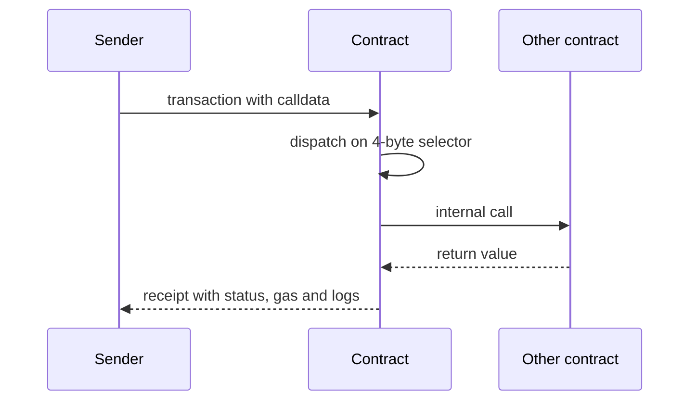
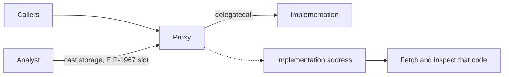
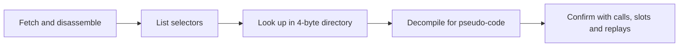
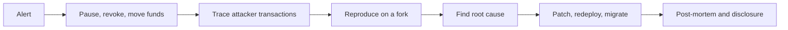

# 14. On-Chain Forensics and Reverse Engineering

Reading transactions, traces and bytecode to understand what a contract does, investigate an incident, and follow funds.

> **Not from the library.** General reference material written to fill a gap, for defensive analysis and learning.

## At a glance

| Task | Tool or technique | Use it when |
|---|---|---|
| Decode a transaction | `cast tx`, explorer | Seeing what was called and with what |
| Trace execution | `cast run`, Tenderly, Phalcon | Understanding internal calls and reverts |
| Read raw storage | `cast storage` | Finding hidden state, proxy targets |
| Identify a function | 4-byte selector | Calldata with no ABI |
| Decompile bytecode | Dedaub, Heimdall | Source is not verified |
| Follow funds | Explorers, labelling tools | Incident response |

## Anatomy of a transaction

- **from**, **to**, **value**, **input data** (calldata), **gas**, **nonce**, and after execution a **receipt** with status, gas used and **logs** (events).
- Calldata starts with a **4-byte selector**, the first four bytes of `keccak256("transfer(address,uint256)")`, followed by ABI-encoded arguments in 32-byte words.
- A transaction to a contract may cause many **internal calls**; the explorer's "internal transactions" or a trace shows them.

```bash
cast tx <hash> --rpc-url $RPC            # transaction fields
cast receipt <hash> --rpc-url $RPC       # status, gas, logs
cast run <hash> --rpc-url $RPC           # replay with a full call trace
cast 4byte 0xa9059cbb                    # selector -> transfer(address,uint256)
cast sig "transfer(address,uint256)"     # signature -> selector
cast decode-calldata "transfer(address,uint256)" <data>   # selector must be included
cast 4byte-calldata <data>                              # guess the signature, then decode
```

From transaction to trace:




## Reading contract state

```bash
cast call <addr> "owner()(address)" --rpc-url $RPC
cast storage <addr> 0 --rpc-url $RPC          # raw slot 0
cast code <addr> --rpc-url $RPC               # deployed bytecode
```

- Storage is an array of 32-byte slots. Simple variables take slots in declaration order (small ones may pack into one slot).
- A mapping value at `mapping[key]` lives at `keccak256(abi.encode(key, slot))`; a dynamic array's data starts at `keccak256(slot)`.
- **Proxies**: the implementation address is stored at the EIP-1967 slot `0x360894a13ba1a3210667c828492db98dca3e2076cc3735a920a3ca505d382bbc`. Read it to find what code really runs.

```bash
cast storage <proxy> 0x360894a13ba1a3210667c828492db98dca3e2076cc3735a920a3ca505d382bbc
```

Finding the real code behind a proxy:




## Unverified contracts and bytecode

- **Verified** source on an explorer makes review easy; unverified code deserves suspicion.
- The start of the bytecode usually contains a **dispatcher**: it loads the first four bytes of calldata and compares them with known selectors (`PUSH4 <selector> EQ JUMPI`). The list of selectors hints at the functions.
- Workflow for an unknown contract:
  1. Fetch the code (`cast code`) and disassemble (`cast disassemble`, evm.codes for opcode reference).
  2. List selectors and look them up in the 4-byte directory.
  3. Decompile (Dedaub, Heimdall) for approximate pseudo-code.
  4. Call read-only functions, read key slots, and replay real transactions to confirm behaviour.
- Decompiled output is a guess. Rely on traces and tests for certainty.
- Warning signs: `selfdestruct`, `delegatecall` to a changeable address, hidden owner-only transfer or mint, blacklist functions, upgradeable proxies controlled by one key, fee settings the owner can raise without limit.

Working through an unknown contract:



## Incident analysis workflow

1. **Collect**: the attacker address, victim contract, transaction hashes, block numbers.
2. **Trace** each transaction: which calls, what flash loans, which price or state changed.
3. **Reproduce** on a fork: replay at the block before the exploit, then write a proof-of-concept test.
4. **Find the root cause**: the missing check, the manipulated oracle, the logic flaw.
5. **Quantify**: funds lost, assets affected, whether still exploitable.
6. **Document** a timeline and publish a post-mortem.



## Following funds

- Every transfer is public: follow outgoing transfers from the attacker address through bridges and mixers.
- Explorers label known exchanges and protocols; labelling and graph tools help cluster addresses.
- Funds sent to a centralised exchange can sometimes be frozen if the exchange is contacted fast.
- Chain analysis is probabilistic: clustering heuristics can be wrong.
- Coordination groups of security researchers (e.g. the Security Alliance's emergency channel) help during live incidents.

## Containment actions for a protocol team

- **Pause** the contracts if a pause exists.
- Tell users to **revoke approvals** to the affected contract.
- Move at-risk funds with the admin multisig; consider a whitehat rescue.
- Use a private channel to coordinate; public announcements can invite copycat attacks before a fix.
- Offer a bounty for return of funds; many attackers accept.

## Personal wallet forensics

- Review the **approvals** your address has granted and revoke unneeded ones.
- Check recent signatures and transactions on the explorer for unexpected approvals.
- If a key or seed is compromised, move assets to a new wallet immediately, highest value first, and use a private relay so a sweeper bot cannot front-run you.

## Common mistakes

- Trusting a decompiler's output without confirming against a trace.
- Reading only the top-level call and missing internal calls.
- Assuming the address that received funds is the real attacker; it may be an intermediate.
- Publishing details of an unpatched bug.

## Recall

1. What are the first four bytes of calldata?
2. How do you find the real code behind a proxy?
3. Where does `mapping[key]` live in storage?
4. Why replay an exploit on a fork?

??? note "Answers"
    1. The function selector: the first four bytes of the Keccak-256 hash of the signature.
    2. Read the proxy's implementation slot (EIP-1967) and inspect that address.
    3. At `keccak256(abi.encode(key, slot))`.
    4. To reproduce the attack safely, confirm the root cause, and test the fix.

## Links

- [[16. Exploit Case Studies|Exploit Case Studies]]
- [[14. Contract Testing and Auditing|Contract Testing and Auditing]]
- [[6. Smart Contract Security|Smart Contract Security]]
- [[13. Node Operation and Infrastructure|Node Operation and Infrastructure]]: running your own RPC for tracing.

## External references

- [ERC-1967: proxy storage slots](https://github.com/ethereum/ercs/blob/master/ERCS/erc-1967.md): defines the implementation slot, `keccak256('eip1967.proxy.implementation') - 1`.
- [Solidity docs: layout of state variables in storage](https://github.com/ethereum/solidity/blob/develop/docs/internals/layout_in_storage.rst): mapping and dynamic array slot formulas.
- [Foundry repository (cast)](https://github.com/foundry-rs/foundry): source of `cast`; the docs are at getfoundry.sh/cast.
- [Foundry docs: cast reference](https://www.getfoundry.sh/reference/cast/cast): `tx`, `receipt`, `run`, `call`, `storage`, `code`, `4byte`, `sig`, `decode-calldata`, `disassemble`
- [Foundry docs: cast run](https://www.getfoundry.sh/reference/cast/run): replays a published transaction locally with a trace (`--debug` opens the debugger)
- [Foundry docs: debugging transactions](https://www.getfoundry.sh/guides/debugging-transactions): replaying failed mainnet transactions
