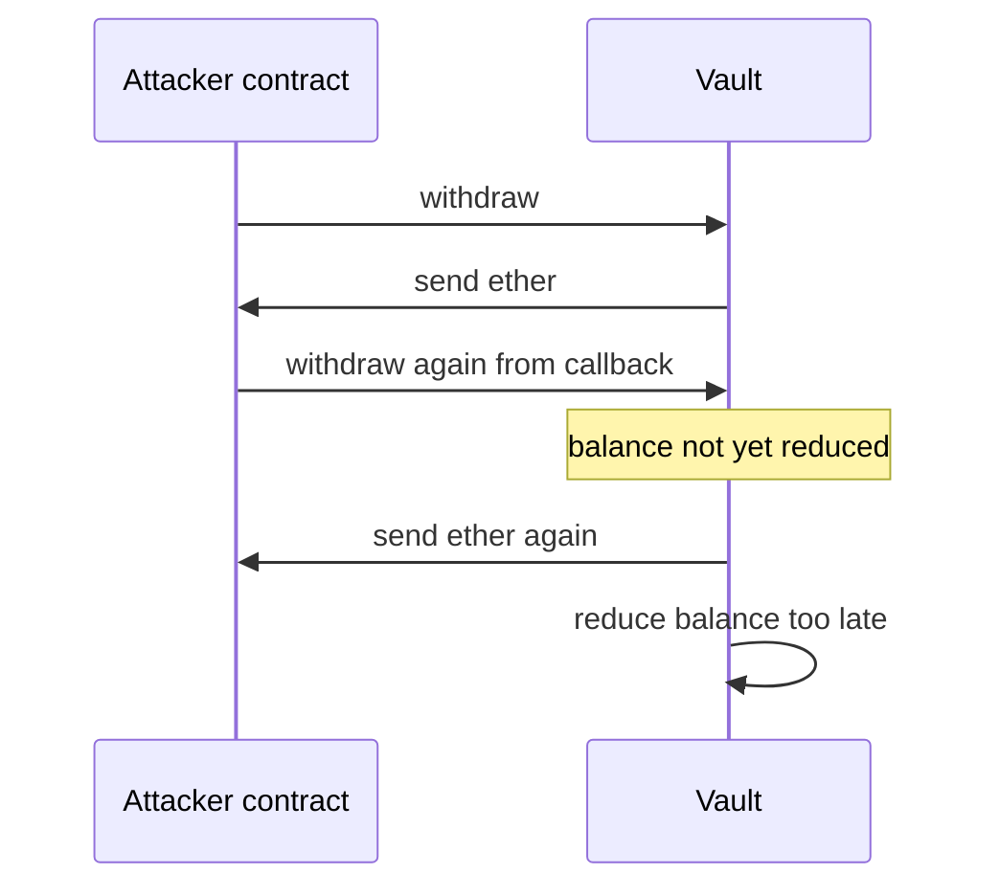
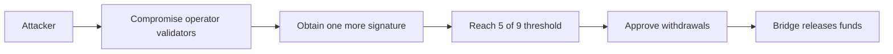
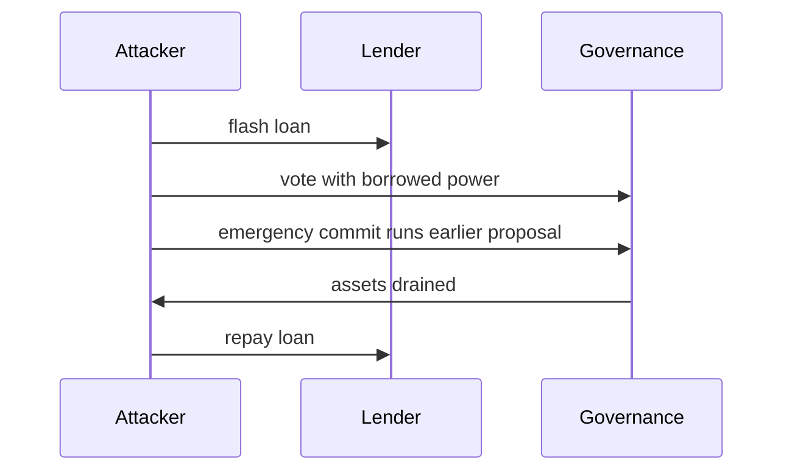
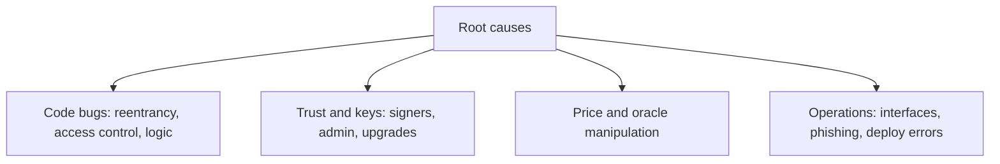

# 14. Exploit Case Studies

Well-known incidents, the root cause of each, and the lesson. Written to learn patterns, not to assign blame.

> **Not from the library.** General reference material written to fill a gap. Figures and causes were cross-checked from search results and memory, not from official post-mortems (none could be fetched while writing). All amounts are approximate and mechanisms are simplified; verify against the projects' own post-mortems before quoting.

## At a glance

| Incident | Year | Root cause class | Lesson |
|---|---|---|---|
| The DAO | 2016 | Reentrancy | Update state before external calls |
| Parity multisig library | 2017 | Unprotected initialiser / selfdestruct in shared library | Lock logic contracts, avoid selfdestruct |
| Poly Network | 2021 | Broken access control on cross-chain call | Never let user-supplied data reach privileged calls |
| Wormhole | 2022 | Signature verification bypass | Verify the verifier |
| Ronin bridge | 2022 | Compromised validator keys (5 of 9) | Decentralise and secure signers |
| Nomad bridge | 2022 | Faulty initialisation trusted any message | Test upgrades; fail closed |
| Beanstalk | 2022 | Flash-loan governance takeover | Delay between voting power and execution |
| Mango Markets | 2022 | Oracle price manipulation | Do not trust thin-market spot prices |
| Euler | 2023 | Logic flaw in donation and liquidation | Invariant tests on accounting |
| Bybit | 2025 | Compromised signing interface | Verify what you sign, off the same machine |

## The DAO (2016)

- A withdraw function sent ether before reducing the caller's balance, and the receiving contract called back in repeatedly.
- About 3.6 million ETH was drained; the response was a contentious hard fork that returned the funds, with the unforked chain continuing as Ethereum Classic.
- **Lesson**: checks-effects-interactions and reentrancy guards. See [[5. Smart Contracts|Smart Contracts]].

Reentrancy in outline:

## Parity multisig (2017)

- Wallets delegated their logic to one shared library contract. A user (accidentally, by their own account) called the library's unprotected initialiser, became its owner, and then triggered `selfdestruct` on it.
- Every wallet pointing at that library lost its working code; about 500,000 ETH (on the order of 150 million dollars at the time) became permanently inaccessible. This was separate from the earlier July 2017 Parity theft.
- **Lesson**: initialise and lock implementation contracts; avoid `selfdestruct` and `delegatecall` into upgradeable shared code.

## Poly Network (2021)

- A cross-chain manager could call arbitrary functions. An attacker crafted a message so it called the function that replaces the trusted keeper key.
- About 600 million dollars across several chains was taken and later returned by the attacker.
- **Lesson**: a function that can call anything must never be reachable with attacker-controlled arguments.

## Wormhole (2022)

- On Solana, the bridge's signature check used a deprecated function that did not check the supplied instructions sysvar account, so a spoofed account let a forged "guardian approved" message be accepted and wrapped ETH was minted without backing.
- About 120,000 wrapped ETH (on the order of 300 million dollars at the time) were created; Jump Crypto, a Wormhole backer, replaced the ETH.
- **Lesson**: validate that every account passed to a program is the one expected. See [[10. Non-EVM Chains|Non-EVM Chains]].

## Ronin bridge (2022)

- The bridge required 5 of 9 validator signatures. The attacker compromised the four validators run by the operator (Sky Mavis) and used a leftover gas-free allowlist permission to obtain a fifth signature from the Axie DAO validator.
- Losses were about 173,600 ETH and 25.5 million USDC (on the order of 600 million dollars at the time).
- **Lesson**: threshold signing is only as strong as the independence of the signers; keep key sets separate, rotate and monitor. See [[18. Oracles and Cross-Chain Messaging|Oracles and Cross-Chain Messaging]].

Bridge compromise path:

## Nomad bridge (2022)

- A routine upgrade initialised the trusted root to zero (0x00), which is also the default value for unproven messages, so unproven messages appeared valid. Anyone could copy a working exploit transaction, swap in their own address and replay it.
- Many participants drained about 190 million dollars in a "crowd" exploit; some were whitehats who returned funds.
- **Lesson**: validation must fail closed; test deployments and upgrades like new code, not routine changes.

## Beanstalk (2022)

- An attacker used a flash loan to gain a supermajority of voting power (the loan was repaid in the same transaction), and an emergency commit path let the previously submitted malicious proposal execute after only a one-day wait. About 180 million dollars of assets was drained, with the attacker's profit reported as roughly 76 million.
- **Lesson**: separate voting power from execution with snapshots and timelocks. See [[8. DAOs and Governance|DAOs and Governance]].

Flash-loan governance attack:

## Mango Markets (2022)

- The attacker pumped the price of MNGO on thin markets while holding a large perpetual position, then borrowed other assets against the resulting unrealised profit. About 110 million dollars was drained.
- **Lesson**: price feeds for illiquid assets are manipulable; use caps, TWAPs and conservative collateral factors. See [[17. DeFi Mechanics and Risks|DeFi Mechanics and Risks]].

## Euler (2023)

- A `donateToReserves` function lacked a health check, so a user could donate collateral and make their own account insolvent, then liquidate it from a second account at a discount. About 197 million dollars was taken; most or all of it was later reported returned.
- **Lesson**: complex accounting needs invariant tests and extra review of new features that touch balances. See [[14. Contract Testing and Auditing|Contract Testing and Auditing]].

## Bybit (2025)

- Attackers compromised a Safe{Wallet} developer machine and injected malicious JavaScript into the Safe interface, so signers approved what looked like a routine transfer between Bybit wallets but was a malicious one. About 1.5 billion dollars of ether (about 400,000 ETH) was taken.
- **Lesson**: multisig does not help if everyone signs what the compromised screen shows; verify transaction data independently, using a hardware device and a separate check.

## Patterns across incidents

| Class | Typical preventions |
|---|---|
| Code bugs | Tests, fuzzing, audits, formal methods |
| Trust and keys | Hardware wallets, diverse signers, timelocks, monitoring |
| Oracles and pricing | Time-weighted, aggregated, bounded prices |
| Operations | Signing verification, separate devices, deployment checklists |

- Many losses came from **bridges** and **admin keys**, not from the core protocol code.
- Several were not "hacks" of cryptography; they used flash loans, logic gaps and social engineering.
- Teams that responded fastest had **pause switches**, monitoring and a rehearsed plan.

## Common mistakes when learning from incidents

- Focusing only on the code bug and ignoring the process failure that let it ship.
- Quoting loss figures without checking the source.
- Assuming a fixed bug means a safe protocol: the same class reappears in new forms.

## Recall

1. What do The DAO and Beanstalk have in common?
2. Why did Nomad's flaw spread so quickly?
3. What does Bybit show about multisig?
4. Which incidents were caused mainly by key management?

??? note "Answers"
    1. State or voting power could be manipulated within a single transaction before checks took effect.
    2. The exploit was a copy-and-edit transaction anyone could replay.
    3. A multisig is only as safe as the interface and process signers rely on.
    4. Ronin, and in part Bybit (the signing interface).

## Links

- [[6. Smart Contract Security|Smart Contract Security]]
- [[15. On-Chain Forensics and Reverse Engineering|On-Chain Forensics and Reverse Engineering]]
- [[14. Contract Testing and Auditing|Contract Testing and Auditing]]

## External references

- [Solidity docs: security considerations](https://github.com/ethereum/solidity/blob/develop/docs/security-considerations.rst): reentrancy, checks-effects-interactions and `tx.origin` pitfalls (source of the official docs).
- [ERC-1967: proxy storage slots](https://github.com/ethereum/ercs/blob/master/ERCS/erc-1967.md): the standard behind the upgradeable-proxy patterns discussed above.
- [Foundry repository](https://github.com/foundry-rs/foundry): fork-mode tooling used to reproduce incidents.

Official project post-mortems (Wormhole, Ronin, Nomad, Beanstalk, Euler, Safe/Bybit) were not reachable in this session, so they are deliberately not linked here.
