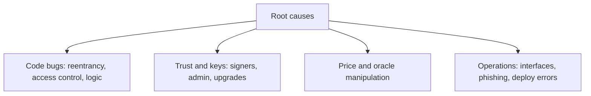

# 16. Exploit Case Studies

Well-known incidents, the root cause of each, and the lesson. Written to learn patterns, not to assign blame.

> **Not from the library.** General reference material written to fill a gap. Amounts are approximate and from public post-mortems as remembered; verify details and figures against the projects' own post-mortems before quoting them.

## At a glance

| Incident | Year | Root cause class | Lesson |
|---|---|---|---|
| The DAO | 2016 | Reentrancy | Update state before external calls |
| Parity multisig library | 2017 | Unprotected initialiser / selfdestruct in shared library | Lock logic contracts, avoid selfdestruct |
| Poly Network | 2021 | Broken access control on cross-chain call | Never let user-supplied data reach privileged calls |
| Wormhole | 2022 | Signature verification bypass | Verify the verifier |
| Ronin bridge | 2022 | Compromised validator keys (5 of 9) | Decentralise and secure signers |
| Nomad bridge | 2022 | Faulty initialisation trusted any message | Test upgrades; fail closed |
| Beanstalk | 2022 | Flash-loan governance takeover | Delay between voting power and execution |
| Mango Markets | 2022 | Oracle price manipulation | Do not trust thin-market spot prices |
| Euler | 2023 | Logic flaw in donation and liquidation | Invariant tests on accounting |
| Bybit | 2025 | Compromised signing interface | Verify what you sign, off the same machine |

## The DAO (2016)

- A withdraw function sent ether before reducing the caller's balance, and the receiving contract called back in repeatedly.
- Roughly 3.6 million ETH was drained; the response was a contentious chain fork, which produced Ethereum and Ethereum Classic.
- **Lesson**: checks-effects-interactions and reentrancy guards. See [[5. Smart Contracts|Smart Contracts]].

## Parity multisig (2017)

- Wallets delegated their logic to one shared library contract. A user triggered the library's own initialiser and then `selfdestruct`ed it.
- Every wallet pointing at that library lost its working code; hundreds of thousands of ETH became permanently inaccessible.
- **Lesson**: initialise and lock implementation contracts; avoid `selfdestruct` and `delegatecall` into upgradeable shared code.

## Poly Network (2021)

- A cross-chain manager could call arbitrary functions. An attacker crafted a message so it called the function that replaces the trusted keeper key.
- The funds, on the order of hundreds of millions of dollars, were later returned.
- **Lesson**: a function that can call anything must never be reachable with attacker-controlled arguments.

## Wormhole (2022)

- On Solana, the bridge's signature check relied on an account that could be spoofed with a fake system account, so a forged "guardian approved" message was accepted and wrapped ETH was minted without backing.
- About 120,000 wrapped ETH were created; the operator covered the loss.
- **Lesson**: validate that every account passed to a program is the one expected. See [[10. Non-EVM Chains|Non-EVM Chains]].

## Ronin bridge (2022)

- The bridge required 5 of 9 validator signatures. The attacker obtained control of enough keys, including via a stale permission that let one organisation sign on behalf of another.
- Losses were on the order of hundreds of millions of dollars.
- **Lesson**: threshold signing is only as strong as the independence of the signers; keep key sets separate, rotate and monitor. See [[18. Oracles and Cross-Chain Messaging|Oracles and Cross-Chain Messaging]].

## Nomad bridge (2022)

- An upgrade initialised a trusted message root to zero, so unproven messages appeared valid. Anyone could copy a working exploit transaction, swap in their own address and replay it.
- Many participants drained funds in a "crowd" exploit.
- **Lesson**: validation must fail closed; test deployments and upgrades like new code, not routine changes.

## Beanstalk (2022)

- An attacker used a flash loan to gain a majority of voting power inside one transaction, and an emergency path allowed immediate execution of a malicious proposal.
- **Lesson**: separate voting power from execution with snapshots and timelocks. See [[8. DAOs and Governance|DAOs and Governance]].

## Mango Markets (2022)

- The attacker inflated the price of Mango's own token on thin markets, borrowed against the inflated collateral and drained the pool.
- **Lesson**: price feeds for illiquid assets are manipulable; use caps, TWAPs and conservative collateral factors. See [[17. DeFi Mechanics and Risks|DeFi Mechanics and Risks]].

## Euler (2023)

- A function that let users "donate" collateral combined with liquidation logic to leave an account insolvent while allowing a liquidator to profit. Most funds were later returned.
- **Lesson**: complex accounting needs invariant tests and extra review of new features that touch balances. See [[14. Contract Testing and Auditing|Contract Testing and Auditing]].

## Bybit (2025)

- Attackers compromised the interface used to sign transactions for a multisig wallet, so signers approved what looked like a routine transfer but was a malicious one. About 1.5 billion dollars of ether was taken.
- **Lesson**: multisig does not help if everyone signs what the compromised screen shows; verify transaction data independently, using a hardware device and a separate check.

## Patterns across incidents

| Class | Typical preventions |
|---|---|
| Code bugs | Tests, fuzzing, audits, formal methods |
| Trust and keys | Hardware wallets, diverse signers, timelocks, monitoring |
| Oracles and pricing | Time-weighted, aggregated, bounded prices |
| Operations | Signing verification, separate devices, deployment checklists |

- Many losses came from **bridges** and **admin keys**, not from the core protocol code.
- Several were not "hacks" of cryptography; they used flash loans, logic gaps and social engineering.
- Teams that responded fastest had **pause switches**, monitoring and a rehearsed plan.

## Common mistakes when learning from incidents

- Focusing only on the code bug and ignoring the process failure that let it ship.
- Quoting loss figures without checking the source.
- Assuming a fixed bug means a safe protocol: the same class reappears in new forms.

## Recall

1. What do The DAO and Beanstalk have in common?
2. Why did Nomad's flaw spread so quickly?
3. What does Bybit show about multisig?
4. Which incidents were caused mainly by key management?

??? note "Answers"
    1. State or voting power could be manipulated within a single transaction before checks took effect.
    2. The exploit was a copy-and-edit transaction anyone could replay.
    3. A multisig is only as safe as the interface and process signers rely on.
    4. Ronin, and in part Bybit (the signing interface).

## Links

- [[6. Smart Contract Security|Smart Contract Security]]
- [[15. On-Chain Forensics and Reverse Engineering|On-Chain Forensics and Reverse Engineering]]
- [[14. Contract Testing and Auditing|Contract Testing and Auditing]]
