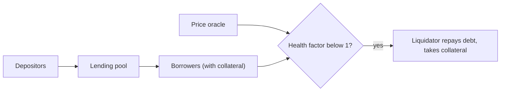

# 17. DeFi Mechanics and Risks

The maths of AMMs, lending, perpetuals and vaults, and the attack surface each one adds.

> **Not from the library.** General reference material written to fill a gap, not investment advice. Parameters differ per protocol; read each protocol's docs.

## At a glance

| Primitive | Core idea | Main risk |
|---|---|---|
| AMM | Pool prices trades with a formula | Impermanent loss, price manipulation |
| Lending market | Over-collateralised loans with liquidation | Bad debt, oracle failure |
| Perpetuals | Leveraged positions with funding payments | Liquidation cascades, manipulation |
| Vault (ERC-4626) | Pool of assets, shares represent a claim | Share inflation, strategy risk |
| Stablecoin | Keep a peg via collateral or incentives | Depeg, collateral crash |

## Constant product AMM

Pool holds reserves `x` and `y` and keeps `x * y = k`.

- Swapping `dx` of token X in (fee `f`, e.g. 0.3%): `dy = y * dx(1-f) / (x + dx(1-f))`.
- Spot price is `y / x`. Larger trades move the price more: **slippage** (price impact).
- Liquidity providers deposit both tokens, get **LP tokens** and earn the fees.
- **Impermanent loss**: when the price ratio changes by a factor `r`, an LP holds less value than simply holding the tokens. The loss is `2*sqrt(r)/(1+r) - 1`. For `r = 2` (one token doubles), about -5.7%; for `r = 4`, about -20%.

Worked example: pool 100 ETH and 200,000 USDC (k = 20,000,000, price 2,000). Selling 10 ETH in (ignoring fee) leaves ETH at 110, so USDC = 20,000,000 / 110 = 181,818. You receive about 18,182 USDC, an average of 1,818 per ETH: roughly 9% below spot.

**Concentrated liquidity** (Uniswap v3 style): LPs supply liquidity only within a price range (ticks). Capital is used far more efficiently but a position stops earning once price leaves the range, and positions are represented as NFTs, not fungible LP tokens.

## Lending markets

- Depositors supply assets and earn interest; borrowers lock **collateral** and borrow other assets.
- **Loan-to-value (LTV)** is the maximum borrow versus collateral; the **liquidation threshold** is slightly higher.
- **Health factor** = (collateral value x liquidation threshold) / debt. Below 1, the position can be liquidated.
- **Liquidators** repay part of the debt and receive collateral at a discount (liquidation bonus), which keeps the system solvent.
- **Interest rates** follow utilisation (borrowed / supplied). A typical curve rises gently and then steeply past a target "kink", pushing borrowers to repay when funds run short.
- **Bad debt** appears when collateral falls faster than liquidators can act, leaving loans worth more than their collateral.

## Perpetual futures

- A **perp** tracks an asset price with no expiry. Traders post **margin** and use leverage.
- **Funding rate**: periodic payments between longs and shorts keep the perp price near the index price.
- **Mark price** (used for liquidation) is usually derived from an oracle to reduce manipulation; **index price** aggregates spot markets.
- If a liquidation cannot cover losses, an **insurance fund** pays; when empty, profitable traders may be reduced (auto-deleveraging).
- Risks: illiquid markets that can be pushed to liquidate others, and oracle lag.

## Vaults and yield

- An **ERC-4626** vault takes deposits, mints **shares**, and invests in a strategy. Share price = total assets / total shares.
- **First-depositor (share inflation) attack**: the first depositor mints 1 share, then "donates" assets directly to the vault, inflating share price so later deposits round down to zero shares and are lost. Mitigations: virtual shares/assets offsets, a minimum initial deposit, or burning initial shares.
- **Yield aggregators** stack risk: your funds depend on every protocol in the chain.
- Always ask where yield comes from. Sustainable sources are fees, interest and trading spreads; token emissions alone can be inflation.

## Stablecoin mechanisms

| Mechanism | How the peg is kept | Failure mode |
|---|---|---|
| Fiat reserves | Redeemable 1:1 with an issuer | Issuer failure, freezing |
| Over-collateralised (Maker/DAI style) | Crypto locked at more than the debt, liquidations | Collateral crashes, oracle error |
| Algorithmic | Mint/burn paired token to move price | Reflexive spiral when confidence breaks |
| Delta-neutral | Hedged position backing | Funding rate flips, exchange risk |

## Attack surface by primitive

| Primitive | Attack | Defence |
|---|---|---|
| AMM | Spot price manipulation with a flash loan | Use TWAP or external feeds, not spot |
| AMM / any | Sandwiching | Slippage and deadlines, see [[12. MEV and Transaction Ordering\|MEV and Transaction Ordering]] |
| Lending | Oracle manipulation to borrow too much or force liquidations | Aggregated oracles, circuit breakers, caps |
| Lending | Bad debt from fast price drops | Conservative collateral factors, supply and borrow caps |
| Vault | Share inflation, donation | Virtual offset, minimum liquidity |
| Any | Read-only reentrancy | Guard view functions that read state during a callback |
| Any | Rounding errors | Round against the user, test small amounts |
| Composable stacks | Dependency failure cascades | Limit exposure, model dependencies |

- **Read-only reentrancy**: a view function reads a pool's price in the middle of another call when state is inconsistent; a different protocol relying on that view gets a wrong value.
- **Flash loans** let anyone borrow huge size without collateral for one transaction, so any attack that needs capital but not time is open to everyone.

## Reading a protocol before using it

1. Where is the code, is it verified and audited, and when was it last changed?
2. Who holds admin power? Is there a timelock and a multisig?
3. What do prices rely on?
4. How is liquidity: can you exit in a stressed market?
5. What is the worst case: bad debt, depeg, pause?

## Common mistakes

- Confusing APR with APY and ignoring impermanent loss in LP returns.
- Borrowing near the liquidation threshold with volatile collateral.
- Treating a high yield as free money.
- Assuming "audited" means "safe".

## Recall

1. Why do bigger swaps get a worse price in a constant product pool?
2. What does a health factor below 1 mean?
3. How does the ERC-4626 first-depositor attack work?
4. Why is a spot price a poor oracle?

??? note "Answers"
    1. Each swap moves along the `x * y = k` curve, so the marginal price rises as one reserve shrinks.
    2. The position's collateral no longer covers the debt with the required margin, so a liquidator may repay it for a discount.
    3. The attacker inflates the share price by donating assets so later deposits round to zero shares.
    4. One transaction can move it with a flash loan, then profit from contracts that trust it.

## Links

- [[4. Cryptocurrencies and Tokens|Cryptocurrencies and Tokens]]
- [[18. Oracles and Cross-Chain Messaging|Oracles and Cross-Chain Messaging]]
- [[6. Smart Contract Security|Smart Contract Security]]
- [[16. Exploit Case Studies|Exploit Case Studies]]

## External references

- [EIP-4626 (ERC-4626)](https://eips.ethereum.org/EIPS/eip-4626): the tokenised vault interface and its security considerations.
- [OpenZeppelin: ERC-4626 inflation attack](https://docs.openzeppelin.com/contracts/5.x/erc4626): explains the attack and the virtual offset defence.
- [EIP-20 (ERC-20)](https://eips.ethereum.org/EIPS/eip-20): the token interface that vault assets and LP tokens build on.
- [Chainlink Data Feeds](https://docs.chain.link/data-feeds): oracle price feeds referenced for lending and perps.
