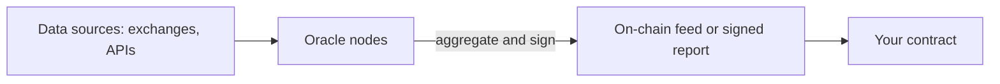
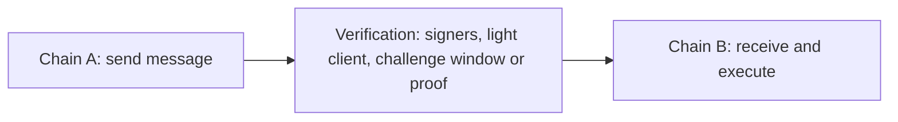

# 18. Oracles and Cross-Chain Messaging

How contracts get outside data and messages from other chains, the trust models behind each design, and the checks a receiving contract must make.

> **Not from the library.** General reference material written to fill a gap. Protocol names are examples; interfaces and addresses change, so read current docs.

## At a glance

| Concept | In one line | Use it when |
|---|---|---|
| Oracle | Feeds off-chain or other-chain data to a contract | Prices, randomness, events, results |
| Push oracle | Updates written on-chain on a schedule or deviation | Lending, stable pricing |
| Pull oracle | Signed data attached to your transaction | Low-latency, many assets |
| TWAP | Average price over a window from an AMM | Manipulation resistance for on-chain markets |
| Bridge / messaging | Moves assets or messages between chains | Multi-chain apps |
| Verification model | Who proves a message is genuine | Judging bridge risk |

## The oracle problem

Contracts are deterministic and cannot call the outside world, so someone must **put the data on-chain**. That someone is a trust assumption. A protocol is no safer than its weakest data source.



## Oracle designs

| Design | How it works | Trade-off |
|---|---|---|
| Push feed (Chainlink Data Feeds) | A network of nodes aggregates a price and updates the contract when the **deviation threshold** moves or the **heartbeat** time passes | Gas paid by the oracle; can be stale between updates |
| Pull oracle (Pyth style) | Publishers sign prices; users include a fresh signed update in their transaction | Very fresh, but the caller pays and must submit updates |
| On-chain TWAP (Uniswap v3 oracle) | Average of pool price over a window | Needs liquid pools; longer window is safer but laggier |
| Optimistic oracle (UMA style) | An answer is proposed and stands unless disputed in a window | Good for subjective or event results; relies on disputers |
| Custom keeper / admin | A trusted account posts values | Simplest and the biggest trust assumption |

## Reading a price feed safely

```solidity
(, int256 answer, , uint256 updatedAt, ) = priceFeed.latestRoundData();
require(answer > 0, "bad price");
require(block.timestamp - updatedAt <= MAX_STALENESS, "stale");
uint256 price = uint256(answer);            // scale using priceFeed.decimals()
```

Checks to make every time:

- **Staleness**: reject data older than the feed's heartbeat plus margin.
- **Positive and sane value**: non-zero, within expected bounds, optionally compared with a second source.
- **Decimals**: feeds commonly use 8 decimals, tokens 18 or 6; normalise explicitly.
- **L2 sequencer uptime**: on rollups, check the sequencer feed so you do not act on prices during an outage.
- **Circuit breakers**: pause or limit actions if price moves too fast.
- **Fallback**: define what happens when the oracle fails; do not fall back to a manipulable spot price.

## Randomness

- `block.timestamp` and `blockhash` are predictable or influenceable. Do not use them for value-bearing randomness.
- Use a **verifiable random function** (e.g. Chainlink VRF) or commit-reveal schemes, and handle the delay between request and fulfilment.

## Cross-chain: what is being moved

| Pattern | How it works | Note |
|---|---|---|
| Lock and mint | Lock the asset on chain A, mint a wrapped version on chain B | Wrapped asset is only as good as the lock |
| Burn and mint | Burn on A, mint on B (native multi-chain tokens) | No pooled collateral to steal |
| Liquidity pools | Pay out from a pool on the destination chain | Fast, relies on pool liquidity |
| Arbitrary messaging | Send any data and calls between chains | Foundation for cross-chain apps |

## Verification models

The key question: **who tells chain B that something happened on chain A?**

| Model | Who verifies | Trust assumption | Example class |
|---|---|---|---|
| Externally verified | A multisig, guardian set or MPC committee signs | Honest majority of signers | Many early bridges |
| Native / light-client | Chain B runs a light client of chain A | Security of chain A itself | IBC (Cosmos) |
| Optimistic | Messages stand unless a watcher challenges in a window | At least one honest watcher | Fraud-proof bridges |
| ZK-verified | A validity proof of chain A's state | The proof system and its implementation | ZK light clients |
| Hybrid | Combination, e.g. configurable verifiers | Depends on your choice | Modular messaging layers |



Messaging protocols (LayerZero, Wormhole, Chainlink CCIP, Axelar, Hyperlane, IBC) differ mainly in this verification layer and in how configurable it is. Pick based on the value at risk, not convenience.

## Receiver-side checklist

When your contract receives a cross-chain message:

- Only accept calls from the **authorised endpoint/relayer contract**.
- Check the **source chain id and sender address** against an allow-list.
- Make messages **replay-proof**: unique nonce or message id, mark as processed.
- Do not assume **ordering** or timely delivery; handle failure and retries.
- Consider **finality**: a message from a chain that later reorgs could be invalid.
- Apply **rate limits and caps** so a compromised route cannot drain everything.
- Keep a **pause** and a way to rotate trusted peers.
- Validate payload decoding strictly; do not execute arbitrary calldata from a message.

## Risk summary

| Risk | Example | Mitigation |
|---|---|---|
| Compromised signers | Ronin | More diverse signers, key hygiene, monitoring |
| Faulty verification code | Wormhole, Nomad | Audits, fail-closed design, tests of upgrades |
| Replay/forged messages | Poly Network | Authenticate sender, restrict callable functions |
| Stale or manipulated data | Mango Markets | Staleness checks, aggregated sources, caps |
| Liquidity risk | Bridge pool drained or run | Limits, diversified routes |

See [[16. Exploit Case Studies|Exploit Case Studies]] for each incident.

## Common mistakes

- Using a single AMM's spot price as the oracle.
- Ignoring feed heartbeat and decimals.
- Assuming "wrapped X" on another chain equals X, forgetting the bridge's trust.
- Treating a cross-chain message as instant and final.
- Granting a messaging endpoint broad powers over your contract.

## Recall

1. What do heartbeat and deviation threshold control in a push feed?
2. Which verification model relies on at least one honest watcher?
3. Why must a receiver store processed message ids?
4. Why avoid `blockhash` for randomness?

??? note "Answers"
    1. How often and how far a price may drift before the on-chain value is updated.
    2. Optimistic verification.
    3. To stop the same valid message being replayed and executed twice.
    4. Block producers can influence or predict it, so it can be gamed.

## Links

- [[17. DeFi Mechanics and Risks|DeFi Mechanics and Risks]]
- [[6. Smart Contract Security|Smart Contract Security]]
- [[10. Non-EVM Chains|Non-EVM Chains]]: IBC and light clients.
- [[9. Zero-Knowledge Proofs|Zero-Knowledge Proofs]]: ZK light clients.

## External references

- [Chainlink: Using Data Feeds](https://docs.chain.link/data-feeds/using-data-feeds): `latestRoundData` and `decimals` usage.
- [Chainlink: L2 Sequencer Uptime Feeds](https://docs.chain.link/data-feeds/l2-sequencer-feeds): answer 0 = up, 1 = down, plus grace period pattern.
- [Chainlink VRF](https://docs.chain.link/vrf): verifiable randomness.
- [Pyth: pull updates](https://docs.pyth.network/price-feeds/core/pull-updates): pull oracle model with signed prices submitted per transaction.
- [IBC Protocol](https://ibcprotocol.dev/): light-client based cross-chain messaging.
