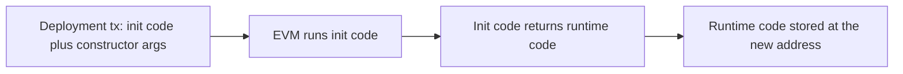

# 20. EVM Bytecode and Low-Level Analysis

How the EVM executes bytecode, how to read a disassembly, and how to recognise common structures when source code is missing.

> **Not from the library.** General reference material written to fill a gap, for defensive analysis and learning.

## At a glance

| Concept | In one line | Use it when |
|---|---|---|
| Stack machine | 256-bit words on a stack of up to 1024 items | Reading opcodes |
| Memory / storage / calldata | Temporary, persistent and input data areas | Tracking where a value lives |
| Creation vs runtime code | Constructor code returns the code that stays on-chain | Analysing a deployment |
| Dispatcher | Routes calldata to a function by selector | Listing a contract's functions |
| Metadata trailer | CBOR blob at the end of Solidity output | Matching bytecode to a compiler and source |

## Execution model

- **Stack**: 256-bit words, at most 1024 deep. Most opcodes pop operands and push a result (`ADD`, `MUL`, `EQ`, `LT`).
- **Memory**: byte-addressable, empty at the start of each call, cost grows with the highest address used. Solidity keeps a **free memory pointer** at `0x40`.
- **Storage**: persistent 32-byte slots (`SLOAD` / `SSTORE`), the most expensive area.
- **Transient storage** (`TLOAD` / `TSTORE`): cleared at the end of each transaction, cheap, used for locks and flash-accounting.
- **Calldata**: read-only call input (`CALLDATALOAD`, `CALLDATACOPY`, `CALLDATASIZE`).
- **Program counter** jumps only to a `JUMPDEST` opcode; anything else reverts.
- Environment opcodes: `CALLER`, `CALLVALUE`, `ORIGIN`, `ADDRESS`, `TIMESTAMP`, `NUMBER`, `GAS`.

## Calls

| Opcode | Runs code of | Storage and `msg.sender` context |
|---|---|---|
| `CALL` | Target | Target's storage; `msg.sender` is the caller |
| `STATICCALL` | Target | Like `CALL` but state changes revert |
| `DELEGATECALL` | Target | **Caller's** storage and `msg.sender`; this is how proxies work |
| `CALLCODE` | Target | Legacy, avoid |
| `CREATE` / `CREATE2` | New contract | Deploys code, returns new address |

- **`CREATE` address** = last 20 bytes of `keccak256(rlp(sender, nonce))`.
- **`CREATE2` address** = last 20 bytes of `keccak256(0xff ++ sender ++ salt ++ keccak256(init_code))`. The address is known in advance, so a counterfactual address can receive funds before deployment.
- `SELFDESTRUCT` after the Cancun upgrade (EIP-6780) only deletes the contract if called in the same transaction as its creation; otherwise it just sends the balance.
- **Precompiles** at low addresses provide fixed functions: `0x01` ecrecover, `0x02` SHA-256, `0x03` RIPEMD-160, `0x04` identity, `0x05` modexp, `0x06`-`0x08` elliptic-curve add/multiply/pairing.

## Creation code vs runtime code



- The transaction `data` for a deployment is **init code**, followed by ABI-encoded constructor arguments.
- Init code ends with `CODECOPY` + `RETURN`; what it returns is the **runtime bytecode** that `cast code` shows later.
- Constructor arguments are not stored in runtime code; read them from the deployment transaction input.

## Recognising a Solidity contract

A typical prologue:

```text
6080604052        PUSH1 0x80  PUSH1 0x40  MSTORE     set the free memory pointer
```

Then, if the contract has no payable functions, a check that no ether was sent, then the **dispatcher**:

```text
PUSH1 0x00  CALLDATALOAD  PUSH1 0xe0  SHR     load the first 4 bytes of calldata
DUP1  PUSH4 0xa9059cbb  EQ  PUSH2 <dest>  JUMPI   if selector == transfer(address,uint256) jump
DUP1  PUSH4 0x70a08231  EQ  PUSH2 <dest>  JUMPI   balanceOf(address)
...
fallthrough -> REVERT (or fallback function)
```

Reading approach:

1. Collect every `PUSH4 <selector>` followed by `EQ` and `JUMPI`; those are the external functions.
2. Resolve selectors with the 4-byte directory or `cast 4byte`.
3. Follow each jump target; a typical function body checks `msg.value`, decodes calldata, runs logic, then returns data with `RETURN`.
4. Look for `LOG` opcodes (`LOG1`-`LOG4`); the first topic is the event signature hash.
5. Mark `SSTORE`, `CALL`, `DELEGATECALL`, `SELFDESTRUCT` and `CREATE2` sites. They are where behaviour matters most.

Other patterns:

- **Revert strings**: `REVERT` data starting `08c379a0` is `Error(string)`; `4e487b71` is `Panic(uint256)` (checked arithmetic, array bounds); custom errors use their own 4-byte selector.
- **Minimal proxy clones** (EIP-1167) are about 45 bytes and just `DELEGATECALL` to a fixed implementation.
- **Metadata trailer**: Solidity appends CBOR data (often starting `a264697066735822`) with the IPFS hash of the metadata and the compiler version, followed by a two-byte length. Two contracts with the same trailer were compiled from the same source and settings.

## Tools

```bash
cast code <addr> --rpc-url $RPC > runtime.hex
cast disassemble $(cat runtime.hex)       # opcode listing
cast 4byte 0xa9059cbb                      # resolve selector
forge inspect MyContract storageLayout     # for your own source
forge inspect MyContract bytecode
heimdall decompile <addr> --rpc-url $RPC   # approximate source and ABI
```

| Tool | Use |
|---|---|
| evm.codes | Opcode reference and an interactive playground with a step debugger |
| ethervm.io | Opcode and decompiler reference pages |
| Dedaub, Heimdall | Decompilers that recover pseudo-code |
| `forge debug`, Tenderly debugger | Step through a real execution |
| Symbolic tools (Mythril, Halmos) | Explore paths and find reachable states |

## Storage layout recap

- Variables are assigned slots in declaration order; values smaller than 32 bytes can pack into one slot.
- `mapping(k => v)` value is at `keccak256(abi.encode(k, slot))`.
- Dynamic array data starts at `keccak256(slot)`; the slot itself holds the length.
- Proxies use fixed pseudo-random slots (EIP-1967) to avoid collisions with logic storage.
- To check a suspected layout, `cast storage` the computed slots and compare with known values.

## Common mistakes

- Assuming decompiled code is exact; it is a reconstruction.
- Reading the creation code when you meant the runtime code.
- Forgetting that `DELEGATECALL` code touches the **caller's** storage.
- Ignoring `JUMPDEST` rules when hand-patching bytecode in tests.
- Treating the metadata hash as proof of safety: it only identifies source, not intent.

## Recall

1. What does the dispatcher use to pick a function?
2. Why does `DELEGATECALL` matter for proxies?
3. How is a `CREATE2` address computed, and why is it useful?
4. What is stored on-chain after a deployment: init code or runtime code?

??? note "Answers"
    1. The first four bytes of calldata compared against known selectors.
    2. It runs the target's code against the caller's storage, so a proxy keeps state while logic is swappable.
    3. From the deployer, salt and init code hash; it is predictable before deployment.
    4. The runtime code returned by the init code.

## Links

- [[15. On-Chain Forensics and Reverse Engineering|On-Chain Forensics and Reverse Engineering]]
- [[21. Tracing and On-Chain Analytics Tooling|Tracing and On-Chain Analytics Tooling]]
- [[5. Smart Contracts|Smart Contracts]]
