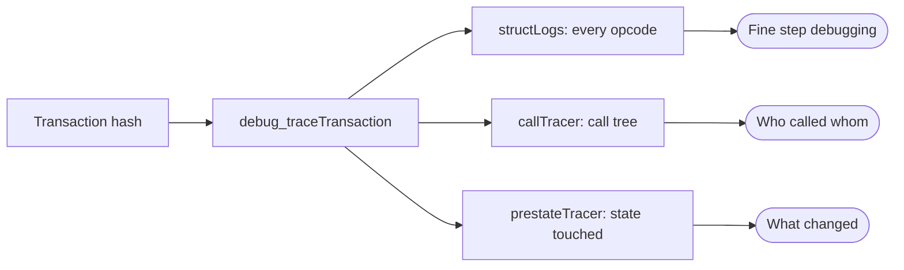
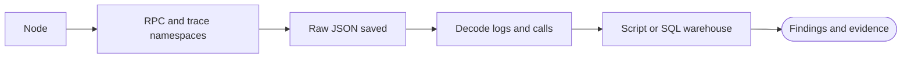
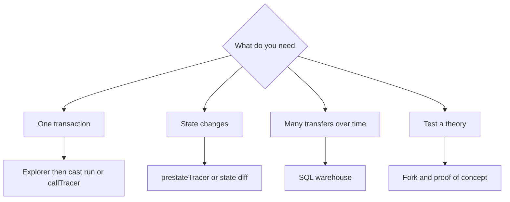

# 20. Tracing and On-Chain Analytics Tooling

The data sources and tools for investigating the chain at scale: node tracing APIs, log queries, SQL warehouses, and scripts.

> **Not from the library.** General reference material written to fill a gap. API availability depends on the client and provider; check their docs.

## At a glance

| Tool | In one line | Use it when |
|---|---|---|
| JSON-RPC (`eth_getLogs`, `eth_getStorageAt`) | Standard node queries | Reading events and state |
| Tracing APIs (`debug_*`, `trace_*`) | Step-level or call-level execution detail | Following internal calls |
| Archive node | Keeps all historical state | Querying state at old blocks |
| Dune / Flipside / BigQuery | SQL over decoded chain data | Aggregates across many blocks |
| Python / TypeScript scripts | Custom analysis | Anything not covered by a dashboard |
| Explorers and tx simulators | Fast human-friendly views | First look at a transaction |

## RPC queries

| Method | Returns |
|---|---|
| `eth_getTransactionByHash` / `eth_getTransactionReceipt` | Transaction and result with logs |
| `eth_getLogs` | Event logs filtered by address, topics and block range |
| `eth_getStorageAt` | A storage slot at a block |
| `eth_getCode` | Runtime code |
| `eth_call` | Read-only call, optionally at a past block (needs old state) |
| `eth_getBlockByNumber` | Block and its transactions |

- An event's **topic0** is the Keccak-256 hash of its signature. For `Transfer(address,address,uint256)` it is `0xddf252ad1be2c89b69c2b068fc378daa952ba7f163c4a11628f55a4df523b3ef`. Indexed arguments appear as the next topics; non-indexed ones are ABI-encoded in `data`.
- Providers cap the block range of `eth_getLogs`, so scan in windows and page the results.

```bash
cast logs --from-block 19000000 --to-block 19000100 \
  --address <token> "Transfer(address,address,uint256)" --rpc-url $RPC
```

## Tracing APIs

Two families, depending on the client:

| API | Output | Notes |
|---|---|---|
| `debug_traceTransaction` / `debug_traceCall` | Opcode-level `structLogs`, or a chosen tracer | Geth-style; very detailed, large |
| `callTracer` | Tree of calls with from/to/value/input/output/errors | Best first view of internal calls |
| `prestateTracer` | State read or changed (balances, storage) | Shows exactly what an exploit touched |
| `trace_transaction`, `trace_block` | Flat list of call traces | OpenEthereum-style namespace offered by some non-Geth clients; check your client's docs |

Three views of the same transaction.



```bash
curl -s -X POST $RPC -H 'content-type: application/json' --data '{
  "jsonrpc":"2.0","id":1,"method":"debug_traceTransaction",
  "params":["<txhash>",{"tracer":"callTracer"}]}'
```

- Tracing needs a node with the `debug` / `trace` namespaces enabled. Many public providers restrict them or charge extra; running your own node is covered in [[13. Node Operation and Infrastructure|Node Operation and Infrastructure]].
- Tracing historical blocks needs **archive** state (or a client able to re-execute from the nearest snapshot).
- `debug_traceCall` lets you trace a **hypothetical** call against a past block, which helps when testing a hypothesis.

From node to findings.



## SQL warehouses

| Platform | Notes |
|---|---|
| Dune | Community dashboards and decoded tables, queries in SQL |
| Flipside | Similar approach with curated tables |
| Google BigQuery public datasets | Raw blocks, transactions, logs and traces for several chains |
| The Graph subgraphs | Event-indexed GraphQL APIs for protocols |

Example shape of a query: "all transfers of one token received by an address, grouped by day".

```sql
SELECT date_trunc('day', block_time) AS day, SUM(value) / 1e18 AS received
FROM erc20_ethereum.evt_Transfer
WHERE contract_address = 0x...
  AND "to" = 0x...
GROUP BY 1
ORDER BY 1;
```

(Table and column names vary per platform; consult its schema.)

## Scripts

```python
from web3 import Web3
w3 = Web3(Web3.HTTPProvider(RPC))
logs = w3.eth.get_logs({
    "address": TOKEN,
    "fromBlock": 19_000_000,
    "toBlock": 19_000_100,
    "topics": [TRANSFER_TOPIC],
})
for l in logs:
    sender = "0x" + l["topics"][1].hex()[-40:]
    receiver = "0x" + l["topics"][2].hex()[-40:]
```

- Write results to CSV/SQLite; keep the **raw JSON** for evidence.
- Decode with the contract ABI instead of slicing bytes by hand when possible.
- Cache RPC responses; block data is immutable once finalised.

## Simulation and debuggers

- **Tenderly** and similar services replay a transaction with a visual call tree and state diffs.
- **Phalcon-style** explorers highlight fund flows and balance changes, helpful in hacks.
- `cast run <hash>` (add `--debug` for the interactive debugger) and `forge test --debug` replay locally.
- A **mainnet fork** (`anvil --fork-url ... --fork-block-number ...`) lets you modify state, impersonate accounts (`anvil_impersonateAccount`) and try fixes safely.

## Choosing a tool

| Question | Start with |
|---|---|
| What did this one transaction do? | Explorer, then `cast run` or `callTracer` |
| What changed in state? | `prestateTracer`, Tenderly state diff |
| Who received X token over time? | SQL warehouse |
| Which contracts called this one? | `trace_block` / explorer's internal transactions |
| Is a theory about an exploit right? | Fork + proof-of-concept test |

Picking a tool by question.



## Common mistakes

- Using a full-state-only node for old `eth_call` queries and getting "missing trie node".
- Missing internal ETH transfers because they emit no event.
- Confusing a log's `address` (the emitting contract) with the token holder.
- Trusting dashboards without checking that the underlying decoded tables cover the contract.
- Losing evidence by not saving raw responses.

## Recall

1. What is topic0 of an event log?
2. Which tracer shows internal calls as a tree?
3. Why can internal ETH transfers be missed when reading only logs?
4. When do you need an archive node?

??? note "Answers"
    1. The Keccak-256 hash of the event signature.
    2. `callTracer`.
    3. Plain ETH transfers inside a call do not emit logs; they appear only in traces.
    4. To query state at old blocks beyond what a regular node keeps.

## Links

- [[15. On-Chain Forensics and Reverse Engineering|On-Chain Forensics and Reverse Engineering]]
- [[20. EVM Bytecode and Low-Level Analysis|EVM Bytecode and Low-Level Analysis]]
- [[22. Fund Tracing and Attribution|Fund Tracing and Attribution]]
- [[7. Web3 Development Workflow|Web3 Development Workflow]]

## External references

- [Geth docs: Built-in tracers](https://geth.ethereum.org/docs/developers/evm-tracing/built-in-tracers): `callTracer` and `prestateTracer`.
- [Geth docs: debug namespace](https://geth.ethereum.org/docs/interacting-with-geth/rpc/ns-debug): `debug_traceTransaction` and `debug_traceCall`.
- [ethereum.org: JSON-RPC API](https://ethereum.org/developers/docs/apis/json-rpc/): `eth_getLogs`, `eth_getStorageAt`, `eth_getCode`.
- [Foundry docs: cast logs](https://www.getfoundry.sh/reference/cast/logs): filter logs by address, block range and event signature.
- [Foundry docs: cast run](https://www.getfoundry.sh/reference/cast/run): replay a published transaction locally.
- [Foundry docs: Anvil forking](https://www.getfoundry.sh/anvil/forking): `--fork-url` and `--fork-block-number`.
- [Foundry docs: Anvil custom methods](https://www.getfoundry.sh/anvil/custom-methods): `anvil_impersonateAccount` and related methods.

No client documentation for the `trace_*` namespace was reachable, so which clients implement it is not confirmed here.
