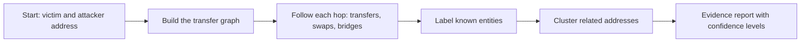

# 22. Fund Tracing and Attribution

Following value across addresses, swaps, bridges and mixers, and how confident you can be about who controls what.

> **Not from the library.** General reference material written to fill a gap, for defensive and educational use.

## At a glance

| Concept | In one line | Use it when |
|---|---|---|
| Transaction graph | Addresses as nodes, transfers as edges | Visualising where funds went |
| Clustering heuristic | A rule that groups addresses by likely owner | Linking addresses |
| Peel chain | Repeated small payments with change back to a new address | Bitcoin flow analysis |
| Obfuscation | Mixers, bridges, swaps, many hops | Understanding why tracing gets hard |
| Attribution | Linking a cluster to an entity | Handing evidence to exchanges or investigators |

## Method

1. Write down the starting transactions (hash, block, amounts, tokens).
2. Follow outgoing transfers from the attacker address; record each hop with hash and timestamp.
3. **Decode swaps**: funds may change token. Follow the swap output, not the original token.
4. **Follow bridges**: find the bridge event (message id, nonce) and look it up on the destination chain.
5. Note **where it stops**: a labelled exchange deposit, a mixer, a dormant address, a protocol deposit.
6. Keep a table of addresses, labels, amounts and a confidence level for each link.

## Account-based chains (Ethereum and similar)

- Every address is visible and balances are explicit, so **direct transfers** are easy to follow.
- Complications: token swaps in DEXs, internal ETH transfers (visible only in traces), proxy/relayer contracts, and funds split across many addresses.
- Useful signals:
  - **Gas funding source**: the first ETH that funded an attacker wallet often comes from an exchange or a prior wallet.
  - **Nonce and timing patterns**: transactions at regular times or with similar gas settings.
  - **Contract deployment links**: the same deployer, similar bytecode or metadata trailer.
  - **Common counterparties**: reuse of the same relayers, bridges or exchange deposit addresses.
  - **ENS names and social posts** linking an address to an identity.
- **Exchange deposit addresses** are unique per customer but sweep to the exchange's hot wallets. Once funds reach a labelled hot wallet, only the exchange can identify the user.

## Bitcoin and UTXO chains

| Heuristic | Meaning | Weakness |
|---|---|---|
| Common-input ownership | Inputs spent in one transaction probably belong to one entity | Broken by CoinJoin and collaborative transactions |
| Change detection | Identify which output is change returning to the sender (round payment amount, address type matching inputs, a never-seen-before address) | Wallet behaviour varies |
| Peel chain | A large balance is repeatedly split into a payment and change | Looks similar for legitimate batching |
| Address reuse | Same address appears in several flows | Good wallets avoid reuse |

- **CoinJoin** merges inputs from many people into equal-size outputs and weakens the first heuristic.
- Taproot key-path spends and Lightning channel opens/closes reduce on-chain visibility; see [[11. Bitcoin Internals|Bitcoin Internals]].

## Obfuscation techniques

| Technique | Effect | How analysts respond |
|---|---|---|
| Many hops / peeling | Spreads the trail | Automated graph tools, thresholds on amounts and timing |
| Swaps across tokens | Changes the asset | Decode swap events; follow the output |
| Cross-chain bridges | Moves to another chain | Match source and destination events; track by amount and time |
| Mixers / privacy pools | Breaks the link between deposit and withdrawal | Timing and amount correlation; behavioural patterns; results are probabilistic |
| Chain-hopping + centralised exchange | Convert and withdraw | Request exchanges' help with evidence |

Be careful: privacy tools are also used by ordinary people. Fund flows through them are not by themselves proof of wrongdoing.

## Labels and tools

| Category | Examples of what exists |
|---|---|
| Free explorers | Address labels, token transfers, internal transactions, contract creation info |
| Graph tools | Visualise fund flows and cluster addresses |
| Commercial analytics | Large labelled datasets used by exchanges and investigators |
| Your own data | SQL queries and scripts, see [[21. Tracing and On-Chain Analytics Tooling|Tracing and On-Chain Analytics Tooling]] |

- Labels are claims, not facts. A mislabelled address wrongly accuses someone; confirm with a second source.

## Attribution: be rigorous

- Separate **observation** ("address A sent X to address B at time T") from **inference** ("A and B are controlled by the same party").
- State confidence: certain (protocol rule), strong (several independent heuristics), weak (one heuristic or coincidence).
- Beware **false positives**: shared exchange wallets, mixers and bridges link unrelated people; address poisoning plants lookalike addresses; a victim can unknowingly interact with an attacker's address.
- Never publish a named accusation based on heuristics alone.

## Acting on findings

- Send exchanges a concise package: transaction hashes, timestamps, addresses, deposit address, and a clear statement of the incident. Speed matters because funds move quickly.
- Contact stablecoin issuers when stolen funds are in a freezable token.
- Report to the relevant law-enforcement agency and incident-sharing groups; the Security Alliance (SEAL) runs SEAL 911, a free 24/7 emergency hotline that connects people facing an active security incident with vetted security researchers.
- Offer the attacker a negotiated return (a bounty) through an on-chain message; some incidents have ended this way.
- Preserve evidence (below).

## Preserving evidence

- Save raw JSON of transactions, receipts and traces, with block numbers and the provider used.
- Take timestamped screenshots of explorer pages and labels.
- Record a **hash** (SHA-256) of each evidence file so later tampering is detectable.
- Keep a written timeline in UTC.
- Do not move or touch attacker funds except through agreed, legal channels.

## Common mistakes

- Treating one heuristic as proof.
- Following the first token and losing the trail after a swap.
- Forgetting internal transfers when reading explorer lists.
- Sharing unverified accusations publicly.
- Not recording how a conclusion was reached, which makes it unusable later.

## Recall

1. What does the common-input-ownership heuristic assume, and what breaks it?
2. Why are bridge events useful in tracing?
3. What is the difference between observation and inference?
4. What should an exchange request include?

??? note "Answers"
    1. That all inputs of one transaction belong to one entity; CoinJoin and other collaborative transactions break it.
    2. They link a deposit on one chain to a withdrawal on another by message id, amount and time.
    3. An observation is a recorded fact on-chain; an inference is a conclusion drawn from patterns and has a confidence level.
    4. Transaction hashes, timestamps, addresses, the deposit address, and a concise incident statement.

## Links

- [[21. Tracing and On-Chain Analytics Tooling|Tracing and On-Chain Analytics Tooling]]
- [[23. Wallet Drainers and Token Scam Analysis|Wallet Drainers and Token Scam Analysis]]
- [[24. Incident Response and Post-Mortems|Incident Response and Post-Mortems]]
- [[15. On-Chain Forensics and Reverse Engineering|On-Chain Forensics and Reverse Engineering]]

## External references

- [Security Alliance: SEAL 911](https://securityalliance.org/seal-911): the emergency incident-response hotline.

Not verified against a primary source: the Bitcoin clustering heuristics (the fetched Bitcoin developer guide page has no privacy section), attribution practice, and exchange/issuer procedures are general knowledge.
