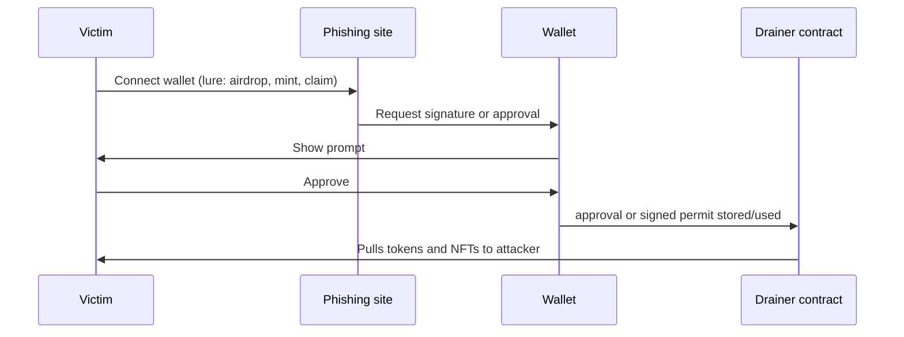

# 23. Wallet Drainers and Token Scam Analysis

How wallet-draining phishing works, how to analyse a suspicious site or token safely, and how to recover and protect a wallet.

> **Not from the library.** General reference material written to fill a gap, for defence and analysis. Do not interact with live drainer sites with a real wallet.

## At a glance

| Threat | In one line | Check |
|---|---|---|
| Approval drainer | Victim approves a spender who then pulls tokens | Token approvals |
| Permit / signature drainer | Off-chain signature gives spending rights without a transaction | Signed typed data |
| Address poisoning | Lookalike address planted in history | Full address comparison |
| Honeypot token | Can be bought but not sold | Simulated sell |
| Rug pull | Owner removes liquidity or mints and dumps | Ownership, liquidity lock, mint rights |
| Malicious contract call | Transaction that silently transfers ownership or approvals | Decoded calldata |

## How a drainer works



Key mechanisms:

- **`approve` / `setApprovalForAll`**: gives a spender rights to move tokens or an entire NFT collection. The victim pays gas to sign this; the drain happens later.
- **EIP-2612 `permit` and similar typed-data signatures (including Permit2)**: the victim signs an off-chain message; the attacker submits it on-chain, paying gas. No victim transaction appears, so it feels harmless.
- **Blind signing** of an opaque message (hex data) can authorise anything.
- **Malicious contract calls**: a "claim" function that really transfers token ownership or sets approvals.
- **Fake token airdrops**: a worthless token whose "sell" or "claim" page is a drainer; the token's name may contain a link.
- **Drainer-as-a-service**: operators rent kits to affiliates and take a share, so many sites share the same code and contract patterns.

## Address poisoning

- The attacker sends a tiny or zero-value transfer from an address that **matches the first and last characters** of one you use often.
- It then sits in your transaction history; copy-pasting from history sends funds to the attacker.
- Defence: use an address book, compare the **whole** address, send a small test amount first.

## Analysing a suspicious site (safely)

1. Use a disposable browser profile or VM with **no wallet** attached.
2. Open developer tools to read network requests and the scripts; kits are often obfuscated JavaScript.
3. Find the **requested actions**: which method (`eth_sendTransaction`, `eth_signTypedData_v4`, `personal_sign`), which contract addresses, which token or approval.
4. Decode any calldata: `cast 4byte-decode` / `cast --calldata-decode`.
5. For typed data, read the domain and the message: the `spender`, `value`, and `deadline` of a permit tell you what you would be granting.
6. Identify the **drain contract** and the **recipient**, then check them on an explorer (creation date, other victims, balance flow).
7. Report the domain to the registrar/host, wallet security teams and phishing blocklists.

## Analysing a token contract

Checks before interacting with an unknown token:

| Check | Why |
|---|---|
| Is source verified? | Unverified code hides logic |
| `owner()`: is it an EOA, a multisig, or renounced? | Owner powers matter |
| Can the owner mint? | Hidden inflation |
| Can fees (taxes) be raised after launch? | A 99% sell tax is a honeypot |
| Blacklist/whitelist or trading toggle? | Can block selling for chosen addresses |
| `maxTxAmount` / `maxWallet` limits editable? | Can be set to trap sellers |
| Proxy upgradeable? Who controls the admin? | Logic can be swapped later |
| Liquidity: who holds the LP tokens, is it locked? | Unlocked LP can be withdrawn (rug pull) |
| Holder distribution | A few wallets holding most supply can dump |
| Contract age and deployer history | New deployer with prior rugs is a red flag |

**Simulate the sale** before buying: on a fork, impersonate a buyer and call the router's swap both ways.

```bash
anvil --fork-url $RPC --fork-block-number <latest>
# then use cast/forge scripts to: buy a small amount, approve, and try to sell it back
```

If the sell reverts or returns far less, treat the token as a honeypot.

- A token can **appear to renounce ownership** while a separate privileged role or proxy admin retains control.
- Automated token scanners help as a first filter but miss novel tricks; confirm with source and simulation.

## Rug pull anatomy

- **Liquidity removal**: the creator holds LP tokens and withdraws the pool's value.
- **Mint and dump**: unlimited minting then selling into the pool.
- **Fee switch**: sell tax changed to nearly 100%.
- **Soft rug**: the team stops working and lets the project die while selling.
- Evidence to look for: LP-token transfers to the deployer, large `Mint` events, sudden `setFee`-type transactions.

## If your wallet was drained or exposed

1. **Stop signing** on that wallet; assume the key may be safe but approvals are not, until proven.
2. Check **approvals** (explorer approval checker or a revoke tool) and **revoke** unknown spenders. Revoking costs gas, so keep a little native token.
3. If the **seed or key leaked**, move everything to a new wallet **immediately**, highest value first. Use a private relay or bundle, because sweeper bots watch compromised wallets and take incoming gas.
4. Record transaction hashes, addresses, the phishing URL and screenshots.
5. Report to wallet providers, the site's host/registrar and, for stolen funds, follow [[22. Fund Tracing and Attribution|Fund Tracing and Attribution]].
6. Do not pay "recovery services" that contact you; they are a second scam.

## Preventive habits

- Use a **hardware wallet**, read every prompt, and **reject blind signatures**.
- Use a separate wallet for mints and unknown sites; keep savings in a wallet that never connects to dapps.
- Prefer **limited allowances** over unlimited approvals; revoke after use.
- Bookmark real sites; treat links from DMs, ads and replies as hostile.
- Simulate transactions with a wallet that shows balance changes before signing.
- Be sceptical of urgency, free tokens, and anyone asking for a seed phrase.

## Common mistakes

- Believing "I only signed, I didn't send a transaction" means nothing happened.
- Revoking approvals on one chain and forgetting the same address on others.
- Trusting a token because it has a large holder count; these can be faked.
- Skipping the sell simulation.

## Recall

1. Why is a `permit` signature dangerous even though it costs the victim no gas?
2. What is address poisoning?
3. Name three on-chain signs a token may be a rug pull.
4. Why move funds with a private relay after a key leak?

??? note "Answers"
    1. The attacker can submit it later to spend the victim's tokens; the victim made no visible transaction.
    2. Planting a lookalike address in a victim's history so they copy it by mistake.
    3. Unlocked LP tokens held by the deployer, owner-controlled minting, and editable fees or trading toggles.
    4. Sweeper bots monitor the compromised address and would front-run public transactions.

## Links

- [[3. Keys, Wallets and Signatures|Keys, Wallets and Signatures]]
- [[6. Smart Contract Security|Smart Contract Security]]
- [[22. Fund Tracing and Attribution|Fund Tracing and Attribution]]
- [[24. Incident Response and Post-Mortems|Incident Response and Post-Mortems]]
