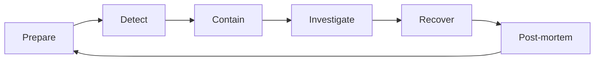

# 24. Incident Response and Post-Mortems

A playbook for a live protocol incident: preparing, detecting, containing, recovering and learning.

> **Not from the library.** General reference material written to fill a gap. Adapt to your team, and rehearse it before you need it.

## At a glance

| Phase | In one line | Output |
|---|---|---|
| Prepare | Roles, tools, pause switches, contacts | Runbook and drills |
| Detect | Alerts on abnormal behaviour | Incident declared |
| Contain | Stop the loss | Paused contracts, revoked access |
| Investigate | Find root cause and scope | Timeline and PoC |
| Recover | Fix, migrate, compensate | Patched system |
| Learn | Publish and improve | Post-mortem and actions |

## Prepare

- **Roles**: incident commander, technical lead, communications lead, scribe, and a person with signing authority. Everyone knows who they are.
- **Contacts**: signers, auditors, key partners (exchanges, bridges, oracle providers), legal, and security-community channels.
- **Controls**: a pause function with a clearly defined, fast-acting role; a documented procedure to use it; rate limits and caps on value at risk.
- **Access**: multisig signers reachable in different time zones, with hardware wallets available; know the quorum needed and how long it takes.
- **Playbooks** for typical scenarios: exploit in progress, oracle failure, compromised admin key, front-end/DNS hijack, compromised dependency.
- **Drills**: run a tabletop exercise and a test pause on a testnet.

## Detect

Signals to monitor:

| Signal | Example alert |
|---|---|
| Value movement | Withdrawals above a threshold, balance drops by a percentage |
| Admin actions | Any role change, upgrade, ownership transfer, timelock queue |
| Price and oracle | Feed deviation, stale feed, large swap in a pool the protocol uses |
| Protocol invariants | Share price jump, utilisation spike, bad debt appearing |
| Mempool | Suspicious transactions targeting your contracts |
| Off-chain | Domain/DNS changes, social account takeovers, CI/CD and dependency alerts |

- Use event-based monitors and simulation-based alerts; also run your own script as a backup.
- Alert paths must reach a human at any hour, with escalation if no one acknowledges.

## Contain

First actions, in order of speed:

1. **Declare the incident** and open a private war room; keep a timeline.
2. **Pause** affected contracts or functions, if possible.
3. Block the **front end** or show a warning; revoke compromised credentials and rotate API keys.
4. Tell users to **revoke approvals** if the cause is an approval or signature issue.
5. Move at-risk funds out of vulnerable contracts using privileged functions, if safe.
6. Consider a **whitehat rescue** (front-running the attacker to secure funds) only with a plan and legal advice; it is risky.
7. Alert partners (exchanges, bridges, stablecoin issuers) with attacker addresses.

Beware that every action is public. A message in a public channel or an on-chain transaction can tip off copycats before the fix.

## Investigate

- Reproduce the attack on a fork (see [[15. On-Chain Forensics and Reverse Engineering|On-Chain Forensics and Reverse Engineering]]); confirm the root cause and whether other contracts, chains or versions share the flaw.
- Quantify losses and affected users.
- Trace funds ([[22. Fund Tracing and Attribution|Fund Tracing and Attribution]]) and preserve evidence with hashes and timestamps.
- Check for ongoing risk: is the vulnerability still exploitable, are keys still safe, are related protocols exposed?

## Recover

- Develop a minimal, well-tested **fix**; get an independent review before redeploying.
- **Migrate**: new contracts, a snapshot of balances, a claim process. Keep users informed.
- Restore service in stages with low caps.
- Decide on **compensation** and recovery plans (treasury, insurance, token distribution) with the community.
- Negotiate a **bounty** with the attacker if funds may be returned; set a deadline and keep communication on-chain or through a trusted party.
- Rotate keys and permissions that might be exposed.

## Communicate

| Audience | What and when |
|---|---|
| Users | Quick, factual: what is happening, what to do (e.g. revoke approvals), next update time |
| Community and partners | More detail once the situation is contained |
| Auditors and researchers | Technical details after the fix is deployed |
| Regulators/legal | As advised by legal counsel |

- Say what you know and what you do not. Avoid speculation and blame.
- Use official channels only; scammers impersonate teams during incidents, so warn users about fake "recovery" messages.
- Give regular updates even if nothing has changed.

## Post-mortem template

1. **Summary**: what happened, impact, current status.
2. **Timeline** (UTC): detection, key actions, resolution.
3. **Root cause**: the technical flaw and the process gap that let it ship.
4. **Impact**: funds, users, downtime.
5. **What went well / what went badly**.
6. **Remediation**: fixes made and **action items** with owners and dates.
7. **Lessons**: changes to testing, review, monitoring, access control.

Blameless tone: focus on systems and decisions, not individuals. Publish when users are safe and the fix is live. Compare with the patterns in [[16. Exploit Case Studies|Exploit Case Studies]].

## Disclosure and bug bounties

- Publish a **security policy** with a contact and scope (a `SECURITY.md` and a bounty page).
- Give researchers a safe-harbor statement so good-faith reports are not punished.
- Respond quickly and pay fairly; it is cheaper than an exploit.
- Agree a **coordinated disclosure** timeline before details become public.

## Common mistakes

- No pause switch, or one that requires a quorum nobody can assemble overnight.
- Announcing a vulnerability publicly before it is contained.
- Signers all in one location or sharing one device.
- Rushed fixes deployed without review that introduce new bugs.
- No post-mortem, so the same mistake recurs.

## Recall

1. What are the first containment actions?
2. Why keep the incident room private at first?
3. What belongs in a post-mortem timeline?
4. Why rehearse the plan?

??? note "Answers"
    1. Declare the incident, pause contracts, secure credentials and the front end, and warn users to revoke approvals if relevant.
    2. Public details can alert copycat attackers before a fix.
    3. Detection, each key action and decision, and resolution, in UTC.
    4. Under pressure, untested procedures fail: signers, tools and permissions must work on the day.

## Links

- [[14. Contract Testing and Auditing|Contract Testing and Auditing]]
- [[16. Exploit Case Studies|Exploit Case Studies]]
- [[23. Wallet Drainers and Token Scam Analysis|Wallet Drainers and Token Scam Analysis]]
- [[13. Node Operation and Infrastructure|Node Operation and Infrastructure]]

## External references

None added: no reachable primary source covers incident-response practice (the playbook above is general guidance, not checked against a reference).
