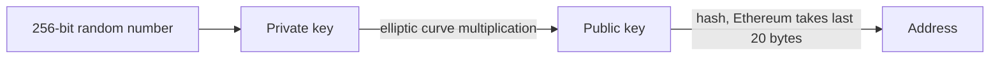
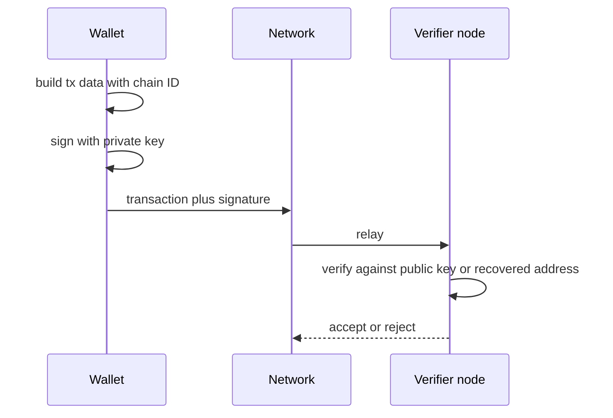
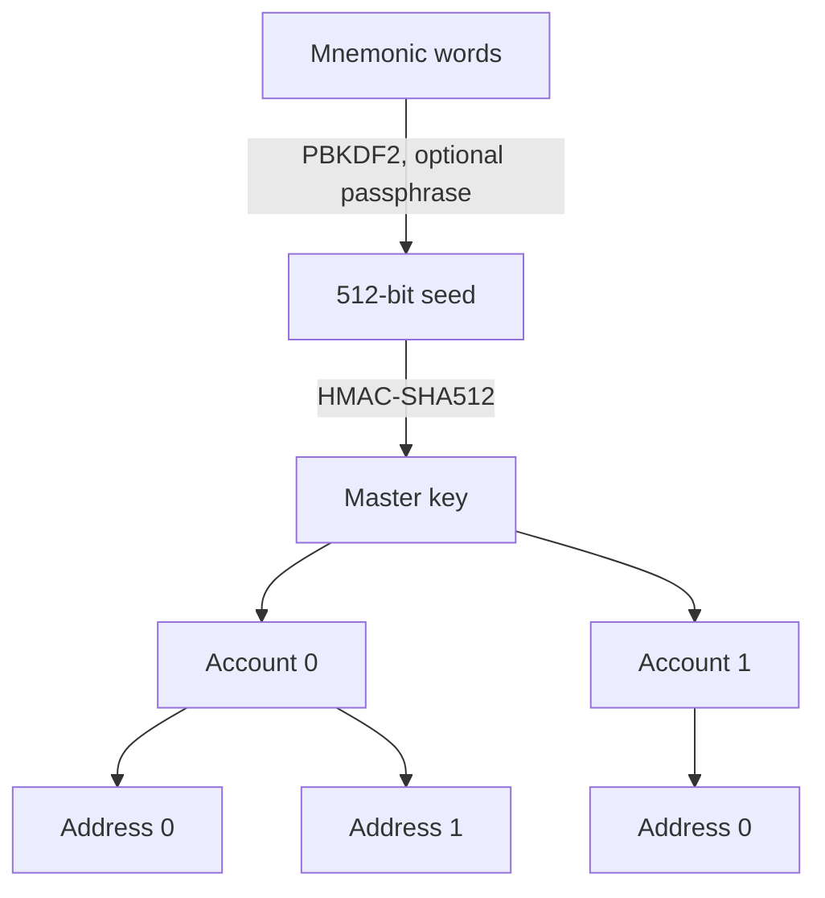

# 02. Keys, Wallets and Signatures

How a private key becomes an address, how signatures authorise transactions, and how to hold keys safely.

> **Not from the library.** General reference material written to fill a gap.

## At a glance

| Concept | In one line | Use it when |
|---|---|---|
| Key pair | Private key signs, public key verifies | Understanding who can spend |
| Address | A short hash of the public key | Receiving funds |
| Seed phrase (BIP-39) | Words that regenerate every key in a wallet | Backing up and recovering |
| HD wallet (BIP-32/44) | One seed, a tree of keys | Many accounts, one backup |
| Multisig / smart wallet | More than one approval needed | Treasuries, shared funds |

## Key pair and address

- A **private key** is a random 256-bit number. Whoever holds it controls the funds. There is no reset, no support desk.
- The **public key** is derived from it on an elliptic curve (secp256k1 for Bitcoin and Ethereum). The derivation is one-way.
- An **address** is derived from the public key by hashing. On Ethereum it is the last 20 bytes of the Keccak-256 hash of the public key, shown as `0x` plus 40 hex characters.
- The same private key therefore always gives the same address, on any chain that uses the same scheme.



## Signatures

- To spend, you **sign** the transaction data with the private key. Anyone can verify the signature against the public key (or recover the address from it) without learning the key.
- A signature covers exactly the data signed: change the amount or destination and it no longer verifies.
- **Chain ID** is included in the signed data (EIP-155) so a transaction for one network cannot be replayed on another.
- **Message signing** (for example "Sign in with Ethereum") proves control of an address without sending a transaction. Read what you are signing: a signed permission can move tokens just as a transaction can.

Signing and verification, without revealing the key:



```bash
# Foundry's cast, for experiments on a throwaway key only
cast wallet new                                  # random key and address
cast wallet sign "hello" --private-key $KEY      # signature over a message
cast wallet verify --address $ADDR "hello" $SIG
```

## Seed phrases and HD wallets

- **BIP-39**: a 12 to 24 word phrase (12, 15, 18, 21 or 24) encodes 128-256 bits of entropy plus a checksum; it is stretched into a 512-bit seed with PBKDF2-HMAC-SHA512 (2048 rounds, salt `"mnemonic" + passphrase`). Words come from a fixed list of 2048.
- **BIP-32**: the seed deterministically generates a tree of private keys (master key via HMAC-SHA512 with key `"Bitcoin seed"`), so one backup restores every account. Hardened child indices start at 2^31 and need the parent private key.
- **BIP-44** paths (`m / purpose' / coin_type' / account' / change / address_index`) organise the tree, for example `m/44'/60'/0'/0/0` is the first Ethereum account (coin type 60, from SLIP-44) and `m/44'/0'/0'/0/0` the first Bitcoin one (coin type 0).
- An optional **passphrase** (the "25th word") creates a completely different wallet from the same words.
- The phrase is the master key. Anyone who sees it owns every account derived from it.

One seed, a tree of keys:



## Custody options

| Option | Who holds the key | Trade-off |
|---|---|---|
| Custodial (exchange) | The company | Easy recovery, but you hold an IOU and carry counterparty risk |
| Software wallet (browser or phone) | Your device | Convenient, exposed to malware and phishing |
| Hardware wallet | Dedicated chip, key never leaves it | Strong against malware; you must still verify what the screen shows |
| Multisig (e.g. 2-of-3) | Several keys | No single point of failure, more operational work |
| Smart contract wallet | Contract with its own rules | Recovery, limits and batching, but adds contract risk |
| MPC wallet | Key split into shares | No full key ever exists in one place; depends on provider design |

## Good habits

- Write the seed phrase on paper or metal, offline. Never in a photo, cloud note, password manager sync or chat.
- Use separate wallets: a small "hot" one for daily use, a hardware or multisig one for savings.
- Test recovery with a small amount before trusting a backup.
- Verify the address and amount on the hardware screen, not only in the browser.
- Revoke old token approvals periodically; see [[6. Smart Contract Security|Smart Contract Security]].
- Never type a seed phrase into a website. Real support never asks for it.

## Common mistakes

- Generating keys with weak randomness or an online "vanity" tool.
- Sending to a wrong-chain address or a typo: transactions are irreversible, so copy and check the first and last characters.
- Committing a private key to Git. Bots scan public repos within seconds; treat any leaked key as burned and move the funds. The repo's gitleaks check exists for this reason.

## Recall

1. Why can an address not be turned back into a public key by simply reversing it?
2. What does a BIP-39 passphrase change?
3. Why does a signed transaction include the chain ID?
4. Name two advantages of multisig over a single hardware wallet.

??? note "Answers"
    1. The address is a hash of the public key, and hashes are one-way.
    2. It derives a different seed, so a completely different set of wallets.
    3. To stop the same signed transaction being replayed on another network.
    4. No single lost or stolen key can drain or lock funds, and approvals can be split across people or locations.

## Links

- [[Crytography|Linux Cryptography]]: hashing and asymmetric basics.
- [[1. Blockchain Fundamentals|Blockchain Fundamentals]]
- [[5. Smart Contracts|Smart Contracts]]

## External references

- [BIP-32 Hierarchical Deterministic Wallets](https://github.com/bitcoin/bips/blob/master/bip-0032.mediawiki): seed to master key, child derivation, hardened indices.
- [BIP-39 Mnemonic code](https://github.com/bitcoin/bips/blob/master/bip-0039.mediawiki): entropy, checksum, word counts, PBKDF2 seed derivation, passphrase.
- [BIP-44 Multi-account hierarchy](https://github.com/bitcoin/bips/blob/master/bip-0044.mediawiki): the five-level derivation path.
- [SLIP-44 Coin types](https://github.com/satoshilabs/slips/blob/master/slip-0044.md): registered coin type numbers (Bitcoin 0, Ethereum 60).
- [BIP-340 Schnorr signatures for secp256k1](https://github.com/bitcoin/bips/blob/master/bip-0340.mediawiki): 64-byte Schnorr signatures and key aggregation context.
- [EIP-155 Simple replay attack protection](https://github.com/ethereum/EIPs/blob/master/EIPS/eip-155.md): chain ID in signed transaction data.
- [Ethereum accounts (ethereum.org docs source)](https://github.com/ethereum/ethereum-org-website/blob/dev/public/content/developers/docs/accounts/index.md): Ethereum address as last 20 bytes of the Keccak-256 hash of the public key.
- [Foundry cast wallet commands (source)](https://github.com/foundry-rs/foundry/blob/master/crates/cast/src/cmd/wallet/mod.rs): `cast wallet new`, `sign` and `verify` arguments.
