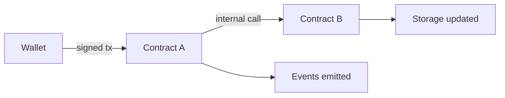

# 05. Smart Contracts

What a smart contract is, how the EVM runs it, and how one is written, tested and deployed.

> **Not from the library.** General reference material. Tool and compiler versions move quickly; check each project's docs.

## At a glance

| Concept | In one line | Use it when |
|---|---|---|
| Smart contract | Code and storage at an address, run by every node | Rules that must not depend on one operator |
| EVM | The virtual machine that executes contracts | Reasoning about gas and determinism |
| ABI | The interface description of a contract | Calling a contract from an app |
| Immutability | Deployed code cannot be edited | Planning upgrades and fixes up front |
| Proxy pattern | Stable address delegating to swappable logic | Upgradeable contracts |

## How a contract runs

- A **contract account** has code, storage and a balance. It does nothing until a transaction or another contract calls it.
- Execution is **deterministic**: every node runs the same bytecode on the same state and must get the same result. That is why contracts cannot call web APIs or use true randomness directly.
- Calls cost gas. If execution reverts, state changes in that call are undone but the gas is spent.
- `msg.sender` is the immediate caller, `msg.value` the ether sent, and `tx.origin` the original signer (do not use it for authorisation).



## Solidity example

A minimal vault. It follows checks-effects-interactions: validate, update state, then send value.

```solidity
// SPDX-License-Identifier: MIT
pragma solidity ^0.8.20;

contract Vault {
    mapping(address => uint256) public balanceOf;

    event Deposited(address indexed user, uint256 amount);
    event Withdrawn(address indexed user, uint256 amount);

    error InsufficientBalance();
    error TransferFailed();

    function deposit() external payable {
        balanceOf[msg.sender] += msg.value;
        emit Deposited(msg.sender, msg.value);
    }

    function withdraw(uint256 amount) external {
        if (balanceOf[msg.sender] < amount) revert InsufficientBalance(); // check
        balanceOf[msg.sender] -= amount;                                  // effect
        (bool ok, ) = msg.sender.call{value: amount}("");                 // interaction
        if (!ok) revert TransferFailed();
        emit Withdrawn(msg.sender, amount);
    }
}
```

- **Events** are cheap logs that apps and indexers read; they are not readable from inside contracts.
- **Custom errors** (`error X();`) are cheaper than revert strings.
- Solidity 0.8+ reverts on integer overflow by default.
- Storage is the expensive part. Prefer `memory`/`calldata` for temporary data and pack small types together.

## Tooling

| Tool | Role |
|---|---|
| Foundry (`forge`, `cast`, `anvil`) | Tests written in Solidity, fuzzing, scripts, local node |
| Hardhat | JavaScript/TypeScript testing and deployment |
| OpenZeppelin Contracts | Audited building blocks (ERC-20, access control, upgrades) |
| Slither | Static analysis |
| Etherscan-style explorers | Read verified source, events and transactions |

```bash
forge init my-contracts && cd my-contracts
forge build
forge test -vvv                       # run tests, verbose traces
forge test --match-test testWithdraw  # a single test
anvil                                 # local chain on :8545
forge script script/Deploy.s.sol --rpc-url http://127.0.0.1:8545 --broadcast
```

## Deployment checklist

1. Tests pass, including fuzz and failure cases; review coverage of every external function.
2. Deploy to a **testnet** first, using a throwaway key.
3. **Verify source code** on the block explorer so others can read it.
4. Decide who owns admin rights; prefer a multisig over a single key.
5. Record the deployed address, constructor arguments, compiler version and commit.

## Upgradeability

- Deployed code cannot change, so bugs are permanent unless planned for.
- **Proxy pattern**: users call a proxy whose storage persists; it `delegatecall`s to a logic contract that can be swapped. Storage layouts must stay compatible between versions.
- Trade-off: upgradeability adds an admin key to trust. Many projects use timelocks and multisigs to limit that power.

## Other contract platforms

- Solana (Rust programs), Cosmos (CosmWasm), Cardano and others differ in model but share the ideas of keys, signed transactions and on-chain state.
- EVM-compatible chains (many L2s and sidechains) run the same Solidity code.

## Common mistakes

- Writing logic that depends on `block.timestamp` or `blockhash` as randomness; both can be influenced.
- Forgetting access control on an admin function.
- Looping over unbounded arrays, which eventually exceeds the gas limit and bricks the function.
- Shipping without verified source or tests of failure paths.

## Recall

1. Why can a contract not fetch a web page directly?
2. What does a revert do to state and to gas?
3. What is the checks-effects-interactions order?
4. Why is `tx.origin` unsafe for authorisation?

??? note "Answers"
    1. Execution must be deterministic across all nodes; an external call could return different data to each.
    2. State changes are undone, but gas already used is still paid.
    3. Validate inputs, update internal state, then make external calls last.
    4. A malicious contract that you call can forward the call, and `tx.origin` would still be you.

## Links

- [[4. Cryptocurrencies and Tokens|Cryptocurrencies and Tokens]]
- [[6. Smart Contract Security|Smart Contract Security]]
- [[7. Web3 Development Workflow|Web3 Development Workflow]]

## External references

- [Foundry](https://github.com/foundry-rs/foundry): official repo for forge, cast, anvil and chisel
- [OpenZeppelin Contracts](https://github.com/OpenZeppelin/openzeppelin-contracts): audited ERC-20/721/1155 implementations, access control and utilities
- [Slither](https://github.com/crytic/slither): static analysis framework for Solidity and Vyper
