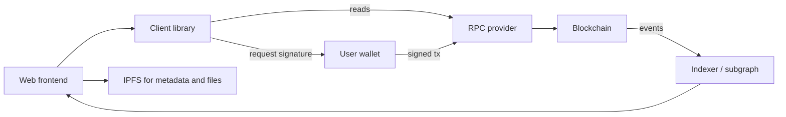
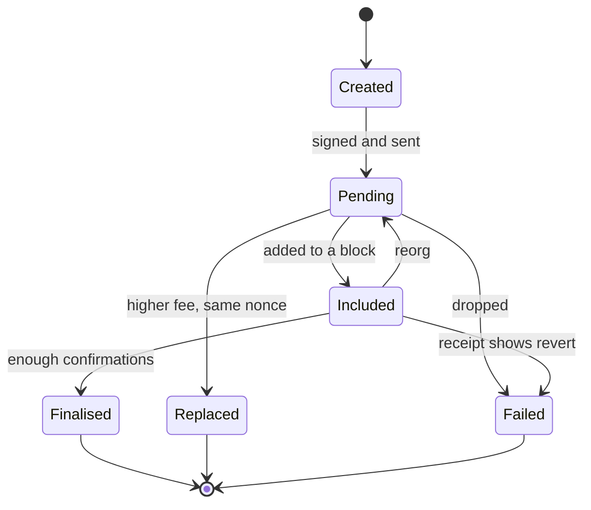
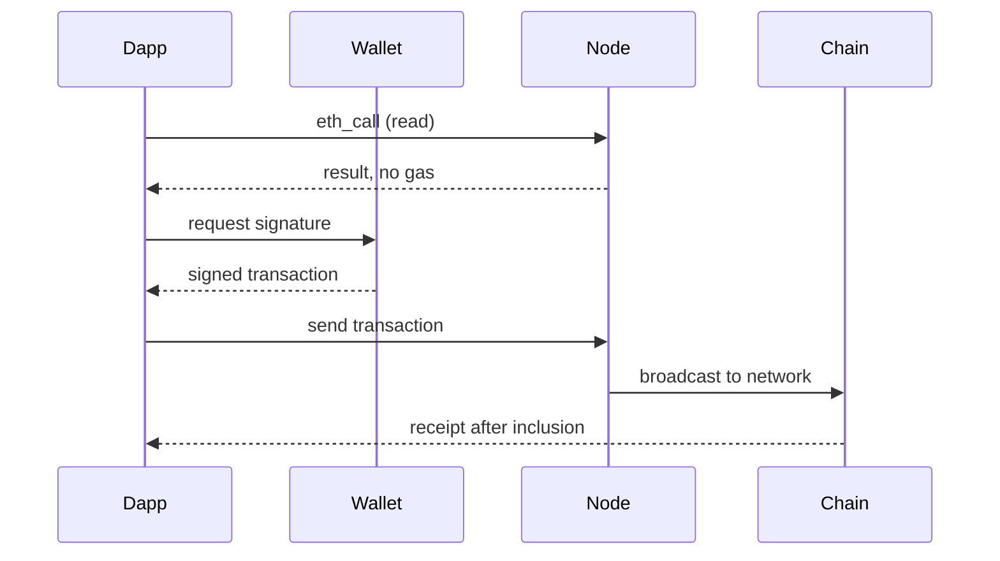
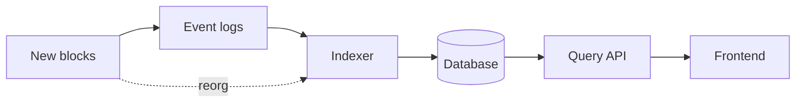

# 06. Web3 Development Workflow

How an ordinary application reads from and writes to a blockchain, and where data lives.

> **Not from the library.** General reference material. Library APIs change between versions; read the current docs.

## At a glance

| Piece | In one line | Use it when |
|---|---|---|
| RPC endpoint | HTTP/WebSocket API to a node | Any read or write to a chain |
| Client library | ethers.js, viem, web3.py | Encoding calls and signing in your app |
| Wallet connection | The user's wallet signs, the app never sees the key | Letting users transact |
| Events and indexers | Logs queried off-chain | Showing history without scanning every block |
| Decentralised storage | IPFS, Arweave | Files too large to keep on-chain |
| ENS | Human-readable names for addresses | Showing `name.eth` instead of `0x...` |

## Architecture of a dapp



- The **frontend is still normal web code**; only the backend is a contract.
- Reads are free `eth_call` requests. Writes need a signed transaction and gas.
- A **provider** talks to a node you run or rent. A hosted provider is convenient but is a trust and availability dependency.

## Reading and writing

```ts
import { createPublicClient, http, parseAbi } from "viem";
import { mainnet } from "viem/chains";

const client = createPublicClient({ chain: mainnet, transport: http(process.env.RPC_URL) });
const abi = parseAbi(["function balanceOf(address) view returns (uint256)"]);

const balance = await client.readContract({
  address: "0xTokenAddress",
  abi,
  functionName: "balanceOf",
  args: ["0xUserAddress"],
});
```

- The **ABI** describes functions and events so the library can encode calls and decode results.
- To write, the user's wallet (browser extension, mobile, hardware) prompts for approval and signs. Your server should not hold user keys.
- Wait for the transaction **receipt** and handle failure; show a pending state, since confirmation takes seconds to minutes.
- Amounts are `bigint` in the smallest unit; format with the token's decimals only for display.

The life of a sent transaction:



How a read and a write differ:



## Development loop

1. Run a local chain (`anvil` or Hardhat node) and deploy there.
2. **Fork** a real network locally to test against live contracts and balances.
3. Move to a public **testnet** using faucet funds.
4. Deploy to mainnet only after tests, review and a deployment checklist (see [[5. Smart Contracts|Smart Contracts]]).
5. Keep RPC URLs and deployer keys in environment variables or a secrets manager; never in Git.

## Events and indexing

- Contracts `emit` events; apps filter logs by contract, topic and block range.
- For history across many contracts, run an **indexer** (a subgraph, or your own service writing to a database) instead of scanning blocks from the browser.
- Handle **reorgs**: recent blocks can change, so mark data as final only after enough confirmations.

From logs to a queryable app:



## Storage and identity

- Storing data on-chain is costly. Keep a **hash or pointer** on-chain and the data in IPFS or Arweave.
- IPFS addresses content by its hash (CID), so content cannot change silently, but it must be **pinned** by someone or it may vanish.
- **ENS** maps names to addresses and other records.
- **Sign-In with Ethereum** lets a user log in by signing a server-issued message, replacing passwords; the server verifies the signature and checks the nonce.

## Common mistakes

- Trusting the frontend for anything important: users can call the contract directly, so enforce rules in the contract.
- Hard-coding an RPC key into client-side code.
- Treating a transaction as successful because it was sent rather than because its receipt shows success.
- Ignoring chain switching: confirm the connected chain ID before sending.

## Recall

1. Why are reads free but writes cost gas?
2. What is an ABI for?
3. Why index events off-chain?
4. Where should rules be enforced, the UI or the contract?

??? note "Answers"
    1. Reads are answered by one node without changing state; writes must be executed and stored by the whole network.
    2. It tells a client how to encode function calls and decode return values and events.
    3. Scanning blocks in an app is slow; an indexer stores queryable data.
    4. In the contract, since anyone can bypass the UI.

## Links

- [[1. Web3 Start Here|Web3 Start Here]]
- [[6. Smart Contract Security|Smart Contract Security]]
- [[1. Security Fundamentals|Security Fundamentals]]

## External references

- [viem readContract](https://viem.sh/docs/contract/readContract): the read-call API used in the snippet, with `parseAbi`.
- [Ethereum JSON-RPC API](https://ethereum.org/en/developers/docs/apis/json-rpc/): the node interface behind every read and write.
- [Decentralized storage](https://ethereum.org/en/developers/docs/storage/): why data is kept off-chain and the main options.
- [EIP-4361: Sign-In with Ethereum](https://eips.ethereum.org/EIPS/eip-4361): the message format and nonce checks for wallet login.
- [EIP-712: Typed structured data signing](https://eips.ethereum.org/EIPS/eip-712): human-readable signing requests for wallets.
- [IPFS: pinning files](https://docs.ipfs.tech/how-to/pin-files/): why content must be pinned to stay available.
