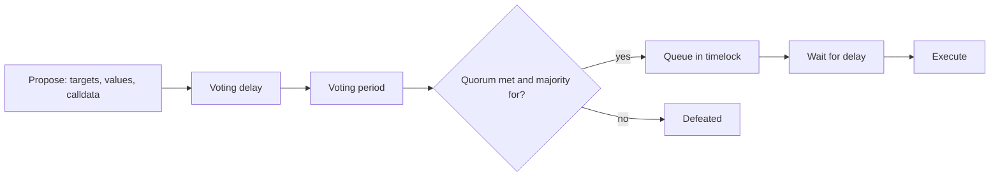
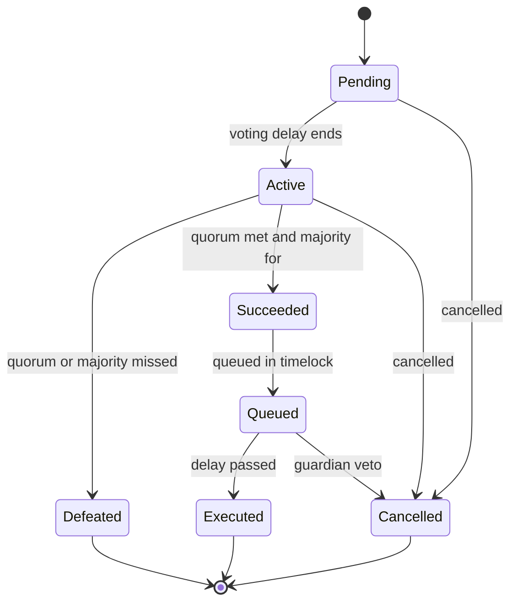
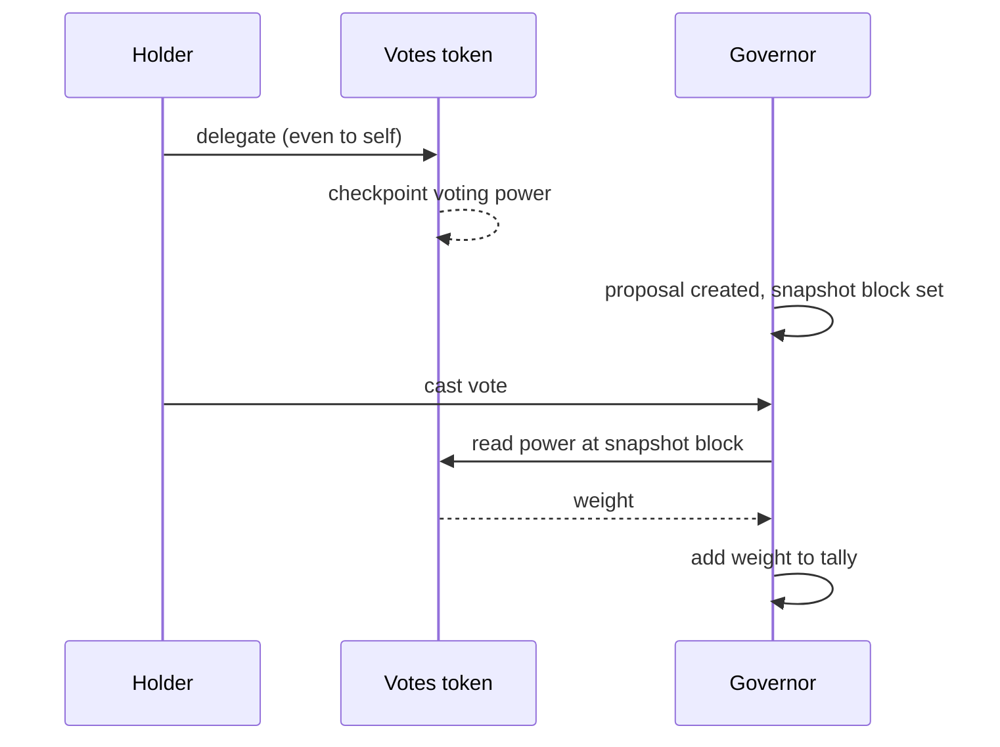
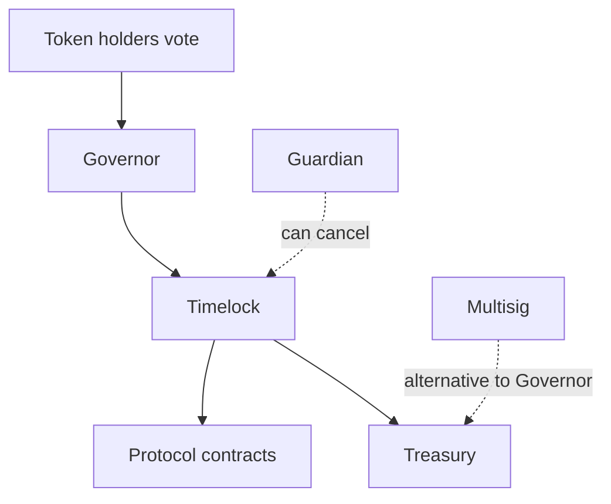

# 08. DAOs and Governance

How decentralised organisations make decisions on-chain, the contracts behind voting, and how governance gets attacked.

> **Not from the library.** General reference material written to fill a gap.

## At a glance

| Concept | In one line | Use it when |
|---|---|---|
| DAO | An organisation whose rules and treasury live in contracts | Shared funds without a single operator |
| Governor contract | Proposal, vote, queue, execute | Building on-chain governance |
| Voting token | Balance (or delegation) equals voting weight | Deciding who gets a say |
| Timelock | Mandatory delay between approval and execution | Giving users time to react |
| Off-chain voting | Signed votes counted off-chain, executed by a multisig | Cheap votes with human execution |

## What a DAO is

- A **DAO** (decentralised autonomous organisation) holds funds in a contract or multisig and changes them only through a defined decision process.
- The rules are code: who can propose, how votes are counted, what a passed proposal may call.
- Many "DAOs" are really a multisig plus a community forum. The practical question is always **who can move the money and change the code**.

## Governor lifecycle

The common pattern (OpenZeppelin Governor, Compound Governor Bravo) works like this:



- A proposal is a list of **calls** (target contract, ether value, calldata) that the timelock runs if it passes.
- **Quorum** is the minimum participation for a vote to count; **threshold** is the token balance needed to propose.
- The **timelock** owns the protocol. Because it delays execution, users can exit before a harmful change lands.

States a proposal moves through:



## Voting power

- **Token-weighted**: one token, one vote. Simple, but favours large holders.
- **Delegation**: holders hand their votes to a delegate without moving tokens. In `ERC20Votes` tokens a holder must delegate (even to themselves) before their balance counts.
- **Snapshots / checkpoints**: voting power is read at a past block (the proposal's snapshot), so buying tokens after a proposal is created does not help.
- Alternatives: **quadratic voting** (cost grows with the square of votes), **conviction voting** (weight grows the longer it is held), **reputation or NFT-based** votes, and **optimistic governance** (passes unless vetoed).

How voting power is counted:



## Off-chain voting and on-chain execution

- Tools like Snapshot collect signed votes at no gas cost, then a multisig carries out the result.
- Cheap and flexible, but the multisig must be trusted to follow the vote. On-chain governance removes that trust at the price of gas and complexity.

## Treasury and roles

- Keep treasury funds in a **multisig or timelock-controlled contract**, never a single key.
- Separate roles: proposer, canceller (a guardian that can veto), executor, and admin. Document who holds each.
- Spend limits, streaming payments and budgets reduce the damage of one bad vote.

Who controls what:



## Attacks and failure modes

| Problem | What happens | Defence |
|---|---|---|
| Flash-loan voting | Borrow tokens, vote, repay in one transaction | Snapshot voting power at an earlier block |
| Malicious proposal | A call hidden in calldata drains the treasury | Review decoded calldata, simulate, timelock, guardian veto |
| Vote buying | Votes are bribed on markets | Hard to prevent; use delegation transparency, reputation weighting |
| Voter apathy | Low turnout lets a small group decide | Sensible quorum, delegation, incentives |
| Whale control | A few holders dominate | Caps, quadratic or reputation weighting |
| Governance takeover | An attacker accumulates enough votes to pass a draining proposal | Delay, quorum tuned to market cap, emergency pause |

- Historic examples: **The DAO (2016)** lost funds to a reentrancy bug and led to a contentious Ethereum fork; a **2022 flash-loan governance attack on Beanstalk** passed a malicious proposal in a single transaction because voting power and execution were not separated by a delay.

## Building one

```bash
# OpenZeppelin Contracts ships Governor, Votes tokens and a TimelockController
forge install OpenZeppelin/openzeppelin-contracts
```

- Use a `Governor` with `GovernorVotes`, `GovernorCountingSimple`, `GovernorTimelockControl`.
- Deploy a `TimelockController`, grant the Governor the proposer role, and give the timelock ownership of your protocol.
- Test the whole lifecycle, including a failing and a cancelled proposal, with time-travel cheat codes (`vm.roll`, `vm.warp`).

## Common mistakes

- Leaving an admin key with power that bypasses the timelock.
- Setting quorum so high that nothing can pass, or so low that a small holder can.
- Forgetting that unminted or locked tokens still affect quorum calculations.
- Not simulating a proposal's calldata before voting.

## Recall

1. Why does the timelock protect users even when governance is hostile?
2. How do snapshots stop flash-loan voting?
3. What must an `ERC20Votes` holder do before their tokens vote?
4. Why is an off-chain vote plus multisig a trust trade-off?

??? note "Answers"
    1. Approved changes cannot run immediately, so users can withdraw or the guardian can cancel.
    2. Voting power is read at a block before the vote, so borrowed tokens that did not exist then carry no weight.
    3. Delegate, even to themselves.
    4. The multisig signers can ignore the result; on-chain execution enforces it by code.

## Links

- [[5. Smart Contracts|Smart Contracts]]
- [[6. Smart Contract Security|Smart Contract Security]]
- [[3. Keys, Wallets and Signatures|Keys, Wallets and Signatures]]: multisig custody.

## External references

- [OpenZeppelin: Governance guide](https://docs.openzeppelin.com/contracts/5.x/governance): Governor modules, delegation and timelock roles.
- [OpenZeppelin: Governance API](https://docs.openzeppelin.com/contracts/5.x/api/governance): `Governor`, `TimelockController` and role constants.
- [OpenZeppelin: ERC20 extensions](https://docs.openzeppelin.com/contracts/5.x/api/token/erc20): `ERC20Votes` for vote tracking and delegation.
- [Ethereum: DAOs](https://ethereum.org/en/dao/): overview of DAO structure and governance.
- [EIP-712: Typed structured data signing](https://eips.ethereum.org/EIPS/eip-712): the signing standard used for off-chain votes.
