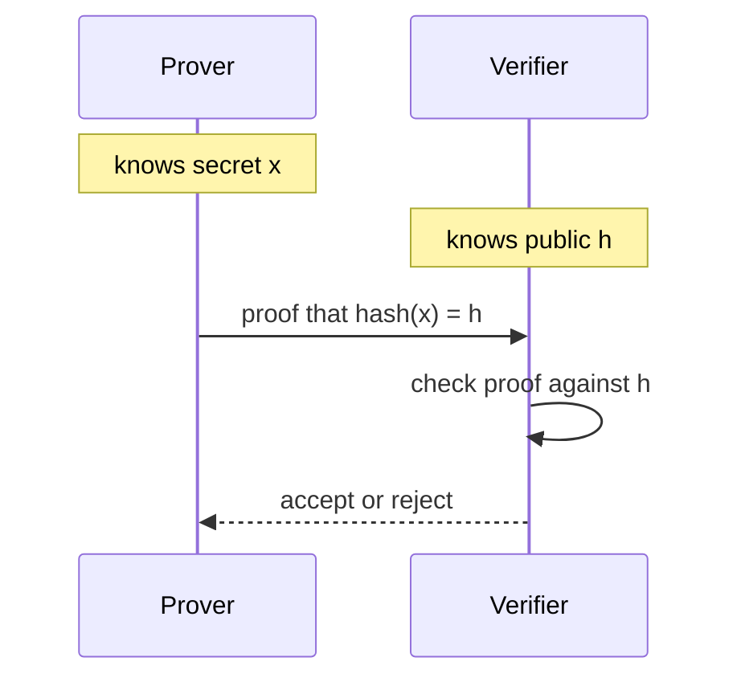
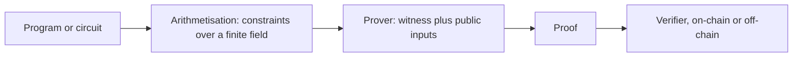
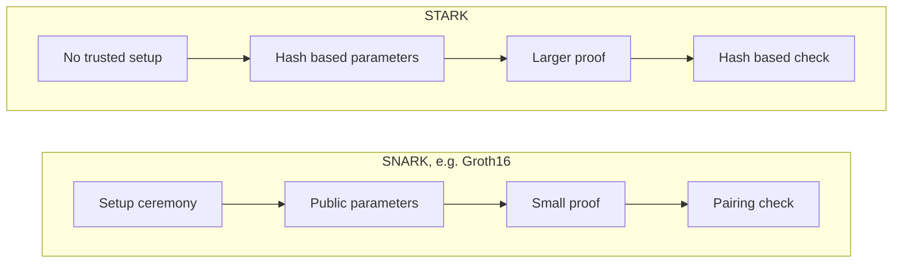

# 08. Zero-Knowledge Proofs

Proving a statement is true without revealing why, how SNARKs and STARKs differ, and where they are used on-chain.

> **Not from the library.** General reference material written to fill a gap. Proof systems evolve quickly; check each project's documentation.

## At a glance

| Concept | In one line | Use it when |
|---|---|---|
| Zero-knowledge proof | Convince a verifier of a fact without revealing the secret | Privacy, or compressing computation |
| SNARK | Small, fast-to-verify proof; many need a setup | Cheap on-chain verification |
| STARK | Transparent (no trusted setup), typically larger proof | Avoiding setup trust, scaling |
| Circuit | The computation written as constraints | Writing a provable program |
| zkVM | Proves execution of ordinary code | Proving without writing circuits by hand |

## The idea

A proof system has a **prover** and a **verifier** and three properties:

- **Completeness**: if the statement is true, an honest prover convinces the verifier.
- **Soundness**: if it is false, a cheating prover almost certainly fails.
- **Zero-knowledge**: the verifier learns nothing beyond "true".

Example statement: "I know a value `x` such that `hash(x) = h`". The public input is `h`; `x` stays private. This is how a user proves they hold a secret (a note, a credential) without showing it.

Two uses, often confused:

- **Privacy**: hide data (who paid whom, a user's age).
- **Succinctness**: verify a huge computation cheaply. A proof may be small and fast to check even if the work was enormous. A proof can give succinctness without hiding anything.

Who knows what in a proof:



## From program to proof



- The computation is turned into polynomial **constraints** (R1CS, PLONKish, AIR) over a finite field.
- The **witness** is the private input plus all intermediate values. The prover shows the constraints hold for it.
- Operations that are cheap on a CPU (comparisons, bit operations, hashes like SHA-256) can be expensive as constraints. ZK-friendly hashes (Poseidon) are used instead.

## SNARK vs STARK

| | SNARK | STARK |
|---|---|---|
| Proof size | Typically very small (hundreds of bytes for Groth16) | Typically larger (tens to hundreds of kilobytes, varies by system and parameters) |
| Verify cost | Typically very low | Typically higher |
| Trusted setup | Often yes (see below) | No, "transparent" |
| Cryptography | Elliptic-curve pairings | Hashes; widely believed (not proven) to resist quantum attacks |
| Examples | Groth16, PLONK | FRI-based systems |

- **Trusted setup**: a ceremony generates public parameters from secret randomness. If that secret ("toxic waste") survives, someone could forge proofs. Groth16 needs a setup ceremony per circuit (a universal "powers of tau" phase, then a circuit-specific phase); PLONK-style systems need only the universal one (as documented by snarkjs). Large multi-party ceremonies make collusion unlikely.
- **Recursion** lets one proof verify other proofs, which is how many proofs are folded into one.

Setup and verification paths:



## Where it is used

| Use | How |
|---|---|
| ZK rollups | Prove a batch of L2 transactions was executed correctly; L1 verifies one proof |
| Private payments | Zcash-style shielded transfers prove balances are valid without revealing amounts |
| Identity and credentials | Prove "over 18" or "resident" without the document |
| Proof of reserves/solvency | Prove totals without publishing every account |
| Bridges and light clients | Prove another chain's state cheaply |

## Tools

| Tool | Role |
|---|---|
| Circom + snarkjs | Write circuits, generate and verify Groth16/PLONK proofs, export a Solidity verifier |
| Noir | Rust-like language for circuits |
| Halo2 | Rust library, PLONKish, no per-circuit setup in the original design |
| zkVMs (e.g. RISC Zero, SP1) | Prove execution of ordinary Rust/RISC-V programs |

A tiny Circom circuit proving knowledge of two factors of a public number:

```circom
pragma circom 2.1.0;

template Multiplier() {
    signal input a;       // private
    signal input b;       // private
    signal output c;      // public result
    c <== a * b;
}

component main = Multiplier();
```

```bash
circom multiplier.circom --r1cs --wasm --sym
snarkjs groth16 setup multiplier.r1cs pot_final.ptau key.zkey
snarkjs groth16 prove key.zkey witness.wtns proof.json public.json
snarkjs groth16 verify verification_key.json public.json proof.json
snarkjs zkey export solidityverifier key.zkey Verifier.sol   # on-chain verifier
```

(A real circuit must also stop `a` or `b` being `1`, otherwise anyone "knows" the factors of any number.)

## Pitfalls

- **Under-constrained circuits**: a missing constraint lets a prover choose values that should be impossible. This is the most common ZK bug and the proof still verifies.
- Leaking secrets through public inputs, timing, or the app around the proof.
- Reusing a setup that was not generated safely.
- Forgetting that a proof is only about the stated circuit; anything not constrained is not proved.
- Replay: bind proofs to a nonce, address or context so one proof cannot be reused elsewhere.

## Recall

1. What are the three properties of a zero-knowledge proof?
2. Why can a proof be useful even when nothing is hidden?
3. Name one advantage of STARKs over Groth16 SNARKs.
4. What is an under-constrained circuit?

??? note "Answers"
    1. Completeness, soundness and zero-knowledge.
    2. Succinctness: a verifier can check a large computation cheaply.
    3. No trusted setup (and a hash-based design widely believed to resist quantum attacks).
    4. A circuit missing constraints, so invalid witnesses still produce a valid proof.

## Links

- [[3. Keys, Wallets and Signatures|Keys, Wallets and Signatures]]: signatures are the simpler proof of knowledge.
- [[4. Cryptocurrencies and Tokens|Cryptocurrencies and Tokens]]: layer 2 and rollups.
- [[Crytography|Linux Cryptography]]

## External references

- [snarkjs](https://github.com/iden3/snarkjs): Groth16 needs a per-circuit ceremony, PLONK/FFLONK only the universal one; Groth16 setup, prove, verify and Solidity verifier export commands.
- [circom](https://github.com/iden3/circom): the circuit compiler producing R1CS and WebAssembly witness generators.
- [circom compilation options](https://github.com/iden3/circom/blob/master/mkdocs/docs/getting-started/compilation-options.md): what `--r1cs`, `--wasm` and `--sym` output.
- [halo2](https://github.com/zcash/halo2): the Halo2 proving system library.
- [Noir](https://github.com/noir-lang/noir): the circuit language and its repository.
- [RISC Zero](https://github.com/risc0/risc0): STARK-based RISC-V zkVM.
- [SP1](https://github.com/succinctlabs/sp1): zkVM proving Rust programs compiled to RISC-V.
