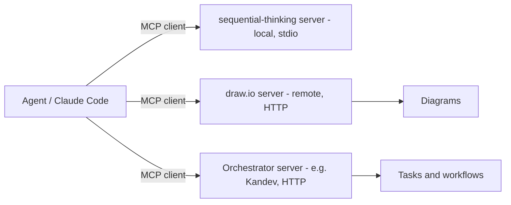

The toolbox around coding agents: instruction files, skills, plugins, MCP servers and extra agent CLIs. The bigger picture is in [[AI Agents and Workflows]].

## Tools at a glance

| Tool | Purpose |
| ---- | ------- |
| **Claude Code** | Anthropic's coding agent CLI |
| **Codex CLI** | OpenAI's coding agent (`@openai/codex`), signs in with a ChatGPT plan |
| **Gemini CLI** | Google's coding agent |
| **CLAUDE.md / AGENTS.md** | Per-repo instructions an agent reads at session start |
| **Skills** | Named, reusable instruction bundles |
| **Plugins** | Packaged skills, commands and hooks (e.g. a "superpowers" workflow plugin) |
| **MCP servers** | Extra tools and data for agents |
| **Hooks and permission modes** | Automatic behaviour and approval rules |
| **Memory** | Notes an agent keeps between sessions |

---

# Instruction Files

| File | Read by | Notes |
| ---- | ------- | ----- |
| `CLAUDE.md` | Claude Code | Project context, commands, decisions. "Read this first on every session" |
| `AGENTS.md` | Many agents (Codex, others) | Shared convention: repository guidelines, commands, style |
| User-level `~/.claude/CLAUDE.md` | Claude Code | Personal preferences across projects |

Patterns that worked across several projects:
- **Say what the project is** and who it is for in two or three sentences
- **Repository layout** and where docs and plans live
- **Exact commands** (`make test`, `make migrate`, `go run ./cmd/server -dev`)
- **Decisions already made** so the agent does not reopen them
- For a **greenfield project**, say so and point to the planning documents and the build plan
- Keep a `CLAUDE.md` and `AGENTS.md` pair when using more than one agent vendor

Example layout line from a polyglot repo: a Go workspace with a store backend, a cloud backend and shared types, plus a React PWA, with `context/` and `docs/` holding the product spec and numbered implementation plans.

---

# Skills

A skill is a folder with a `SKILL.md` (name, description, instructions) that the agent loads **only when the task matches**. Skills built and used:

| Skill | What it does |
| ----- | ------------ |
| `website-designer` | Looks at reference screenshots and writes a design brief |
| `community-starter` | Builds a static site from a content brief |
| `site-builder` | Runs the whole pipeline: designer → starter → gallery update |
| `doc-to-details` | Turns a business document into a structured content brief |
| `production-audit`, `website-evaluator`, `content-integrity-audit` | Checks a generated site against production standards, reference design and the source document |
| `book-to-skill` | Converts a book or document into a knowledge-base skill |
| `architecture-review` | Reviews plans for soundness, backed by book-derived knowledge bases |

Skills are best for **repeatable procedures** with a clear input and output. The website builder shows the idea: drop reference screenshots plus a business document into a folder, run `/site-builder <style>`, and get a built site to preview.

## Writing a good skill
1. One clear job, and a **description** that says when to use it
2. Steps in order, with inputs and expected outputs
3. Checks the agent should run before saying it is done
4. Small reference files loaded on demand, not one giant prompt
5. Test it on a real example and tighten the wording where the agent goes wrong

## Skills from books
`book-to-skill` converts a PDF or EPUB into a skill holding the author's frameworks, so an agent can apply them while working. Two knowledge-base skills were built this way from well-known distributed-systems and data-systems books and attached to the architecture review skill.

---

# MCP (Model Context Protocol)

An open protocol that lets an agent use **external tools and data** through a standard interface. An **MCP server** exposes tools; the agent is the **client**.



## Transport types
| Transport | Use |
| --------- | --- |
| **stdio** | Agent starts a local process (`npx some-mcp-server`) |
| **Streamable HTTP** | Remote or long-running server at a URL (`/mcp`) |

Handshake for HTTP: `initialize` → server returns a session id → `notifications/initialized` → `tools/call`.

## Project config: `.mcp.json`

```json
{
  "mcpServers": {
    "sequential-thinking": {
      "command": "npx",
      "args": ["-y", "@modelcontextprotocol/server-sequential-thinking"]
    },
    "drawio": {
      "type": "http",
      "url": "https://mcp.draw.io/mcp"
    }
  }
}
```

Never put API keys directly in a committed `.mcp.json`; use environment variables.

## Servers used
| Server | Gives the agent |
| ------ | --------------- |
| **Sequential thinking** | A structured step-by-step reasoning tool for hard problems |
| **draw.io** | Create and edit diagrams from text |
| **Kandev** | Create, move and inspect tasks and workflows ([[Kandev]]) |
| **Excalidraw, Notion, Gmail, Calendar, Drive** | Connectors available through the Claude app |

## Building a tiny MCP client
A script that speaks the handshake and calls tools is only a few dozen lines; useful for driving a service from automation. Handle both plain JSON and SSE (`event: message` / `data: {...}`) responses.

---

# Several Agents Side by Side

| Agent | Strengths seen | Notes |
| ----- | -------------- | ----- |
| **Claude Code** | Planning, implementation, long multi-file work | Rolling session limits can interrupt a long run |
| **Codex CLI** | Second-opinion reviews, test runs, integration | Different vendor = different blind spots |
| **Gemini CLI** | Installed for experiments | Skills can be copied into its own skills directory |

Install pattern: `npm i -g @openai/codex` plus an ACP adapter when an orchestrator needs to drive it.

---

# Permissions and Autonomy
- **Permission modes** range from ask-every-time, through accept-edits, to full access; choose per task
- **Auto-approve** is convenient inside an isolated worktree, risky elsewhere
- A repo can record **explicit autonomy approval** and memory files granting a plan to be executed without asking at each step; keep that scoped to trusted work
- Hooks run automatically on events, for example a formatter after each edit

---

# Memory and Plans
- **Memory files** hold lasting facts about the user and project between sessions
- **Numbered implementation plans** in the repo let any session resume the work
- **Handoff briefs** (a "start here" document with current state, IDs and lessons) save hours when switching sessions

Related: [[Kandev]], [[AI Projects and Automation]]
