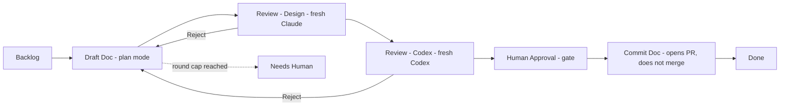
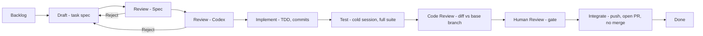

> **Repositories:** upstream platform [kdlbs/kandev](https://github.com/kdlbs/kandev) · workflow definitions and ops tooling [sharifndlovu123/kandev-workflow-test](https://github.com/sharifndlovu123/kandev-workflow-test) · canvas plugin [sharifndlovu123/kandev-canvas-step-history](https://github.com/sharifndlovu123/kandev-canvas-step-history)

**Kandev** is an open-source orchestrator (`github.com/kdlbs/kandev`, installed with `npm i -g`) that runs **multi-step workflows across coding agents**: a task moves along a board of steps, each step has a prompt and a bound agent, and some steps are human gates. Concepts are in [[AI Agents and Workflows]]; the surrounding tooling is in [[Claude Code Tooling and MCP]].

## Parts at a glance

| Part | What it is |
| ---- | ---------- |
| **Workspace** | Top-level container for repos, agents and workflows |
| **Workflow** | An ordered set of steps (a board) |
| **Step** | One stage with a prompt, events and optional agent |
| **Task** | A unit of work moving through a workflow, with its own git worktree |
| **Agent profile** | Which agent, model and permission mode to use (e.g. Claude, Codex) |
| **Executor profile** | Where the task runs (e.g. a git worktree) |
| **Task plan** | Document attached to the task, holding verdicts and round counters |
| **MCP endpoint** | Streamable-HTTP interface to drive Kandev from scripts |

---

# Running It

Kandev runs as a **systemd user service** on a fixed port so it survives reboots and crashes.

```
$ kandev service install --port 38429
$ systemctl --user status kandev
$ systemctl --user restart kandev
$ kandev service logs -f
```

- Data lives under `~/.kandev/` (SQLite database, logs, one git worktree per task)
- After a hard kill, remove the stale backend lock file before restarting
- The MCP endpoint is `http://localhost:<port>/mcp`

---

# The Two Workflows

## Design Doc: idea → approved design document as a PR



## Feature Delivery: approved design doc → implemented PR



- **Plan-mode steps** (Draft) write documents, never code
- **Review steps** reset the agent's context so each reviewer is genuinely independent
- **Reviews use different lenses**: one checks correctness and completeness, the other approach and risk
- **Human gates** are steps with no agent; the task waits for a person
- Agents open **pull requests but never merge**

---

# Driving It Over MCP

A small client script performs the handshake: `initialize` (returns a session id) → `notifications/initialized` → `tools/call`. Responses are either plain JSON or an SSE stream, so the client handles both.

```
$ ./ops/kandev-mcp.py list_workflows_kandev '{"workspace_id":"<id>"}'
$ ./ops/kandev-mcp.py list_workflow_steps_kandev '{"workflow_id":"<id>"}'
```

Common tools:

| Tool | Use |
| ---- | --- |
| `list_workflows`, `list_workflow_steps`, `list_tasks` | Inspect the setup |
| `create_task` | New task: needs title, workflow, step, repository, base branch, agent and a **prompt** (the agent's only context) |
| `move_task` | Move to a step; the `prompt` is the handoff note. Mid-turn moves are deferred to turn end |
| `update_workflow_step` | Sync a live step with an edited YAML (prompt and events only) |
| `export_workflow` / `import_workflow` | Move definitions as documents; import **skips** names that already exist |
| `step_complete` (agent side) | Agent signals "done" and the runtime advances the task |

## Workflows as code
Keep the workflow YAML in Git and treat the **live instance and YAML as a pair**: an edit to the YAML does nothing to a running workflow, so each changed step must also be synced to the live instance, or the YAML regenerated from an export.

---

# Hard-Won Lessons

| Lesson | Detail |
| ------ | ------ |
| **Plan is the source of truth** | Verdicts and counters live in the task plan, not in chat history |
| **Agents don't stop** | They hand off to a gate (correctly) and then keep going past it. Fixed with a **movement-discipline** block in every agent prompt: move to exactly one named step, never skip ahead, if unsure stop |
| **Prompt rules are not enforcement** | Bounce guards on turn start were tried and reverted because they fired on correct handoffs. The robust fix is structural routing so the agent has no say in the destination |
| **Structural advance for single-exit steps** | Steps with one exit advance on a completion signal instead of the agent choosing |
| **Round cap is only a counter check** | One task bounced through 14 spec-review rounds. The "Needs Human" step now forces stating the round count and classifying each open finding (architecture / mechanism / environmental) before another draft |
| **Session limits** | A rolling account limit killed agents mid-turn several times. Re-trigger by bouncing the task to Backlog then back to the dead step with a minimal "continue, don't restart" prompt |
| **Resume prompts must be minimal** | One that named a file and a cross-step action let a task blow past its human gate |
| **Agent bindings are task-level** | Per-step agent choice is a UI setting, not set through MCP |
| **Service survives backend crashes** | But a dead *agent* still needs resuming |

## Ops tooling around it
- **Resume driver**: polls a task, waits out a stated rate-limit reset time, re-triggers it, restarts the backend if it is down, and stops at a human gate
- **Per-feature run files** with task id, branch, worktree and next action (git-ignored, deleted when the feature ships)
- **Live workflow diagram** script that reads the database read-only and draws the workflow, prepared as material for an upstream contribution (the upstream rule: discuss a new subsystem in an issue first and wait for maintainer buy-in; an agent preparing the change must stop and report missing discussion instead of opening a PR)

---

# Agents Used
- **Claude** (via an ACP adapter) for drafting, Claude-side reviews, implementation and code review
- **Codex** for the second review, testing, integration and committing docs: this spreads quota and gives a **cross-vendor cold check**
- **Gemini** installed and detected but not used by the two workflows

# What It Proved
Both workflows ran end to end on a real Django codebase: a design doc through its own PR, then the implementation through a second PR, covering a security feature (HTTP method hygiene and a read-only impersonation middleware), each merged by a human.

Next: a "workflow upgrade" aimed at **structural gate enforcement** and notifications for human gates.

Related: [[Kandev Canvas - Step History]] (a plugin that visualises a task's path through a workflow), [[CI-CD Pipelines]], [[Local Kubernetes Tools]] (the same idea of a local service plus an API), [[Ansible]]
