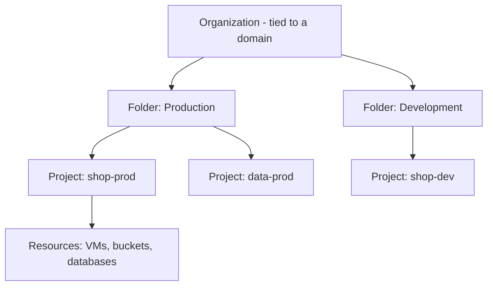
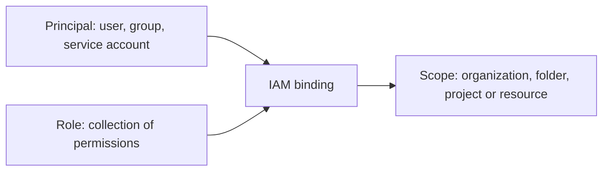

Google Cloud Platform (GCP) runs on the same infrastructure as Google Search and YouTube. Its strengths are data analytics, machine learning, Kubernetes and a fast global network. Compared with the others in [[The Big Three]]; the same ideas on the other clouds are in [[1. AWS Cloud Concepts]] and [[1. Azure Core Concepts]].

## Services at a glance

| Area | Services |
| ---- | -------- |
| **Compute** | Compute Engine (VMs), Google Kubernetes Engine (GKE), Cloud Run, Cloud Functions, App Engine |
| **Storage** | Cloud Storage, Persistent Disk, Filestore |
| **Databases** | Cloud SQL, Spanner, Firestore, Bigtable, Memorystore |
| **Networking** | VPC, Cloud Load Balancing, Cloud CDN, Cloud DNS, Cloud NAT, Cloud VPN, Cloud Interconnect |
| **Data and analytics** | BigQuery, Pub/Sub, Dataflow, Dataproc, Looker |
| **AI / ML** | Vertex AI, pre-trained APIs (Vision, Speech, Translation, Natural Language), Gemini |
| **Security and identity** | Cloud IAM, Secret Manager, Cloud KMS, Security Command Center |
| **Operations** | Cloud Logging, Cloud Monitoring, Cloud Trace, Error Reporting |
| **Developer tools** | Cloud Build, Artifact Registry, Cloud Deploy, Cloud Source Repositories |
| **Management** | Resource Manager, Cloud Billing, Cloud Shell, `gcloud` CLI |

---

# Cloud Basics

- **IaaS**: Compute Engine. **PaaS**: App Engine, Cloud Run. **SaaS**: Google Workspace. Service models in [[Cloud Computing Services]]
- **Why use it**: pay for what you use (OpEx), scale on demand, global reach, managed services reduce operations work
- **Shared responsibility**: Google secures the infrastructure; you secure your **data, identities, configuration and workloads**
- Default **encryption at rest** and in transit; **customer-managed keys** (Cloud KMS) optional

---

# Global Infrastructure

| Term | Meaning |
| ---- | ------- |
| **Region** | A geographic location, e.g. `africa-south1` (Johannesburg), `europe-west1` (Belgium), `us-central1` |
| **Zone** | Isolated deployment area in a region, e.g. `europe-west1-b`; each region has 3 or more |
| **Multi-region** | Larger area (`US`, `EU`, `ASIA`) used by services such as Cloud Storage, BigQuery and Spanner |
| **Edge points of presence** | Cache and connect near users (Cloud CDN, Premium network tier) |

Resources are **zonal** (a VM), **regional** (a subnet, a regional managed instance group) or **global** (VPC network, HTTP(S) load balancer, firewall rules). Pick a location for latency, data residency, price and available services.

---

# Resource Hierarchy



- **Organization**: root node, linked to a Cloud Identity / Google Workspace domain
- **Folders**: group projects by team or environment
- **Project**: the **core unit**. Holds resources, is the **billing and quota boundary**, has a **project ID** (globally unique, permanent), a **project name** and a **project number**
- **IAM policies and Organization Policies are inherited downward**. A child can add permissions but cannot take away what a parent granted
- Rough equivalent: a GCP project ≈ an AWS account, or an Azure subscription plus resource group

```
$ gcloud projects create shop-dev-12345 --folder=123456789
$ gcloud config set project shop-dev-12345
$ gcloud projects list
```

---

# Ways to Use GCP

| Tool | Notes |
| ---- | ----- |
| **Cloud Console** | Web GUI |
| **Cloud Shell** | Free browser terminal with tools pre-installed |
| **`gcloud` CLI** | Main command line; also `gsutil` / `gcloud storage`, `bq` for BigQuery |
| **Client libraries** | Python, Java, Go, Node.js, and others |
| **REST / gRPC APIs** | Everything is an API |
| **Infrastructure as Code** | Terraform, Config Connector, Deployment Manager ([[Infrastructure as Code]]) |

```
$ gcloud init
$ gcloud auth login
$ gcloud auth application-default login      # credentials for libraries and Terraform
$ gcloud services enable compute.googleapis.com run.googleapis.com
$ gcloud config list
```

**APIs are enabled per project** before use (`gcloud services enable ...`), a common first-time error.

---

# Compute

| Service | Model | Use |
| ------- | ----- | --- |
| **Compute Engine** | IaaS VMs | Full control, lift-and-shift |
| **GKE** | Managed Kubernetes | Container orchestration ([[Orchestration Platforms]]) |
| **Cloud Run** | Serverless containers | Deploy an image, scale to zero, pay per request |
| **Cloud Functions** | FaaS | Small event-driven functions |
| **App Engine** | PaaS | Deploy source code, Standard or Flexible environment |
| **Batch** | Batch jobs | Large scale batch processing |

## Compute Engine
- **Machine families**: general purpose (E2, N2, N4), compute-optimised (C2, C3), memory-optimised (M), accelerator / GPU (A, G)
- **Custom machine types**: choose exact vCPU and memory
- **Images and instance templates**, **managed instance groups (MIGs)** with **autoscaling** and **autohealing**
- **Spot VMs**: deep discount, can be preempted at any time
- **Live migration** moves VMs during host maintenance without a reboot

```
$ gcloud compute instances create web-1 --zone=europe-west1-b \
    --machine-type=e2-medium --image-family=debian-12 --image-project=debian-cloud
$ gcloud compute ssh web-1 --zone=europe-west1-b
$ gcloud compute instances stop web-1 --zone=europe-west1-b
```

## GKE
Google runs the control plane. **Standard** mode: you manage node pools. **Autopilot** mode: Google manages nodes and you pay per Pod. Kubernetes itself is covered in [[2. Kubernetes Architecture – from Container Images to Running Pods]].

```
$ gcloud container clusters create-auto demo --region=europe-west1
$ gcloud container clusters get-credentials demo --region=europe-west1
```

## Cloud Run

```
$ gcloud run deploy shop-api --image=europe-west1-docker.pkg.dev/PROJECT/repo/shop-api:1.0 \
    --region=europe-west1 --allow-unauthenticated
```

Built on Knative; request-based autoscaling, revisions and traffic splitting.

## Choosing
- Need full OS control → **Compute Engine**
- Containers and Kubernetes ecosystem → **GKE**
- Just run my container → **Cloud Run**
- Tiny reaction to an event → **Cloud Functions**

---

# Storage

| Service | Type | Use |
| ------- | ---- | --- |
| **Cloud Storage** | Object | Files, backups, static sites, data lake |
| **Persistent Disk / Hyperdisk** | Block | VM disks |
| **Local SSD** | Block (ephemeral) | Fast scratch, lost when the VM stops |
| **Filestore** | File (NFS) | Shared file systems |

## Cloud Storage
Buckets with **globally unique names**; objects up to 5 TiB.

| Storage class | Min duration | Use |
| ------------- | ------------ | --- |
| **Standard** | None | Hot data |
| **Nearline** | 30 days | Accessed about once a month |
| **Coldline** | 90 days | About once a quarter |
| **Archive** | 365 days | Long-term retention |

- Location types: **region**, **dual-region**, **multi-region**
- **Autoclass** moves objects between classes automatically; **lifecycle rules** by age
- **Object versioning**, **retention policies**, **signed URLs**, **uniform bucket-level access** (IAM only)

```
$ gcloud storage buckets create gs://my-unique-bucket-12345 --location=europe-west1
$ gcloud storage cp ./report.pdf gs://my-unique-bucket-12345/
$ gcloud storage ls gs://my-unique-bucket-12345
```

Compare with [[4. AWS Storage and Databases]] (S3) and [[4. Azure Storage]] (Blob).

---

# Databases

| Service | Type | Best for |
| ------- | ---- | -------- |
| **Cloud SQL** | Managed MySQL, PostgreSQL, SQL Server | Standard relational apps |
| **AlloyDB** | PostgreSQL-compatible, high performance | Demanding Postgres workloads |
| **Spanner** | Globally distributed relational, strong consistency | Global scale transactions |
| **Firestore** | Serverless document database | Mobile and web apps |
| **Bigtable** | Wide-column NoSQL | Huge time series / IoT / analytics throughput |
| **Memorystore** | Managed Redis / Memcached | Caching |
| **BigQuery** | Data warehouse | Analytics (below) |

Relational background is in the Relational db Concepts notes under Databases.

---

# Networking

- **VPC network is global**; **subnets are regional**. Resources in different regions of one VPC communicate over private IPs
- **Auto-mode** VPC creates a subnet per region; **custom-mode** gives you control (preferred for production)
- **Firewall rules** (stateful, allow / deny, applied by network tags or service accounts) at the VPC level
- **Routes**, **VPC peering**, **Shared VPC** (central network owned by a host project, used by service projects shared across the organisation)

| Service | Purpose |
| ------- | ------- |
| **Cloud Load Balancing** | Global HTTP(S) (Layer 7), regional / global TCP/UDP (Layer 4), internal and external |
| **Cloud CDN** | Cache content at the edge |
| **Cloud DNS** | Managed DNS ([[DNS]]) |
| **Cloud NAT** | Outbound internet for private VMs without external IPs |
| **Cloud VPN** | IPsec tunnels to on-prem |
| **Cloud Interconnect** | Dedicated or partner private connectivity |
| **Cloud Armor** | WAF and DDoS protection |
| **Private Google Access / Private Service Connect** | Reach Google APIs and services privately |

Network tiers: **Premium** (traffic on Google's backbone, global) and **Standard** (cheaper, regional, public internet). General networking theory is in [[Subnetting]] and [[Ipv4 and Ipv6]]; compare [[3. Azure Networking]] and [[5. AWS Networking]].

---

# IAM and Security

IAM answers **who** (principal) can do **what** (role) on **which resource**.



## Principals
- **Google Account / Cloud Identity user**, **Google Group** (assign roles to groups, not individuals), **service account** (identity for apps and VMs), **Workspace domain**

## Roles
| Type | Notes |
| ---- | ----- |
| **Basic** | Owner, Editor, Viewer. Very broad, avoid in production |
| **Predefined** | Fine-grained, maintained by Google (e.g. `roles/storage.objectViewer`) |
| **Custom** | You choose the exact permissions |

```
$ gcloud projects add-iam-policy-binding shop-dev-12345 \
    --member="user:dev@example.com" --role="roles/storage.objectViewer"
$ gcloud iam service-accounts create app-sa --display-name="App service account"
```

## Good practice
- **Least privilege**: smallest predefined role at the lowest scope
- **Service accounts for workloads**; avoid downloaded keys, use **attached service accounts** and **Workload Identity** (GKE, federation for GitHub Actions)
- **Organization Policy constraints**, e.g. disable service account key creation, restrict regions
- **Secret Manager** for secrets, **Cloud KMS** for encryption keys
- **Security Command Center** for posture and threats, **VPC Service Controls** for data exfiltration perimeters
- **Cloud Audit Logs**: Admin Activity (always on), Data Access (opt in), System Event

Compare [[2. AWS IAM and Security]] and [[5. Azure Identity and Security]].

---

# Data and Analytics

| Service | Purpose |
| ------- | ------- |
| **BigQuery** | Serverless, columnar data warehouse; query with SQL; pay per bytes scanned or reserved slots |
| **Pub/Sub** | Global messaging and event ingestion |
| **Dataflow** | Managed stream and batch pipelines (Apache Beam) |
| **Dataproc** | Managed Hadoop and Spark |
| **Looker / Looker Studio** | Dashboards and BI |
| **Data Fusion, Composer** | Pipelines and workflow orchestration (Airflow) |

```
$ bq query --use_legacy_sql=false 'SELECT name, SUM(number) AS total
  FROM `bigquery-public-data.usa_names.usa_1910_2013` GROUP BY name ORDER BY total DESC LIMIT 5'
```

BigQuery separates storage from compute, so it scales to petabytes without managing servers. Costs are controlled by **partitioning**, **clustering** and selecting only the columns you need.

# AI and Machine Learning
- **Vertex AI**: build, train, deploy and manage models; includes **Gemini** models and Model Garden
- **Pre-trained APIs**: Vision, Speech-to-Text, Text-to-Speech, Translation, Natural Language, Document AI
- **AutoML** for custom models without writing model code
- Typical progression: pre-trained API → AutoML → custom training

---

# Operations and Cost

## Cloud Operations suite
- **Cloud Logging**: central logs, queries, sinks to BigQuery / Cloud Storage / Pub/Sub
- **Cloud Monitoring**: metrics, dashboards, **alerting policies**, uptime checks
- **Cloud Trace / Profiler / Error Reporting**: latency, performance, exceptions
- **Ops Agent** collects metrics and logs from VMs

## Cost control
- **Budgets and alerts**, **labels**, billing export to BigQuery
- **Committed use discounts**, **sustained use discounts** (automatic), **Spot VMs**
- **Recommender** for rightsizing and unused resources
- Delete idle resources, use **lifecycle rules** and cooler storage classes

---

# Developer Tools and Delivery
- **Artifact Registry**: container images and language packages ([[3. Container Images and Build Tools]])
- **Cloud Build**: managed CI builds, `cloudbuild.yaml`
- **Cloud Deploy**: delivery pipelines to GKE and Cloud Run
- Works with GitHub Actions through **Workload Identity Federation** ([[GitHub Actions]]); overview in [[CI-CD Pipelines]]
- Infrastructure with Terraform ([[Infrastructure as Code]])

---

# Quick Comparison

| Idea | GCP | AWS | Azure |
| ---- | --- | --- | ----- |
| Billing / isolation unit | Project | Account | Subscription |
| VMs | Compute Engine | EC2 | Virtual Machines |
| Object storage | Cloud Storage | S3 | Blob Storage |
| Managed Kubernetes | GKE | EKS | AKS |
| Serverless containers | Cloud Run | Fargate / App Runner | Container Apps |
| Functions | Cloud Functions | Lambda | Functions |
| Data warehouse | BigQuery | Redshift | Synapse / Fabric |
| Messaging | Pub/Sub | SNS / SQS | Service Bus / Event Grid |
| Identity | Cloud IAM | IAM | Entra ID + RBAC |
| Network scope | Global VPC | Regional VPC | Regional VNet |
