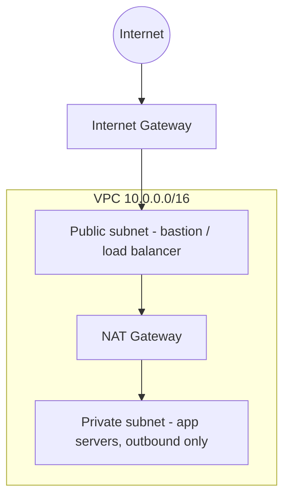

> **Repository:** [sharifndlovu123/vpc-playground](https://github.com/sharifndlovu123/vpc-playground) · each folder has `deploy.sh` / `destroy.sh`; remember NAT gateways cost money while running

The **same network** (one VPC / VNet, a public subnet and a private subnet) built several ways, to compare tools and clouds side by side. Source: the `vpc-playground` repo. Tool detail is in [[Infrastructure as Code]], [[Terraform]] and [[CloudFormation, Bicep and ARM Templates]]; networking theory is in [[5. AWS Networking]] and [[3. Azure Networking]].

## What was built

| Cloud | Tool | Folder |
| ----- | ---- | ------ |
| AWS | CloudFormation | `aws/cfn/` |
| AWS | Terraform | `aws/terra/` |
| Azure | ARM (JSON) | `azure/arm/` |
| Azure | Bicep | `azure/bicep/` |
| Azure | Terraform | `azure/terra/` |



Each folder has a `notes.md` (the exercise prompt) and its own `deploy.sh` and `destroy.sh` so the commands never have to be remembered.

---

# Building Blocks Per Cloud

| Piece | AWS | Azure |
| ----- | --- | ----- |
| Network | VPC | VNet |
| Subnets | `aws_subnet` per AZ | Subnets in the VNet (not tied to a zone) |
| Internet access | Internet Gateway + route table | Default outbound / public IP, NSG |
| Private outbound | **NAT Gateway** (billed hourly) | NAT Gateway or firewall |
| Traffic rules | Security groups + NACLs | **NSGs** |
| Address management | `cidrsubnet()` in Terraform | Network Manager **IPAM pool** |

---

# Per Tool: What Each One Taught

## AWS CloudFormation
- Parameterised CIDRs instead of hardcoding; `aws cloudformation deploy` with `--capabilities CAPABILITY_NAMED_IAM`
- Stack tracks the resources; `delete-stack` removes them

```
$ aws cloudformation deploy --template-file aws/cfn/template.yml \
    --stack-name vpc-cfn-demo --capabilities CAPABILITY_NAMED_IAM
$ aws cloudformation delete-stack --stack-name vpc-cfn-demo
```

## AWS Terraform
- `aws_vpc`, `aws_subnet`, `aws_internet_gateway`, `aws_route_table`, two AZs, plus a NAT Gateway
- Use **`cidrsubnet()`** to carve subnets from one VPC CIDR: a small habit that pays off past two subnets

```hcl
locals {
  vpc_cidr = "10.0.0.0/16"
  public   = [for i in range(2) : cidrsubnet(local.vpc_cidr, 8, i)]        # 10.0.0.0/24, 10.0.1.0/24
  private  = [for i in range(2) : cidrsubnet(local.vpc_cidr, 8, i + 10)]   # 10.0.10.0/24, 10.0.11.0/24
}
```

- Layout with `bootstrap/` (remote state) and `envs/prod/` (backend, providers, security, vpc) follows the structure advice in [[Terraform Best Practices]]
- **Cost warning**: a NAT Gateway bills hourly, so destroy the same day

## Azure ARM (portal export)
- Exporting from the portal produces JSON with duplicated subnets; it had to be **cleaned up** and the address prefix **parameterised per subnet**
- Includes a **Network Manager** with an IPAM pool for address allocation

## Azure Bicep (decompiled)
- `az bicep decompile` converts the ARM JSON; hand-clean it the same way
- Removing the duplicate subnets also removed a **circular dependency** the decompiler introduced

```
$ az bicep decompile --file template.json
$ az deployment group create -g rg-vpc-demo --template-file main.bicep
```

## Azure Terraform
- The `azurerm` provider, Azure CLI auth by default; resources imported / exported from the same VNet

---

# Comparison Notes

| Topic | Observation |
| ----- | ----------- |
| **Verbosity** | ARM JSON is the longest and hardest to read; Bicep is far shorter; Terraform and CloudFormation sit between |
| **Reuse** | `cidrsubnet()` and loops in Terraform, parameters in the other tools |
| **State** | Terraform needs a state backend; CloudFormation and ARM/Bicep keep state in the cloud service |
| **Cleanup** | Deleting a CloudFormation stack or an Azure resource group removes everything; `terraform destroy` needs the state |
| **Portal export** | A fast start, but needs tidying (duplicates, hardcoded values) |
| **Decompile** | Useful for ARM → Bicep migration, always review the output |
| **Cost** | NAT Gateways and public IPs cost money while idle |

# Practical Habits
- Wrap every deploy and destroy in a **script** that takes the profile / subscription / resource group as an argument or an environment variable
- Offer **two destroy modes** for Azure: remove only what the template created, or delete the whole sandbox resource group (`destroy-all.sh`)
- Keep a `notes.md` with the exercise prompt in each folder so the lab can be repeated
- Run the plan or what-if before applying ([[CI-CD Pipelines]])
