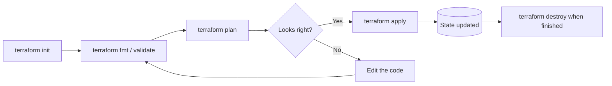

Terraform (by HashiCorp) is a declarative IaC tool that talks to cloud APIs through **providers**. You write **HCL** (HashiCorp Configuration Language), run a plan, and Terraform creates, changes or destroys real resources. Wider context is in [[Infrastructure as Code]]; conventions are in [[Terraform Best Practices]].

## Terms at a glance

| Term | Meaning |
| ---- | ------- |
| **Provider** | Plugin that talks to an API (`aws`, `azurerm`, `google`, `kubernetes`, `github`...) |
| **Resource** | One infrastructure object, e.g. `aws_vpc` |
| **Data source** | Read-only lookup of something that already exists |
| **Variable / Output / Local** | Inputs, results, and named expressions |
| **Module** | A reusable folder of Terraform code |
| **State** | Terraform's record of what it manages |
| **Backend** | Where state is stored (S3, Azure Storage, GCS, Terraform Cloud) |
| **Plan / Apply** | Preview, then make the change |
| **Workspace** | A named copy of state for the same code |

---

# Workflow



```
$ terraform init                      # download providers and modules, configure the backend
$ terraform fmt -recursive            # format
$ terraform validate                  # check syntax and references
$ terraform plan -out=tfplan          # preview, save the plan
$ terraform apply tfplan              # apply exactly that plan
$ terraform destroy                   # remove everything it manages
$ terraform output
$ terraform show
$ terraform state list
```

Installation tip: manage versions with `tfenv` or `asdf` so every machine uses the same Terraform version.

---

# Language Basics

## Providers and versions

```hcl
# versions.tf
terraform {
  required_version = ">= 1.6"

  required_providers {
    aws = {
      source  = "hashicorp/aws"
      version = "~> 5.0"
    }
  }
}

provider "aws" {
  region = "af-south-1"
}
```

`~> 5.0` allows 5.x updates but not 6.0. The **`.terraform.lock.hcl`** file records exact provider versions and checksums: commit it.

Other providers follow the same shape:

```hcl
provider "azurerm" {
  features {}
}

provider "google" {
  project = "shop-dev-12345"
  region  = "europe-west1"
}
```

## Resources and references

```hcl
resource "aws_vpc" "main" {
  cidr_block = "10.0.0.0/16"
}

resource "aws_subnet" "public" {
  vpc_id     = aws_vpc.main.id          # reference creates a dependency
  cidr_block = "10.0.1.0/24"
}
```

References (`aws_vpc.main.id`) build a **dependency graph**, so Terraform creates the VPC before the subnet. Use `depends_on` only when a dependency is not visible in the code.

## Variables, locals and outputs

```hcl
variable "environment" {
  description = "Deployment environment"
  type        = string
  default     = "dev"

  validation {
    condition     = contains(["dev", "staging", "prod"], var.environment)
    error_message = "Environment must be one of: dev, staging, prod."
  }
}

locals {
  name_prefix = "shop-${var.environment}"
  common_tags = {
    Environment = var.environment
    ManagedBy   = "terraform"
  }
}

output "vpc_id" {
  description = "ID of the VPC"
  value       = aws_vpc.main.id
}
```

Set variable values with, in increasing priority: defaults, `terraform.tfvars` / `*.auto.tfvars`, `-var-file`, `-var`, and `TF_VAR_name` environment variables.

```
$ terraform apply -var="environment=prod"
$ terraform apply -var-file=prod.tfvars
$ export TF_VAR_environment=staging
```

Mark secrets with `sensitive = true` (hides them in output; they can still appear in **state**, so protect the state).

## Data sources

```hcl
data "aws_availability_zones" "available" {
  state = "available"
}

data "aws_caller_identity" "current" {}
```

## `count`, `for_each` and conditionals

```hcl
# count: N identical copies, or on / off
resource "aws_instance" "web" {
  count = var.create_web ? 1 : 0

  ami           = "ami-0abcdef1234567890"
  instance_type = "t3.micro"
}

# for_each: one per key, stable addresses
resource "aws_subnet" "private" {
  for_each = {
    a = "10.0.11.0/24"
    b = "10.0.12.0/24"
  }

  vpc_id     = aws_vpc.main.id
  cidr_block = each.value
  tags       = { Name = "private-${each.key}" }
}
```

Prefer **`for_each`** for collections: removing an item from a `count` list shifts indexes and can destroy resources, while `for_each` keys stay stable.

## Dynamic blocks and `for` expressions

```hcl
dynamic "ingress" {
  for_each = var.allowed_ports

  content {
    from_port   = ingress.value
    to_port     = ingress.value
    protocol    = "tcp"
    cidr_blocks = ["0.0.0.0/0"]
  }
}

locals {
  subnet_ids = [for s in aws_subnet.private : s.id]
}
```

## Lifecycle rules

```hcl
resource "aws_db_instance" "main" {
  # ...

  lifecycle {
    prevent_destroy       = true          # error instead of deleting
    create_before_destroy = true          # replace without downtime
    ignore_changes        = [tags]        # ignore drift on these arguments
  }
}
```

---

# Modules

A module is a directory of `.tf` files. The folder you run Terraform in is the **root module**; it calls **child modules**.

```
project/
├── main.tf
├── variables.tf
├── outputs.tf
├── versions.tf
└── modules/
    └── network/
        ├── main.tf
        ├── variables.tf
        └── outputs.tf
```

```hcl
module "network" {
  source = "./modules/network"

  environment = var.environment
  cidr_block  = "10.0.0.0/16"
}

output "vpc_id" {
  value = module.network.vpc_id
}
```

Modules can also come from the **Terraform Registry** (always pin the `version`), Git, or other sources:

```hcl
module "vpc" {
  source  = "terraform-aws-modules/vpc/aws"
  version = "~> 5.0"

  name = "shop"
  cidr = "10.0.0.0/16"
  azs  = ["af-south-1a", "af-south-1b"]
}
```

---

# State

State maps your code to real resources (ids, attributes). **Never edit it by hand.**

## Remote backends

```hcl
terraform {
  backend "s3" {
    bucket         = "shop-terraform-state"
    key            = "prod/network/terraform.tfstate"
    region         = "af-south-1"
    encrypt        = true
    use_lockfile   = true       # native S3 locking in recent Terraform versions
  }
}
```

| Cloud | Typical backend |
| ----- | --------------- |
| AWS | S3 (with locking via lock file or DynamoDB) |
| Azure | Storage account container (`azurerm` backend, blob lease locking) |
| GCP | Cloud Storage bucket (`gcs` backend) |
| Any | Terraform Cloud / HCP Terraform, GitLab, Spacelift, env0 |

- **Locking** stops two people applying at once
- Turn on **versioning** and **encryption** on the state bucket, and restrict access
- Do not commit `*.tfstate` to Git

## State commands

```
$ terraform state list
$ terraform state show aws_vpc.main
$ terraform state mv aws_instance.old aws_instance.new
$ terraform state rm aws_instance.legacy        # stop managing, do not delete
$ terraform import aws_s3_bucket.assets my-unique-bucket-12345    # adopt an existing resource
```

Declarative alternatives in code:

```hcl
moved {
  from = aws_instance.old
  to   = aws_instance.new
}

import {
  to = aws_s3_bucket.assets
  id = "my-unique-bucket-12345"
}
```

## Workspaces

```
$ terraform workspace new staging
$ terraform workspace list
$ terraform workspace select prod
```

Workspaces give the same code multiple state files. Many teams prefer **separate directories / state per environment** for stronger isolation (see [[Terraform Best Practices]]).

---

# Cloud Examples

## Azure Resource Group + Storage Account

```hcl
resource "azurerm_resource_group" "main" {
  name     = "rg-demo"
  location = "southafricanorth"
}

resource "azurerm_storage_account" "main" {
  name                     = "stdemo12345"
  resource_group_name      = azurerm_resource_group.main.name
  location                 = azurerm_resource_group.main.location
  account_tier             = "Standard"
  account_replication_type = "LRS"
}
```

Compare with Bicep in [[CloudFormation, Bicep and ARM Templates]]; resources in [[4. Azure Storage]].

## GCP VPC + Subnet

```hcl
resource "google_compute_network" "main" {
  name                    = "main"
  auto_create_subnetworks = false
}

resource "google_compute_subnetwork" "app" {
  name          = "app"
  region        = "europe-west1"
  network       = google_compute_network.main.id
  ip_cidr_range = "10.10.0.0/24"
}
```

Concepts in [[1. GCP Fundamentals]].

## Kubernetes cluster pieces
Providers exist for `kubernetes` and `helm`, and managed clusters (EKS / GKE / AKS) are normally created with Terraform, then workloads deployed with Helm or manifests ([[Orchestration Platforms]]).

---

# Tooling Around Terraform

| Tool | Role |
| ---- | ---- |
| **tflint** | Linter for errors and provider-specific rules |
| **terraform-docs** | Generate module documentation |
| **pre-commit-terraform** | Git hooks for fmt, validate, docs, lint |
| **Checkov / tfsec / Trivy** | Security scanning of Terraform code |
| **Infracost** | Cost estimates in pull requests |
| **Atlantis** | Run plan / apply from pull-request comments |
| **Terragrunt** | Orchestration and DRY configuration across many stacks |
| **Terratest** | Automated tests in Go |
| **OpenTofu** | Open-source drop-in alternative to Terraform |

## In a pipeline
Plan on pull requests, apply on merge or approval, with a least-privilege role and OIDC ([[GitHub Actions]], [[Azure Pipelines]]).

```yaml
# GitHub Actions excerpt
- uses: hashicorp/setup-terraform@v3
- run: terraform init
- run: terraform fmt -check
- run: terraform validate
- run: terraform plan -out=tfplan
```

---

# Common Gotchas

| Problem | Cause / fix |
| ------- | ----------- |
| "Resource already exists" | Created outside Terraform: `terraform import` |
| Plan wants to **replace** something | An argument that forces replacement changed; read the plan carefully (`-/+`) |
| State lock error | Another run is active, or a crashed run left a lock: `terraform force-unlock <id>` |
| Secrets in state | Use secret stores and write-only arguments, protect the backend |
| Slow plans | Too many resources in one state; split into smaller compositions |
| Provider version surprises | Pin versions, commit `.terraform.lock.hcl` |
| `count` index shifting | Use `for_each` with stable keys |
| Drift from console edits | Re-plan, then import or revert; restrict console write access |
