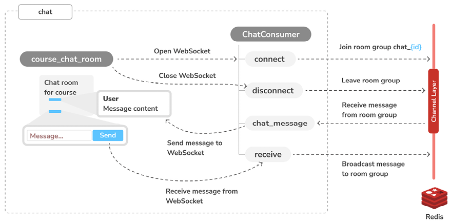
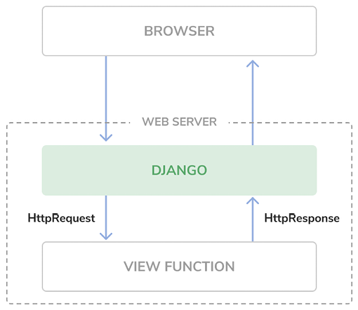
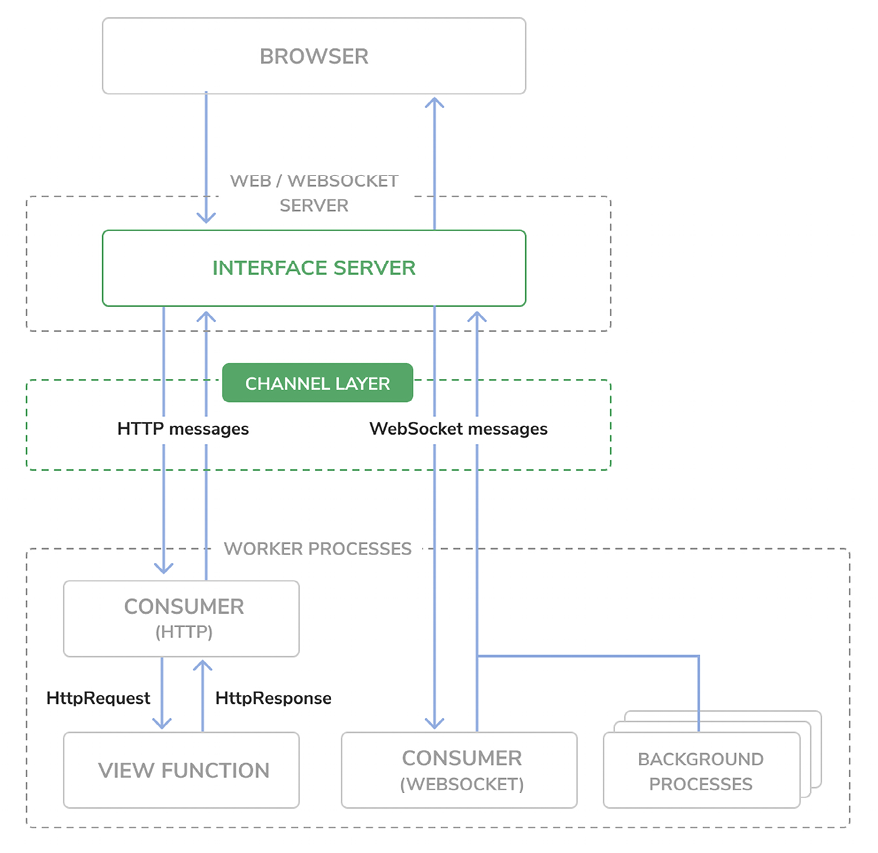

You will learn how to build real-time applications through asynchronous programming with Django Channels. 
 
By serving your Django project through Asynchronous Server Gateway Interface (ASGI), and implementing asynchronous communication, you will enhance the responsiveness and scalability of your server.
 
Additionally, you will persist chat messages into the database, building a comprehensive chat history and enriching the user experience and functionality of the chat application.


BREAKDOWN
-Add Channels to your project
-Build a WebSocket consumer and appropriate routing
-Implement a WebSocket client
-Enable a channel layer with Redis
-Make your consumer fully asynchronous
-Persist chat messages into the database



PROGRAM BREAKDOWN

    - implement the course_chat_room view in the chat application. This view will serve the template that displays the chat room for a given course. 
    - The latest chat messages will be displayed when a user joins a chat room. 
    - You will use JavaScript to establish a WebSocket connection in the browser, and you will build the ChatConsumer WebSocket consumer to handle WebSocket connections and to exchange messages. 
    - You will use Redis to implement the channel layer that allows broadcasting messages to all users in the chat room.


Channels https://channels.readthedocs.io/
We will use Channels to exchange msgs in real time
 You will use Channels to build this functionality. Channels is a Django application that extends Django to handle protocols that require long-running connections, such as WebSockets, chatbots, or MQTT (a lightweight publish/subscribe message transport commonly used in Internet of Things (IoT) projects).

 This functionality requires real-time communication between the server and the client.

 There are several ways you could implement this feature, using AJAX polling or long polling in combination with storing the messages in your database or Redis. This cannot be done with HTTP request/resposne model

 -  asynchronous communication, which allows real-time interactions, where the server can push updates to the client as soon as new messages arrive without the client needing to request updates periodically. 
 - reduced latency, improved performance under load, and a better overall user experience.

 Requires ASGI ( https://docs.djangoproject.com/en/5.0/howto/deployment/asgi/.)
  - Web Server Gateway Interface (WSGI), which is the standard interface for Python applications to handle HTTP request
  - However, to work with asynchronous applications, you need to use another interface called ASGI, which can handle WebSocket requests as well
  - using ASGI, we will enable Django to handle each message independently and in real time, creating a smooth and live chat experience for students.

    - asynchronous views has been supported since Django 3.1
    - Django 4.1 introduced asynchronous handlers for class-based views.
    - Django 5.0 adds handling for disconnect events in asynchronous views before the response is generated.
    - additional 
        1. adds asynchronous functions to the authentication framework
        2. provides support for asynchronous signal dispatching 
        3. adds async support to multiple built-in decorators.

Channels builds upon the native ASGI support available in Django, and provides additional functionalities to handle protocols (such as WebSockets, IoT protocols, and chat protocols.)

WebSockets provide full-duplex communication by establishing a persistent, open, bidirectional Transmission Control Protocol (TCP) connection between servers and clients
 -  Instead of sending HTTP requests to the server, you establish a connection with the server; 
 - once the channel is open, messages can be exchanged in both directions without needing to establish a new connection each time. 
 - You are going to use WebSockets to implement your chat server.

## The request/response cycle is altered by using Channels
1. shows the request cycle of a synchronous Django setup:


When an HTTP request is sent by the browser to the web server, Django handles the request and passes the HttpRequest object to the corresponding view. 
The view processes the request and returns an HttpResponse object that is sent back to the browser as an HTTP response. 
There is no mechanism to maintain an open connection or send data to the browser without an associated HTTP request.


2. Channels with WebSockets


Channels replaces Django’s request/response cycle with messages that are sent across channels.
HTTP requests are still routed to view functions using Django, but they get routed over channels.
Allows WebSocket message handling as well, where you have producers and consumers that exchange messages across a channel layer.
Channels preserves Django’s synchronous architecture, allowing you to choose between writing synchronous code and asynchronous code, or a combination of both.

NB existing synchronous views will co-exist with the WebSocket functionality that we will implement with Daphne, and you will serve both HTTP and WebSocket requests.


# DAPHNE (https://github.com/django/daphne)[[Daphne]]
Basic Channels and Daphne setup
python -m pip install -U 'channels[daphne]==4.1.0'
add to apps ('daphne') on top

 - daphne is added to the INSTALLED_APPS setting, it takes control over the runserver command, replacing the standard Django development server. This will allow you to serve asynchronous requests during development.

 - Channels expects you to define a single root application that will be executed for all requests. You can define the root application by adding the ASGI_APPLICATION setting to your project.

 - You can place the root application anywhere in your project, but it is recommended to put it in a project-level file. You can add your root routing configuration to the asgi.py file directly, where the ASGI application will be defined.

Asgi.py
 ```python
    import os
    from channels.routing import ProtocolTypeRouter
    from django.core.asgi import get_asgi_application
    os.environ.setdefault('DJANGO_SETTINGS_MODULE', 'educa.settings')
    django_asgi_app = get_asgi_application()
    application = ProtocolTypeRouter({
        'http': django_asgi_app,
    })

 ```
Explained:
- In the previous code, you define the main ASGI application that will be executed when serving the Django project through ASGI. 
- You use the ProtocolTypeRouter class provided by Channels as the main entry point of your routing system. 
- ProtocolTypeRouter takes a dictionary that maps communication types like http or websocket to ASGI applications
-  You instantiate this class with the default application for the HTTP protocol. Later websockets

add to settings.py, used by Channels to locate the root routing configuration.
ASGI_APPLICATION = 'educa.asgi.application'

run 
python manage.py runserver

EXPECTED OUTPUT
    Watching for file changes with StatReloader
    Performing system checks...
    System check identified no issues (0 silenced).
    April 14, 2024 - 08:02:57
    Django version 5.0.4, using settings 'educa.settings'
    * Starting ASGI/Daphne version 4.1.0 development server at http://127.0.0.1:8000/
    Quit the server with CONTROL-C.

Explained:
    * line confirms that you are using the Daphne development server, which is capable of managing synchronous and asynchronous requests, instead of the standard Django development server. HTTP requests continue to behave the same as before, but they get routed over Channels.

Channels have been setup now we can implment the chat server
1. 'Set up a consumer': Consumers are individual pieces of code that can handle WebSockets in a very similar way to traditional HTTP views. You will build a consumer to read and write messages to a communication channel.

2. 'Configure routing': Channels provides routing classes that allow you to combine and stack your consumers. You will configure URL routing for your chat consumer.

3. 'Implement a WebSocket client': When the student accesses the chat room, you will connect to the WebSocket from the browser and send or receive messages using JavaScript.

4. 'Enable a channel layer': Channel layers allow you to talk between different instances of an application. They’re a useful part of making a distributed real-time application. You will set up a channel layer using Redis.


# Writing a consumer
Consumers are the equivalent of Django views for asynchronous applications
    - they handle WebSockets in a very similar way to how traditional views handle HTTP requests.
    - Consumers are ASGI applications that can handle messages, notifications, and other things.
    - Unlike Django views, consumers are built for long-running communication. 
    - URLs are mapped to consumers through routing classes that allow you to combine and stack consumers.

basic consumer that can accept WebSocket connections and echoes every message it receives from the WebSocket back to it. 
This initial functionality will allow the student to send messages to the consumer and receive back the messages it sends.

chat/consumers.py
```python
import json
from channels.generic.websocket import WebsocketConsumer
class ChatConsumer(WebsocketConsumer):
    def connect(self):
        # accept connection
        self.accept()
    def disconnect(self, close_code):
        pass
    # receive message from WebSocket
    def receive(self, text_data):
        text_data_json = json.loads(text_data)
        message = text_data_json['message']
        # send message to WebSocket
        self.send(text_data=json.dumps({'message': message}))


```

Explained
This class inherits from the Channels WebsocketConsumer class to implement a basic WebSocket consumer.

    methods
    connnect(): Called when a new connection is received. You accept any connection with self.accept(). You can also reject a connection by calling self.close().

    disconnect(): Called when the socket closes. You use pass because you don’t need to implement any action when a client closes the connection.

    receive(): Called whenever data is received from the WebSocket. You expect text to be received as text_data (this could also be binary_data for binary data). You treat the text data received as JSON. Therefore, you use json.loads() to load the received JSON data into a Python dictionary. You access the message key, which you expect to be present in the JSON structure received. To echo the message, you send the message back to the WebSocket with self.send(), transforming it into JSON format again through json.dumps().

    NB  ChatConsumer consumer accepts any WebSocket connection and echoes to the WebSocket client every message it receives 


Next One , expose our consumer by adding it to the URLs of the project.
# Routing
Define a URL to route connections to the ChatConsumer consumer you have implemented.
Channels provides routing classes that allow you to combine and stack consumers to dispatch based on what the connection is.
    URL routing system of Django for asynchronous applications.

chat/routing.py
```python
from django.urls import re_path
from . import consumers
websocket_urlpatterns = [
    re_path(
        r'ws/chat/room/(?P<course_id>\d+)/$',
        consumers.ChatConsumer.as_asgi()
    ),
]
```

Explained
-  re_path() to define the path with a regular expression instead of path(). Channels’ URL routing may not function correctly with path() routes if inner routers are wrapped by additional middleware, so this approach helps avoid any issues.
- The URL includes an integer parameter called course_id. This parameter will be available in the scope of the consumer and will allow you to identify the course chat room that the user is connecting to.
- You call the as_asgi() method of the consumer class in order to get an ASGI application that will instantiate an instance of the consumer for each user connection. This behavior is similar to Django’s as_view() method for class-based views.

PRO TIP - It is a good practice to prepend WebSocket URLs with /ws/ to differentiate them from URLs used for standard synchronous HTTP requests. This also simplifies the production setup when an HTTP server routes requests based on the path.

new Asgi.py
```python
import os
# new
from channels.auth import AuthMiddlewareStack
#  enw
from channels.routing import ProtocolTypeRouter, URLRouter
from django.core.asgi import get_asgi_application
os.environ.setdefault('DJANGO_SETTINGS_MODULE', 'educa.settings')
django_asgi_app = get_asgi_application()
# new
from chat.routing import websocket_urlpattern
s
application = ProtocolTypeRouter({
    'http': django_asgi_app,
    #  new
    'websocket': AuthMiddlewareStack(
        URLRouter(websocket_urlpatterns)
    ),
})
```

Explained
- A new route for the websocket protocol. You use URLRouter to map websocket connections to the URL patterns defined in the websocket_urlpatterns list of the chat.routing module.
- AuthMiddlewareStack as a wrapper function for the URL router. The AuthMiddlewareStack class provided by Channels supports standard Django authentication, where the user details are stored in the session. Later, you will access the user instance in the scope of the consumer to identify the user who sends a message.

NB - Note that the websocket_urlpatterns import is below the get_asgi_application() function call. This is needed to ensure the application registry is populated before importing code that may import ORM models.

# Implementing the WebSocket client
build a WebSocket client to establish a connection with the WebSocket in the course chat room template and be able to send/receive messages.

implement the WebSocket client with JavaScript to open and maintain a connection in the browser, and you will interact with the Document Object Model (DOM) using JavaScript.

You will perform the following tasks related to the WebSocket client:

1. Open a WebSocket connection with the server when the page is loaded.
2. Add messages to an HTML container when data is received through the WebSocket.
3. Attach a listener to the submit button to send messages through the WebSocket when the user clicks the SEND button or presses the Enter key.

chat/room.html
```javascript

  {{ course.id|json_script:"course-id" }}


  const courseId = JSON.parse(
    document.getElementById('course-id').textContent
  );
  const url = 'ws://' + window.location.host +
              '/ws/chat/room/' + courseId + '/';
  const chatSocket = new WebSocket(url);


```
Explained
-  include_js block, you use the json_script template filter to securely use the value of course.id with JavaScript. The json_script template filter provided by Django outputs a Python object as JSON, wrapped in a <script> tag, so that you can safely use it with JavaScript.

-  The code {{ course.id|json_script:"course-id" }} is rendered as <script id="course-id" type="application/json">6</script>

- This value is then retrieved in the domready block by parsing the content of the element with id="course-id" using JSON.parse(). This is the safe way to use Python objects in JavaScript.

NB - The json_script template filter securely encodes Python objects as JSON and safely embeds them in a <script> HTML tag, protecting against cross-site scripting (XSS) attacks by escaping potentially harmful characters.  https://docs.djangoproject.com/en/5.0/ref/templates/builtins/#json-script.

- You define an URL with the WebSocket protocol, which looks like ws:// (or wss:// for secure WebSockets, just like https://). You build the URL using the current location of the browser, which you obtain from window.location.host.
The rest of the URL is built with the path for the chat room URL pattern that you defined in the routing.py file of the chat application.
(You write the URL instead of building it with a resolver because Channels does not provide a way to reverse URLs. )

- You then open a WebSocket connection to the stored URL using new WebSocket(url). You assign the instantiated WebSocket client object to the new constant chatSocket.

now run it
python manage.py runserver go to http://127.0.0.1:8000/chat/room/1/

we should see, WebSocket HANDSHAKING and WebSocket CONNECT

- The Daphne server listens for incoming socket connections using a standard TCP socket. - The handshake is the bridge from HTTP to WebSockets. In the handshake, details of the connection are negotiated and either party can close the connection before completion. - Remember that you are using self.accept() to accept any connection in the connect() method of the ChatConsumer class, implemented in the consumers.py file of the chat application. 
- The connection is accepted, and therefore, you see the WebSocket CONNECT message in the console.

If you use the browser developer tools to track network connections, you can also see information for the WebSocket connection that has been established.


You will implement the methods to handle common events, such as receiving a message and closing the connection.
chat/room.html dom
```javascript

  const courseId = JSON.parse(
    document.getElementById('course-id').textContent
  );
  const url = 'ws://' + window.location.host +
              '/ws/chat/room/' + courseId + '/';
  const chatSocket = new WebSocket(url);
//   new
  chatSocket.onmessage = function(event) {
    const data = JSON.parse(event.data);
    const chat = document.getElementById('chat');
    chat.innerHTML += '<div class="message">' +
                      data.message + '</div>';
    chat.scrollTop = chat.scrollHeight;
  };
  chatSocket.onclose = function(event) {
    console.error('Chat socket closed unexpectedly');
  };


```

Explained
- onmessage: Triggered when data is received through the WebSocket. You parse the message, which you expect in JSON format, and access its message attribute. 

- You then append a new <div> element with the message received to the HTML element with the chat ID. This will add new messages to the chat log, while keeping all previous messages that have been added to the log. 

- You scroll the chat log <div> to the bottom to ensure that the new message gets visibility. You achieve this by scrolling to the total scrollable height of the chat log, which can be obtained by accessing its scrollHeight attribute.

- onclose: Fired when the connection with the WebSocket is closed. You don’t expect to close the connection, and therefore, you write the error Chat socket closed unexpectedly to the console log if this happens.

You have implemented the action to display the message when a new message is received. 

You need to implement the functionality to send messages to the socket as well.

add below previous
```javascript
const input = document.getElementById('chat-message-input');
const submitButton = document.getElementById('chat-message-submit');
submitButton.addEventListener('click', function(event) {
  const message = input.value;
  if(message) {
    // send message in JSON format
    chatSocket.send(JSON.stringify({'message': message}));
    // clear input
    input.value = '';
    // use to return back to send another msg easily
    input.focus();
  }
});

```
Simple to understand
The user is now able to send messages using the text input and by clicking the submit button.

add to bottom of dom
chat/room.html
```javascript
input.addEventListener('keypress', function(event) {
    if (event.key === 'Enter') {
      // cancel the default action, if needed
      event.preventDefault();
      // trigger click event on button
      submitButton.click();
    }
  });
 
input.focus();
```
Explained
- To improve the user experience, you will give focus to the text input when the page loads, allowing users to begin typing immediately without needing to click on it first. 
- You will also capture keyboard keypress events to identify the Enter key and fire the click event on the submit button. Users will be able to either click the button or press the Enter key to send a message.


Outside of the event handler, in the main JavaScript code for the domready block, you give the focus to the text input with input.focus(). By doing so, when the DOM is loaded, the focus will be set on the input element for the user to type a message.

entirety 
```javascript


  const courseId = JSON.parse(
    document.getElementById('course-id').textContent
  );
  const url = 'ws://' + window.location.host +
              '/ws/chat/room/' + courseId + '/';
  const chatSocket = new WebSocket(url);

  chatSocket.onmessage = function(event) {
    const data = JSON.parse(event.data);
    const chat = document.getElementById('chat');
    chat.innerHTML += '<div class="message">' +
                      data.message + '</div>';
    chat.scrollTop = chat.scrollHeight;
  };

  chatSocket.onclose = function(event) {
    console.error('Chat socket closed unexpectedly');
  };

  const input = document.getElementById('chat-message-input');
  const submitButton = document.getElementById('chat-message-submit');

  submitButton.addEventListener('click', function(event) {
    const message = input.value;
    if(message) {
      // send message in JSON format
      chatSocket.send(JSON.stringify({'message': message}));
      // clear input
      input.value = '';
      input.focus();
    }
  });

  input.addEventListener('keypress', function(event) {
    if (event.key === 'Enter') {
      // cancel the default action, if needed
      event.preventDefault();
      // trigger click event on button
      submitButton.click();
    }
  });
 
  input.focus();


```

Test again
http://127.0.0.1:8000/chat/room/1/
Great! The message has been sent through the WebSocket and the ChatConsumer consumer has received the message and has sent it back through the WebSocket. The chatSocket client has received a message event and the onmessage function has been fired, adding the message to the chat log.

You have implemented the functionality with a WebSocket consumer and a WebSocket client to establish client/server communication and can send or receive events. 

However, the chat server is not able to broadcast messages to other clients. If you open a second browser tab and enter a message, the message will not appear on the first tab. In order to build communication between consumers, you have to enable a channel layer.

# Enabling a channel layer

Channel layers allow you to communicate between different instances of an application. A channel layer is the transport mechanism that allows multiple consumer instances to communicate with each other and with other parts of Django.

In your chat server, you plan to have multiple instances of the ChatConsumer consumer for the same course chat room. Each student who joins the chat room will instantiate the WebSocket client in their browser, and that will open a connection with an instance of the WebSocket consumer. You need a common channel layer to distribute messages between consumers.

## Channels and groups
Channel layers provide two abstractions to manage communications: channels and groups:

- Channel: You can think of a channel as an inbox where messages can be sent or as a task queue. Each channel has a name. Messages are sent to a channel by anyone who knows the channel name and then given to consumers listening on that channel.

- Group: Multiple channels can be grouped into a group. Each group has a name. A channel can be added or removed from a group by anyone who knows the group name. Using the group name, you can also send a message to all channels in the group.

You will work with channel groups to implement the chat server. By creating a channel group for each course chat room, the ChatConsumer instances will be able to communicate with each other.

Let’s add a channel layer to our project.


Setup
Redis is the preferred option for a channel layer, though Channels has support for other types of channel layers.
Redis works as the communication store for the channel layer.
To use Redis as a channel layer, you have to install the channels-redis package

python -m pip install channels-redis==4.2.0

settings.py
```python
CHANNEL_LAYERS = {
    'default': {
        'BACKEND': 'channels_redis.core.RedisChannelLayer',
        'CONFIG': {
            'hosts': [('127.0.0.1', 6379)],
        },
    },
}

```

- CHANNEL_LAYERS setting defines the configuration for the channel layers available to the project
- You define a default channel layer using the RedisChannelLayer backend provided by channels-redis and specify the host 127.0.0.1 and the port 6379, on which Redis is running.

run redis
```
docker run -it --rm --name redis -p 6379:6379 redis:7.2.4
```

Test Via Shell
channel layer can communicate with Redis, write the following code to send a message to a test channel named test_channel and receive it back:
python manage.py shell
```bash
import channels.layers
from asgiref.sync import async_to_sync
channel_layer = channels.layers.get_channel_layer()
async_to_sync(channel_layer.send)('test_channel', {'message': 'hello'})
async_to_sync(channel_layer.receive)('test_channel')
```
expect {'message': 'hello'}
on recieve


Channel Layer to our proejct
## Updating the consumer to broadcast messages
- edit the ChatConsumer consumer to use the channel layer we have implemented with Redis. 
- You will use a channel group for each course chat room. Therefore, you will use the course id to build the group name. 
- ChatConsumer instances will know the group name and will be able to communicate with each other.

edit consumers.py and add
```python
import json
# new
from asgiref.sync import async_to_sync
from channels.generic.websocket import WebsocketConsumer
class ChatConsumer(WebsocketConsumer):
    def connect(self):
        # new
        self.id = self.scope['url_route']['kwargs']['course_id']
        self.room_group_name = f'chat_{self.id}'
        # join room group
        async_to_sync(self.channel_layer.group_add)(
            self.room_group_name, self.channel_name
        )
        # accept connection
        self.accept()
    # ...
```

Explained
- you import the async_to_sync() helper function to wrap calls to asynchronous channel layer methods.

Connect()
1. You retrieve the course id from the scope to know the course that the chat room is associated with. You access self.scope['url_route']['kwargs']['course_id'] to retrieve the course_id parameter from the URL. Every consumer has a scope with information about its connection, arguments passed by the URL, and the authenticated user, if any.

2. You build the group name with the id of the course that the group corresponds to. Remember that you will have a channel group for each course chat room. You store the group name in the room_group_name attribute of the consumer.

3. You join the group by adding the current channel to the group. You obtain the channel name from the channel_name attribute of the consumer. You use the group_add method of the channel layer to add the channel to the group. You use the async_to_sync() wrapper to use the channel layer asynchronous method.

4. You keep the self.accept() call to accept the WebSocket connection.

When the ChatConsumer consumer receives a new WebSocket connection, it adds the channel to the group associated with the course in its scope. The consumer is now able to receive any messages sent to the group.

add to consumers.py disconnect()
```python
def disconnect(self, close_code):
        # leave room group
        async_to_sync(self.channel_layer.group_discard)(
            self.room_group_name, self.channel_name
        )

```
Explained
When the connection is closed, you call the group_discard() method of the channel layer to leave the group. You use the async_to_sync() wrapper to use the channel layer asynchronous method.

add to consumer.py recieve()
```python
def receive(self, text_data):
    text_data_json = json.loads(text_data)
    message = text_data_json['message']
    # send message to room group
    async_to_sync(self.channel_layer.group_send)(
        self.room_group_name,
        {
            'type': 'chat_message',
            'message': message,
        }
    )

```

When you receive a message from the WebSocket connection, instead of sending the message to the associated channel, you send the message to the group. You do this by calling the group_send() method of the channel layer. You use the async_to_sync() wrapper to use the channel layer asynchronous method. You pass the following information in the event sent to the group:

- type: The event type. This is a special key that corresponds to the name of the method that should be invoked on consumers that receive the event. You can implement a method in the consumer named the same as the message type so that it gets executed every time a message with that specific type is received.

- message: The actual message you are sending.


REMEMBER: While there’s one ChatConsumer class defined in your code, Django Channels (via Daphne) will create a separate instance of that consumer for each WebSocket connection (i.e., for each user/client). Even though it's the same class, each user’s connection is isolated in its own consumer instance.


In consumers.py add inside the ChatConsumer a new def
```python
class ChatConsumer(WebsocketConsumer):
    # ...
    # receive message from room group
    def chat_message(self, event):
        # send message to WebSocket
        self.send(text_data=json.dumps(event))

```
Explained

You name this method chat_message() to match the type key that is sent to the channel group when a message is received from the WebSocket. 
When a message with type chat_message is sent to the group, all consumers subscribed to the group will receive the message and will execute the chat_message() method. 
In the chat_message() method, you send the event message received to the WebSocket.

The complete consumers.py file should now look like this:


Entirety
```python
import json
from asgiref.sync import async_to_sync
from channels.generic.websocket import WebsocketConsumer
class ChatConsumer(WebsocketConsumer):
    def connect(self):
        self.id = self.scope['url_route']['kwargs']['course_id']
        self.room_group_name = f'chat_{self.id}'
        # join room group
        async_to_sync(self.channel_layer.group_add)(
            self.room_group_name, self.channel_name
        )
        # accept connection
        self.accept()
    def disconnect(self, close_code):
        # leave room group
        async_to_sync(self.channel_layer.group_discard)(
            self.room_group_name, self.channel_name
        )
    # receive message from WebSocket
    def receive(self, text_data):
        text_data_json = json.loads(text_data)
        message = text_data_json['message']
        # send message to room group
        async_to_sync(self.channel_layer.group_send)(
            self.room_group_name,
            {
                'type': 'chat_message',
                'message': message,
            }
        )
    # receive message from room group
    def chat_message(self, event):
        # send message to WebSocket
        self.send(text_data=json.dumps(event))

```

run it
```bash
python manage.py runserver
```


You will see that the first message is only displayed in the first browser window. When you open a second browser window, messages sent in any of the browser windows are displayed in both of them. 

When you open a new browser window and access the chat room URL, a new WebSocket connection is established between the JavaScript WebSocket client in the browser and the WebSocket consumer in the server. Each channel gets added to the group associated with the course ID and passed through the URL to the consumer. Messages are sent to the group and received by all consumers.


## Adding context to the messages
 display who sent which message and when it was sent.

edit consumers.py and add
```python
import json
from asgiref.sync import async_to_sync
from channels.generic.websocket import WebsocketConsumer
#  new
from django.utils import timezone
class ChatConsumer(WebsocketConsumer):
    def connect(self):
        #  new
        self.user = self.scope['user']
        self.id = self.scope['url_route']['kwargs']['course_id']
        self.room_group_name = f'chat_{self.id}'
        # join room group
        async_to_sync(self.channel_layer.group_add)(
            self.room_group_name, self.channel_name
        )
        # accept connection
        self.accept()
    def disconnect(self, close_code):
        # leave room group
        async_to_sync(self.channel_layer.group_discard)(
            self.room_group_name, self.channel_name
        )
    # receive message from WebSocket
    def receive(self, text_data):
        text_data_json = json.loads(text_data)
        message = text_data_json['message']
        # new
        now = timezone.now()
        # send message to room group
        async_to_sync(self.channel_layer.group_send)(
            self.room_group_name,
            {
                'type': 'chat_message',
                'message': message,
                # new
                'user': self.user.username,
                'datetime': now.isoformat(),
            }
        )
    # receive message from room group
    def chat_message(self, event):
        # send message to WebSocket
        self.send(text_data=json.dumps(event))

```

Explained
You now import the timezone module provided by Django. 
In the connect() method of the consumer, you retrieve the current user from the scope with self.scope['user'] and store them in a new user attribute of the consumer.

When the consumer receives a message through the WebSocket, it gets the current time using timezone.now() and passes the current user and datetime in ISO 8601 format along with the message in the event sent to the channel group.


edit room.html add
```javascript

  {{ course.id|json_script:"course-id" }}
//   new
  {{ request.user.username|json_script:"request-user" }}


```

Using the json_script template, you safely print the username of the request user to use it with JavaScript.

edit room.html add
```javascript

  const courseId = JSON.parse(
    document.getElementById('course-id').textContent
  );
//   new
  const requestUser = JSON.parse(
    document.getElementById('request-user').textContent
  );
  # ...


```

In the new code, you safely parse the data of the element with the ID request-user and store it in the requestUser constant.


Find the following code
```javascript
const data = JSON.parse(event.data);
const chat = document.getElementById('chat');
chat.innerHTML += '<div class="message">' +
                  data.message + '</div>';
chat.scrollTop = chat.scrollHeight;
```

replace with this
```javascript
const data = JSON.parse(event.data);
const chat = document.getElementById('chat');

const dateOptions = {hour: 'numeric', minute: 'numeric', hour12: true};
const datetime = new Date(data.datetime).toLocaleString('en', dateOptions);

// check data.user against sessions user
const isMe = data.user === requestUser;

const source = isMe ? 'me' : 'other';
const name = isMe ? 'Me' : data.user;

chat.innerHTML += '<div class="message ' + source + '">' +
                  '<strong>' + name + '</strong> ' +
                  '<span class="date">' + datetime + '</span><br>' +
                  data.message + '</div>';
chat.scrollTop = chat.scrollHeight;
```

Explained
1. You convert the datetime received in the message to a JavaScript Date object and format it with a specific locale.

2. You compare the username received in the message with two different constants as helpers to identify the user.

3. The constant source gets the value me if the user sending the message is the current user, or other otherwise.

4. The constant name gets the value Me if the user sending the message is the current user or the name of the user sending the message otherwise. You use it to display the name of the user sending the message.

5. You use the source value as a class of the main <div> message element to differentiate messages sent by the current user from messages sent by others. Different CSS styles are applied based on the class attribute. These CSS styles are declared in the css/base.css static file.

6. You use the username and the datetime in the message that you append to the chat log.

open http://127.0.0.1:8000/chat/room/1/
open 2 seperate browsers and test

Great! You have built a functional real-time chat application using Channels. Next, you will learn how to improve the chat consumer by making it fully asynchronous.

## Modifying the consumer to be fully asynchronous

The ChatConsumer you have implemented inherits from the synchronous base class WebsocketConsumer. 

Synchronous consumers operate in a way that each request must be processed in sequence, one after the other. Synchronous consumers are convenient for accessing Django models and calling regular synchronous I/O functions.

However, asynchronous consumers perform better because of their ability to perform non-blocking operations, moving to another task without waiting for the first operation to complete. They don’t require additional threads when handling requests, thus reducing wait times and increasing the ability to scale to more users and requests simultaneously.

Given that you are already using the asynchronous channel layer functions, you can seamlessly rewrite the ChatConsumer class to make it asynchronous.

Edit consumers.py file of the chat, add async
<!-- just take not of all the asyncs, await and AsyncWebsocketConsumer -->
```python
import json
from channels.generic.websocket import AsyncWebsocketConsumer
from django.utils import timezone
class ChatConsumer(AsyncWebsocketConsumer):
    async def connect(self):
        self.user = self.scope['user']
        self.id = self.scope['url_route']['kwargs']['course_id']
        self.room_group_name = 'chat_%s' % self.id
        # join room group
        await self.channel_layer.group_add(
            self.room_group_name, self.channel_name
        )
        # accept connection
        await self.accept()
    async def disconnect(self, close_code):
        # leave room group
        await self.channel_layer.group_discard(
            self.room_group_name, self.channel_name
        )
    # receive message from WebSocket
    async def receive(self, text_data):
        text_data_json = json.loads(text_data)
        message = text_data_json['message']
        now = timezone.now()
        # send message to room group
        await self.channel_layer.group_send(
            self.room_group_name,
            {
                'type': 'chat_message',
                'message': message,
                'user': self.user.username,
                'datetime': now.isoformat(),
            }
        )
    # receive message from room group
    async def chat_message(self, event):
        # send message to WebSocket
        await self.send(text_data=json.dumps(event))

```
Explained
1. The ChatConsumer consumer now inherits from the AsyncWebsocketConsumer class to implement asynchronous calls.

2. You have changed the definition of all methods from def to async def.

3. You use await to call asynchronous functions that perform I/O operations.

4. You no longer use the async_to_sync() helper function when calling methods on the channel layer.


## Persisting messages into the database
We will develop functionality to store messages in the database, allowing us to present a chat history to users when they join a chat room. 

This feature is essential for real-time applications, where it’s necessary to display both current and previously generated data

To implement the chat history functionality, we will follow these steps:

1. We will create Django model to store chat messages and add it to the administration site.
2. We will modify the WebSocket consumer to persist messages.
3. We will retrieve the chat history to display the latest messages when users enter a chat room.


### Django Model
add to models.py
```python
from django.conf import settings
from django.db import models
class Message(models.Model):
    user = models.ForeignKey(
        settings.AUTH_USER_MODEL,
        on_delete=models.PROTECT,
        related_name='chat_messages'
    )
    course = models.ForeignKey(
        'courses.Course',
        on_delete=models.PROTECT,
        related_name='chat_messages'
    )
    content = models.TextField()
    sent_on = models.DateTimeField(auto_now_add=True)
    def __str__(self):
        return f'{self.user} on {self.course} at {self.sent_on}'

```

Explained
- user: The User object that wrote the message. This is a foreign key field because it specifies a many-to-one relationship: a user can send multiple messages, but each message is sent by a single user. By using PROTECT for the on_delete parameter, a User object cannot be deleted if related messages exist.

- course: A relationship with the Course object. Each message belongs to the chat room of a course. By using PROTECT for the on_delete parameter, a Course object cannot be deleted if related messages exist.

content: A TextField to store the content of the message.

sent_on: A DateTimeField to store the date and time when the message object is saved the first time.

run
```bash
python manage.py makemigrations chat
python manage.py migrate

```

### Adding the message model to the administration site
edit admin.py add the following 
```python
from django.contrib import admin
from chat.models import Message
@admin.register(Message)
class MessageAdmin(admin.ModelAdmin):
    list_display = ['sent_on', 'user', 'course', 'content']
    list_filter = ['sent_on', 'course']
    search_fields = ['content']
    raw_id_fields = ['user', 'content']

```

### Storing messages in the database
We will modify the WebSocket consumer to persist each message that is received through the WebSocket. 

Edit the consumers.py file of the chat application,
```python
import json
from channels.generic.websocket import AsyncWebsocketConsumer
from django.utils import timezone
# new
from chat.models import Message
class ChatConsumer(AsyncWebsocketConsumer):
    # ...
    # new
    async def persist_message(self, message):
        # send message to WebSocket
        await Message.objects.acreate(
            user=self.user, course_id=self.id, content=message
        )
    # receive message from WebSocket
    async def receive(self, text_data):
        text_data_json = json.loads(text_data)
        message = text_data_json['message']
        now = timezone.now()
        # send message to room group
        await self.channel_layer.group_send(
            self.room_group_name,
            {
                'type': 'chat_message',
                'message': message,
                'user': self.user.username,
                'datetime': now.isoformat(),
            },
        )
        # new
        # persist message
        await self.persist_message(message)
    # ...

```
Explained
- we add the asynchronous persist_message() method to the ChatConsumer class. This method takes a message parameter and creates a Message object in the database with the given message, the related authenticated user, and the id of the Course object that the group chat room belongs to. 

- Since the is ChatConsumer is fully asynchronous, we use the acreate() QuerySet method, which is the asynchronous version of create(). You can read more about how to write asynchronous queries with the Django ORM at https://docs.djangoproject.com/en/5.0/topics/db/queries/#asynchronous-queries.

- We call the persist_message() method asynchronously in the receive() method that is executed when a message is received by the consumer through the WebSocket.

Run the development server and open http://127.0.0.1:8000/chat/room/1/ in your browser, replacing 1 with the id of an existing course in the database. With a logged-in user who is enrolled in the course, write a message and send it.

Then, open a second browser window in incognito mode to prevent the use of the same session. Log in with a different user, also enrolled in the same course, and send a few messages as well.

Open http://127.0.0.1:8000/admin/chat/message/

NB
Note that messages could contain malicious code, for example, JavaScript fragments. We do not mark the messages as safe in our template, providing an initial layer of protection against malicious content. 
However, to further enhance security, consider sanitizing the messages before storing them in the database. A reliable option for sanitizing content is the nh3 package. You can read more about nh3 at https://nh3.readthedocs.io/en/latest/. Additionally, django-nh3 is a Django integration available that offers custom nh3 model fields and form fields. More information is available at https://github.com/marksweb/django-nh3

         Look up nh3

### Displaying the chat history
When users join a course chat room, we will display the latest five messages of the chat history. This will ensure that users gain immediate context for ongoing conversations.

Edit the views.py file of the chat application and add to
course_chat_room view:
```python
@login_required
def course_chat_room(request, course_id):
    try:
        # retrieve course with given id joined by the current user
        course = request.user.courses_joined.get(id=course_id)
    except Course.DoesNotExist:
        # user is not a student of the course or course does not exist
        return HttpResponseForbidden()
    # new
    # retrieve chat history
    latest_messages = course.chat_messages.select_related(
        'user'
    ).order_by('-id')[:5]
    latest_messages = reversed(latest_messages)
    return render(
        request,
        'chat/room.html',
        {'course': course, 'latest_messages': latest_messages}
    )

```
Explained 
We retrieve the chat messages related to the course and use select_related() to fetch the related user in the same query. 
Django’s ORM doesn’t support negative indexing, so we retrieve the first five messages in reverse chronological order, and we utilize the reversed() function to reorder them back into chronological sequence.


 chat/room.html template and add 
```javascript
# ...

  <div id="chat">
//   new
    
      <div class="message meother">
        <strong>{{ message.user.username }}</strong>
        <span class="date">
          {{ message.sent_on|date:"Y.m.d H:i A" }}
        </span>
        <br>
        {{ message.content }}
      </div>
    
  </div>
  <div id="chat-input">
    <input id="chat-message-input" type="text">
    <input id="chat-message-submit" type="submit" value="Send">
  </div>

# ...

```


### Integrating the chat application with existing views
The chat server is now fully implemented, and students enrolled in a course can communicate with each other. Let’s add a link for students to join the chat room for each course.

students/course/detail.html 
```html
<div class="contents">
  ...
  <!-- new -->
  <h3>
    <a href="">
      Course chat room
    </a>
  </h3>
</div>

```