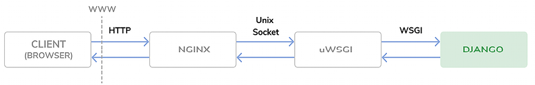
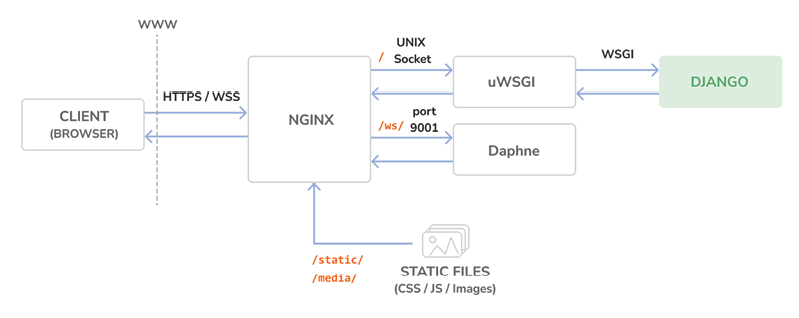
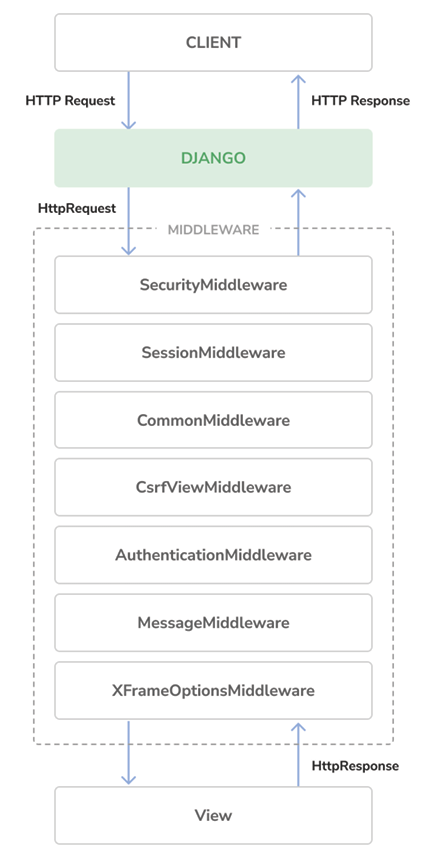

# Going Live

This chapter speaks on the following

-Configuring Django settings for multiple environments
-Using Docker Compose to run multiple services
-Setting up a web server with uWSGI and Django
-Serving PostgreSQL and Redis with Docker Compose
-Using the Django system check framework
-Serving NGINX with Docker
-Serving static assets through NGINX
-Securing connections through Transport Layer Security (TLS) / Secure Sockets Layer (SSL)
-Using the Daphne Asynchronous Server Gateway Interface (ASGI) server for Django Channels
-Creating a custom Django middleware
-Implementing custom Django management commands


# Creating a production environment

## Managing settings for multiple environments
Usually have at least a 
- local environment for development 
- production environment for serving your application
- You could have other environments as well, such as testing or staging environments.

Some project settings will be common to all environments, but others will be specific to each environment. Usually, you will use a base file that defines common settings, and a settings file per environment that overrides any necessary settings and defines additional ones.

For this development we will use the following env
local: The local environment to run the project on your machine
prod: The environment for deploying your project on a production server

Create a Settings Dir, next to settings.py
Rename settings.py to base.py and move it into the new dir

settings/
    __init__.py
    base.py
    local.py
    prod.py

 - base.py: The base settings file, which contains common settings (previously settings.py)
 - local.py: Custom settings for your local environment
 - prod.py: Custom settings for the production environment

IMPORTANT - You have moved the settings files to a directory one level below, so you need to update the BASE_DIR setting in the settings/base.py file to point to the main project directory.
    .replace 
    ```python
        BASE_DIR = Path(__file__).resolve().parent.parent
    ```
    .with
    ```python
    BASE_DIR = Path(__file__).resolve().parent.parent.parent
    ```

You point to one directory above by adding .parent to the BASE_DIR path. 


### local environment
Let’s configure the settings for the local environment.

add to local.py settings
```python
from .base import *
DEBUG = True
DATABASES = {
    'default': {
        'ENGINE': 'django.db.backends.sqlite3',
        'NAME': BASE_DIR / 'db.sqlite3',
    }
}

```

Now, remove the DATABASES and DEBUG settings from the base.py settings file.

Django wont be able to detect the setting.py file because it is called something else, so we are forced to explicitly state it. 
```bash
python manage.py runserver --settings=education.settings.local
```

It is good to rest the env and see if its functioning as expected
run the following
```bash
docker run -it --rm --name redis -p 6379:6379 redis:7.2.4
python manage.py runserver --settings=education.settings.local

```

TIP
If don’t want to pass the --settings option every time you run a management command, you can define the DJANGO_SETTINGS_MODULE environment variable. Django will use it to identify the settings module to use. 

If you are using Linux or macOS, you can define the environment variable by executing the following command in the shell:
```bash
export DJANGO_SETTINGS_MODULE=education.settings.local
```

if your using windows
```pwsh
set DJANGO_SETTINGS_MODULE=education.settings.local
```

### Production environment 
settings/prod.py
```python
from .base import *
DEBUG = False
ADMINS = [
    ('Antonio M', 'email@mydomain.com'),
]
ALLOWED_HOSTS = ['*']
DATABASES = {
    'default': {
        'ENGINE': 'django.db.backends.sqlite3',
        NAME: BASE_DIR / 'db.sqlite3',
    }
}
```

And Test
```bash
python manage.py runserver --settings=education.settings.prod
```

Explained

DEBUG: Setting DEBUG to False is necessary for any production environment. Failing to do so will result in the traceback information and sensitive configuration data being exposed to everyone.

ADMINS: When DEBUG is False and a view raises an exception, all information will be sent by email to the people listed in the ADMINS setting. Make sure that you replace the name/email tuple with your own information.

ALLOWED_HOSTS: For security reasons, Django will only allow the hosts included in this list to serve the project. For now, you allow all hosts by using the asterisk symbol, *. You will limit the hosts that can be used for serving the project later.

DATABASES: You keep the default database settings pointing to the SQLite database of your local environment. You will configure the production database later.


## Using Docker Compose
For the production environment, we will use Docker Compose to build and run multiple Docker containers.

Docker Compose is a tool for defining and running multi-container applications.
You can create a configuration file to define the different services and use a single command to start all services from your configuration. 

Each Docker container will run a different service.
- Web service: A web server to serve the Django project
- Database service: A database service to run PostgreSQL
- Cache service: A service to run Redis

View docs on docker desktop installation
https://docs.docker.com/compose/install/compose-desktop/

### Creating a Dockerfile
Create a Docker image to run the Django project. 
A Dockerfile is a text file that contains the commands for Docker to assemble a Docker image. You will prepare a Dockerfile with the commands for building the Docker image for the Django project.

next to Education/Educa dir make a Dockerfile
```Dockerfile
# Pull official base Python Docker image
FROM python:3.12.3
# Set environment variables
ENV PYTHONDONTWRITEBYTECODE=1
ENV PYTHONUNBUFFERED=1
# Set work directory
WORKDIR /code
# Install dependencies
RUN pip install --upgrade pip
COPY requirements.txt .
RUN pip install -r requirements.txt
# Copy the Django project
COPY . .
```

Explained
1. The Python 3.12.3 parent Docker image is used. You can find the official Python Docker image at https://hub.docker.com/_/python.

2. The following environment variables are set:
    - PYTHONDONTWRITEBYTECODE: This prevents Python from writing out pyc files.
    - PYTHONUNBUFFERED: This ensures that the Python stdout and stderr streams are sent straight to the terminal without first being buffered.

3. The WORKDIR command is used to define the working directory of the image.
4. The pip package of the image is upgraded.
5. The requirements.txt file is copied to the working directory (.) of the parent Python image.
6. The Python packages in requirements.txt are installed in the image using pip.
7. The Django project source code is copied from the local directory to the working directory (.) directory of the image.


## Adding the Python requirements
A requirements.txt file is used in the Dockerfile you created to install all of the necessary Python packages for the project.
Next to the educa project directory, create a new file and name it requirements.txt.

ensure it has the following
```txt
asgiref==3.8.1
Django~=5.0.4
Pillow==10.3.0
sqlparse==0.5.0
django-braces==1.15.0
django-embed-video==1.4.9
pymemcache==4.0.0
django-debug-toolbar==4.3.0
redis==5.0.4
django-redisboard==8.4.0
djangorestframework==3.15.1
requests==2.31.0
channels[daphne]==4.1.0
channels-redis==4.2.0
psycopg==3.1.18
uwsgi==2.0.25.1
python-decouple==3.8
```

note of the new additions.
- psycopg: This is the PostgreSQL adapter. You will use PostgreSQL for the production environment.
- uwsgi: A WSGI web server. You will configure this web server later to serve Django in the production environment.
- python-decouple: Package to load environment variables easily.

## Creating a Docker Compose file
define the services that will run in different Docker containers, we will use a Docker Compose file.
Compose file is a text file in YAML format, defining services, networks, and data volumes for a Docker application. YAML is a human-readable data-serialization language

next to educa/education dir. docker-compose.yml
```yml
services:
  web:
    build: .
    command: python /code/educa/manage.py runserver 0.0.0.0:8000
    restart: always
    volumes:
      - .:/code
    ports:
      - "8000:8000"
    environment:
      - DJANGO_SETTINGS_MODULE=educa.settings.prod
```

Explained
- build: This defines the build requirements for a service container image. This can be a single string defining a context path, or a detailed build definition. You provide a relative path with a single dot (.) to point to the same directory where the Compose file is located. Docker Compose will look for a Dockerfile at this location. You can read more about the build section at https://docs.docker.com/compose/compose-file/build/.

command: This overrides the default command of the container. You run the Django development server using the runserver management command. 

IMPROTANT - The project is served on host 0.0.0.0, which is the default Docker IP, on port 8000.

restart: This defines the restart policy for the container. Using always, the container is always restarted if it stops. This is useful for a production environment where you want to minimize downtime. You can read more about the restart policy at https://docs.docker.com/config/containers/start-containers-automatically/.

volumes: Data in Docker containers is not permanent. Each Docker container has a virtual filesystem that is populated with the files of the image and that is destroyed when the container is stopped. Volumes are the preferred method to persist data generated and used by Docker containers. In this section, you mount the local . directory to the /code directory of the image. You can read more about Docker volumes at https://docs.docker.com/storage/volumes/.

ports: This exposes container ports. Host port 8000 is mapped to container port 8000, on which the Django development server is running.

environment: This defines environment variables. You set the DJANGO_SETTINGS_MODULE environment variable to use the production Django settings file educa.settings.prod.

NB - Note that in the Docker Compose file definition, you are using the Django development server to serve the application. The Django development server is not suitable for production use, so you will replace it later with a WSGI Python web server.

new structure
Chapter17/
    Dockerfile
    docker-compose.yml
    educa/
        manage.py
        ...
    requirements.txt


open a shell where the docker-compose is
```bash
docker compose up
```

Open http://0.0.0.0:8000/admin/

NB - CSS styles are not loaded. You are using DEBUG=False, so URL patterns for serving static files are not being included in the main urls.py file of the project.

Check the docker, you should see a web-1 and a new web image
The chapter17-web image has been built using the Dockerfile you defined earlier and is used by the web-1 container.

### Configuring the PostgreSQL service
For a production environment, you will need a more powerful database, such as PostgreSQL, MySQL, or Oracle. 

edit docker-compose.yml
```yml
services:
# new
  db:
    image: postgres:16.2
    restart: always
    volumes:
      - ./data/db:/var/lib/postgresql/data
    environment:
      - POSTGRES_DB=postgres
      - POSTGRES_USER=postgres
      - POSTGRES_PASSWORD=postgres
  web:
    build: .
    command: python /code/educa/manage.py runserver 0.0.0.0:8000
    restart: always
    volumes:
      - .:/code
    ports:
      - "8000:8000"
    environment:
      - DJANGO_SETTINGS_MODULE=educa.settings.prod
    #   new
      - POSTGRES_DB=postgres
      - POSTGRES_USER=postgres
      - POSTGRES_PASSWORD=postgres
    depends_on:
      - db

```

DB service Explained
- image: The service uses the base postgres Docker image.
- restart: The restart policy is set to always.

- volumes: You mount the ./data/db directory to the image directory /var/lib/postgresql/data to persist the database so that data stored in the database is maintained after the Docker application is stopped. 
\This will create the local data/db/ path.
When you mount ./data/db:/var/lib/postgresql/data:

PostgreSQL thinks it’s writing to its internal /var/lib/postgresql/data,
But in reality, the data is being stored on your host machine at ./data/db.

- environment: You use the POSTGRES_DB (database name), POSTGRES_USER, and POSTGRES_PASSWORD variables with default values.


The definition for the web service now includes the PostgreSQL environment variables for Django. 

You create a service dependency using depends_on so that the web service is started after the db service. This will guarantee the order of the container initialization, but it won’t guarantee that PostgreSQL is fully initiated before the Django web server is started. To solve this, you need to use a script that will wait on the availability of the database host and its TCP port. Docker recommends that you use the wait-for-it tool to control container initialization.

Download the 'wait-for-it.sh' bash script from https://github.com/vishnubob/wait-for-it/blob/master/wait-for-it.sh and save the file next to the docker-compose.yml file. 

Then, edit the docker-compose.yml file and modify the web service definition as follows. The new code is highlighted in bold:

```yml
web:
  build: .
#   new
  command: ["./wait-for-it.sh", "db:5432", "--",
            "python", "/code/educa/manage.py", "runserver",
            "0.0.0.0:8000"]
  restart: always
  volumes:
      - .:/code
    environment:
      - DJANGO_SETTINGS_MODULE=educa.settings.prod
      - POSTGRES_DB=postgres
      - POSTGRES_USER=postgres
      - POSTGRES_PASSWORD=postgres
    depends_on:
      - db

```
use the wait-for-it.sh bash script to wait for the db host to be ready and accept connections on port 5432, the default port for PostgreSQL, before starting the Django development server. 

You can read more about the service startup order in Compose at https://docs.docker.com/compose/startup-order/.

Edit the prod.py
```python
#  new
from decouple import config
from .base import *	
DEBUG = False
ADMINS = [
    ('Antonio M', 'email@mydomain.com'),
]
ALLOWED_HOSTS = ['*']
DATABASES = {
    'default': {
        # new
        'ENGINE': 'django.db.backends.postgresql',
        'NAME': config('POSTGRES_DB'),
        'USER': config('POSTGRES_USER'),
        'PASSWORD': config('POSTGRES_PASSWORD'),
        'HOST': 'db',
        'PORT': 5432,
    }
}
```

Explained
- ENGINE: You use the Django database backend for PostgreSQL.
NAME, USER, and PASSWORD: You use the config() function of python-decouple to retrieve the POSTGRES_DB (database name), POSTGRES_USER, and POSTGRES_PASSWORD environment variables. You have set these environment variables in the Docker Compose file.

- HOST: You use db, which is the container hostname for the database service defined in the Docker Compose file. A container hostname defaults to the container’s ID in Docker. That’s why you use the db hostname.

- PORT: You use the 5432 value, which is the default port for PostgreSQL.

build again and run
```bash
docker compose up
```

### Applying database migrations and creating a superuser

shell in the parent directory, where the docker-compose.yml
```bash
# directly aim at container
sudo docker exec -it education_system-web-1 python /code/education/manage.py migrate

# docker will point us to a container with the web tag
sudo docker compose exec web python /code/education/manage.py migrate
sudo docker compose exec web python /code/education/manage.py createsuperuser


```
You can access http://localhost:8000/admin/ 


### Configuring the Redis service
Edit the docker-compose.yml
```yml
services:
  db:
    # ...
    # new
  cache:
    image: redis:7.2.4
    restart: always
    volumes:
      - ./data/cache:/data
  web:
    # ...
    depends_on:
      - db
    #   new
      - cache

```

Explained

- image: The service uses the base redis Docker image.
- restart: The restart policy is set to always.
- volumes: You mount the ./data/cache directory to the /data image directory where any Redis writes will be persisted. This will create the local data/cache/ path.

In the web service definition, you add the cache service as a dependency, so that the web service is started after the cache service. 

TIP - The Redis server initializes fast, so you don’t need to use the wait-for-it tool in this case.


Add to educa/prod.settings
```python
REDIS_URL = 'redis://cache:6379'
CACHES['default']['LOCATION'] = REDIS_URL
CHANNEL_LAYERS['default']['CONFIG']['hosts'] = [REDIS_URL]
```

In these settings, you use the cache hostname that is automatically generated by Docker Compose using the name of the cache service and port 6379 used by Redis. 
The Django CACHE setting and the CHANNEL_LAYERS setting used by Channels to use the production Redis URL.

## Serving Django through WSGI and NGINX

Django’s primary deployment platform is WSGI. WSGI stands for Web Server Gateway Interface , and it is the standard for serving Python applications on the web.
, Django creates a wsgi.py file inside your project directory. This file contains a WSGI application callable, which is an access point to your application.

WSGI is used for both running your project with the Django development server and deploying your application with the server of your choice in a production environment. You can learn more about WSGI at https://wsgi.readthedocs.io/en/latest/.


we will use uWSGI, an open source web server that implements the WSGI specification.

### Using uWSGI

for production use, and deploying your application in a production environment will require a standard web server; not a simple development server

- uWSGI is an extremely fast Python application server.
- It communicates with your Python application using the WSGI specification. 
- uWSGI translates web requests into a format that your Django project can process.

Edit the docker-compose.yml
```yml
web:
    build: .
    # new
    command: ["./wait-for-it.sh", "db:5432", "--",
              "uwsgi", "--ini", "/code/config/uwsgi/uwsgi.ini"]
    restart: always
    volumes:
      - .:/code
    environment:
      - DJANGO_SETTINGS_MODULE=educa.settings.prod
      - POSTGRES_DB=postgres
      - POSTGRES_USER=postgres
      - POSTGRES_PASSWORD=postgres
    depends_on:
      - db
      - cache

```
Explained

The new command for the image runs uwsgi and passes the /code/config/uwsgi/uwsgi.ini configuration file to it. Let’s create the configuration file for uWSGI.

IMPORTANT - Make sure to remove the ports section. uWSGI will be reachable with a socket, so you don’t need to expose a port in the container.

### Configuring uWSGI
uWSGI allows you to define a custom configuration in an .ini file. config/uwsgi/uwsgi.ini
```
Chapter17/
    config/
        uwsgi/
            uwsgi.ini
    Dockerfile
    docker-compose.yml
    educa/
        manage.py
        ...
    requirements.txt

```

### Edit the config/uwsgi/uwsgi.ini
```ini
[uwsgi]
socket=/code/educa/uwsgi_app.sock
chdir = /code/educa/
module=educa.wsgi:application
master=true
chmod-socket=666
uid=www-data
gid=www-data
vacuum=true

```

Explained
socket: This is the Unix/TCP socket to bind the server.

chdir: This is the path to your project directory, so that uWSGI changes to that directory before loading the Python application.

module: This is the WSGI module to use. You set this to the application callable contained in the wsgi module of your project.

master: This enables the master process.

chmod-socket: These are the file permissions to apply to the socket file. In this case, you use 666 so that NGINX can read/write the socket.

uid: This is the user ID of the process once it’s started.
gid: This is the group ID of the process once it’s started.

vacuum: Using true instructs uWSGI to clean up any temporary files or UNIX sockets it creates.


The socket option is intended for communication with some kind of third-party router, such as NGINX. You are going to run uWSGI using a socket and you are going to configure NGINX as your web server, which will communicate with uWSGI through the socket.

'You will not be able to access your uWSGI instance from your browser now, since it’s running through a socket. To complete the environment, we will use NGINX in front of uWSGI, to manage HTTP requests and pass application requests to uWSGI through the socket. Let’s complete the production environment.'


### Using NGINX
you have to serve dynamic content, but you also need to serve static files, such as CSS style sheets, JavaScript files, and images.

uWSGI is capable of serving static files, it adds unnecessary overhead to HTTP requests, set up a web server, such as NGINX, in front of it.

NGINX is a web server focused on high concurrency, performance, and low memory usage. NGINX also acts as a reverse proxy, receiving HTTP and WebSocket requests and routing them to different backends.

Generally, use a web server, such as NGINX, in front of uWSGI for serving static files efficiently, and you will forward dynamic requests to uWSGI workers. By using NGINX, 'also apply different rules and benefit from its reverse proxy capabilities.'

We will add the NGINX service to the Docker Compose file.

```yml
services:
  db:
    # ...
  cache:
    # ...
  web:
    # ...
    # new
  nginx:
    image: nginx:1.25.5
    restart: always
    volumes:
      - ./config/nginx:/etc/nginx/templates
      - .:/code
    ports:
      - "80:80"

```

Explained

image: The service uses the base nginx Docker image.
restart: The restart policy is set to always.
volumes: You mount the ./config/nginx volume to the /etc/nginx/templates directory of the Docker image. This is where NGINX will look for a default configuration template. You also mount the local directory . to the /code directory of the image, so that NGINX can have access to static files.
ports: You expose port 80, which is mapped to container port 80. This is the default port for HTTP.


### Configuring NGINX
add new path
```
config/
    uwsgi/
      uwsgi.ini
      <!-- new -->
    nginx/
        default.conf.template

```

Edit the nginx/default.conf.template
```template
# upstream for uWSGI
upstream uwsgi_app {
    server unix:/code/educa/uwsgi_app.sock;
}
server {
    listen       80;
    server_name  www.educaproject.com educaproject.com;
    error_log    stderr warn;
    access_log   /dev/stdout main;
    location / {
        include      /etc/nginx/uwsgi_params;
        uwsgi_pass   uwsgi_app;
    }
}

```

Explained

upstream component named uwsgi_app, which points to the socket created by uWSGI. You use the server block with the following configuration:

- You tell NGINX to listen on port 80.
- You set the server name to both www.educaproject.com and educaproject.com. NGINX will serve incoming requests for both domains.
- You use stderr for the error_log directive to get error logs written to the standard error file. The second parameter determines the logging level. You use warn to get warnings and errors of higher severity.
- You point access_log to the standard output with /dev/stdout.
- any request under the / path has to be routed with the uwsgi_app socket to uWSGI.
You include the default uWSGI configuration parameters that come with NGINX. These are located at /etc/nginx/uwsgi_params.


Run docker
```bash
docker compose up
```


The production environment request/response cycle
The following happens when the client browser sends an HTTP request:

1. NGINX receives the HTTP request.
2. NGINX delegates the request to uWSGI through a socket.
3. uWSGI passes the request to Django for processing.
4. Django returns an HTTP response that is passed back to NGINX, which in turn passes it back to the client browser.

Total we have 4 containers running
- The db service is running PostgreSQL
- The cache service is running Redis
- The web service is running uWSGI and Django
- The nginx service is running NGINX


### Using a hostname

Instead of accessing our project using localhost, we will configure the project to use the educaproject.com hostname.

If you are using Linux or macOS, edit the /etc/hosts file and add the following line to it:
Windows: C:\Windows\System32\drivers\etc
```hosts
127.0.0.1 educaproject.com www.educaproject.com
```

Open http://educaproject.com/ in your browser.
Edit the educa/settings/prod.py production settings file of your project and change the ALLOWED_HOSTS setting, as follows:

```python
ALLOWED_HOSTS = ['educaproject.com', 'www.educaproject.com']
```

### Serving static and media assets
uWSGI is capable of serving static files flawlessly, but it is not as fast and effective as NGINX.

Use NGINX to serve static files in your production environment. You will set up NGINX to serve both the static files of your application (CSS style sheets, JavaScript files, and images) and media files uploaded by instructors for the course contents.


Edit Settings base.py
```python
STATIC_ROOT = BASE_DIR / 'static'
```
This is the root directory for all static files of the project. Next, you are going to collect the static files from the different Django applications into the common directory.

#### Collecting static files
Each application in your Django project may contain static files in a static/ directory
Django provides a command to collect static files from all applications into a single location. 
This simplifies the setup for serving static files in production

Collectstatic command collects the static files from all applications of the project into the path defined with the STATIC_ROOT setting.

run 
```bash
docker compose up
```

run the command
```bash
docker compose exec web python /code/education/manage.py collectstatic
or
python manage.py collectstatic --settings=education.settings.local

```

Both commands will have the same effect since the base local directory is mounted to the Docker image

Files located under the static/ directory of each application present in the INSTALLED_APPS setting have been copied to the global /education/static/ project directory.


#### Serving static files with NGINX
```template
server {
    # ...
    location / {
        include      /etc/nginx/uwsgi_params;
        uwsgi_pass   uwsgi_app;
    }
    location /static/ {
        alias /code/education/static/;
    }
    location /media/ {
        alias /code/education/media/;
    }
}

```

Explained
These directives tell NGINX to serve static files located under the /static/ and /media/ paths directly. These paths are as follows:

- /static/: This corresponds to the path of the STATIC_URL setting. The target path corresponds to the value of the STATIC_ROOT setting. You use it to serve the static files of your application from the directory mounted to the NGINX Docker image.

- /media/: This corresponds to the path of the MEDIA_URL setting, and its target path corresponds to the value of the MEDIA_ROOT setting. You use it to serve the media files uploaded to the course contents from the directory mounted to the NGINX Docker image.

Files under the /static/ and /media/ paths are now served by NGINX directly, instead of being forwarded to uWSGI. Requests to any other path are still passed by NGINX to uWSGI through the UNIX socket.

```bash
docker compose up
```

Static resources, such as CSS style sheets and images, are now loaded correctly. HTTP requests for static files are now being served by NGINX directly, instead of being forwarded to uWSGI.

## Securing your site with SSL/TLS
The TLS protocol is the standard for serving websites through a secure connection. The TLS predecessor is SSL. in multiple libraries and online documentation, you will find references to both the terms TLS and SSL. It’s strongly encouraged that you serve your websites over HTTPS. SSL is deperecated


### Checking your project for production
Django includes a system check framework for validating your project at any time. 

The check framework inspects the applications installed in your Django project and detects common problems. Checks are triggered implicitly when you run management commands like runserver and migrate. However, you can trigger checks explicitly with the check management command.

```bash
python manage.py check --settings=education.settings.prod
```

If you use the --deploy option, the system check framework will perform additional checks that are relevant for a production deployment.  from the educa project directory:

```bash
python manage.py check --deploy --settings=education.settings.prod
```

expected result
```shell
System check identified some issues:
WARNINGS:
(security.W004) You have not set a value for the SECURE_HSTS_SECONDS setting. ...
(security.W008) Your SECURE_SSL_REDIRECT setting is not set to True...
(security.W009) Your SECRET_KEY has less than 50 characters, less than 5 unique characters, or it's prefixed with 'django-insecure-'...
(security.W012) SESSION_COOKIE_SECURE is not set to True. ...
(security.W016) You have 'django.middleware.csrf.CsrfViewMiddleware' in your MIDDLEWARE, but you have not set CSRF_COOKIE_SECURE ...
System check identified 5 issues (0 silenced).
```
address the security.W009 issue

Edit the educa/settings/base.py file and modify the SECRET_KEY setting by removing the django-insecure- prefix and adding additional random characters to generate a string with at least 50 characters.

ie: 'cib3f923h348f72ohf3bf9oa8dybo*Vby8bwfofvb*OBVFOe8wyfgyW*VFE*YYFG'


Run the check command again and verify that the security.W009 issue is not raised anymore.
```bash
python manage.py check --deploy --settings=education.settings.prod
``` 

### Configuring your Django project for SSL/TLS
Django comes with specific settings for SSL/TLS support
Edit the educa/settings/prod.py 

```python
# Security
CSRF_COOKIE_SECURE = True
SESSION_COOKIE_SECURE = True
SECURE_SSL_REDIRECT = True
```
Explained
CSRF_COOKIE_SECURE: Use a secure cookie for cross-site request forgery (CSRF) protection. With True, browsers will only transfer the cookie over HTTPS.

SESSION_COOKIE_SECURE: Use a secure session cookie. With True, browsers will only transfer the cookie over HTTPS.

SECURE_SSL_REDIRECT: This indicates whether HTTP requests have to be redirected to HTTPS.


Django will now redirect HTTP requests to HTTPS; session and CSRF cookies will be sent only over HTTPS.
run check again
```bash
python manage.py check --deploy --settings=education.settings.prod
``` 


expected output
```shell
(security.W004) You have not set a value for the SECURE_HSTS_SECONDS setting. ...
```

This warning is related to the HTTP Strict Transport Security (HSTS) policy. The HSTS policy prevents users from bypassing warnings and connecting to a site with an expired, self-signed, or otherwise invalid SSL certificate. 

NB- IMPORTANT
we will use a self-signed certificate for our site, so we will ignore this warning.
When you own a real domain, you can apply for a trusted Certificate Authority (CA) to issue an SSL/TLS certificate for it, so that browsers can verify its identity

in that case, you can give a value to SECURE_HSTS_SECONDS higher than 0, which is the default value. You can learn more about the HSTS policy at https://docs.djangoproject.com/en/5.0/ref/middleware/#http-strict-transport-security.

run check again
```bash
python manage.py check --deploy --settings=education.settings.prod
``` 

Expected output, no issues

### Creating an SSL/TLS certificate
Create a new directory inside the educa project directory and name it ssl. 
Then, generate an SSL/TLS certificate from the command line with the following command:

```bash
openssl req -x509 -newkey rsa:2048 -sha256 -days 3650 -nodes \
  -keyout ssl/educa.key -out ssl/educa.crt \
  -subj '/CN=*.educationproject.com' \
  -addext 'subjectAltName=DNS:*.educationproject.com'

```

Explained
This will generate a private key and a 2048-bit SSL/TLS certificate that is valid for 10 years.
This certificate is issued for the *.educaproject.com hostname
  'This is a wildcard certificate; by using the * wildcard character in the domain name, the certificate can be used for any subdomain of educaproject.com, such as www.educaproject.com or django.educaproject.com.'

The educa/ssl/ directory will contain two files: educa.key (the private key) and educa.crt (the certificate).

You will need at least OpenSSL 1.1.1 or LibreSSL 3.1.0 to use the -addext option. You can check the OpenSSL location in your machine with the which openssl command and you can check the version with the openssl version command.

Alternatively, you can use the SSL/TLS certificate provided in the source code for this chapter. You will find the certificate at https://github.com/PacktPublishing/Django-5-by-example/blob/main/Chapter17/educa/ssl/. dont use this in production


### Configuring NGINX to use SSL/TLS
Edit the docker-compose.yml
```yml
services:
  # ...
  nginx:
    #...
    ports:
      - "80:80"
      # new
      - "443:443"

```

The NGINX container host will be accessible through port 80 (HTTP) and port 443 (HTTPS). The host port 443 is mapped to the container port 443.

Edit the config/nginx/default.conf.template file of the educa project and edit the server block to include SSL/TLS, as follows:
```template
server {
   listen               80;
   <!-- new -->
   listen               443 ssl;
   ssl_certificate      /code/education/ssl/education.crt;
   ssl_certificate_key  /code/education/ssl/education.key;
   server_name          www.educationproject.com educationproject.com;
   # ...
}
```

NGINX now listens both to HTTP over port 80 and HTTPS over port 443. You indicate the path to the SSL/TLS certificate with ssl_certificate and the certificate key with ssl_certificate_key.

run program
```bash
docker compose up
```

open https://educationproject.com/ expect connection not private
IMPORTANT 

  - It alerts you that your site is not using a trusted or valid certificate; the browser can’t verify the identity of your site. This is because you signed your own certificate instead of obtaining one from a trusted CA. 
  - Own a real domain? you can apply for a trusted CA to issue an SSL/TLS certificate for it, so that browsers can verify its identity. If you want to obtain a trusted certificate for a real domain, you can refer to the Let’s Encrypt project created by the Linux Foundation. 
  - obtaining and renewing trusted SSL/TLS certificates for free. You can find more information at https://letsencrypt.org.
Your browser might mark the certificate as unsafe, but you are using it for testing purposes only. You are now serving your site securely over HTTPS.


### Redirecting HTTP traffic over to HTTPS

You are redirecting HTTP requests to HTTPS with Django using the SECURE_SSL_REDIRECT setting
equest using http:// is redirected to the same URL using https://. However, this can be handled in a more efficient manner using NGINX.

Edit the config/nginx/default.conf.template
```template
# upstream for uWSGI
upstream uwsgi_app {
    server unix:/code/educa/uwsgi_app.sock;
}
server {
    listen      80;
    <!-- new -->
    server_name www.educationproject.com educationproject.com;
    return 301 https://$host$request_uri;
}
<!-- new -->
server {
    listen               443 ssl;
    ssl_certificate      /code/educa/ssl/educa.crt;
    ssl_certificate_key  /code/educa/ssl/educa.key;
    server_name   www.educaproject.com educaproject.com;
    # ...
}

``` 

Explained
- you remove the directive listen 80; from the original server block, so that the platform is only available over HTTPS (port 443).
- On top of the original server block, you add an additional server block that only listens on port 80 and redirects all HTTP requests to HTTPS. 
- To achieve this, you return an HTTP response code 301 (permanent redirect) that redirects to the https:// version of the requested URL using the $host and $request_uri variables.


open a shell in the parent directory, where the docker-compose.yml, run to reload nginx
```bash
docker compose exec nginx nginx -s reload
```

Your environment is now secured with TLS/SSL


## Configuring Daphne for Django Channels
We will add Daphne to our production environment.

#dit the docker-compose.yml 
```yml
daphne:
    build: .
    working_dir: /code/education/
    command: ["../wait-for-it.sh", "db:5432", "--",
              "daphne", "-b", "0.0.0.0", "-p", "9001",
              "education.asgi:application"]
    restart: always
    volumes:
      - .:/code
    environment:
      - DJANGO_SETTINGS_MODULE=educa.settings.prod
      - POSTGRES_DB=postgres
      - POSTGRES_USER=postgres
      - POSTGRES_PASSWORD=postgres
    depends_on:
      - db
      - cache

```
Explained 
The daphne service definition is very similar to the web service. The image for the daphne service is also built with the Dockerfile you previously created for the web service.
slight differences
- working_dir changes the working directory of the image to /code/educa/.
- command runs the education.asgi:application application defined in the educa/asgi.py file with daphne in the 0.0.0.0 hostname and port 9001. It also uses the wait-for-it bash script to wait for the PostgreSQL database to be ready before initializing the web server.

Since you are running Django on production, Django checks the ALLOWED_HOSTS when receiving HTTP requests. 

We will implement the same validation for WebSocket connections.

Edit educa/asgi.py
```python
import os
from django.core.asgi import get_asgi_application
from channels.routing import ProtocolTypeRouter, URLRouter
# new
from channels.security.websocket import AllowedHostsOriginValidator
from channels.auth import AuthMiddlewareStack
os.environ.setdefault('DJANGO_SETTINGS_MODULE', 'educa.settings')
django_asgi_app = get_asgi_application()
from chat.routing import websocket_urlpatterns
application = ProtocolTypeRouter({
    'http': django_asgi_app,
    # new
    'websocket': AllowedHostsOriginValidator(
        AuthMiddlewareStack(
            URLRouter(websocket_urlpatterns)
        )
    ),
})
```

### Using secure connections for WebSockets
You have configured NGINX to use secure connections with SSL/TLS. You need to change ws (WebSocket) connections to use the wss (WebSocket Secure) protocol now, 
in the same way that HTTP connections are now being served over HTTPS.

Edit the chat/room.html and find this line
```js
const url = 'ws://' + window.location.host +
```
change it to

```js
const url = 'wss://' + window.location.host +
```

By using wss:// instead of ws://, you are explicitly connecting to a secure WebSocket.


### Including Daphne in the NGINX configuration

In your production setup, you will run Daphne on a UNIX socket and use NGINX in front of it.
NGINX will pass requests to Daphne based on the requested path

You will expose Daphne to NGINX through a UNIX socket interface, just like the uWSGI setup.

Edit the config/nginx/default.conf.template 
```template
# upstream for uWSGI
upstream uwsgi_app {
    server unix:/code/educa/uwsgi_app.sock;
}
# upstream for Daphne
<!-- new -->
upstream daphne {
    server daphne:9001;
}
server {
    listen       80;
    server_name www.educaproject.com educaproject.com;
    return 301 https://$host$request_uri;
}
server {
    listen               443 ssl;
    ssl_certificate      /code/educa/ssl/educa.crt;
    ssl_certificate_key  /code/educa/ssl/educa.key;
    server_name  www.educaproject.com educaproject.com;
    error_log    stderr warn;
    access_log   /dev/stdout main;
    location / {
        include      /etc/nginx/uwsgi_params;
        uwsgi_pass   uwsgi_app;
    }
    <!-- name, if error, try wss -->
    location /ws/ {
        proxy_pass          http://daphne;
        proxy_http_version  1.1;
        proxy_set_header    Upgrade $http_upgrade;
        proxy_set_header    Connection "upgrade";
        proxy_redirect      off;
    }
    location /static/ {
        alias /code/educa/static/;
    }
    location /media/ {
        alias /code/educa/media/;
    }
}

```

Explained
- ou set up a new upstream named daphne, which points to the daphne host and port 9001.
- In the server block, you configure the /ws/ location to forward requests to Daphne. 
- use the proxy_pass directive to pass requests to Daphne and you include some additional proxy directives.

With this configuration, NGINX will pass any URL request that starts with the /ws/ prefix to Daphne and the rest to uWSGI, except for files under the /static/ or /media/


shows the final production setup, including the Daphne server:

Explained
-NGINX runs in front of uWSGI and Daphne as a reverse proxy server.
-NGINX faces the web and passes requests to the application server (uWSGI or Daphne) based on their path prefix.
-NGINX also serves static files and redirects non-secure requests to secure ones.
-setup reduces downtime, consumes fewer server resources, and provides greater performance and security.

Stop and rebuild
```bash
docker compose up
```

test and create a new course, with instructor user and open https://educaproject.com/chat/room/1/ with your browser. 

Congratulations! You have built a custom production-ready stack using NGINX, uWSGI, and Daphne. You could do further optimization for additional performance and enhanced security through configuration settings in NGINX, uWSGI, and Daphne. However, this production setup is a great start!

Use Docker Compose to define and run services in multiple containers. Note that you can use Docker Compose both for local development environments as well as production environments.

Advanced production environments, you will need to dynamically distribute containers across a varying number of machines. For that, instead of Docker Compose, you will need an orchestrator like Docker Swarm mode or Kubernetes. 

Managing systems and cloud infrastructure demands expertise in configuration, optimization, and security. To ensure a secure and efficient production environment, consider bringing a systems/DevOps expert on board or enhancing your own expertise in these areas.


it’s a good time to dive into middleware for request/response processing across our application.

## Creating a custom middleware

You can think of it as a low-level plugin system, allowing you to implement hooks that get executed in the request/response process. Each middleware is responsible for some specific action that will be executed for all HTTP requests or responses.

avoid adding expensive processing to middleware since they are executed in every single request.

When an HTTP request is received, middleware is executed in order of appearance in the MIDDLEWARE setting. When an HTTP response has been generated by Django, the response passes through all middleware back in reverse order.



Middleware can be written as a function, as follows:
```python
def my_middleware(get_response): # middleware factory
    def middleware(request):
        # Code executed for each request before
        # the view (and later middleware) are called.
        response = get_response(request)
        # Code executed for each request/response after
        # the view is called.
        return response
    return middleware
```

Explained
-A middleware factory is a callable that takes a get_response callable and returns middleware.
-The middleware callable takes a request and returns a response, just like a view.
- NB If any middleware returns a response without calling its get_response callable, it short-circuits the process; no further middleware gets executed (nor does the view), and the response returns through the same layers that the request passed in through.

order of middleware components in the MIDDLEWARE setting is very important because each component may depend on the data set in the request by other middleware components executed previously.

[[short_circuiting]]


When adding a new middleware to the MIDDLEWARE setting, make sure to place it in the right position.

### Creating subdomain middleware
create custom middleware to allow courses to be accessible through a custom subdomain.

Each course detail URL, which looks like https://educaproject.com/course/django/, will also be accessible through the subdomain that makes use of the course slug, such as https://django.educaproject.com/.

Users will be able to use the subdomain as a shortcut to access the course details. 
Requests to subdomains will be redirected to each corresponding course detail URL.

NB - Middleware can reside anywhere within your project. However, it’s recommended that you create a middleware.py 

inside the courses application directory and name it middleware.py.
```python
from django.urls import reverse
from django.shortcuts import get_object_or_404, redirect
from .models import Course
def subdomain_course_middleware(get_response):
    """
    Subdomains for courses
    """
    def middleware(request):
        host_parts = request.get_host().split('.')
        if len(host_parts) > 2 and host_parts[0] != 'www':
            # get course for the given subdomain
            course = get_object_or_404(Course, slug=host_parts[0])
            course_url = reverse('course_detail', args=[course.slug])
            # redirect current request to the course_detail view
            url = '{}://{}{}'.format(
                request.scheme, '.'.join(host_parts[1:]), course_url
            )
            return redirect(url)
        response = get_response(request)
        return response
    return middleware

```

Explained Steps
1. You get the hostname that is being used in the request and divide it into parts. For example, if the user is accessing mycourse.educaproject.com, you generate the ['mycourse', 'educaproject', 'com'] list.

2. You check whether the hostname includes a subdomain by checking whether the split generated more than two elements. If the hostname includes a subdomain, and this is not www, you try to get the course with the slug provided in the subdomain.

3. If a course is not found, you raise an HTTP 404 exception. Otherwise, you redirect the browser to the course detail URL.


Edit the settings/base.py file of the project and add 'courses.middleware.subdomain_course_middleware' at the bottom of the MIDDLEWARE list, as follows:
```python
MIDDLEWARE = [
    # ...
    'courses.middleware.subdomain_course_middleware',
]
```

NB - Remember that the hostnames allowed to serve your Django project are specified in the ALLOWED_HOSTS setting. Let’s change this setting so that any possible subdomain of educaproject.com is allowed to serve your application.

Edit the educa/settings/prod.py file and modify the ALLOWED_HOSTS
```python
ALLOWED_HOSTS = ['.educaproject.com']
```

this will match .educaproject.com and any subdomain django.educaproject.com or course.educaproject.com

### Serving multiple subdomains with NGINX
You need NGINX to be able to serve your site with any possible subdomain.

. Edit the config/nginx/default.conf.template
find
```template
server_name  www.educaproject.com educaproject.com;
```

change to

```template
server_name  *.educaproject.com educaproject.com;
```

By using the asterisk, this rule applies to all subdomains of educaproject.com.

NB
To test your middleware locally, you need to add 'any subdomains' you want to test to /etc/hosts. 
For testing the middleware with a Course object with the slug django, add the following line to your /etc/hosts
ie
```hosts
127.0.0.1  django.educaproject.com
```

rebuild
```bash
docker compose up
```
Then, open https://django.educaproject.com/


Now, we will delve into a final topic that is extremely useful for projects: automating tasks and making them available as commands.

## Implementing custom management commands
https://docs.djangoproject.com/en/5.0/howto/custom-management-commands/.

Django allows your applications to register custom management commands for the manage.py utility. For example, you used the makemessages and compilemessages management commands 

A management command consists of a Python module containing a Command class that inherits from django.core.management.base.BaseCommand or one of its subclasses. You can create simple commands or make them take positional and optional arguments as input.

Django looks for management commands in the management/commands/ directory for each active application in the INSTALLED_APPS setting

Each module found is registered as a management command named after it.


Create a custom management command to remind students to enroll in at least one course. The command will send an email reminder to users who have been registered for longer than a specified period and who aren’t enrolled in any course yet.

create inside the students
```markup
management/
    __init__.py
    commands/
        __init__.py
        enroll_reminder.py

```

Edit the enroll_reminder.py
```python
import datetime
from django.conf import settings
from django.contrib.auth.models import User
from django.core.mail import send_mass_mail
from django.core.management.base import BaseCommand
from django.db.models import Count
from django.utils import timezone
class Command(BaseCommand):
    help = 'Sends an e-mail reminder to users registered more' \
           'than N days that are not enrolled into any courses yet'
    def add_arguments(self, parser):
        parser.add_argument('--days', dest='days', type=int)
    def handle(self, *args, **options):
        emails = []
        subject = 'Enroll in a course'
        date_joined = timezone.now().today() - datetime.timedelta(
            days=options['days'] or 0
        )
        users = User.objects.annotate(
            course_count=Count('courses_joined')
        ).filter(course_count=0, date_joined__date__lte=date_joined)
        for user in users:
            message = f"""Dear {user.first_name},
            We noticed that you didn't enroll in any courses yet.
            What are you waiting for?"""
            emails.append(
                (
                    subject,
                    message,
                    settings.DEFAULT_FROM_EMAIL,
                    [user.email]
                )
            )
        send_mass_mail(emails)
        self.stdout.write(f'Sent {len(emails)} reminders')

```

Explained

- The Command class inherits from BaseCommand.
- You include a help attribute. This attribute provides a short description of the command that is printed if you run the python manage.py help enroll_reminder command.

- You use the add_arguments() method to add the --days named argument. This argument is used to specify the minimum number of days a user has to be registered, without having enrolled in any course, in order to receive the reminder.

- The handle() command contains the actual command. You get the days attribute parsed from the command line. If this is not set, you use 0, so that a reminder is sent to all users that haven’t enrolled on a course, regardless of when they registered. 

- You use the timezone utility provided by Django to retrieve the current timezone-aware date with timezone.now().date(). (You can set the timezone for your project with the TIME_ZONE setting.) You retrieve the users who have been registered for more than the specified days and are not enrolled in any courses yet. You achieve this by annotating the QuerySet with the total number of courses each user is enrolled in. 

- You generate the reminder email for each user and append it to the emails list. Finally, you send the emails using the send_mass_mail() function, which is optimized to open a single SMTP connection for sending all emails, instead of opening one connection per email sent.

Run the command whenever
```bash
docker compose exec web python /code/education/manage.py \
  enroll_reminder --days=20 --settings=education.settings.prod
```

if you dont have a SMTP server running use, add to base.py
EMAIL_BACKEND = 'django.core.mail.backends.console.EmailBackend'


Django also includes a utility to call management commands using Python. You can run management commands from your code as follows:
```python
from django.core import management
management.call_command('enroll_reminder', days=20)
```


Django management commands can be scheduled to run automatically using tools like cron or Celery Beat. Cron is a time-based job scheduler in Unix-like operating systems that enables users to schedule scripts or commands to run at specified times and intervals.

Celery Beat is a scheduler that works with Celery to run functions at designated intervals. 
By using either cron or Celery Beat, you can ensure your tasks are executed regularly without manual intervention.