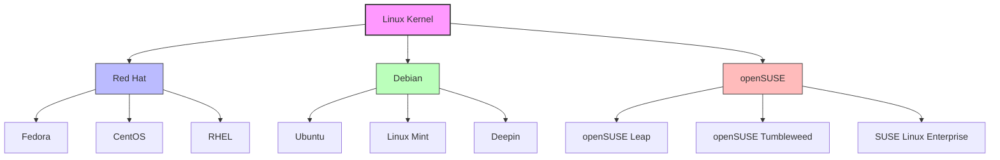

## **Linux Distributions & How the Three Major Companies Expanded Linux**  

A **Linux distribution (distro)** is a complete operating system built on the **Linux kernel**, bundled with software, utilities, and package management systems. Different distros exist to serve different needs, from servers and desktops to embedded systems.  

---

## **The Three Major Linux Families**  

1. **Debian-based (Debian) → Ubuntu, Kali, etc.**  
2. **Red Hat-based (RHEL) → Fedora, CentOS, Rocky Linux, etc.**  
3. **SUSE-based (openSUSE) → SUSE Linux Enterprise**  

These three families have shaped the modern Linux ecosystem, with different package managers and philosophies.  

---

## **1. Debian and Its Expansions**  

### **Origin**  
- **Created in 1993** by **Ian Murdock** as a community-driven, free OS.  
- Uses the **APT (Advanced Package Tool)** and `.deb` package format.  

### **Major Forks & Expansions**  

| Distro | Description |
|--------|------------|
| **Ubuntu** | Developed by Canonical, user-friendly, widely used on desktops and servers. |
| **Kali Linux** | Security-focused OS for penetration testing. |
| **Raspberry Pi OS** | Optimized for Raspberry Pi devices. |
| **MX Linux** | Lightweight and performance-oriented. |
| **Deepin** | A Debian-based distro with a modern UI. |

Debian remains the **foundation for many distros**, with Ubuntu being the most influential fork.  

---

## **2. Red Hat and Its Expansions**  

### **Origin**  
- **Founded in 1993** by **Marc Ewing** and later acquired by IBM.  
- Uses the **RPM (Red Hat Package Manager)** and **YUM/DNF** for package management.  
- **Enterprise-focused**, often used in corporate and government environments.  

### **Major Forks & Expansions**  

| Distro | Description |
|--------|------------|
| **Fedora** | Community-driven, cutting-edge, serves as a testing ground for RHEL. |
| **Red Hat Enterprise Linux (RHEL)** | Stable, enterprise-grade, commercial Linux. |
| **CentOS (Deprecated)** | Free version of RHEL (replaced by CentOS Stream). |
| **Rocky Linux** | A true RHEL alternative after CentOS was discontinued. |
| **AlmaLinux** | Another CentOS replacement with full RHEL compatibility. |

Red Hat drives **enterprise Linux**, while Fedora influences future RHEL features.  

---

## **3. openSUSE and Its Expansions**  

### **Origin**  
- **Started in 1992** as **S.u.S.E. Linux**, later acquired by Novell, now maintained by the openSUSE Project.  
- Uses the **Zypper package manager** and `.rpm` packages.  

### **Major Forks & Expansions**  

| Distro | Description |
|--------|------------|
| **openSUSE Leap** | Stable, for enterprises and workstations. |
| **openSUSE Tumbleweed** | Rolling release, always up-to-date. |
| **SUSE Linux Enterprise (SLE)** | Paid, enterprise-grade distro for businesses. |

SUSE is known for **YaST**, a powerful system configuration tool, and is widely used in **business and cloud environments**.  

---

### **Comparison of the Three Major Linux Families**  

| Feature | Debian | Red Hat | SUSE |
|---------|--------|---------|------|
| **Target Users** | Community & general users | Enterprise & corporate | Enterprise & cloud |
| **Package Format** | `.deb` (APT) | `.rpm` (YUM/DNF) | `.rpm` (Zypper) |
| **Main Enterprise Distro** | Debian | RHEL | SUSE Linux Enterprise |
| **Most Popular Fork** | Ubuntu | Fedora | openSUSE |

Each Linux family has **unique strengths** but all contribute to the overall Linux ecosystem.